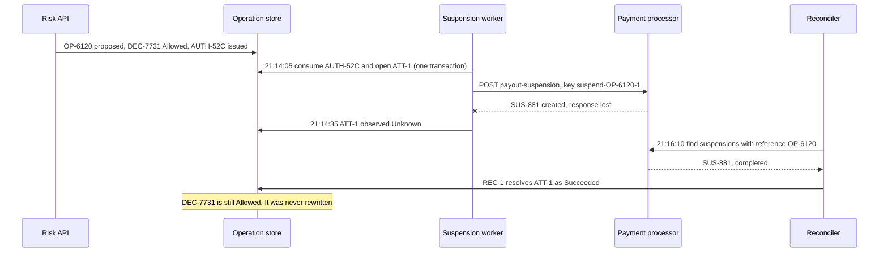

# An Allowed Decision Does Not Mean the Operation Succeeded

**Pattern classification:** General learning material

**Difficulty:** Intermediate

**Prerequisites:** No formal prerequisites. Familiarity with a .NET service that calls an external API, and with recording what an application did for later review, is helpful. No AsiBackbone package, workflow product, or prior Learning material is required.

**Sample scope:** The C# targets .NET 8 or later. The stores, the processor client, and the test harness are illustrative interfaces and fakes, not a runnable sample or a recommended persistence API. The execution states, the point at which authority is consumed, and the append-only record layout are this example's design choices, not requirements. Where a rule is a modeling choice rather than a property of distributed systems, the article says so.

**What this article covers:** the stages between proposing an operation and knowing what it did; why a decision record stays `Allowed` when execution later fails, and why rewriting it to `Denied` corrupts provenance; what decision evidence, attempt evidence, and outcome evidence each prove; four ways an allowed operation can fail, from failure before anything is sent to a lost completion record; a decision/execution matrix; retrying the same operation versus starting a materially new attempt; compensation as a separately governed operation; focused tests; and when a synchronous result and ordinary logs are enough.

A risk analyst asks why a merchant flagged for card testing was still paid out on Tuesday night. The operations dashboard shows the suspension request, and next to it, in green:

```text
OP-6120  merchant.payouts.suspend  M-2207  Allowed
```

One engineer reads that as "the suspension happened, so the payout must have been a processor bug." Another opens the code, sees that the processor call timed out, and "fixes" the record by changing it to `Denied` so the dashboard stops lying.

Both have made the same mistake in opposite directions. `Allowed` was never a claim about what happened at the processor. It was, and still is, the true answer to a different question.

> **A decision records whether an operation may run, under the facts and policy of a particular moment. Execution evidence records whether it was attempted and what was observed. Keep the decision unchanged, record attempts and outcomes separately, treat an unknown outcome as unknown, and reconcile before acting again.**

Most operations do not need all of the machinery below. Near the end, this article covers when a synchronous result and ordinary logs are the whole answer.

---

## The Example: Suspending a Merchant's Payouts

A payments platform lets its risk team suspend payouts for a merchant. The **risk API**, an ASP.NET Core service, owns the request and the decision about whether a suspension is allowed. It does not call the payment processor itself. A **suspension worker**, a .NET `BackgroundService`, holds the processor credentials and performs the call. Suspending payouts stops money from reaching the merchant, notifies the merchant, and is visible to the processor's own support staff, so it is consequential in both directions.

On a Tuesday:

| When (UTC) | Stage | What happens |
| --- | --- | --- |
| 21:14:02 | Proposed | An analyst requests `merchant.payouts.suspend` for merchant `M-2207`. The risk API records operation `OP-6120` |
| 21:14:03 | Decided | Policy version 14 evaluates current facts (the analyst's role, the merchant's risk score, no open legal hold) and records decision `DEC-7731`: `Allowed` |
| 21:14:03 | Authority issued | The risk API issues `AUTH-52C`: single use, bound to `OP-6120`, expires 21:29 |
| 21:14:05 | Execution claimed | In one transaction, the worker consumes `AUTH-52C` and opens attempt `ATT-1`. Nothing has been sent yet |
| 21:14:05 | Execution attempted | The worker sends `POST /merchants/M-2207/payout-suspensions` with `Idempotency-Key: suspend-OP-6120-1` |
| 21:14:35 | Outcome observed | The 30-second timeout fires. No response arrived. The outcome is **unknown** |
| 21:16:10 | Reconciled | A reconciler asks the processor for suspensions carrying reference `OP-6120` and finds `SUS-881`, created at 21:14:06. `ATT-1` is resolved as succeeded |

The payout that worried the analyst was a separate problem: it settled at 21:13, a minute before the request. Without separate records for each stage, nobody could have shown that.



---

## Seven Stages, Three Kinds of Truth

```text
Proposed → Decided → Authority issued → Execution claimed → Execution attempted → Outcome observed → Reconciled
```

Each stage answers a different question and is owned by a different component:

| Stage | Question it answers | Owner in the example | Record it produces |
| --- | --- | --- | --- |
| Proposed | What does someone want to happen, to what? | Risk API | `OP-6120`: intent, target, requester |
| Decided | May it happen, under these facts and this policy, now? | Risk API's policy evaluation | `DEC-7731`: outcome, policy version, facts evaluated |
| Authority issued | Who may perform it, how many times, until when? | Risk API | `AUTH-52C`: scope, use limit, expiry |
| Execution claimed | Which attempt is using the authority? | Suspension worker, in a shared store | `ATT-1`: attempt number, authority consumed |
| Execution attempted | Was a request actually sent to the target? | Suspension worker | `ATT-1` marked as started, with the request key |
| Outcome observed | What did the worker see come back? | Suspension worker | An observation: succeeded, failed, or unknown |
| Reconciled | What does the system that performed the effect say happened? | Reconciler | `REC-1`: resolved outcome, source, evidence |

In this example, the claim consumes the authority. That is a design choice: other systems reserve or lease authority at the claim and consume it when the request is sent or completes. Whichever point you choose, consuming or reserving the authority and recording the attempt must succeed or fail together. If they are separate writes, a crash between them leaves spent authority with no attempt to reconcile, or an attempt that holds no authority.

Those stages produce three kinds of truth that are easy to collapse into one status column:

- **Decision truth.** Whether the operation was permitted, given what was known when the decision was made. It is fixed at that moment. A later failure does not make it false.
- **Execution truth.** Whether the effect actually happened at the target. Only the target, or a faithful observation of it, can establish this. It can be unknown for a while.
- **Evidence.** What the system recorded about each of the above, when, and from which source. Evidence can be missing or late even when the underlying truth is settled.

A decision record is evidence about the decision. It is not evidence about the effect, however confident it looks:

| Evidence | Proves | Does not prove |
| --- | --- | --- |
| Decision record (`DEC-7731`) | What was decided, under which policy and facts, and when | That anything was attempted, or that the effect occurred |
| Authority record (`AUTH-52C`) | What was permitted to whom, and whether the authority has been used | That use produced the effect |
| Attempt record (`ATT-1` started) | That a specific request was sent, under which authority and key | What the target did with it |
| Outcome observation | What the worker saw: a response, an error, or nothing | The target's state, when the observation was a timeout or lost response |
| Reconciliation record (`REC-1`) | What the target reported later, by which lookup | Anything the target itself cannot report |

---

## Why the Decision Stays `Allowed`

Rewriting `DEC-7731` to `Denied` because the processor call failed looks like tidying up. It does damage that is hard to undo:

- **It records a decision nobody made.** Policy version 14 allowed the suspension. A reviewer reading `Denied` six months later will conclude that policy, or a person, refused it, and will look for a reason that does not exist.
- **It erases the authorization trail for an effect that may exist.** In the example, the suspension was created. A record that says `Denied` next to a live suspension reads as an unauthorized change to a merchant's account.
- **It breaks the logic that depends on it.** Retry, reconciliation, and reporting all ask "was this permitted?" A rewritten decision answers that question wrongly, and a `Denied` operation is usually treated as finished, so nothing reconciles it.
- **It corrupts any measurement built on decisions.** Denial rates, policy-change impact, and separation-of-duties reviews all start counting execution failures as policy outcomes.

The same applies to approvals and to authority. An approval that was granted stays granted; a grant that was consumed stays consumed. What changes is the execution evidence written alongside them.

```csharp
// Anti-pattern: the catch block rewrites history and hides a possibly successful effect.
catch (Exception ex)
{
    decision.Outcome = DecisionOutcome.Denied;
    decision.Reason = $"Execution failed: {ex.Message}";
    await db.SaveChangesAsync(ct);
}
```

Write the observation instead, and leave the decision alone:

```csharp
// The decision record is append-only. Failures are written as new observations of the attempt.
catch (Exception ex) when (IsAmbiguous(ex))
{
    await store.RecordObservationAsync(
        new ExecutionObservation(attempt.AttemptId, ExecutionState.Unknown,
            ExternalReference: null, Detail: "timeout-after-send", clock.GetUtcNow()), ct);
}
```

This example keeps decision records append-only, which is one way to preserve history, not the only one. Immutable event storage, temporal tables, versioned rows, or explicit amendment records can all work. What matters is that the original decision is never silently replaced by a statement about what happened during execution.

Decisions do get superseded. If the risk team later concludes the suspension should never have been requested, that is a **new decision** about a **new operation**, recorded with its own facts and linked to the original. See [Compensation Is Another Operation](#compensation-is-another-operation).

---

## Illustrative Execution States

One way to describe a single attempt is:

| State | Meaning | Automatic action allowed |
| --- | --- | --- |
| `NotStarted` | The attempt exists, but there is affirmative evidence that no request reached the target | A retry, if the rules in [Retry or New Attempt?](#retry-or-new-attempt) allow it |
| `Started` | A request was sent, or may have been, and no outcome has been recorded yet. This includes a request the target accepted for asynchronous processing but has not yet completed | None; the attempt's owner, or a status check, is still waiting |
| `Succeeded` | The target's contract, or a later status check, establishes that the effect is complete | None needed |
| `Failed` | The target reported that the effect did not happen | Depends on why; see the matrix below |
| `Unknown` | The request may have taken effect, and nobody can yet say | None; reconcile first |

These names are not a standard; a workflow engine, job scheduler, or cloud control plane may already have its own. What matters is that the vocabulary can say three things a two-state `Success`/`Failure` flag cannot: *nothing was sent*, *the target refused*, and *we do not know*.

Three rules keep the states honest. The first is a modeling choice; the other two follow from it:

- **In this conservative model, `Failed` means the target affirmatively reported that the effect did not occur.** Many systems use `Failed` more broadly, for any attempt that returned an error. That is fine as long as they still represent "we do not know whether the effect happened" separately.
- **Classify errors by the target's documented semantics, not by the transport status alone.** A timeout, a dropped connection, a worker crash, or a server error *may* leave the effect in place. Status codes such as `422`, `429`, or `500` do not say on their own whether anything was applied; some providers even store and replay a server error under the original idempotency key. Without documented no-effect semantics, record `Unknown`.
- **`Unknown` blocks a materially new attempt.** Before another attempt starts, reconciliation resolves the earlier one. Repeating the *original* request is a different matter; see [Timeout After a Possible External Effect](#3-timeout-after-a-possible-external-effect).

A `202 Accepted`, or any response that means "queued," is not `Succeeded`. It establishes that the target took the request, not that the effect is complete.

Some targets can partially apply a request. If yours can, a single `Failed` is not enough; record which parts were observed and reconcile each.

---

## Four Ways an Allowed Operation Fails

All four start from the same `Allowed` decision. They end in different states, and the right next step differs.

### 1. Failure Before Execution

At 21:14:05 the worker claims `AUTH-52C` and opens `ATT-1`, then fails to load the processor credentials from its secret store. No request is sent.

This is the one failure where the system can be certain nothing happened at the target, but only if the code can prove it. Record `NotStarted` with the reason. A variation is a worker backlog: the worker picks up the message at 21:31, after `AUTH-52C` expired, and the claim is refused. There is no attempt at all, and the operation is waiting for a fresh decision.

Failure before execution also includes failing to record required decision evidence. If the host requires a durable decision record before issuing authority, and that write fails, no authority is issued and nothing executes. [Sensitive-Data Access Decision](../../case-studies/sensitive-data-access-decision.md#17-partial-failure-and-operational-contracts) walks through that ordering.

### 2. Deterministic Executor Failure

The worker sends the request, and the processor answers `422` with `merchant_account_closed`: another team closed `M-2207` an hour earlier. The processor documents that this error code means no change was made; the `422` status alone would not establish that.

Record `Failed` with the target's code. The decision stays `Allowed`: it answered correctly with the facts the risk API had. Do not retry: the same request will fail the same way. If someone still wants an outcome, for example blocking a reopening, that is a different operation that needs its own decision.

### 3. Timeout After a Possible External Effect

This is Tuesday's path. The request was sent; no response arrived. The processor may have created the suspension, may still be creating it, or may never have received the request.

Record `Unknown`. Do not mark the attempt `Failed`, do not start a new attempt, and do not ask for new authority to get past it. Two moves are safe:

- **Look the effect up by your own reference**, here the `OP-6120` reference attached to the suspension. This is the default, because it reads without changing anything.
- **Replay the original request, with the original idempotency key and unchanged parameters,** but only where the processor's documented idempotency contract says a repeat after a connection failure cannot apply the effect twice, and only while the key is still within the processor's documented retention period. Some providers document exactly that. The replay is part of the same attempt, `ATT-1`, not a new one.

A safe replay is a recovery action, not reconciliation by itself. It prevents a duplicate effect, but its response may not say what happened: a provider that saved a server error under the key will return that same error again. Resolve the attempt only when the replayed response, or a status lookup, actually establishes the outcome.

Lookups have limits too. Finding no suspension does not by itself prove that none will exist: a lookup can lag behind writes, and a request still in flight may not be visible yet. Resolve the attempt as having had no effect only when the processor's documented consistency and processing rules make a "not found" answer decisive, for example after a stated processing window has passed. Otherwise it stays `Unknown`, and a person decides. [Idempotency Does Not Prevent Authority Replay](idempotency-does-not-prevent-authority-replay.md#reconciliation-and-what-makes-an-attempt-new) covers these provider-specific caveats in depth.

### 4. Failure to Persist Completion Evidence

The processor answers `201 Created` with `SUS-881`. The worker tries to write `Succeeded` to its database, and the write fails during a failover.

The effect happened; the evidence did not. The wrong fix is to run the operation again so that it produces evidence. Retry the **evidence write**, not the side effect: keep the observation in a durable pending record or outbox and deliver it when the store returns. If the worker dies before it can, `ATT-1` is left in `Started`. An execution lease that stops being renewed lets a sweeper move it to `Unknown`, and reconciliation then finds `SUS-881`. The record arrives late; the effect does not happen twice.

---

## The Decision/Execution Matrix

| Decision | What happened | Executor calls | Attempt state | Automatic retry under the same operation? | Fresh decision needed before another attempt? |
| --- | --- | --- | --- | --- | --- |
| `Denied` | Nothing | 0 | No attempt | No | The operation is finished; a new request is a new proposal |
| `AcknowledgmentRequired`, `EscalationRecommended`, `Deferred` | Nothing yet | 0 | No attempt | No | Yes; the pending step completes first, then a current decision |
| `Allowed` | Authority expired before the claim | 0 | No attempt | No | Yes |
| `Allowed` | Claimed, failed before any request was sent | 0 | `NotStarted` | Only with new authority, because the claim consumed `AUTH-52C` | If the original decision is no longer fresh |
| `Allowed` | Target rejected the request deterministically | 1 | `Failed` | No; it will fail again | Yes, for any different request |
| `Allowed` | Target reported a transient rejection it documents as having no effect, such as rate limiting | 1 per send | That send failed with no effect; `ATT-1` remains active, so a bounded resend is still part of it | Yes: bounded resends inside the same claimed attempt, same key and parameters, while the decision is current. No second claim, so no new authority | No, within those bounds |
| `Allowed` | Target accepted the request for asynchronous processing | 1 | `Started` until a status check confirms completion | No; poll or wait for the target's notification | No |
| `Allowed` | Timeout, reset, crash after sending, or an error the target does not document as no-effect | 1 | `Unknown` | No new attempt. Look up the effect, or replay the same request only where the target's idempotency contract makes that safe and the key is still retained | Only if reconciliation decisively proves no effect and the decision is no longer fresh |
| `Allowed` | Target succeeded; completion write failed | 1 | `Succeeded` once the pending write lands; if the worker dies first, `Unknown` until reconciliation finds the effect | No | No |
| `Allowed` | Target succeeded | 1 | `Succeeded` | Not applicable | Not applicable |

In every row, the decision column never changes after it is written.

---

## Retry or New Attempt?

Two different things get called "retry," and they need different permissions.

An **operational retry** resends the *same* logical attempt. It keeps the same `OperationId`, the same request parameters, and the same idempotency key, and it happens while the decision behind it is still current. It does not claim authority again: in this example `AUTH-52C` was consumed once, when `ATT-1` was claimed, and the attempt's execution contract permits a bounded number of resends inside it. A bounded transport retry after a documented no-effect rejection is the typical case.

A **materially new attempt** is new work under the same `OperationId`. It needs a current decision and new authority. An attempt is materially new when any of these is true:

- The previous attempt is `Failed` because the target refused it, and someone wants to try again anyway, perhaps with different parameters.
- The authority behind the previous attempt is consumed, expired, or revoked.
- The decision is older than the policy's freshness rule for this operation, or a fact it depended on has changed: the merchant's status, the analyst's role, a legal hold.
- The request itself would differ: a different scope, amount, target, or key.

A previous attempt that is `Unknown` blocks a materially new attempt until it is reconciled. It blocks ordinary operational retries too, with one exception: a safe replay of the original request under the original key, where the target's idempotency contract allows it and the key is still retained. That replay is a recovery action; it resolves the attempt only if its response establishes the outcome. A new idempotency key is never a way past an unknown outcome; it is only justified after reconciliation proves the previous attempt had no effect and a new decision authorizes another one.

`OperationId` stays the same across all of this. It identifies the logical suspension; decisions, authority, attempts, and reconciliation all hang beneath it.

[Capability-Scoped Background Operation](../../case-studies/capability-scoped-background-operation.md#27-operational-retry-versus-authorization-retry) separates these two kinds of retry in a longer worked case.

---

## Compensation Is Another Operation

On Wednesday the risk team concludes `M-2207` was a false positive. The suspension should end.

It is tempting to treat this as undoing `OP-6120`: flip its decision, delete `SUS-881`, move on. But reinstating payouts releases held money to a merchant that was flagged a day earlier. That is a consequential effect in its own right, and its risks are different from the suspension's. It may need a different approver, a check that no new risk signals arrived, and evidence of its own.

So this article treats it as a separate operation. That is a recommended model, not a universal definition of compensation, and it applies whenever compensation creates its own consequential effect:

```text
OP-6188  merchant.payouts.reinstate  M-2207  compensates OP-6120
    → DEC-7790 (Allowed, policy v14, approver: risk lead)
    → AUTH-61D
    → ATT-1 → Succeeded (processor removed SUS-881)
```

`OP-6120` keeps its history: `DEC-7731` `Allowed`, `ATT-1` `Succeeded`. `OP-6188` links back to it, so a reviewer can follow the whole story without any record having been rewritten.

Compensation can also fail, can leave visible history (the merchant was notified twice), and may not fully restore the earlier state. It is recovery, not prevention. Where cleanup creates no further consequential effect, such as deleting an internal draft nobody else saw, it can reasonably stay inside the original operation's own error handling. [Deployment Approval and Infrastructure Change Gates](../../case-studies/deployment-approval-and-infrastructure-change-gates.md#18-rollback-is-its-own-consequential-operation) applies the same reasoning to rollback.

---

## Keeping the Records Apart

The records do not need separate databases or separate services. They need separate identities and separate lifecycles, correlated by identifiers:

```csharp
// Written once by the policy evaluation. Never updated.
public sealed record DecisionRecord(
    string DecisionId, string OperationId, string CorrelationId,
    DecisionOutcome Outcome, string PolicyVersion, string FactsFingerprint, DateTimeOffset DecidedAt);

// One per claimed attempt. Ties the attempt to the decision and authority it used.
public sealed record ExecutionAttempt(
    string AttemptId, string OperationId, string DecisionId, string AuthorityId,
    int AttemptNumber, string IdempotencyKey, DateTimeOffset ClaimedAt);

// Appended for each thing the executor observed. Never overwrites an earlier observation.
public sealed record ExecutionObservation(
    string AttemptId, ExecutionState State, string? ExternalReference, string? Detail, DateTimeOffset ObservedAt);

// What the target reported later, and how it was asked.
public sealed record ReconciliationRecord(
    string ReconciliationId, string AttemptId, ExecutionState ResolvedState,
    string Source, string? ExternalReference, DateTimeOffset ReconciledAt);
```

A single `Operations` table with a `Status` column can still be useful as a read model for the dashboard. It should be derived from these records, not be the only place the facts live. The dashboard that showed `Allowed` next to `OP-6120` was not wrong; it was showing the wrong column. A clearer row would read:

```text
OP-6120  merchant.payouts.suspend  M-2207  Decision: Allowed  Execution: Succeeded (reconciled)  SUS-881
```

[Your Audit Log Records the Story, Not the Decision](your-audit-log-is-not-evidence.md) explains why the decision record needs its own binding to the operation, and [Authorization vs. Approval vs. Acknowledgment](authorization-vs-approval-vs-acknowledgment.md#storing-them-together-is-fine-merging-them-is-not) makes the same storage-versus-meaning distinction for approvals.

---

## Testing the Distinction

Assert on the fake processor, which stands in for where the effect lands, and on each record separately. A single status assertion cannot tell the four failure paths apart.

```csharp
[Theory]
[InlineData(DecisionOutcome.Denied)]
[InlineData(DecisionOutcome.AcknowledgmentRequired)]
[InlineData(DecisionOutcome.EscalationRecommended)]
[InlineData(DecisionOutcome.Deferred)]
public async Task Blocked_decisions_create_zero_executor_calls(DecisionOutcome outcome)
{
    var processor = new FakeProcessor();
    var harness = SuspensionHarness.Create(processor, policyReturns: outcome);

    string operationId = await harness.RequestSuspensionAsync("M-2207");
    await harness.RunWorkerUntilIdleAsync();

    Assert.Equal(0, processor.RequestsReceived);
    Assert.Empty(await harness.AttemptsAsync(operationId));
}

[Fact]
public async Task Allowed_decision_coexists_with_a_failed_execution_outcome()
{
    var processor = new FakeProcessor();
    processor.RejectNext(status: 422, code: "merchant_account_closed");
    var harness = SuspensionHarness.Create(processor, policyReturns: DecisionOutcome.Allowed);

    string operationId = await harness.RequestSuspensionAsync("M-2207");
    await harness.RunWorkerUntilIdleAsync();

    DecisionRecord decision = await harness.DecisionForAsync(operationId);
    ExecutionObservation outcome = await harness.LatestObservationAsync(operationId);

    Assert.Equal(DecisionOutcome.Allowed, decision.Outcome);   // unchanged by the failure
    Assert.Equal(ExecutionState.Failed, outcome.State);
    Assert.Equal("merchant_account_closed", outcome.Detail);
    Assert.Equal(1, processor.RequestsReceived);                // and no automatic retry
}

[Fact]
public async Task Unknown_outcome_is_reconciled_not_re_executed()
{
    var processor = new FakeProcessor();
    processor.LoseNextResponseAfterCommit();                    // suspension created, response lost
    var harness = SuspensionHarness.Create(processor, policyReturns: DecisionOutcome.Allowed);

    string operationId = await harness.RequestSuspensionAsync("M-2207");
    await harness.RunWorkerUntilIdleAsync();
    Assert.Equal(ExecutionState.Unknown, (await harness.LatestObservationAsync(operationId)).State);

    await harness.RedeliverAsync(operationId);                  // queue redelivery
    await harness.RunWorkerUntilIdleAsync();
    await harness.RunReconcilerAsync();

    Assert.Equal(1, processor.RequestsReceived);
    Assert.Equal(1, processor.SuspensionsCreated);
    Assert.Equal(ExecutionState.Succeeded, (await harness.ReconciliationForAsync(operationId)).ResolvedState);
}

[Fact]
public async Task Decision_attempt_outcome_and_reconciliation_records_correlate_without_merging()
{
    var processor = new FakeProcessor();
    processor.LoseNextResponseAfterCommit();
    var harness = SuspensionHarness.Create(processor, policyReturns: DecisionOutcome.Allowed);

    string operationId = await harness.RequestSuspensionAsync("M-2207");
    await harness.RunWorkerUntilIdleAsync();
    await harness.RunReconcilerAsync();

    DecisionRecord decision = await harness.DecisionForAsync(operationId);
    ExecutionAttempt attempt = Assert.Single(await harness.AttemptsAsync(operationId));
    IReadOnlyList<ExecutionObservation> observations = await harness.ObservationsAsync(attempt.AttemptId);
    ReconciliationRecord reconciliation = await harness.ReconciliationForAsync(operationId);

    Assert.Equal(decision.DecisionId, attempt.DecisionId);
    Assert.Equal(attempt.AttemptId, reconciliation.AttemptId);
    Assert.Contains(observations, o => o.State == ExecutionState.Unknown);   // the original observation survives
    Assert.Equal(DecisionOutcome.Allowed, decision.Outcome);
    Assert.Equal(processor.LastSuspensionId, reconciliation.ExternalReference);
}
```

Also cover:

- **Failure before execution** records `NotStarted` with zero processor requests, and a later attempt requires new authority.
- **A lost completion write** retries the evidence delivery and never sends a second processor request.
- **An expired authority** is refused at the claim, with no attempt record and zero processor requests.
- **Compensation** creates a new operation with its own decision, and leaves every record of the original unchanged.

[How to Test That a Denied Operation Never Executes](test-denied-operation-never-executes.md) goes further on making the zero-call assertion trustworthy, including hidden side effects and fire-and-forget work.

---

## When a Synchronous Result and Ordinary Logs Are Enough

Much of this article exists because the decision and the effect are separated: by time, by a queue, by a process boundary, or by an external system that commits independently. Remove those separations and most of the machinery goes with them.

A synchronous result and ordinary logs are usually enough when:

- The operation runs inside the request that authorized it, for example an ASP.NET Core endpoint with an authorization policy that updates a row and returns.
- The effect is a local database change that commits, or does not, in the same transaction as anything else you record.
- The caller receives the result directly and can see a failure.
- No separate authority is issued for later use, and nothing retries the operation in the background.
- Nobody needs to show later that the operation was permitted, separately from showing that it happened.

There, an exception rolls back the change, the response says so, and a log line describes what happened. At the database, the transaction ultimately committed or it did not, and the platform's transaction result and normal recovery usually make a separately modeled `Unknown` state unnecessary. There is also no decision record to protect, because the authorization check is re-run on every request.

The caller can still be uncertain. If the connection drops around the commit, the database knows the answer but the client does not, and resubmitting may apply the change twice. Where a duplicate submission would matter, keep an operation identifier or an idempotency key on the request, or let the client check before resubmitting. That is still far less machinery than the rest of this article. [Your Audit Log Records the Story, Not the Decision](your-audit-log-is-not-evidence.md#when-an-ordinary-log-really-is-enough) covers the evidence side of the same judgment.

The separation becomes worth its cost once an external call, a queue, a delayed worker, an approval step, or an audit requirement puts distance between "may this happen?" and "did it happen?"

---

## Failure Modes

1. **Reading `Allowed` as `Succeeded`.** A dashboard shows the decision as if it were the outcome, or one status column holds both, and each update overwrites the history before it.
2. **Rewriting the decision after an execution failure.** The record now claims a refusal nobody made, and may sit next to an effect that exists.
3. **Recording a timeout as `Failed`.** A retry policy then resends, and the target may apply the effect twice.
4. **Re-executing to recreate missing evidence.** The completion write failed, so the operation is run again to produce one.
5. **Reissuing authority to get past an unknown outcome.** The new authority is valid, and the effect may happen twice.
6. **Treating every retry as operational.** A later attempt runs under a stale decision because it reused the same `OperationId`.
7. **Undoing instead of compensating.** A reversal with its own consequences runs under the original operation's authority, or with none.

---

## A Short Review Checklist

1. Is the decision record written once and never changed by execution results?
2. Can the system show, for each operation, whether an attempt was claimed, whether a request was sent, and what was observed, as separate facts?
3. Are errors classified by the target's documented semantics, with timeouts, resets, crashes, and undocumented server errors recorded as an unknown outcome rather than a failure?
4. Does an `Unknown` attempt block a materially new attempt until reconciliation resolves it, with same-key replays allowed only where the target's idempotency contract makes them safe and the key is still retained, and treated as resolving the attempt only when a response or lookup establishes the outcome?
5. Does reconciliation look the effect up by your own reference, treat "not found" as decisive only under the target's documented consistency rules, and escalate when it cannot tell?
6. Are consuming (or reserving) authority and recording the attempt a single atomic step?
7. Is a lost completion record recovered by retrying the evidence write, never the side effect?
8. Is the line between an operational retry and a materially new attempt written down, and does a new attempt require a current decision and new authority?
9. Is compensation that creates another consequential effect a separate operation with its own decision?
10. Do tests assert zero executor calls for every blocked outcome, an unchanged `Allowed` beside a failed outcome, no re-execution after an unknown outcome, and correlated records that are not merged?
11. For simple synchronous operations, have you deliberately chosen *not* to build this?

---

## Continue Deeper

[Deployment Approval and Infrastructure Change Gates](../../case-studies/deployment-approval-and-infrastructure-change-gates.md#17-execution-failure-does-not-rewrite-the-decision) shows the same distinction in a deployment pipeline, including a rejected target, ambiguous provider state, and re-planning. [Sensitive-Data Access Decision](../../case-studies/sensitive-data-access-decision.md#17-partial-failure-and-operational-contracts) applies it to a governed export, with pre-execution evidence that fails closed and post-execution evidence that is recovered without repeating the export.

For the distributed-state treatment of consumed authority and unknown outcomes, including each consume-before-execute failure window, read [Replay Protection and Bounded-Use Authority](../../security/replay-protection-and-bounded-use.md#replay-resistance-is-not-exactly-once-execution). [Idempotency Does Not Prevent Authority Replay](idempotency-does-not-prevent-authority-replay.md) follows one ambiguous timeout through execution leases, reconciliation, and a materially new attempt. [Delayed Financial Payout and Ambiguous External Commit](../../case-studies/delayed-financial-payout-and-ambiguous-external-commit.md) composes these boundaries in one end-to-end case, from a delayed payout's decision through an ambiguous provider timeout and reconciliation.

If the decision itself could not be made, rather than the execution failing, [Should Authorization Fail Open, Fail Closed, or Defer?](fail-open-fail-closed-or-defer.md#when-the-side-effect-may-already-have-happened) covers that case and the indeterminate side effects it can leave. [Authorization vs. Approval vs. Acknowledgment](authorization-vs-approval-vs-acknowledgment.md#what-each-decision-does-not-prove) explains what each kind of decision does and does not prove before execution starts.

### Related Work

These references address related aspects of the problem:

- [RFC 9110, section 9.2.2](https://www.rfc-editor.org/rfc/rfc9110#section-9.2.2) cautions that a client should not automatically retry a non-idempotent request unless it knows the request semantics are idempotent or can detect that the original request was never applied.
- [Making retries safe with idempotent APIs](https://aws.amazon.com/builders-library/making-retries-safe-with-idempotent-APIs/), from the Amazon Builders' Library, describes caller-supplied request identifiers and returning an equivalent response to a retried request.
- Stripe's [idempotent requests documentation](https://docs.stripe.com/api/idempotent_requests) is one provider's statement of which repeats are safe after a connection error and which results, including some errors, are saved and replayed.
- The Azure Architecture Center's [Transient fault handling](https://learn.microsoft.com/en-us/azure/architecture/best-practices/transient-faults) guidance separates transient faults from failures that will not succeed on retry, and recommends bounded retry strategies.
- The [Compensating Transaction pattern](https://learn.microsoft.com/en-us/azure/architecture/patterns/compensating-transaction) explains why compensation is application-specific and cannot always restore the original state.

---

## The Short Answer

An `Allowed` decision, an approval, or a valid grant says that an operation may run, not that it ran, and nothing that happens afterward makes it untrue. Leave the decision as recorded and keep attempts, observations, and reconciliation as separate evidence. Classify outcomes by what the target documents and reports, treat an unknown outcome as unknown, and resolve it against the system that performed the effect before any new attempt. Retry evidence rather than effects, require a current decision for a materially new attempt, and govern compensation as its own operation. When the decision and the effect happen together in one synchronous request, ordinary results and logs are usually enough.
