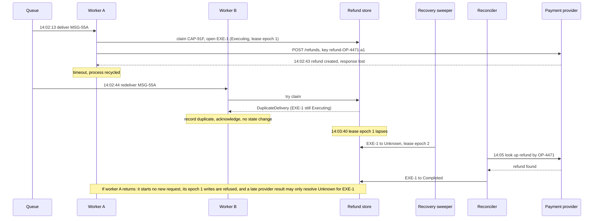

# Idempotency Does Not Prevent Authority Replay

**Pattern classification:** General learning material

**Difficulty:** Advanced

**Prerequisites:** No formal prerequisites. Familiarity with a .NET background worker reading from a queue, `HttpClient`, and calling an external API that accepts an idempotency key is helpful, but no AsiBackbone package, message broker, payment provider, or prior Learning material is required.

**Sample scope:** The C# targets .NET 8 or later. The stores, the queue, and the payment provider are illustrative interfaces and fakes, not a runnable sample or a recommended persistence API; the snippets show which component owns which question, not a complete implementation.

**What this article covers:** plain-language definitions of replay protection and idempotency, and why they key on different things; how duplicate transport delivery, inbox and outbox deduplication, atomic capability consumption, operation identity, and provider idempotency keys each cover one boundary; a compact table of `CorrelationId`, `DecisionId`, `CapabilityId`, `OperationId`, `IdempotencyKey`, and the attempt and delivery identifiers around them; why reused authority must be rejected even when the downstream operation is idempotent; why one-use authority does not make it safe to retry an ambiguously completed side effect; recording an unknown outcome instead of a failure; reconciliation and what makes a later attempt materially new; why none of these mechanisms alone proves exactly-once execution; tests for both directions of the distinction; and when ordinary idempotency is the whole answer.

**In plain terms:** picture a shop where a manager signs a one-time voucher so a cashier can issue one refund. The voucher is *authority*: once it has been used, it should never be accepted again, however it comes back. The refund has an *order number*: if the cashier is interrupted halfway through, the till uses that number so it does not pay out twice. Each protection has a blind spot. Tearing up the voucher does not tell you whether the money left the till, and the till's duplicate check does not stop someone from presenting an old voucher for a new refund. When nobody can tell whether the money went out, the right move is to check the till's records, not to pay again. The rest of this article makes that idea precise for a .NET background worker, a message queue, and a payment provider.

A refund worker times out talking to a payment provider. The queue redelivers the message. One team says that is fine, because the provider call carries an idempotency key. Another team says it is fine, because the refund runs under a single-use capability that cannot be presented twice.

Both teams are describing real protections. Each is wrong about what its protection covers, and the gap between them is where a customer gets refunded twice, or a week-old authorization gets used again.

> **Idempotency decides whether the same logical operation should produce its effect again. Replay protection decides whether the same authority should be accepted again. They key on different identifiers, fail in different ways, and neither one establishes what happened after an ambiguous timeout. Keep them separate, record unknown outcomes as unknown, and reconcile before any new attempt.**

The opposite mistake matters too. Many systems need only one of these mechanisms, and some need neither beyond a database constraint. Near the end, this article covers when ordinary idempotency is the whole answer.

---

## The Example: A Refund Delivered Twice

The rest of the article uses one system.

A support portal lets agents issue refunds. The **refund API** is an ASP.NET Core service that owns orders, refund operations, and the decision about whether a refund may run. It does not call the payment provider itself. When an agent approves a refund, the refund API records the operation, evaluates its policy, and issues narrow, single-use authority for a **refund worker**, a .NET `BackgroundService` that reads a queue with at-least-once delivery and is the only component holding the payment provider's credentials.

The message on the queue carries identifiers, not facts. The amount, the order, and the customer come from the refund API's own records when the worker asks for them.

The payment provider is generic. Where its key semantics matter, assume it behaves like Stripe's API v1, discussed below: it remembers an idempotency key for at least 24 hours, and a repeated key returns the first request's saved response, even when that response was an error.

On a Thursday afternoon:

| When (UTC) | What happens |
| --- | --- |
| 14:02:10 | An agent approves a 120.00 refund on order `ORD-8841`. The refund API records operation `OP-4471`, decision `DEC-3381` (`Allowed`), and capability `CAP-91F` (single use, expires 14:17), and writes message `MSG-55A` to its outbox in the same transaction |
| 14:02:12 | The outbox relay publishes `MSG-55A` |
| 14:02:13 | Worker A receives `MSG-55A`, atomically claims `CAP-91F` as execution `EXE-1` under a 60-second execution lease that it renews while it works, and sends `POST /refunds` with `Idempotency-Key: refund-OP-4471-a1` |
| 14:02:43 | The provider has created the refund, but its response never arrives. Worker A's 30-second timeout fires and the host recycles the process before anything else is recorded |
| 14:02:44 | The message lock expires and the queue redelivers `MSG-55A` to worker B |
| 14:03:40 | `EXE-1`'s execution lease, last renewed at 14:02:40, lapses. A recovery sweeper marks `EXE-1` as `Unknown` |
| Friday 15:30 | An operator clears the dead-letter queue with a "resubmit all" tool. One resubmitted message is a copy of `MSG-55A` under a new message ID, still naming `CAP-91F` and `OP-4471` |

Two duplicates arrive, and they need opposite reasoning. At 14:02:44, the authority has been used once and, from worker B's point of view, the effect's outcome is unresolved; it does not formally become `Unknown` until 14:03:40. On Friday, the outcome is known, and the same authority is being presented again more than a day later.

---

## Two Definitions That Are Easy to Merge

**Replay protection** answers: *should this authority be accepted again?* It keys on the authority artifact, here `CapabilityId`. Its state is a use count or a consumed flag, owned by the component about to perform the protected action. A replayed capability is rejected whether the second presentation comes from a queue redelivery, a retried worker, an operator's resubmission, or someone who copied it out of a log. The boundary does not need to guess which; it only needs to know the authority is spent.

**Idempotency** answers: *if the same logical operation is attempted again, should its effect happen again?* It keys on the operation, here `OperationId`, and on whatever key the downstream system uses for it, here the provider's `IdempotencyKey`. Its state is the operation's progress and, ideally, its result, so a repeat can return the earlier result instead of repeating the effect.

Neither definition mentions the queue, and the queue has its own question. **Duplicate transport delivery** asks: *has this message already been handled?* It keys on the message or delivery. Brokers with at-least-once delivery redeliver by design, and an inbox table or the broker's own duplicate detection exists to absorb those copies.

Each question has a case the others cannot see:

- **A second valid capability for the same operation** passes replay protection, because it is a different capability. Only operation-level idempotency stops a second refund.
- **The same capability carried by a resubmitted message with a new message ID** passes transport deduplication, because it is a different message. Only replay state stops a second use of the authority.
- **The same capability presented after the outcome became unknown** is correctly rejected by replay protection. That rejection says nothing about whether the customer was refunded.

---

## Five Identifiers, Five Questions

Most of the confusion comes from one identifier quietly doing several jobs. The refund system keeps them apart:

| Identifier | Example | Question it answers | Who creates it | Stays the same across | Changes when |
| --- | --- | --- | --- | --- | --- |
| `CorrelationId` | `COR-2210` | Which end-to-end story is this part of? | The refund API, when the agent's request arrives | Every decision, message, attempt, and reconciliation for this refund | Never within the story; it groups, it does not authorize |
| `DecisionId` | `DEC-3381` | Which exact authorization decision allowed this, under which facts and policy version? | The refund API's policy evaluation | Nothing else; one decision is one evaluation | Any re-evaluation produces a new one |
| `CapabilityId` | `CAP-91F` | Which bounded authority is being presented, and has it been used? | The refund API, when it issues execution authority | Every presentation of that authority, honest or not | A new decision issues new authority; old authority is never reset |
| `OperationId` | `OP-4471` | Which logical business operation is this, regardless of how many attempts it takes? | The refund API, when the refund is requested | Retries, redeliveries, reconciliation, and an authorized later attempt | A genuinely different refund, such as a second partial refund on the same order |
| `IdempotencyKey` | `refund-OP-4471-a1` | Has the provider already seen this request? | The worker, derived deterministically from `OperationId` and attempt | Every resend of the same provider request | Only a deliberately new, authorized attempt (see below) |

Two more identifiers sit around them. `MessageId` (`MSG-55A`) identifies a message for transport deduplication, and a resubmission tool may change it. `ExecutionId` (`EXE-1`) identifies one claimed attempt under one capability, so evidence can say which attempt produced which outcome.

A system may store some of these as the same physical value when the meanings truly align, for example deriving `IdempotencyKey` from `OperationId`. Do that deliberately. Using the `CorrelationId` as the idempotency key, or the `MessageId` as the capability identity, is how a retry becomes a second refund or a resubmission becomes reused authority.

---

## What Each Mechanism Proves, and What It Does Not

| Mechanism | Keys on | Prevents | Does not prevent |
| --- | --- | --- | --- |
| Broker duplicate detection | `MessageId`, within a configured window | A sender resending the same message ID within the window | Resubmission under a new ID, duplicates after the window, receiver crashes mid-handling |
| Inbox table at the worker | `MessageId` | Handling the same delivery twice | A different message carrying the same authority or operation; an unknown outcome inside the first handling |
| Outbox at the refund API | The local transaction | Recording the decision without publishing the message, or the reverse | Duplicate publication by the relay, which the consumer must still absorb |
| Atomic capability consumption | `CapabilityId` | A second use of the same authority, including racing consumers | A second capability for the same operation; duplicated effects after an ambiguous outcome |
| Local operation state | `OperationId` | Starting a second execution of an operation already executing or completed | Knowing what the provider did after a lost response |
| Provider idempotency key | `IdempotencyKey`, in the provider's namespace, for the provider's retention period | A resent provider request creating a second refund, within that period and with identical parameters | Requests after the key is pruned; requests under a different key; replayed authority |
| Reconciliation | `OperationId` / provider reference | Acting on a guess about an unknown outcome | Nothing by itself; it converts unknown into a fact so a decision can be made |

[Azure Service Bus duplicate detection](https://learn.microsoft.com/en-us/azure/service-bus-messaging/duplicate-detection), for example, considers only the application-set `MessageId`, with a history window that defaults to 10 minutes and can be set between 20 seconds and 7 days. A copy resubmitted under a new ID, or a day later, is a new message to the broker. That is the right behavior for a broker. It is also why transport deduplication cannot carry an authority guarantee.

### Provider Keys Mean What the Provider Says

Provider keys have their own documented edges. [Stripe's API v1 idempotency documentation](https://docs.stripe.com/api/idempotent_requests), for instance, permits keys to be pruned once they are at least 24 hours old, after which a reused key is treated as a new request, and rejects a request whose parameters differ from the original. Stripe's [API v2 namespace](https://docs.stripe.com/api-v2-overview#idempotency) recognizes a replay for 30 days instead, and behaves differently when the first request failed. The same provider can document different retention and replay semantics for different APIs, which is the point: the provider owns them, not the caller. The expired [IETF Idempotency-Key header draft](https://datatracker.ietf.org/doc/html/draft-ietf-httpapi-idempotency-key-header) likewise left expiry policy to each resource. An idempotency key is a promise from one system, for a stated period, about requests that reach it.

| Repeating a key | Stripe API v1 | Stripe API v2 |
| --- | --- | --- |
| Recognized as a replay | Same key within 24 hours | Same key, same API, same account or sandbox, within 30 days |
| After the first request succeeded | Returns the saved response | Returns an updated response without new changes |
| After the first request failed once execution began | Returns the saved error | Re-executes the failed work |
| Outside the window | Treated as a new request | Not recognized as a replay |

The table describes one provider's documentation at the time of writing. Check your own provider's current documentation before relying on any of these rows.

---

## Direction One: An Idempotent Operation Can Still Accept Replayed Authority

On Friday at 15:30, the resubmitted copy of `MSG-55A` reaches the worker. It has a new message ID, so the inbox has never seen it. It names `CAP-91F` and `OP-4471`.

Suppose the worker has no replay state and relies only on idempotency. It loads `OP-4471`, derives `refund-OP-4471-a1`, and calls the provider. Three things can now happen, and only one of them is harmless:

1. **The provider still remembers the key** and returns the original refund. No money moves. This is the case teams point to when they say replay protection is redundant.
2. **The provider pruned the key** after its retention period, 24 hours for a Stripe API v1 key. It sees a new request and creates a second refund. Nothing at the worker's boundary controlled that window.
3. **The operation record was later moved to a retryable state** by a support tool, or a different path derives a different key. Idempotency now sees a new attempt, and the replayed authority is what started it.

Even case 1 is wrong at the authority boundary. The refund was decided at 14:02 on Thursday under the facts true then: the order was refundable, the agent could approve 120.00, and the customer had not opened a chargeback. A capability that expired at 14:17 has no business starting anything on Friday, and a spent capability has no business starting anything at all. Accepting it, even when the provider happens to absorb the effect, records a second execution under authority that was already used, hides a resubmission path that can carry spent authority, and turns a security-relevant signal into a quiet success.

The rule at the boundary does not depend on the downstream operation:

> **A spent, expired, or revoked capability is rejected before any operation-level logic runs, whether or not the operation would have been idempotent.**

The Friday copy is rejected with `capability.already-consumed`, recorded with its new message ID and `ExecutionAttempted: false`, and acknowledged so it does not return. Because the presenting message is not a known redelivery of `MSG-55A`, the event is also routed to whoever owns the resubmission tooling. Replay protection does not need to decide whether the copy was malicious; the evidence lets a person decide later.

---

## Direction Two: One-Use Authority Does Not Make a Retry Safe

At 14:02:44, worker B receives the redelivered `MSG-55A`. `CAP-91F` is consumed. That is correct and, by itself, nearly useless: it tells worker B that authority was used, not whether the customer received 120.00.

The duplicate does not tell worker B that worker A is gone, either. The message lock expired, but a lock can lapse while its holder is still working: processing took longer than the lock, renewal failed, or the broker redelivered early. Duplicate delivery is evidence about transport, not about the outcome of the side effect.

There are four tempting reactions, and the first three are wrong:

- **"The capability is consumed, so this is a duplicate; acknowledge it and move on."** If an inbox row or a consumed flag is treated as completion, and nothing else owns the unfinished execution, the refund shows `Processing` forever and nobody is told. Deduplication is not completion.
- **"A duplicate arrived while the operation is executing, so the first attempt must have died; mark it unknown."** Worker A may still be waiting on the provider and about to record `Completed`. Inferring its fate from a redelivery races a live executor.
- **"The capability is consumed, so this is an authorization failure; get a new one."** The message is dead-lettered as `capability.already-consumed`, someone asks the refund API to reissue authority, and `CAP-92A` arrives for the same operation. If nothing at the operation level refuses a second execution, and the worker generates its provider key per attempt with `Guid.NewGuid()`, the provider sees a new request and refunds again. Replay protection worked perfectly. The customer was still refunded twice.
- **"Leave the execution to its owner; resolve it when there is evidence that it ended without a result."** This is the only safe reaction.

Worker B records the duplicate and acknowledges the message, because the execution record, not the message, now owns recovery. Two paths move `EXE-1` to `Unknown`, and neither is a duplicate delivery. If worker A is alive when its call ends ambiguously, it records `Unknown` itself. If worker A's process dies, as it did at 14:02:43, its execution lease stops being renewed, and at 14:03:40 a recovery sweeper marks `EXE-1` as `Unknown`. The execution lease is separate from the broker's message lock, which only decides when the message is offered again.

The order of operations is what creates the window. Worker A claimed `CAP-91F` *before* calling the provider, and that ordering is right: claiming after the call would let a crash between the effect and the claim leave the capability looking unused, which reopens replay. But consuming first means there can be a state the capability store cannot describe, *authority consumed, effect unknown*. [Replay Protection and Bounded-Use Authority](../../security/replay-protection-and-bounded-use.md#replay-resistance-is-not-exactly-once-execution) walks through each ordering and the window each leaves open.

The worker needs an operation state that can say so:

```text
Requested → Executing(EXE-1) → Completed
                             → NotApplied        (provider documents that nothing happened)
                             → Unknown           (the request may have taken effect)
                                   ↓
                             reconciliation → Completed | NotApplied | Escalated
```

`Escalated` is a workflow status for a person to act on, not a safety state. For deciding whether another execution may start, an escalated execution is still `Unknown`.

`Unknown` is not `NotApplied`. `NotApplied` means there is affirmative evidence that the provider did not perform the effect. `Unknown` means the worker cannot establish whether it did. A `5xx`, a dropped connection, or a crashed process is often called a failure, yet each can leave the effect indeterminate. Treating `Unknown` as `NotApplied` is how a lost response becomes a duplicate payment.

---

## The Execution Boundary

### A Handler That Looks Safe

Before the design that works, here is one that most teams would approve in review. Every line looks reasonable, and the refund is still paid twice:

```csharp
// Anti-pattern: each check is real, but none of them protects what it appears to.
public async Task HandleAsync(RefundMessage message, CancellationToken ct)
{
    if (await inbox.HasSeenAsync(message.MessageId, ct)) return;                   // 1
    RefundOperation operation = await store.GetOperationAsync(message.OperationId, ct);
    if (operation.State == OperationState.Completed) return;                         // 2
    if (!await capabilities.IsValidAsync(message.CapabilityId, ct)) return;          // 3

    try
    {
        await provider.CreateRefundAsync(operation, Guid.NewGuid().ToString(), ct); // 4
        await capabilities.MarkUsedAsync(message.CapabilityId, ct);                 // 5
        await store.SetStateAsync(operation.OperationId, OperationState.Completed, ct);
        await inbox.RecordAsync(message.MessageId, ct);
    }
    catch (Exception)
    {
        await store.SetStateAsync(operation.OperationId, OperationState.Failed, ct); // 6
        throw;                                                                       // 7
    }
}
```

Run Thursday's timeline through it:

1. **The inbox check guards only this message ID.** The Friday resubmission has a new ID and passes. The row is also written only after success, so the 14:02:44 redelivery passes too.
2. **The state check reads, then acts.** Two workers can both see `Requested`, and `Failed` never blocks anything.
3. **Validity is checked, not consumed.** Two racing workers both see a valid capability. Nothing changes until line 5.
4. **A fresh key per call** defeats provider idempotency and makes every resilience-pipeline retry a distinct provider request, potentially producing another refund.
5. **Consumption after the effect.** At 14:02:43 the provider created the refund, the response was lost, and this line never ran. `CAP-91F` still looks unused.
6. **A timeout is recorded as `Failed`** whenever the worker survives to catch it, although the customer was refunded.
7. **Redelivery finds nothing recorded.** Whether the rethrow asks the broker to redeliver or, as on Thursday, the process dies and the lock lapses, worker B arrives at 14:02:44 and passes every check above. It generates a new key and refunds again.

There is also no execution ownership at all: nothing tells worker B that worker A might still be talking to the provider, and nothing stops worker A from finishing after worker B started.

### The Handler That Keeps Each Question Separate

The worker's handler keeps each question in its own step:

```csharp
public sealed record RefundMessage(
    string MessageId, string CorrelationId, string OperationId, string CapabilityId);

public enum ClaimStatus
{
    Claimed,
    DuplicateDelivery,     // the inbox has already recorded this MessageId
    AlreadyConsumed,       // the authority is spent, whichever message presents it
    Expired, Revoked, Invalid,
    OperationNotExecutable // the operation is executing, unknown, or completed under another execution
}

public enum EffectOutcome { Completed, NotApplied, Unknown }

public sealed class RefundExecutionHandler(
    IRefundStore store,              // operations, executions, inbox, capability state: one database
    IPaymentProvider provider,       // holds the provider credentials; the message never does
    IExecutionEvidence evidence,
    TimeProvider clock)
{
    public async Task HandleAsync(RefundMessage message, CancellationToken ct)
    {
        // One local transaction: record the delivery, check static validity, then
        // atomically consume the capability and open an execution for the operation.
        ClaimResult claim = await store.TryClaimAsync(
            message.MessageId, message.CapabilityId, message.OperationId, clock.GetUtcNow(), ct);

        switch (claim.Status)
        {
            case ClaimStatus.Claimed:
                break;

            case ClaimStatus.DuplicateDelivery or ClaimStatus.AlreadyConsumed:
                // Never execute, and never infer the original attempt's outcome from a duplicate.
                // A redelivery is routine; spent authority on a new message is a replay signal.
                // An execution that stops without an outcome is resolved through its lease.
                await evidence.NotExecutedAsync(message, claim.Status, claim.OperationState, ct);
                return;

            default:
                await evidence.RejectedAsync(message, claim.Status, ct);
                return;
        }

        RefundOperation operation = claim.Operation!;   // amount and order from the store, not the message

        // Derived from the operation and the authorized attempt number, set before any resilience
        // pipeline runs, so every resend of this request carries the same key.
        string idempotencyKey = $"refund-{operation.OperationId}-a{operation.AttemptNumber}";

        // Renewed in the background until disposed. If this process dies, the lease lapses
        // and the recovery sweeper, not a duplicate delivery, moves the execution to Unknown.
        // Once the lease is lost, the token stops the local call path, including retries, from
        // starting another provider request. It cannot recall a request already sent.
        await using ExecutionLease lease = await store.HoldExecutionLeaseAsync(claim.ExecutionId!, ct);

        // An ambiguous call returns Unknown, which this path records itself.
        EffectOutcome outcome = await provider.CreateRefundAsync(
            operation, idempotencyKey, lease.LostToken, ct);

        // Conditional on the lease epoch this worker acquired (see below).
        await store.RecordOutcomeAsync(claim.ExecutionId!, lease.Epoch, outcome, ct);
    }
}
```

`TryClaimAsync` is where the replay guarantee lives, so its contract matters more than its signature. Inside one transaction it:

1. Inserts the inbox row, or reports `DuplicateDelivery` if the `MessageId` is already there.
2. Reports `AlreadyConsumed` for spent authority, even if it has also expired since, because "used once" is the fact recovery needs.
3. Refuses a capability that is expired, revoked, or bound to a different operation.
4. Conditionally moves the capability from `Issued` to `Consumed`, for example `UPDATE ... SET State = 'Consumed' WHERE CapabilityId = @id AND State = 'Issued' AND ExpiresAt > @now`, succeeding only if exactly one row changed.
5. Enforces an operation-level uniqueness invariant: at most one execution of an `OperationId` may remain consequential. An earlier execution that is executing, unknown (including escalated), or completed blocks another one, so a new execution is permitted only after every earlier one is conclusively `NotApplied`. A filtered or partial unique index, a single current-execution row updated with a conditional write, or a transactional predicate can each enforce it. If the invariant would be violated, the transaction rolls back, the capability is not spent, and the result is `OperationNotExecutable`.
6. Starts the execution's lease, recording which worker owns it, until when, and a lease epoch that increases every time ownership of the execution changes.

Across several worker instances, "atomic" has to hold in the shared store, not in a process lock. [Cross-System Capability Exchange and Delegated Authority](../../advanced/cross-system-capability-exchange-and-delegated-authority.md#16-replay-state-belongs-at-the-receiving-execution-boundary) explains why that state belongs to the receiving execution boundary rather than to whoever issued the authority.

Three choices in the sketch are deliberate:

- **A consumed capability ends the handler.** It never falls through to "check whether the operation is idempotent and continue." Replay protection runs first, and its rejection is final for that presentation.
- **The operation-level uniqueness invariant is the barrier against duplicate effects.** Even a second *valid* capability for `OP-4471` cannot open a second execution while `EXE-1` is executing or unknown, or after the operation completed.
- **The provider key is computed once.** If the provider call goes through a resilience pipeline, every retry must resend the same key. A key generated inside a per-attempt `DelegatingHandler`, or a fresh `Guid` per call, turns transport retries into new requests. `AddStandardResilienceHandler` retries unsafe methods such as `POST` by default; either keep the key stable or call `options.Retry.DisableForUnsafeHttpMethods()` for this client.

The provider adapter decides between `NotApplied` and `Unknown`, and it should be conservative:

| What the worker observed | Outcome | Why |
| --- | --- | --- |
| `2xx` with a refund reference | `Completed` | The provider reports the effect |
| A documented rejection before execution, such as a parameter validation error | `NotApplied` | Only because the provider documents that no execution began |
| A conflict reporting that a request with the same key is still being processed | `Unknown` | This request did nothing, but the original may still complete |
| A timeout after the request was sent, a connection reset, cancellation mid-request, a `5xx`, or an unreadable response | `Unknown` | The request may have taken effect |
| A connection that could not be established, where the client can prove nothing was sent | `NotApplied` | Rarely provable; when in doubt, `Unknown` |

---

## Reconciliation, and What Makes an Attempt New

The whole path for `EXE-1`, from claim to resolution:



Executions reach `Unknown` in two ways: the executing worker records it after an ambiguous call, or a recovery sweeper finds an execution whose owner stopped renewing its lease:

```text
recovery sweeper, on a timer:
    for each execution in Executing whose lease has expired:
        mark Unknown   // the executor stopped without recording an outcome
```

The lease should comfortably exceed the provider call's own timeout, so a slow but live worker is not swept.

A lease only means something if it fences. Once the sweeper takes ownership, worker A is a stale executor even if it is still running, and it must not send another provider request, including a resend from its own resilience pipeline. Two separate mechanisms carry that rule, and they are not equally strong:

- **The lease epoch fences durable writes.** The sweeper's transition increments the epoch, and every state-changing write the executor makes is conditional on the epoch it acquired, for example `UPDATE Executions SET State = @state WHERE ExecutionId = @id AND LeaseEpoch = @myEpoch`. That conditional write has to run in the same durable store every worker and the sweeper use; a lease kept in one process's memory fences nothing.
- **The lease-loss token cancels the outbound path cooperatively.** `LostToken` tells the provider client and its resilience pipeline not to start another send after the lease is lost. It works only if every layer honors it, and it cannot recall a request already handed to the network.

The provider never sees the epoch. A generic payment API cannot refuse a stale worker's request; only a downstream system that itself understands a generation or fencing token could. That gap is one more reason the provider key must stay stable for the attempt, and the lease must comfortably outlast the call's timeout.

A stale executor can still hold useful evidence. If worker A wakes up holding the provider's late response for the request it already sent, it may record that result for its existing `ExecutionId` through a narrow evidence write that moves `Unknown` to `Completed` or `NotApplied`, conditional on the execution still being `Unknown`. That write records what happened to a request already issued. It does not restore worker A's ownership or permit another attempt.

A reconciliation worker handles `Unknown` executions. It does not hold the capability and does not need it, because it does not perform the refund. It asks the provider what happened:

```text
for each execution in Unknown, oldest first, at a controlled rate:
    look up the provider by our reference (metadata operation_id = OP-4471)
        found, succeeded          → Completed; record the provider refund ID
        found, failed             → NotApplied; record the provider's reason
        not found                 → if the provider documents that repeating this key, with
                                    identical parameters, is safe for the observed state and
                                    cannot create an unintended new effect, repeat it under
                                    those semantics; otherwise Escalate
    cannot tell                   → Escalate to an operator; never resend
```

Resending the original request with the original key is safe for reconciliation only when the provider's documented semantics make it so for the state you observed. A provider that behaves like Stripe's API v1 returns the saved result while it still remembers the key, and treats the resend as a new refund after the key is pruned. A provider that behaves like Stripe's API v2 may re-execute a request that failed, so the resend is an attempt, not a read. An idempotency key has no universal meaning; the provider defines it. Prefer a non-mutating lookup by your own reference, such as a client reference, metadata search, or retrieve-by-idempotency-key endpoint, whenever one exists.

At 14:05, after the sweeper has marked `EXE-1` as `Unknown`, reconciliation finds the refund under `OP-4471`, marks `EXE-1` as `Completed`, and the support agent sees the refund as issued. Nothing is resent. The redelivered message at 14:02:44 is now explained: it was a duplicate of work that succeeded.

If reconciliation had instead proven `NotApplied`, the refund would still be wanted, and the question becomes whether a **materially new attempt** is allowed. A new attempt is not a retry of `EXE-1`. It needs:

- **A current decision.** The refund API re-evaluates `OP-4471` under current facts, producing `DEC-3390`. The order may have been refunded by another path, the customer may have filed a chargeback, or the agent's approval limit may have changed.
- **New authority.** `CAP-92A`, bound to `OP-4471` and attempt 2. `CAP-91F` stays consumed forever; it is never reset to `Issued`.
- **A new execution.** `EXE-2`, permitted by the operation-level invariant only because `EXE-1` reached a terminal `NotApplied`.
- **A key decision based on the provider's semantics, recorded with the decision.** Providers differ here. Stripe's API v1 returns the saved response of the first request under a key, even when it was an error, so resending `refund-OP-4471-a1` returns the old failure and attempt 2 needs `refund-OP-4471-a2`. Stripe's API v2 instead retries a failed request under the same key. Whichever applies, the attempt number comes from the new decision, not from the worker.

The `OperationId` does not change. It is still the same logical refund, and every attempt, decision, and reconciliation hangs beneath it.

> **Never change the idempotency key to get past an outcome that has not been resolved.** A new key is justified only after reconciliation proves the previous attempt had no effect and a new decision authorizes another one.

[Capability-Scoped Background Operation](../../case-studies/capability-scoped-background-operation.md#27-operational-retry-versus-authorization-retry) separates operational retries, which resend the same logical execution under authority that is still current, from authorization retries, which require fresh context, a new decision, and new authority.

---

## Why None of These Proves Exactly-Once Execution

Each mechanism covers one boundary, and the refund crosses several: the refund API's transaction, the broker, the worker's transaction, the network, and the provider's ledger.

- The outbox makes "decided" and "message published" agree, inside one database.
- Transport deduplication makes one message handled once, inside a window.
- Atomic consumption makes one capability used once, inside the store that holds its state.
- Operation state makes one logical refund have at most one active execution, inside the worker's database.
- The provider key makes one request produce one refund, inside the provider's namespace and retention period.

No transaction spans the worker's database and the provider. The moment between "the provider committed" and "the worker recorded it" always exists, and a crash or lost response inside it produces `Unknown`. What a well-designed system can honestly claim is narrower and more useful: *duplicate effects are prevented within these stated boundaries, and every case outside them surfaces as an unknown outcome that is reconciled before anything is attempted again.* [Outbox and Inbox Patterns](../../security/replay-protection-and-bounded-use.md#outbox-and-inbox-patterns) describes the same chain as a sequence of explicit state transitions, each with its own duplicate semantics.

When the protected effect is a local mutation in the same database as the replay state, a shared transaction can close the window for that effect. It does not extend to an email, an HTTP API, a cloud control plane, or a downstream system that commits independently.

---

## Testing Both Directions

Tests for this boundary have to prove a negative: that the side effect did *not* happen a second time. Assert on the fake provider's ledger, not on a status flag.

```csharp
[Fact]
public async Task Replayed_capability_is_rejected_even_when_the_provider_would_deduplicate()
{
    var provider = new FakePaymentProvider(keyRetention: TimeSpan.FromHours(24));
    var harness = RefundHarness.Create(provider);
    var (operation, capability) = await harness.ApproveRefundAsync("ORD-8841", 120.00m);

    await harness.DeliverAsync(new("MSG-55A", "COR-2210", operation, capability));
    // Resubmitted copy: new MessageId, same authority, inside the provider's retention window.
    await harness.DeliverAsync(new("MSG-77C", "COR-2210", operation, capability));

    Assert.Equal(1, provider.RequestsReceived);         // the replay never reached the provider
    Assert.Equal(1, provider.RefundsCreated);
    Assert.Contains(harness.Evidence, e =>
        e.Reason == "capability.already-consumed" && e.MessageId == "MSG-77C" && !e.ExecutionAttempted);
}

[Fact]
public async Task Replayed_capability_cannot_refund_again_after_the_provider_prunes_its_key()
{
    var provider = new FakePaymentProvider(keyRetention: TimeSpan.FromHours(24));
    var harness = RefundHarness.Create(provider);
    var (operation, capability) = await harness.ApproveRefundAsync("ORD-8841", 120.00m);

    await harness.DeliverAsync(new("MSG-55A", "COR-2210", operation, capability));
    harness.Clock.Advance(TimeSpan.FromHours(25));
    await harness.DeliverAsync(new("MSG-77C", "COR-2210", operation, capability));

    Assert.Equal(1, provider.RefundsCreated);
}

[Fact]
public async Task Ambiguous_timeout_is_recorded_as_unknown_and_redelivery_does_not_resend()
{
    var provider = new FakePaymentProvider();
    provider.LoseNextResponseAfterCommit();             // refund created, response never arrives
    var harness = RefundHarness.Create(provider);
    var (operation, capability) = await harness.ApproveRefundAsync("ORD-8841", 120.00m);
    var message = new RefundMessage("MSG-55A", "COR-2210", operation, capability);

    await harness.DeliverAsync(message);
    await harness.DeliverAsync(message);                // broker redelivery

    Assert.Equal(1, provider.RequestsReceived);
    Assert.Equal(OperationState.Unknown, await harness.OperationStateAsync(operation));
    Assert.True(await harness.IsConsumedAsync(capability));
}

[Fact]
public async Task Duplicate_delivery_does_not_change_an_execution_that_still_holds_its_lease()
{
    var provider = new FakePaymentProvider();
    provider.HoldNextResponse();                        // worker A is still waiting on the provider
    var harness = RefundHarness.Create(provider);
    var (operation, capability) = await harness.ApproveRefundAsync("ORD-8841", 120.00m);
    var message = new RefundMessage("MSG-55A", "COR-2210", operation, capability);

    Task workerA = harness.DeliverAsync(message);
    await harness.DeliverAsync(message);                // lock lapsed; redelivered to worker B

    Assert.Equal(OperationState.Executing, await harness.OperationStateAsync(operation));
    provider.ReleaseHeldResponse();
    await workerA;
    Assert.Equal(OperationState.Completed, await harness.OperationStateAsync(operation));
    Assert.Equal(1, provider.RequestsReceived);
}

[Fact]
public async Task A_second_valid_capability_cannot_start_another_execution_while_the_outcome_is_unknown()
{
    var provider = new FakePaymentProvider();
    provider.LoseNextResponseAfterCommit();
    var harness = RefundHarness.Create(provider);
    var (operation, first) = await harness.ApproveRefundAsync("ORD-8841", 120.00m);
    await harness.DeliverAsync(new("MSG-55A", "COR-2210", operation, first));

    // Someone reissues authority instead of reconciling.
    string second = await harness.IssueCapabilityAsync(operation);
    await harness.DeliverAsync(new("MSG-56B", "COR-2210", operation, second));

    Assert.Equal(1, provider.RefundsCreated);
    Assert.Contains(harness.Evidence, e => e.Reason == "operation.outcome-unknown");
}
```

Also cover:

- **Racing deliveries.** Two workers presenting the same capability at the same instant produce exactly one claim. Run this against the real store, because an in-memory lock proves nothing about several instances.
- **Restart.** A worker restarted after a claim does not see the capability as unused, and the abandoned execution becomes `Unknown` only after its lease expires.
- **Lease fencing.** A worker whose lease was taken over starts no further provider request, including pipeline retries, its epoch-conditional writes are refused, and its late provider result can only move `Unknown` to a definite outcome for its own `ExecutionId`.
- **Store unavailability.** If capability state cannot be read or written, the handler does not execute and does not assume the capability is unused.
- **Provider key stability.** Every resend inside one attempt carries the same key, including resends made by the resilience pipeline.
- **A confirmed `NotApplied` permits a new attempt only with a new decision and a new capability,** and the new attempt is denied if the facts changed while the first was being reconciled.
- **An expired capability is rejected** even when it was never used.

[Replay Protection and Bounded-Use Authority](../../security/replay-protection-and-bounded-use.md#important-invariants-to-test) lists the replay invariants in more depth, and [Governed AI Tool Gateway](../../tutorials/governed-ai-tool-gateway.md#idempotency) shows the same distinction for a `payment.refund` tool proposed by a model.

---

## When Ordinary Idempotency Is Enough, and When Replay State Is Justified

Replay state is only needed where there is something to replay: authority that exists apart from the decision that produced it.

**Ordinary idempotency is enough** when the side effect runs in the request that authorized it. A signed-in agent posts a refund to an ASP.NET Core endpoint with an `Idempotency-Key` header, the endpoint checks the agent's authorization on every request, and the handler performs the refund inline. A retry is a new request that is authorized again from current facts. There is no token, grant, or message carrying authority to a later component, so there is nothing to consume. Operation identity enforced by a uniqueness rule, a provider key, and an `Unknown` state for lost responses are the complete design.

**Scoped-authority replay state earns its cost** when:

- Authority travels separately from the decision, in a message, token, link, or grant that a later component presents.
- The component that executes is not the component that decided, and cannot or should not re-run the full decision itself.
- The authority must be usable a bounded number of times, such as one refund, one approval for one deployment, or three downloads of a generated export.
- Reuse would be consequential even if the downstream effect happened to be idempotent, because the facts behind the decision can change.
- Copies of the authority can appear outside the normal path: dead-letter resubmission, logs, support tooling, or another trust boundary.

**Both are needed** in designs like the refund worker, where portable authority drives an external effect. Replay state stops reused authority; operation identity and provider keys stop duplicated effects; reconciliation handles the window neither can close.

[How Short-Lived Execution Authority Differs from User Authorization](short-lived-execution-authority-vs-user-authorization.md#when-you-do-not-need-an-execution-grant) covers when a delayed worker needs its own grant at all, which decides whether the replay question exists.

---

## Failure Modes

### 1. Treating a provider idempotency key as replay protection

The worker accepts any capability because "the provider deduplicates." Replayed authority now executes whenever the key has been pruned, the parameters are recomputed, or another path derives a different key.

### 2. Treating a consumed capability as a completed operation

Redelivery finds the capability spent and acknowledges silently. Refunds that never completed, or whose outcome is unknown, disappear from view.

### 3. Reissuing authority to get past an unknown outcome

A consumed capability is treated as an authorization failure and "fixed" with a new one. The new authority is valid, and if the operation barrier or key is weak, the effect happens twice.

### 4. Generating a fresh idempotency key per attempt

`Guid.NewGuid()` inside the call path makes every retry a new request. Keys must come from the operation and an authorized attempt number, computed before any retry logic runs.

### 5. Using one identifier for several meanings

The `CorrelationId` doubles as the idempotency key, so a legitimately new refund in the same support case is treated as a duplicate; or the `MessageId` doubles as capability identity, so a resubmitted message carries fresh-looking authority.

### 6. Trusting transport deduplication for authority

The broker's duplicate detection or the inbox table is relied on to prevent reuse. A resubmission with a new message ID, or a duplicate after the window, walks straight through.

### 7. Recording an unknown outcome as a failure

A timeout is logged as `Failed`, a retry policy resends, and the provider sees a new request. `Unknown` needs its own state, distinct from `NotApplied`, and that state stops automatic execution.

### 8. Resetting spent authority on failure

A failed attempt returns the capability to `Issued` so the retry "can use it." Under an ambiguous failure, that is a duplicate execution with the original authorization's facts, which may no longer be true.

### 9. Inferring the outcome from a duplicate delivery

A redelivery arrives while the operation is executing, and the handler marks the execution unknown or failed. The original worker was still alive; its lock had simply lapsed. Use an execution lease and a recovery sweeper to detect abandoned executions.

### 10. Claiming exactly-once delivery or execution

Documentation or a dashboard says "exactly once." When the provider's ledger and the worker's records disagree, nobody looks, because the system claimed it could not happen.

---

## A Short Review Checklist

**Definitions and identity**

1. Can you name, for each duplicate path, whether it is caught by transport deduplication, replay protection, operation idempotency, or the provider key?
2. Are `CorrelationId`, `DecisionId`, `CapabilityId`, `OperationId`, and `IdempotencyKey` distinct values with distinct meanings, or deliberately shared with a written reason?
3. Does the message carry identifiers only, with amounts and targets resolved from the owning service's records?

**Authority**

4. Is a spent, expired, or revoked capability rejected before any operation logic runs, regardless of whether the operation is idempotent?
5. Is consumption an atomic state transition in a store shared by every executing instance?
6. Is spent authority never reset, and does a new attempt require a new decision and new authority?

**Effects and recovery**

7. Is the provider key derived from the operation and an authorized attempt, stable across every resend, and never regenerated by retry logic?
8. Does the operation have an `Unknown` state distinct from `NotApplied`, reached only from the executor's own ambiguous result or an expired execution lease, and does it stop automatic execution?
9. Does lease expiry fence the old executor's durable writes by lease epoch, and does lease loss cancel its outbound call path so it starts no further provider request?
10. Does reconciliation read the outcome by your own reference, repeat the original key only where the provider's documented semantics make that safe for the observed state, and escalate when it cannot tell?
11. Is the claim you make about duplicates stated as boundaries, not as "exactly once"?

**Evidence and tests**

12. Do rejected replays record the capability, the presenting message, the reason, and that execution was not attempted?
13. Do tests assert, on the provider's ledger, that replayed authority and ambiguous outcomes never produce a second effect?

---

## Continue Deeper

For atomic consumption, racing consumers, process restarts, replay-store failure, retention of replay state, and each consume-before-execute failure window, read [Replay Protection and Bounded-Use Authority](../../security/replay-protection-and-bounded-use.md). To reproduce the check-then-act race and repair it, work through the [Replay Protection and Bounded-Use Authority lab](../../labs/replay-protection-and-bounded-use.md) and run the [Replay Protection and Bounded Use sample](https://github.com/AsiBackbone/Learning/blob/main/samples/replay-protection-and-bounded-use/README.md).

[Capability-Scoped Background Operation](../../case-studies/capability-scoped-background-operation.md#26-handle-ambiguous-execution-without-blind-replay) follows one report job through a queue and worker, including redelivery, a stable execution identity, ambiguous publication, and the difference between operational and authorization retries.

When the authority crosses into an independently operated system, [Cross-System Capability Exchange and Delegated Authority](../../advanced/cross-system-capability-exchange-and-delegated-authority.md) explains why replay state belongs to the recipient and how a single-use grant can be burned by a failed execution.

If a workflow engine drives the retries, [When Should a Workflow Engine Own the Decision?](when-workflow-engine-should-own-decision.md#retries-timers-and-compensation) shows how to key the execution claim narrowly enough to allow a legitimately new operation, and why an existing claim with an unknown outcome is not a reason to execute again. If the provider call fails because authorization itself was unavailable, [Should Authorization Fail Open, Fail Closed, or Defer?](fail-open-fail-closed-or-defer.md#when-the-side-effect-may-already-have-happened) covers the same indeterminate state during an outage.

### Related Work

These references address related aspects of the problem:

- [Making retries safe with idempotent APIs](https://aws.amazon.com/builders-library/making-retries-safe-with-idempotent-APIs/), from the Amazon Builders' Library, describes caller-supplied request identifiers, rejecting a reused identifier with different parameters, and returning an equivalent response to retries.
- Stripe's [API v1 idempotent requests documentation](https://docs.stripe.com/api/idempotent_requests) and [API v2 idempotency documentation](https://docs.stripe.com/api-v2-overview#idempotency) show one provider documenting different key retention, replay windows, and failed-request behavior for different APIs.
- The [IETF Idempotency-Key HTTP header field draft](https://datatracker.ietf.org/doc/html/draft-ietf-httpapi-idempotency-key-header) proposes a common header, uniqueness and payload-mismatch rules, and resource-defined expiry. It is an expired Internet-Draft, not an RFC or current standard.
- [Azure Service Bus duplicate detection](https://learn.microsoft.com/en-us/azure/service-bus-messaging/duplicate-detection) documents broker-side deduplication by `MessageId` within a configurable window.

---

## The Short Answer

Idempotency and replay protection are not two names for one control. Idempotency stops the same operation from producing its effect twice; it keys on the operation and is only as strong as the system that remembers the key. Replay protection stops the same authority from being accepted twice; it keys on the authority and lives at the execution boundary. Transport deduplication stops the same message from being handled twice, and nothing more.

Reject reused authority even when the operation underneath is idempotent. Do not let a consumed capability justify a retry, a reissue, or silence after an ambiguous timeout: record the outcome as unknown, reconcile against the system that performed the effect, and treat any further attempt as new work that needs a current decision and new authority. State your duplicate guarantees as boundaries, and test them on the ledger where the effect actually lands.
