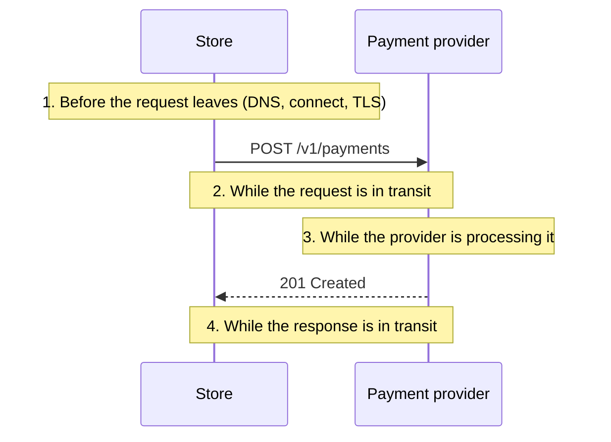

# A Payment API Timeout Leaves the Outcome Unknown

**Pattern classification:** General learning material

**Difficulty:** Intermediate

**Prerequisites:** No formal prerequisites. Familiarity with ASP.NET Core, `HttpClient`, a relational database, and calling a payment provider's REST API is helpful. No AsiBackbone package, message broker, or prior Learning material is required.

**Sample scope:** The C# targets .NET 8 or later, and the SQL uses PostgreSQL syntax. Statements about `Microsoft.Extensions.Http.Resilience` describe its documented defaults on the verification date below; check the package version you use. The store, the order, and the payment provider are hypothetical. The provider's endpoints, statuses, error codes, and timings are invented for the example; real providers document their own, and their documentation decides what is safe. The repositories, helpers, and tests are illustrative sketches, not a runnable sample, a production-ready payment integration, or payment-processing, financial, or compliance advice. Original prose is licensed under [Creative Commons Attribution 4.0 International (CC BY 4.0)](https://creativecommons.org/licenses/by/4.0/), and original code examples are additionally offered under the [MIT License](https://opensource.org/license/mit), so they can be copied into software under the MIT License without applying CC BY 4.0 to it, as described in the repository's [licensing terms](https://github.com/AsiBackbone/Learning/blob/main/LICENSING.md). Third-party material, where identified, remains under its original license. External sources were last verified on November 13, 2026.

**What this article covers:** what an HTTP timeout does and does not tell you; why an unknown outcome is its own state, separate from both failure and success; what to persist before the first send; the order of operations in which the checkout endpoint initiates each recorded payment attempt at most once and survives double clicks, while recovery may resend the same logical attempt only under the original key and within the provider's safety conditions; classifying the provider's response by its documented semantics; finding out what happened through notifications, lookups by your own reference, and settlement records; exactly when resending with the original idempotency key is safe; resilience handlers and SDKs that retry or time out for you; what the rest of the application does while a payment is unknown; recovery and its limits; the tests that matter most; and when a simpler design is enough. A companion [implementation reference](../../aspnetcore/payment-attempt-recovery-implementation-reference.md) carries the full schema, endpoint, notification handler, recovery loop, and test matrix.

**In plain terms:** you phone a shop to pay for an order by card, and the line drops just after you read out the card number. You do not know whether they charged you. Calling back and reading the card out again as if it were a new order risks paying twice. Calling back and asking "did order 5521 go through?" is safe. So is repeating the same order number, if the shop has told you it will never charge one order number twice, but only for as long as the shop keeps that promise. What you must not do is decide the payment failed because the call ended.

Consider a hypothetical online store. When a customer clicks **Pay**, an ASP.NET Core endpoint calls a card-payment provider's `POST /v1/payments` API, with a 10-second timeout. The team knows about idempotency keys and sends one with every request. In this hypothetical incident, order `ORD-5521` is for 84.00 USD:

```text
14:21:07.118  checkout-api  POST /orders/ORD-5521/payment
14:21:07.140  checkout-api  Calling provider: create payment 84.00 USD, Idempotency-Key 3f0c9a…
14:21:17.141  checkout-api  Provider call timed out after 10 s
14:21:17.152  checkout-api  ORD-5521 → PaymentFailed; returned "Payment failed. Please try again."
14:21:18.904  provider      pay_7Q1 succeeded, 84.00 USD
14:21:19.230  checkout-api  Webhook payment.succeeded pay_7Q1: no matching order, ignored
14:21:26.410  checkout-api  POST /orders/ORD-5521/payment
14:21:26.431  checkout-api  Calling provider: create payment 84.00 USD, Idempotency-Key 9b2e41…
14:21:27.006  checkout-api  Provider returned 201 pay_7Q4 succeeded
14:21:27.020  checkout-api  ORD-5521 → Paid
```

In this hypothetical incident, the provider was slow rather than unavailable. It charged the card 1.8 seconds after the store gave up waiting. The store told the customer the payment had failed, so the customer clicked **Pay** again. The endpoint generated a fresh key for the new request, as it did for every request, so the provider had no way to recognize the second request as a repeat and charged the card a second time. The provider's notification for the first charge arrived 0.3 seconds later, but the webhook handler matched notifications to orders by the provider's payment ID, which the store had never received for `pay_7Q1`, so it discarded the only evidence of the first charge. The customer found two charges on their statement the next week.

Every individual piece did what it was written to do. The defect was a single assumption: that a request which did not return had not happened.

> **A timeout tells you that your client stopped waiting. It does not tell you whether the payment took effect. Record the attempt as `Unknown`, not `Failed`. Persist the attempt, its idempotency key, and the exact request and context it will be sent with before the first send. Find out what happened from the provider's own records, and resend only with the original key and unchanged parameters while the provider's contract makes that safe. Never mint a new key to get past an outcome you have not resolved.**

None of this requires exotic infrastructure. The core is one durable attempt record written before the call and one unresolved state the code is not allowed to round off. Everything else in this article, the order lock, the event history, the provider-specific classification, and the recovery loop, builds on those two.

**How to read this article:** this page makes the argument and gives the rules, with short sketches. When you are ready to build, [Payment Attempt Recovery in ASP.NET Core: An Implementation Reference](../../aspnetcore/payment-attempt-recovery-implementation-reference.md) shows how the rules hold up under concurrency, crashes, redelivered notifications, and operators.

---

## What a Timeout Actually Tells You

A request to a payment provider can be interrupted at four points, and a client-side timeout looks the same at all of them:



Only a failure at the first point shows that *this send* did not reach the provider. At the second, the provider may or may not have received the request. At the third, it has received it and may be about to act. At the fourth, it may already have acted, and the response carrying the result, which could as easily be a rejection as a success, has not reached the caller. In the incident, the timeout fell at the third point: the provider was still processing, and it finished after the store had stopped listening.

In .NET 5 and later, `HttpClient.Timeout` surfaces as an `OperationCanceledException`, commonly a `TaskCanceledException`, whose inner exception is a `TimeoutException`. A timeout strategy in a Polly resilience pipeline, including the one in the standard resilience handler, surfaces instead as Polly's `TimeoutRejectedException`, which derives from Polly's `ExecutionRejectedException` rather than from either of those types. None of these carries any information about the provider. Cancelling the caller's `CancellationToken`, a reset connection, a crash of your own process between send and record, and a response that ends before its body is complete are all in the same family: each one ends your observation, not the provider's work. A gateway `502` or `504` is slightly different. It is an observed response, but from a proxy or load balancer in front of the provider, and it says nothing about what the provider did. The outcome is `Unknown` either way.

Some transport failures do happen before any request bytes are sent. Since .NET 8, `HttpRequestException.HttpRequestError` classifies the failure, for example as a DNS-resolution, connection, or TLS-handshake error. That classifies one transport failure; it does not establish the history of the payment. A positively identified pre-transmission failure shows that this send did not reach the provider. It does not show that an earlier send of the same attempt, from this process, a retry layer, or a process that crashed, was never accepted. Treat it as safe to resend only when the application can also show that the attempt had no earlier send. The [retry article's classification](retry-logic-may-replay-authorization-decision.md#a-classification-that-separates-the-two-questions) applies the same rule. When in doubt, record `Unknown`. As later sections show, an unknown attempt with a persisted key and reference is often far easier to resolve than a wrong guess is to undo.

---

## Three Answers, Not Two

A boolean `succeeded` cannot represent the incident. The minimum vocabulary for one payment attempt has an answer for each thing the store might know:

| Attempt state | Meaning | May anything send this attempt's request? | What the order shows |
| --- | --- | --- | --- |
| `NotStarted` | Recorded, and nothing has been sent | Yes, once, by whoever moves it to `Started` | Awaiting payment |
| `Started` | The application committed to sending the recorded request and has not yet recorded a final result. The request may be executing, may already have completed, may be waiting for the customer, or may never have left because the process failed after the transition | Only a documented-safe resend of the same request, with the same key (see [When Resending with the Original Key Is Safe](#when-resending-with-the-original-key-is-safe)) | Confirming payment, or the customer's next step |
| `Unknown` | Normal observation has ended without an answer, and an explicit recovery process must establish the result | The same, and only from the recovery path | Confirming payment |
| `Succeeded` | The provider's contract establishes that the payment took effect | No | Paid |
| `Failed` | The provider made a definitive negative payment decision for the attempt, for example a documented decline on its only send | No; a different payment method is a new attempt | Payment unsuccessful, with the documented reason |
| `NotApplied` | It was established that the attempt had no effect: no cooperating sender sent it, the provider documented a rejection before execution of its only send, or reconciliation proved no effect | No; another try is a new attempt | Awaiting payment |

These names are illustrative, not a standard, and match the ones used across the Learning articles on [execution outcomes](allowed-decision-does-not-mean-execution-succeeded.md#illustrative-execution-states). What matters is that the vocabulary can say *nothing was sent*, *the provider said no*, *the provider has it and will tell us*, and *we do not know*.

The coarse state answers "may anything send, and what may the order do?" It does not say why. Record that separately, as the provider's last reported status and a reason, such as `processing`, `requires_customer_action`, `send_rejected_no_effect`, or `provider.no-response`. A `Started` attempt waiting for a 3-D Secure challenge needs a different next step from one waiting for the provider, and the reason column is where that difference lives.

Three rules keep the states honest:

- **`Failed` means the provider made a definitive negative payment decision; `NotApplied` means the payment operation never executed.** A declined authorization is `Failed`. A malformed request the provider rejects before execution is `NotApplied`, with the error as its reason: nothing happened, but it is an integration defect to fix, not a customer decline. Either applies only when the evidence covers the whole attempt: on its only send, or as the provider's documented replay of the original outcome. A fresh rejection of a resend, after an earlier send whose outcome is unknown, leaves the attempt `Unknown`. A timeout, a reset, an undocumented error, or a `5xx` is neither, whatever its HTTP status.
- **`Unknown` is not a slow failure.** It does not decay into `Failed` after a timer. It is resolved only by evidence, whether a system or a person finds it. A person can also authorize a separately recorded business exception, but taking responsibility does not establish `Failed` or `NotApplied`, and the attempt's recorded state must not claim that it does. In this sample, such an exception cannot unblock checkout for the same order, because the unknown attempt still holds the one live slot. What it can do is act on the order through its own recorded operation, such as cancelling it with a refund if the payment later turns out to have succeeded. Letting the customer pay again while the attempt is unknown is the separate policy described under [What the Rest of the Application Does Meanwhile](#what-the-rest-of-the-application-does-meanwhile).
- **`Unknown` blocks a new attempt for the same order.** While any attempt might still take effect, the store does not start another one. The one exception, resending the *same* request under the *same* key, is not a new attempt.

---

## Write It Down Before You Send It

The single most useful change is to create the attempt durably, with everything a later process would need to repeat or look up the request, *before* the first byte goes to the provider. The core of the record is small:

```sql
CREATE TABLE payment_attempts (
    attempt_id        uuid        PRIMARY KEY,
    order_id          text        NOT NULL REFERENCES orders (order_id),
    attempt_number    int         NOT NULL,
    provider_account  text        NOT NULL,  -- internal ID: provider, account, and environment
    endpoint          text        NOT NULL,  -- absolute URL, including any regional host
    api_version       text        NOT NULL,
    client_reference  text        NOT NULL,  -- 'ORD-5521-a1': sent to the provider with the payment
    idempotency_key   text        NOT NULL,  -- generated here, once, never per send
    request_body      text        NOT NULL,  -- the serialized parameters every send of this attempt uses
    amount_minor      bigint      NOT NULL,  -- what any later evidence must match
    currency          text        NOT NULL,
    state             text        NOT NULL CHECK (state IN
                          ('NotStarted', 'Started', 'Unknown', 'Succeeded', 'Failed', 'NotApplied')),
    first_sent_at     timestamptz NULL,      -- conservative start of the provider's key window
    version           int         NOT NULL DEFAULT 0,
    UNIQUE (order_id, attempt_number),
    UNIQUE (provider_account, client_reference),
    UNIQUE (provider_account, idempotency_key)
);

-- At most one attempt per order that might still take effect.
CREATE UNIQUE INDEX one_live_attempt_per_order
    ON payment_attempts (order_id)
    WHERE state IN ('NotStarted', 'Started', 'Unknown');
```

Each column answers a question that recovery will ask:

- **`client_reference`** is your own identifier for this attempt, sent to the provider in whatever field it offers for that purpose, such as a merchant reference or metadata. It is how a lookup or a notification finds its way back to the attempt even when the provider's response, and with it the provider's payment ID, never arrived. In the incident, this is the field whose absence made the first charge unmatchable. It identifies the *attempt*, not the order: once an order has two attempts, a lookup by order ID alone could resolve one with the other's record.
- **`idempotency_key`** is generated when the attempt is created and stored with it. The attempt owns the key; transport code forwards it unchanged. A handler that generates or replaces a key on each retry turns repeats into different payments, which is the incident again, and a key generated by the HTTP pipeline does not survive separate calls or a process restart in any case. Use the format and uniqueness your provider requires, and do not put personal data in it.
- **`request_body`, `endpoint`, `api_version`, and `provider_account`** together are the request, and they stay fixed for the life of the attempt. Providers compare a repeat's parameters with the original's, and some scope duplicate detection narrowly; Adyen, for example, documents that keys are stored at company-account level and are not checked for duplication across regional endpoints. Resending the exact stored body is a conservative application rule rather than a universal provider requirement, but it rules out accidental drift, such as a resend rebuilt after the customer edited the cart.
- **What is persisted is the payment, not the transport.** `provider_account` identifies which account and credential scope to use; it is not a credential. API keys, authorization headers, and signatures stay in the application's secret store and are applied at send time. Store a payment-method token, never card details.
- **`first_sent_at`** is stamped when the attempt moves to `Started`, before the send, so it is never later than the provider's own record of first submission. Providers measure key retention from the first request; this column is how the store knows when its window closes.
- **`version`** makes every state change conditional, so a late writer cannot overwrite a newer result.
- **The `CHECK` on `state`** protects the central invariant: a misspelled state, such as `Unkown`, would fall outside the partial unique index and quietly allow a second live attempt.

The partial unique index, together with a lock on the order row when an attempt is created, turns a double click, a second browser tab, or a refreshed checkout page into the *same* attempt instead of a second payment. It is the store's own idempotency, at the order level, and it does not depend on the provider at all.

A production design adds an append-only history of every send intent, send result, notification, lookup, and transition, so an operator can see what happened when an attempt reaches a person; tables for notification deduplication, escalations, and a transactional outbox; recovery ownership and scheduling columns; and further named constraints. [Payment Attempt Recovery in ASP.NET Core](../../aspnetcore/payment-attempt-recovery-implementation-reference.md#persisting-the-attempt) gives the full schema and explains each part.

---

## Send Each Attempt Once

The checkout endpoint initiates each recorded attempt at most once. Recovery may resend the same logical attempt later, with the original idempotency key and unchanged request, only under the conditions in [When Resending with the Original Key Is Safe](#when-resending-with-the-original-key-is-safe). The endpoint follows one order of operations, and each step is its own short transaction, because a database transaction must not stay open across a call to the provider:

```csharp
public async Task<PaymentStatus> PayAsync(string orderId, string customerId, CancellationToken requestAborted)
{
    // Lock the order row, refuse an order that is Paid, cancelled, or not this customer's, and return
    // its live attempt, or create attempt N+1 with a new key and the exact request and context.
    PaymentAttempt attempt = await attempts.GetOrCreateLiveAttemptAsync(orderId, customerId, requestAborted);
    if (attempt.State is not AttemptState.NotStarted)
    {
        return PaymentStatus.From(attempt);   // already sent by someone: report, never send again
    }

    // Conditional NotStarted -> Started, stamping first_sent_at and recording a send intent, under its
    // own short budget rather than the customer's token. Exactly one caller wins. False means a confirmed
    // conditional miss; a write that fails or cannot be confirmed must not lead to a send either.
    using CancellationTokenSource startBudget = new(TimeSpan.FromSeconds(5), clock);
    if (!await attempts.TryMarkStartedAsync(attempt.AttemptId, attempt.Version, clock.GetUtcNow(), startBudget.Token))
    {
        return PaymentStatus.From(await attempts.GetAsync(attempt.AttemptId, CancellationToken.None));
    }

    // Its own budget: a closed browser tab must not cancel the call or the record of its outcome.
    using CancellationTokenSource callBudget = new(TimeSpan.FromSeconds(15), clock);
    ProviderOutcome outcome = await provider.CreatePaymentAsync(attempt.ToProviderRequest(), callBudget.Token);

    // Conditional on the attempt still being Started or Unknown, with the order marked Paid on Succeeded.
    // A notification that already resolved the attempt wins; Unknown never overwrites a known outcome.
    // Production code must treat a failed or unconfirmed outcome write as ambiguous, reload durable
    // state, and leave recovery able to finish it; the implementation reference shows how.
    using CancellationTokenSource recordBudget = new(TimeSpan.FromSeconds(5), clock);
    return PaymentStatus.From(await attempts.RecordAsync(attempt.AttemptId, outcome, recordBudget.Token));
}
```

Five rules carry most of the weight:

- **The send happens only after a confirmed `Started`.** A crash between `Started` and the send leaves an attempt that may or may not have been sent, which recovery treats as `Unknown`. That is safe. The reverse order, send first and record later, leaves a payment with no record at all.
- **A paid order cannot get another attempt.** Recording `Succeeded` and marking the order `Paid` happen in one local transaction, and creating an attempt locks the same order row and refuses a paid order.
- **The customer's request token does not cancel the provider call.** Passing `HttpContext.RequestAborted` to the provider call turns every customer who closes the tab during a slow payment into an unknown outcome the store created for itself.
- **The response says what the customer should do next.** While the outcome is open, the endpoint returns `202 Accepted` with the URL of a status `GET` that never sends anything. The page shows "We're confirming your payment" and no **Pay** button for the same order. When the provider asks for customer action, such as a 3-D Secure challenge, the page presents the provider's current next action instead.
- **Every ending without an answer is `Unknown`.** The provider client maps the expected ways a call ends without an answer to `Unknown`: an `OperationCanceledException` from the call budget, or from `HttpClient.Timeout` in a client that leaves that timeout enabled, Polly's `TimeoutRejectedException` and other `ExecutionRejectedException` types if a resilience pipeline is present, an `HttpRequestException`, and an empty, malformed, or unrecognized body. A programming or configuration error is allowed to surface for alerting instead of being disguised as a provider outcome; the attempt is already `Started`, so recovery resolves it. The companion implementation disables `HttpClient.Timeout` and makes the per-call budget the sole client-side deadline.

The 15-second budget and the incident's 10-second timeout are illustrative. [Payment Attempt Recovery in ASP.NET Core](../../aspnetcore/payment-attempt-recovery-implementation-reference.md#the-checkout-endpoint) shows the complete endpoint, the status `GET`, the payment client's registration and exception handling, and how it handles a lost race on the unique index, a failed outcome write, and a `NotStarted` attempt whose transition failed.

---

## Classify the Response by the Provider's Contract

None of the following status mappings is safe to adopt without the provider's documentation for the specific endpoint and API version. The same HTTP status can carry different execution semantics across providers, API versions, and endpoints, and even between authorization, capture, refund, and payout operations of one provider.

One rule applies before any row: **a response resolves the attempt only when the provider's contract establishes the outcome of the logical payment, including any earlier sends of it.** A response that establishes only that *this* send had no effect does not resolve an earlier send whose outcome is unknown. If the first send timed out and a same-key resend is rejected before execution, perhaps because the stored payment token has since expired, the rejection says nothing about the first send, and the attempt stays `Unknown`. The rows that resolve an attempt below assume the response covers the whole attempt; on a resend, that depends on the provider's replay semantics.

The table is an illustrative mapping for the fictional provider:

| What came back | Attempt state | Why |
| --- | --- | --- |
| `200` or `201` with status `succeeded` | `Succeeded` | The provider's contract establishes the payment |
| `200` or `201` with status `processing` | `Started` (provider status `processing`) | The provider accepted the operation and reports it as processing; a notification, a lookup, an expiry, or a required customer action will determine its next state |
| `200` or `201` with a status that requires customer action, such as a 3-D Secure challenge | `Started` (provider status `requires_customer_action`) | Only the customer can move it on; present the provider's next action |
| `402` with a decline code the provider documents as no-effect, on the attempt's only send or as a documented replay of the original outcome | `Failed` | The provider made a definitive negative payment decision for the attempt |
| `400` validation error the provider documents as rejected before execution, on the attempt's only send or as a documented replay of the original outcome | `NotApplied`, with the error as its reason | Nothing happened, and resending the same request fails the same way. It is an integration defect to fix, not a customer decline |
| A response the provider documents as "a request with this key is still in progress" | `Started` | The original is still executing. Wait, then resend with the same key |
| A response the provider documents as "this key was already processed" | Unchanged until the original result is obtained | An earlier send took effect in some way. Some providers return the original result with this response, and that resolves the attempt; others only signal that it exists, and the next step is a lookup |
| `429`, or another error, *only where the provider documents that specific response as rejected before execution* | `Started`, with that send recorded as having no effect | A bounded resend of the same request with the same key is allowed |
| The same statuses without that documentation | `Unknown` | A `429` or `409` on its own does not prove that nothing happened |
| `500`, `502`, `503`, `504`, or any status the provider does not document as no-effect | `Unknown` | The payment may have taken effect |
| No response, a reset, a cancellation, an incomplete body, or a body the client cannot read or recognize | `Unknown` | The store stopped observing; the provider may not have stopped working |

Successful outcomes need the same care. In many real providers, authorizing a card payment and capturing it are separate operations, and a successful authorization does not mean that the funds have been captured or settled. This article's fictional provider authorizes and captures in one call, and the sample models only that combined operation. With a provider that separates them, each operation needs its own attempt, key, and unknown state, and the order needs its own states: a successful authorization is not `Paid`, and a capture must be allowed against the existing authorization. The sample's checkout and paid-order rules cannot be reused unchanged for that.

Real providers show why the table is only a shape. Stripe's documentation for API v1 tells callers to treat a `500` as indeterminate, says it caches `500` responses to `POST` requests sent with an idempotency key, and says a `409` for a key that is still executing means wait and retry with the same key and parameters. That guidance is specific to API v1; Stripe documents different replay behavior and a 30-day window for API v2, so the v1 rules must not be carried over to v2. Adyen documents a `transient-error: true` response header as its signal that a request had no side effects and may be retried later with the same key, and says not to retry when that header is absent or `false`. It documents error code `704`, returned with HTTP `422` or `409`, for a request that is already processed or still in progress, including a duplicate same-key request that arrives while an earlier one is executing. "Already processed" and "still in progress" call for different next steps, which is why the table separates them.

Map *your* provider's documented codes for each endpoint you call, and map everything else to `Unknown`. An error the team has never seen before belongs in `Unknown` until someone reads the provider's documentation and decides otherwise.

---

## Finding Out What Happened

An unknown attempt is resolved by evidence from the system that performed the effect. The main sources, in rough order of how soon each arrives, are provider notifications, direct lookups, and settlement and transaction records, with manual investigation behind them. A lookup that finds nothing needs its own caution.

### The Provider Tells You: Notifications

Most payment providers send asynchronous notifications, often called webhooks, when a payment's status changes. They are frequently the first evidence to arrive after a lost response; in the incident, it arrived 0.3 seconds after the charge. Adyen and Stripe both point to them for tracking or reconciling missing responses.

A notification resolves an attempt only if the handler can find it, and its business effects must be applied at most once. Where the provider supplies a stable notification identity, the delivery itself is deduplicated too:

- **Verify, then scope.** Verify the notification's signature, and take the provider account and environment from that verified context, never from a payload field alone; a test-mode event must never resolve a live attempt.
- **Match by your own reference, and check the provider's.** Find the attempt by provider account and client reference, the pair the store generated and sent, not by an ID only the lost response would have carried. When the notification also carries a provider payment ID, resolve it independently: if the two identifiers point to different attempts, store the notification and escalate the conflict without applying it to either, and if only the provider payment ID finds an attempt, use it. Check that the amount, currency, account, and any provider payment ID already recorded match before the notification resolves anything; a different provider payment ID for the same attempt is a contradiction, never an update.
- **Record each delivery before acting on it.** Notifications arrive late, more than once, out of order, and before the endpoint has recorded its own outcome. Use the provider's stable event ID, where there is one, so a redelivery is recognized and changes nothing. Otherwise, build a key from the notification's fields only when the provider's semantics guarantee those fields identify one event, or record each delivery separately and rely on conditional transitions and effect-keyed downstream work to keep business effects from repeating.
- **Resolve conditionally.** Only a `Started` or `Unknown` attempt may be resolved, so a notification and the endpoint's own late write cannot overwrite each other. A later lifecycle event, such as a refund or a dispute, is recorded against the resolved payment rather than treated as a contradiction; a genuinely incompatible outcome raises an alert instead of overwriting the record.
- **Never drop a payment you cannot place.** A notification that matches no attempt, or whose amount does not match, is stored and escalated to a person, not logged and forgotten. Once the underlying reference or account problem is corrected, reconciliation applies the stored notification through the same conditional rules.
- **Acknowledge after commit.** Return success to the provider only after the notification and everything it caused are committed. A failure before then returns an error, so the provider redelivers.

[Payment Attempt Recovery in ASP.NET Core](../../aspnetcore/payment-attempt-recovery-implementation-reference.md#the-notification-handler) implements these rules, including deduplication without an event ID, an outbox that queues each downstream effect once, and durable escalations.

### You Ask: Lookup by Your Own Reference

Notifications can be delayed or lost, so a recovery loop also asks. The strongest evidence is a non-mutating lookup that ties the provider's record to this attempt: retrieve by the provider's payment ID if one was recorded, otherwise search by the client reference within the attempt's own provider account. A match must agree on the amount, currency, and provider account before it resolves anything. A record for the right order but the wrong amount is an escalation, not a success. A record that is waiting for the customer is not missing; it is a `Started` attempt whose next step belongs to the customer.

### "Not Found" Is Not "Not Charged"

A lookup that finds nothing is weaker evidence than it looks. A provider's search can lag behind its writes, a request still being processed may not be visible yet, and a request still in the network may arrive after the lookup. Treat "not found" as `NotApplied` only when the provider documents that a payment not visible after a stated period was never accepted, that period has passed, *and* no request for this attempt can still arrive and be accepted. Few card APIs offer that last guarantee, so for most integrations "not found" leaves the attempt `Unknown`. The next step is the original-key resend below, not a new attempt. [Delayed Financial Payout and Ambiguous External Commit](../../case-studies/delayed-financial-payout-and-ambiguous-external-commit.md#13-reconcile-before-any-new-attempt) works through those conditions, including a provider-enforced request expiry, in a longer case.

### Settlement Records and People

Settlement and payout reports arrive hours or days later. They are an authoritative reconciliation source for settled payment activity, too slow to drive the checkout page but a strong backstop for what notifications and lookups missed: a reconciliation job that matches every settled payment to a `Succeeded` attempt can detect the incident's unmatched charge when the relevant settlement records become available, rather than waiting for the customer to complain. They describe one stage of a payment's life, so reconcile them alongside the provider's transaction lifecycle, refunds, reversals, disputes, and account records rather than treating one report as final. Whatever still cannot be resolved goes to a person, with the attempt's reference, key, request, context, and its full event history. Stripe's own guidance, for an API v1 outcome still unknown after its retry window, is to retrieve the object, inspect the request in its Dashboard, use webhook events, and contact support before repeating the operation.

---

## When Resending with the Original Key Is Safe

Resending the stored request under the stored key is the most useful recovery action available, and the most commonly misused. If the provider already processed the original, a documented idempotent repeat must not apply the payment again within the contract's scope. What it returns is up to the provider: the original response, a current result, or an indication that the request is a duplicate or still in progress. If the original never arrived, the repeat *is* the payment. Both are what the customer wanted, which is why a payment provider's idempotency contract is so valuable, and also why the repeat is only safe when every condition below holds:

1. **The provider documents idempotent repeats for this endpoint, operation, and API version.** Idempotency is a property of a specific API, not of HTTP `POST`. Authorization, capture, refund, and payout endpoints of one provider can have different retry contracts, and so can two versions of one API.
2. **The key is still retained, and will be when the request arrives.** Measure the window from `first_sent_at`, design against the provider's *minimum* guaranteed retention, and stop with a safety margin before it closes. The provider measures retention from its own receipt, by its own clock, so the margin must also cover clock skew between your application's clock and the provider's; a clock that runs behind would otherwise treat a closed window as open. In practice, use an escalation deadline set well inside the window, and check it in the same transaction that records the send intent, not only when the work is picked up. Stripe's API v1 retains keys for at least 24 hours and may remove them afterwards, after which a reused key can execute a new request; its guidance is to limit retries of an unresolved operation to the first 24 hours after the original request. Twenty-four hours is the guarantee, not a deletion schedule: a key may still be recognized later, or may not, so nothing outside the guarantee is safe. Stripe's API v2 has a different window and different replay behavior. Adyen documents key validity of 7 to 14 days after first submission, which supports designing for 7 days, not 14. A repeat after the provider has forgotten the key is a new payment.
3. **The request and its context are unchanged.** Send the stored body to the stored endpoint, with the stored API version and account context. A provider that compares parameters rejects a mismatch, which at least fails safely; a request sent to another region, account, or API version may not be compared with the original at all.
4. **The provider's documented behavior for the earlier result is acceptable.** A repeat can return a cached answer rather than a fresh one. Stripe's API v1 replays a cached `500`, so the repeat prevents a duplicate payment but resolves nothing; resolution then has to come from a lookup or a notification. Other APIs re-execute a request whose first try failed. Read what your provider does with each earlier outcome before automating the repeat.
5. **"Still in progress" means wait.** A response the provider documents as "this key is still executing" is not a failure and not a reason to change the key. Wait and repeat later with the same key.
6. **The payment is still wanted, and can still be made.** Because the repeat may be the first and only payment, it has the same preconditions as the original: the order is still payable, the customer has not cancelled, and the amount is still right. The stored payment-method token must still be usable; a single-use token, or a payment method that now needs the customer to authenticate again, makes a later repeat fail for reasons that have nothing to do with idempotency, and brings the attempt back to the customer. An attempt already waiting for customer action is not resent at all.
7. **One owner sends it, as part of the same attempt.** The repeat belongs to the attempt that holds the key. It is not a new attempt and does not get a new `attempt_number`. Before it goes out, a send intent is recorded, conditional on the sender still owning the attempt and the attempt still being in a sendable state. If that write fails or its commit cannot be confirmed, nothing is sent until the state is re-read.

When the window closes and the outcome is still unknown, the safe action is the boring one: stop sending entirely, under either the old key or a new one, and resolve the attempt from the provider's records or through a person. Stopping sends is not stopping the investigation; read-only lookups and notification handling continue.

These checks are local, and they have a limit. A process can pass every one of them and then pause, for a long garbage collection or a stalled host, or its request can sit in a network buffer, and reach the provider after the key window has closed. A generous safety margin makes that unlikely; local checks cannot make it impossible. Eliminating it takes a provider-enforced safeguard, such as a documented request expiry that the provider itself checks, which few card payment APIs offer. Size the margin with that in mind, and treat a late arrival as one of the cases reconciliation exists for.

> **Never generate a new idempotency key to get past an outcome you have not resolved.** A new key tells the provider "this is a different payment", which is exactly what you do not know. A new key is justified only after the earlier attempt is established as having had no effect, and then it belongs to a new attempt.

[Idempotency Does Not Prevent Authority Replay](idempotency-does-not-prevent-authority-replay.md#provider-keys-mean-what-the-provider-says) compares Stripe's API v1 and v2 key semantics side by side, and explains why a provider key never stands in for the authority behind the payment.

---

## Your HTTP Client May Already Be Retrying

The incident had no retry policy. Many applications do, and it may be resending payment requests already.

**Resilience handlers.** Microsoft's documentation for `Microsoft.Extensions.Http.Resilience` describes the standard resilience handler's defaults: up to three retries with exponential backoff and jitter, a 30-second total timeout, and a 10-second timeout per attempt. It also states that the handler, by default, retries all HTTP methods, `POST` included. The defaults are bounded; they are not a payment-specific safety policy. A slow payment that takes 12 seconds is cut off by the attempt timeout and resent automatically. If the key is set on the `HttpRequestMessage` from the stored attempt, the resend carries the same key, and the provider's contract governs it. If a handler generates the key per send, every resend is a new payment. Either way, when the handler gives up, the outcome is still `Unknown`, and a handler cannot see the key window, the order's state, or whether the customer has cancelled.

For a payment client, two configurations are reasonable:

- **No automatic resend of payment requests.** Removing every resilience handler from the payment client, for example with `RemoveAllResilienceHandlers()`, leaves resends to the recovery loop, which can see the window and the order. `options.Retry.DisableForUnsafeHttpMethods()` on the standard handler stops it from resending `POST`, `PATCH`, `PUT`, `DELETE`, and `CONNECT`, but leaves its timeout and circuit-breaker strategies in place, so the client must still map `TimeoutRejectedException` and Polly's other `ExecutionRejectedException` types to `Unknown`, and the call budget must cover the pipeline's total timeout.
- **A narrow resend for documented no-effect responses only**, with the key fixed before the pipeline runs. [Your Retry Logic May Be Replaying an Authorization Decision](retry-logic-may-replay-authorization-decision.md#resend-only-what-is-safe-to-repeat-reconcile-the-rest) shows a pipeline that resends only responses the provider documents as not processed.

What is unsafe is adopting a default transient-fault policy for payment creation without checking its handled outcomes against the provider's contract.

**Provider SDKs.** Some payment SDKs, including Stripe's, can retry network failures and manage an idempotency key for the retries they perform inside a single SDK call. Behavior varies by provider, language, version, and retry configuration, so check the SDK you use. Stripe's documentation is explicit about the boundary: if your application retries across separate SDK calls or process restarts, generate and persist a key for the operation and supply it to every attempt. An SDK cannot remember a key after the process that generated it has gone.

**Retrying immediately inside the request.** One or two same-key resends, a few seconds apart, are often fine when the provider's contract allows them, and they resolve many brief network failures before the customer notices. Longer inline sequences can resolve more transient failures, but they add checkout latency and cannot eliminate unknown outcomes. Measure whether the extra wait is worth more to your customers than returning `202`, showing "confirming", and letting the recovery loop continue.

---

## What the Rest of the Application Does Meanwhile

An unknown payment is a state the whole order flow has to respect, not only the payment code:

- **The customer** sees "We're confirming your payment. Please don't pay again." and receives an email when the outcome is known. Support tools show the attempt's state and event history, so an agent does not tell the customer to pay again either.
- **Fulfillment** does not ship. Whether inventory stays reserved, and for how long, is a business policy: a reservation expiry longer than the recovery loop's escalation deadline, with an escalation when it runs out, bounds how long stock is held. The business must still decide what happens when a payment succeeds after its stock was released, such as a backorder, alternative fulfillment, or a refund.
- **Cancellation** while a payment is unknown is recorded as an intent. If the payment later turns out to have succeeded, the refund is a separate operation with its own record, not an edit to the payment. [An Allowed Decision Does Not Mean the Operation Succeeded](allowed-decision-does-not-mean-execution-succeeded.md#compensation-is-another-operation) explains why compensation is its own operation.
- **Paying another way** while an attempt is unknown is not something this article's design supports. Some payment systems deliberately allow a new attempt, for example with a different card, while an earlier one is still unknown, accepting a possible double charge for low-value orders where a waiting customer is the larger cost. That is a separate business and architectural policy: it needs a different concurrency model than the one-live-attempt index and checkout endpoint shown here, an explicit and owned decision, per-attempt reconciliation, duplicate detection that pairs every successful attempt with its order, and a tested automatic-refund path. Never relabel an unknown attempt as `Failed` or `NotApplied` to get past the index.
- **Monitoring** treats the age and count of unknown attempts as an operational signal. A rising backlog means the recovery loop or the provider has a problem, and the right response is to find out which, not to start resending more.

---

## The Recovery Loop

A small background service drives every attempt that has stalled, one claimed attempt at a time:

```text
for each attempt that is Unknown, or Started well past the endpoint's budgets and the provider's
normal processing time:

    look it up by provider payment ID, or by provider account and client reference
        found, and amount, currency, and account match → record the outcome conditionally; done
        found, still processing or awaiting the customer → check again later; never resend
        found, but anything does not match             → escalate to a person; send nothing; done
        not found                                      → the attempt stays Unknown; continue

    if the attempt is past its escalation deadline:
        send nothing, under any key; escalate; keep looking it up on a slower schedule; done

    if every condition in "When Resending with the Original Key Is Safe" holds:
        record a send intent, refused if the escalation deadline has passed
        resend the stored request, unchanged, and classify the response as the endpoint does
    otherwise:
        send nothing; escalate
```

The loop never creates an attempt. A new attempt for the order starts only from the checkout endpoint, and only after every earlier attempt is `Failed` or `NotApplied`. It also closes an attempt left `NotStarted` by a crash before its first send, which no cooperating sender could have transmitted, so the order can be paid again.

Two limits deserve to be stated plainly. A lease keeps two healthy recovery workers from working the same attempt at the same time, but it cannot stop a worker that pauses after its checks from waking and sending a request it had already prepared. If both workers send the same stored request under the same key, and the provider receives both within its documented idempotency scope and retention guarantee, the provider's contract makes the overlap harmless. Nothing local can guarantee that "within": a worker can pause past the end of the key window as easily as past the end of its lease. That is why the escalation deadline sits well inside the provider's minimum key window, why that deadline is checked again when the send intent is recorded, and why the loop never sends anything but the attempt's stored request.

The timings are policy, not physics: checks on a backoff such as 1, 2, 5, and 15 minutes, and an escalation deadline well inside the provider's minimum key window, are a starting point to tune against the provider's documented processing times and limits. [Payment Attempt Recovery in ASP.NET Core](../../aspnetcore/payment-attempt-recovery-implementation-reference.md#the-recovery-loop) gives the exact claim, ownership, and scheduling predicates, the handling of customer-action states and abandoned sends, and escalations that alert once per reason and survive a crash.

---

## Testing the Unknown Path

The unknown path is the one that rarely happens in development and always happens in production. A fake provider that can take a payment and then drop the response makes it routine. In the test, `TestCheckout` is a wrapper that supplies a test customer and cancellation token to `PayAsync` and runs the status `GET` and the recovery loop on demand:

```csharp
[Fact]
public async Task A_lost_response_is_unknown_and_the_payment_is_taken_once()
{
    var provider = new FakePaymentProvider { Mode = FakeMode.ChargeThenDropResponse };
    await using var checkout = TestCheckout.Create(provider);

    PaymentStatus first = await checkout.PayAsync("ORD-5521");
    PaymentStatus second = await checkout.PayAsync("ORD-5521");   // the customer clicks again

    Assert.Equal(AttemptState.Unknown, first.State);
    Assert.Equal(AttemptState.Unknown, second.State);
    Assert.Single(provider.CreateRequestsReceived);

    await checkout.RunRecoveryOnceAsync();

    Assert.Equal(AttemptState.Succeeded, (await checkout.StatusAsync("ORD-5521")).State);
    Assert.Equal(1, provider.ChargesFor("ORD-5521"));
}
```

The tests with the most value are:

- **A payment with a lost response** is recorded as `Unknown`, never `Failed`, and the endpoint returns `202`.
- **A second click, a second tab, or a browser retry** while the attempt is live returns its status and sends nothing.
- **A request that never arrived**: the lookup returns "not found", the attempt *stays* `Unknown`, and a same-key resend inside the window produces exactly one payment, as does a variant in which the original arrives late.
- **Every resend** carries the same key, endpoint, API version, account context, and body as the first send.
- **A resend after the minimum key window**, using `FakeTimeProvider` to move past it, does not happen; the attempt is escalated.
- **A replayed `500`, or a same-key resend rejected before execution,** leaves an attempt whose first send timed out `Unknown`.
- **A pipeline timeout, a malformed body, and an empty body** each produce `Unknown`.
- **A notification that arrives before the endpoint records its timeout** wins, and a redelivered notification changes nothing.
- **A closed browser tab** during the call does not cancel the provider call or the recording of its outcome.

[Payment Attempt Recovery in ASP.NET Core](../../aspnetcore/payment-attempt-recovery-implementation-reference.md#test-matrix) lists the full matrix, including crashes between each pair of steps, lost commit acknowledgements, concurrent notifications, escalation, and outbox behavior.

---

## When a Simpler Design Is Enough

Not every payment integration needs all of this:

- **Provider-hosted checkout.** When the customer pays on a page the provider hosts, provider-hosted checkout can remove your server from the direct payment-submission path. Your server may still make mutating API calls, for example to create a checkout session or an order with the provider, and the same unknown-outcome rules apply to those calls. Your order still needs an "awaiting confirmation" state and a notification handler that can place every payment, because a customer can close the browser before the redirect returns, and the redirect alone is not conclusive evidence.
- **SDK retries for a call that never outlives its process.** If an attempt either completes within one SDK call or is abandoned to manual reconciliation, an SDK that manages its own key covers its retries. The persisted key becomes necessary the moment anything retries across calls, workers, or restarts.
- **Low volume with an attentive operator.** A small store can resolve unknown payments by hand from the provider's dashboard. It still needs the attempt row and client reference written before the call, an `Unknown` state that blocks a second payment, and a notification handler that alerts on payments it cannot place. Those three are the irreducible minimum; the automated recovery loop is the part that can wait.
- **No external commit at all.** When a payment is a ledger entry in the same database as the order, a single transaction can make both updates atomic and removes the cross-system gap. A lost commit acknowledgement can still leave the caller unsure whether that transaction committed, as Microsoft's [EF Core connection resiliency](https://learn.microsoft.com/en-us/ef/core/miscellaneous/connection-resiliency#transaction-commit-failure-and-the-idempotency-issue) documentation describes. Use a stable operation identifier, a uniqueness constraint, and a lookup in the database to establish the result before retrying.

---

## Failure Modes

1. **Recording a timeout as a decline.** It tells the customer to pay again and erases the only reason to look.
2. **Generating the idempotency key per call, per retry, or in a handler.** Every repeat becomes a new payment.
3. **Rebuilding the request, or its routing, for a resend.** A changed body, region, account, or API version is either rejected or treated as a different payment.
4. **Sending before the attempt is durably recorded.** A crash between send and record leaves a payment with nothing to look up.
5. **Cancelling the provider call with the customer's request token.** A closed tab turns ordinary latency into an unknown outcome.
6. **Letting a resilience exception escape the payment client.** A `TimeoutRejectedException` or circuit-breaker rejection that nobody catches can leave a send unclassified.
7. **Matching notifications only by the provider's payment ID.** The ID is in the response that was lost, so the evidence is discarded.
8. **Treating "not found" as "not charged", a replayed error as an answer, or a rejection of a later send as the outcome of an earlier one.**
9. **Resending after the provider's minimum key window, or under a new key.** Either can take the payment again. Checking the window only when work is picked up, not immediately before dispatch, widens the gap.
10. **Letting the last writer win.** A late timeout record overwrites a notification's `Succeeded`, or a refund notification is mistaken for a contradiction.
11. **Leaving a paid order or a stranded `NotStarted` attempt unguarded.** One allows a second payment; the other blocks the order indefinitely.
12. **Letting the rest of the system round off `Unknown`.** Stock released on a guess, an order cancelled outright, or a support agent telling the customer to try again.
13. **Claiming exactly-once payments.** Keys, records, and reconciliation together prevent duplicates within stated boundaries and surface everything else as `Unknown`. No transaction spans your database and the provider's ledger.

---

## A Short Review Checklist

1. Is every payment attempt written durably, with its client reference, idempotency key, and the exact request and context, before the first send, and without credentials?
2. Is the key generated once per attempt, never by the HTTP pipeline or per send, and are the key and the client reference unique per provider account and environment?
3. Is the client reference sent to the provider in a field that lookups and notifications return?
4. Does the code send only after a confirmed transition to `Started`, and can an order have only one live attempt and no attempt after it is paid?
5. Is every way a call can end without an answer, including timeouts, cancellation, pipeline rejections, transport errors, unreadable bodies, and undocumented statuses, classified as `Unknown`?
6. Does the checkout page show "confirming" and suppress **Pay** while an attempt is `Started` or `Unknown`, and is the provider call's cancellation independent of the customer's request?
7. Do notifications and lookups match by provider account and client reference, verify amount, currency, and account, resolve only through conditional writes, and leave "not found" as `Unknown`?
8. Are same-key resends limited to endpoints whose provider documents them as safe, inside the provider's minimum key window with a margin for clock skew, with the stored request and context, while the order is still payable and the payment method still usable?
9. Is the payment client free of automatic resends, or limited to the same stored key and documented no-effect responses?
10. Does an attempt still unknown at its escalation deadline go to a person, with no further sends under any key?
11. Do fulfillment, inventory, cancellation, and support tools all treat `Unknown` as "not yet known"?
12. Do tests cover a lost response, a double click, a late original, a resend after the window, a replayed `500`, and an early notification?

The [implementation review checklist](../../aspnetcore/payment-attempt-recovery-implementation-reference.md#implementation-review-checklist) adds the items for event history, notification deduplication, the outbox, escalations, and recovery ownership.

---

## Continue Deeper

To build this, start with [Payment Attempt Recovery in ASP.NET Core: An Implementation Reference](../../aspnetcore/payment-attempt-recovery-implementation-reference.md). It turns each rule here into a schema, a checkout endpoint, a notification handler with an outbox and durable escalations, a recovery loop with explicit ownership predicates, and a full test matrix.

When a payment is approved by a policy or a person before it runs, the decision and the payment's outcome are separate facts. [An Allowed Decision Does Not Mean the Operation Succeeded](allowed-decision-does-not-mean-execution-succeeded.md#3-timeout-after-a-possible-external-effect) shows why the decision stays as recorded when the execution times out, and what the decision/execution matrix looks like for each kind of failure.

For the same ambiguity in a delayed, background payout, with short-lived authority, an atomic claim, leases, a provider-enforced request expiry, and the full conditions for proving that a payout never happened, follow [Delayed Financial Payout and Ambiguous External Commit](../../case-studies/delayed-financial-payout-and-ambiguous-external-commit.md).

[Idempotency Does Not Prevent Authority Replay](idempotency-does-not-prevent-authority-replay.md) separates the provider's idempotency key from replay protection for the authority behind a payment, and follows one ambiguous refund through reconciliation to a materially new attempt.

If retries run long after the original request, in a queue or a background job, [Your Retry Logic May Be Replaying an Authorization Decision](retry-logic-may-replay-authorization-decision.md) explains why the authorization behind the first attempt may no longer apply to the resend.

### Related Work

Each source below was last verified on November 13, 2026. Provider documentation describes one provider's contract at that time; check your own provider's current documentation before relying on any of it.

- [RFC 9110, section 9.2.2](https://www.rfc-editor.org/rfc/rfc9110#section-9.2.2) defines idempotent methods and cautions that a client should not automatically retry a non-idempotent request unless it knows the request is idempotent or can detect that the original was never applied.
- Stripe's [advanced error handling](https://docs.stripe.com/error-low-level) documentation says that a network error leaves it unknown whether the request was received or executed, recommends retrying API v1 requests with the same key and parameters within the first 24 hours, treats a `500` as indeterminate, explains `409` for a key still executing, and describes reconciling through retrieval, the Dashboard, and webhooks. It notes that API v2 uses different replay behavior and a 30-day window, and recommends storing a local identifier in a created object's metadata so notifications can be matched to local records.
- Stripe's [idempotent requests](https://docs.stripe.com/api/idempotent_requests) reference describes saving the first result for a key, comparing parameters on a repeat, and treating a key reused after pruning as a new request.
- Adyen's [API idempotency](https://docs.adyen.com/development-resources/api-idempotency) documentation describes key scope at company-account level, the absence of duplicate checks across regional endpoints, a key validity period of 7 to 14 days, the `transient-error` header and when not to retry, error code `704` for a request already processed or in progress, and asynchronous notifications for tracking missing responses.
- [Build resilient HTTP apps](https://learn.microsoft.com/en-us/dotnet/core/resilience/http-resilience), Microsoft's documentation for `Microsoft.Extensions.Http.Resilience`, lists the standard handler's defaults, notes that it retries all HTTP methods by default, and shows `DisableForUnsafeHttpMethods`.
- The .NET API reference for [`HttpClient.Timeout`](https://learn.microsoft.com/en-us/dotnet/api/system.net.http.httpclient.timeout), [`HttpClient.SendAsync`](https://learn.microsoft.com/en-us/dotnet/api/system.net.http.httpclient.sendasync), and [`HttpRequestError`](https://learn.microsoft.com/en-us/dotnet/api/system.net.http.httprequesterror) documents the exceptions a send can raise, including a timeout, and the error categories .NET 8 added to `HttpRequestException`.
- Polly's API reference for [`TimeoutRejectedException`](https://www.pollydocs.org/api/Polly.Timeout.TimeoutRejectedException.html) documents the exception a timeout strategy throws and its `ExecutionRejectedException` base class.
- [Making retries safe with idempotent APIs](https://aws.amazon.com/builders-library/making-retries-safe-with-idempotent-APIs/), from the Amazon Builders' Library, describes caller-supplied request identifiers and returning an equivalent response to a repeated request.

---

## The Short Answer

When a payment call times out, you know that you stopped waiting, not whether the payment took effect. Record the attempt as `Unknown`, show the customer that the payment is being confirmed, and keep a second payment for the same order from starting. Before the first send, persist the attempt with its own reference, an idempotency key generated once, and the exact request and context, and send the reference to the provider. Resolve the attempt from the provider's notifications and lookups, matching by your reference and checking the amount. Resend the stored request with the stored key only where the provider documents that as safe, inside its minimum key window, while the order is still payable. When that window closes without an answer, send nothing more under any key and hand the attempt to a person. A provider-hosted checkout or a small, attentive operation can do less, but never less than a record before the call, an unknown state that blocks a second payment, and a way to place every payment the provider reports.
