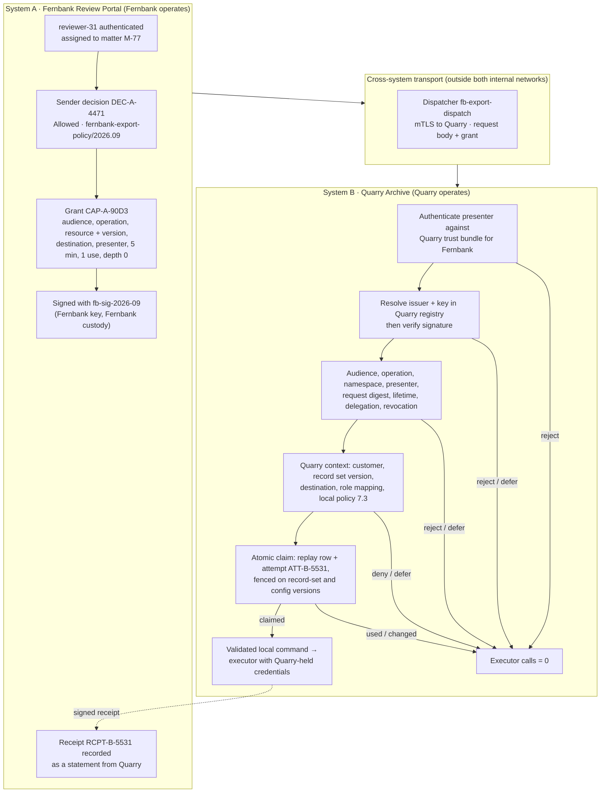

# Cross-System Delegated Execution and Recipient-Local Trust

**Learning objective:** Follow one `records.export` operation from a governance decision in one independently operated system, through a narrow delegated grant and a cross-system handoff, to validation, recipient-local policy, an atomic claim, and host-owned execution in a second system with its own trust anchors, policies, clocks, and replay state. Answer one practical question: **what must the receiving system independently verify before it treats delegated authority from another system as acceptable execution authority?** Then decide when a simpler same-system or ordinary service-authorization design would do.

**Pattern classification:** General learning material

**Difficulty:** Advanced

**Prerequisites:** Recommended — [Cross-System Capability Exchange and Delegated Authority](../advanced/cross-system-capability-exchange-and-delegated-authority.md), which is the conceptual treatment this case composes, and [Scoped Capability and Host-Owned Execution](../tutorials/scoped-capability-and-host-owned-execution.md). [Signing, Verification, Key Custody, and Tamper Evidence](../security/signing-verification-key-custody-and-tamper-evidence.md), [Replay Protection and Bounded-Use Authority](../security/replay-protection-and-bounded-use.md), and [Capability-Scoped Background Operation](capability-scoped-background-operation.md) support the verification, replay, and freshness sections.

**Estimated study time:** 55–75 minutes for the full case. The five-, ten-, and twenty-minute routes below cover the central distinctions first.

> **Scope.** This is architecture teaching material. The organizations, systems, people, record sets, keys, certificates, and destinations are fictional, and the protected side effect is a synthetic write to an in-memory export store. The delegated grant is a JSON-shaped teaching artifact protected by an abstract signature envelope. It is not a JWT, JWS, CWT, macaroon, or proposed interoperability format, and nothing here defines a federation protocol. External standards are cited only where they address the same boundary.

## Before You Begin

This case study uses one fictional operation: `records.export`.

**Fernbank** is a fictional company. Its legal team uses the **Fernbank Review Portal** (System A) to request and govern exports of archived case records for regulatory review. The records themselves are held by **Quarry Archive** (System B), a separately operated records-archive service run by a different organization. Quarry stores record sets for many customers, Fernbank among them, and is the only party that can read a record set and write an export.

Fernbank decides whether its reviewer may request the export. Quarry decides whether it will perform it. Neither system administers the other: they have different identity providers, signing keys, policy engines, clocks, databases, on-call rotations, and incident processes.

Keep these artifacts distinct throughout the study:

| Artifact | Owner | What it means | What it does not mean |
| --- | --- | --- | --- |
| Export request | System A | What an authenticated reviewer asked for | That policy allows it, or that Quarry will perform it |
| Sender decision | System A | What Fernbank's policy concluded, at request time, under Fernbank's facts | Recipient authorization, or current truth at Quarry |
| Delegated grant | Issued by System A | Narrow, short-lived, single-use continuation authority addressed to one Quarry boundary | Permission Quarry must honor, or a credential that opens records |
| Signature envelope | System A's key | Evidence that a key Quarry accepts protected these exact bytes | Proof the issuer is trusted for this purpose, or that the grant is current, unused, or authorized |
| Presenter identity | Fernbank's dispatcher, authenticated by Quarry | Which workload delivered the grant over this connection | Authority for this export |
| Recipient trust registry | System B | Which issuers, keys, operations, namespaces, audiences, presenters, and chains Quarry accepts | Anything Fernbank can change |
| Recipient decision | System B | What Quarry's policy concludes now, under Quarry's facts | A rewrite of Fernbank's decision |
| Claim | System B | Quarry's atomic, recorded use of the grant | Proof that the export completed |
| Validated local command | System B | The only input the executor receives, built from Quarry's own records | The raw foreign artifact |
| Execution and receipt evidence | System B, returned to System A | What Quarry did, under which attempt | Something Fernbank recorded itself |

The central distinctions are:

```text
Valid signature
    ≠
Trusted issuer
```

```text
Trusted issuer
    ≠
Correct audience / scope / freshness
```

```text
Valid delegated authority
    ≠
Recipient-local authorization or policy approval
```

```text
Delegation
    ≠
Unlimited transitive trust
```

and:

```text
Sender decision
    +
Recipient-local validation
    +
Current execution context
    ↓
Execution may proceed
```

**Five-minute route:** read **At a Glance** (including **Trust Assumptions**), **The Scenario**, **Five Things That Stay Distinct**, and **The Simpler Architectures**.

**Ten-minute route:** add **What Quarry Configures Before Any Artifact Arrives**, **The Recipient Validation Pipeline**, and the **Decision and Execution Matrix**.

**Twenty-minute route:** add **Clocks and Lifetime**, **Delegation Chains: Why Quarry Rejects Larch**, **Key Rotation and Historical Verification**, and **Degraded Mode**. The remaining sections cover identifiers, the claim, execution, drift, evidence, traces, tests, operations, failure modes, tradeoffs, and review.

**About the code:** all C# and pseudocode on this page is illustrative. Repositories, helpers, and some transitions are omitted, and none of it compiles as shown. The tests in **What the Tests Should Prove** describe the contract an implementation should meet; they are not a runnable companion. The [Cross-System Capability Exchange sample](https://github.com/AsiBackbone/Learning/blob/main/samples/cross-system-capability-exchange/README.md) is the runnable, simpler simulation that accompanies the advanced article.

## At a Glance

The lifecycle is:

```text
System A — Fernbank Review Portal (request / governance domain)
    ↓
Authenticated reviewer + authoritative matter context
    ↓
Sender governance decision
    ↓
Narrow delegated continuation grant
    ↓
Cross-system handoff over mutually authenticated transport
    ↓
System B — Quarry Archive (receiving / execution domain)
    ↓
Issuer / key / signature / audience / scope / expiry / delegation / revocation / replay validation
    ↓
Recipient-local actor mapping, policy, resource, and destination checks
    ↓
Atomic claim / bounded use
    ↓
Validated local command → host-owned synthetic export
    ↓
Execution evidence at Quarry + signed receipt reconciled at Fernbank
```

The same path, drawn across its trust boundaries:



The case preserves two invariants and states one limit:

> **Quarry's executor runs only after Quarry itself has authenticated the presenter, resolved the issuer and key from its own registry, verified the signature, confirmed that the grant is addressed to this boundary and bound to this exact request, found it current and unrevoked under Quarry's clock and revocation state, accepted its delegation path, rebuilt current context from Quarry's records, applied Quarry's own policy, and atomically claimed the grant's single use.**

> **No value Fernbank asserts — issuer name, key identifier, role, resource meaning, destination, expiry, or chain — becomes Quarry's truth until Quarry's own configuration or records confirm it.**

> **Neither invariant makes Quarry safe from a Fernbank that is wrong in every field consistently. A compromised Fernbank signing key, or a Fernbank policy defect that mints a correctly shaped grant, passes every artifact check. Quarry's local policy, its narrow issuer purpose, and its executor's credential boundaries are what limit that, and the case says how far.**

### Trust Assumptions

Every guarantee in this case holds only under these assumptions. State your own equivalents before reusing any of it.

| Component | Assumed | Consequence if the assumption fails |
| --- | --- | --- |
| Transport between the systems | Untrusted for content; mutually authenticated TLS protects the channel | Grants carry no data credential, and every binding is rechecked. A party that reads a grant in transit cannot present it as another workload without the presenter's private key (§8). If that key is compromised, the binding no longer distinguishes the dispatcher from the attacker |
| Fernbank Review Portal and its policy | Trusted by Quarry only for the purpose its registry entry names | A Fernbank defect can mint a wrong grant. Quarry's namespace, operation, role-mapping, and local-policy checks catch some of it, not a grant that is wrong consistently (§16) |
| Fernbank's signing key | In Fernbank's custody; may be compromised | Quarry rejects the key once its registry marks it compromised. Until then, a forged grant inside the issuer's permitted purpose passes artifact checks (§13, Trace H) |
| Fernbank's dispatcher | May be compromised | It can present only the grants Fernbank issues to it, inside their bindings, within their windows. It holds no Quarry data credential |
| Quarry's trust registry, policy store, replay store, record store, and executor | Trusted, and hardened accordingly | Every guarantee fails; Quarry's boundary is the enforcement point |
| Quarry's clock | Synchronized to a source Quarry trusts | If Quarry cannot trust its own clock, it defers time-bounded work (§10, §14) |
| Fernbank's revocation feed | Reachable within Quarry's freshness bound | When it is stale, Quarry defers rather than accepts (§14) |
| Availability | **Not protected.** Either system, or the transport, can delay or drop work | Denial of service is out of scope for every control in this case |

---

## 1. The Scenario

**System A — Fernbank Review Portal.** Operated by Fernbank. Authenticates Fernbank staff with Fernbank's identity provider, holds matter assignments, runs `fernbank-export-policy/2026.09`, issues delegated grants signed with Fernbank's key, and dispatches them through a workload named `fb-export-dispatch`.

**System B — Quarry Archive.** Operated by Quarry. Stores record sets for customers including `cust-fernbank`, runs `quarry-inbound-export/7.3`, keeps its own trust registry, replay store, and clock, and is the only system whose executor can read a record set and write an export.

**System C — Larch Workflow Hub.** A third, independently operated orchestration service. Fernbank sometimes routes work through it. Quarry already trusts Larch as an issuer for a different operation, `records.ingest`. It appears only in the delegation-chain trace.

**Requester:** `reviewer-31`, authenticated by Fernbank, assigned to regulatory matter `M-77` with the `legal-reviewer` role.

**Request, Wednesday 4 November 2026, 14:02:04 UTC:**

```text
operation:      records.export
resource:       quarry:cust-fernbank/RS-2207   (Quarry's identifier, from Quarry's catalog)
version seen:   rev-14
fields:         case metadata and correspondence index; message bodies excluded
format:         encrypted CSV
destination:    DST-F2   (Fernbank's review bucket, registered with Quarry)
purpose:        regulatory-review (matter M-77)
```

Fernbank's decision is `DEC-A-4471`, `Allowed`. At 14:02:10 the portal issues grant `CAP-A-90D3`, valid until 14:07:10, for one use, signed with key `fb-sig-2026-09`. The dispatcher opens a mutually authenticated connection to Quarry and presents the request body and the grant at 14:02:13, with correlation `COR-8F21`.

Quarry authenticates the dispatcher, resolves Fernbank's issuer entry and the key in its own registry, verifies the signature, checks every binding, rebuilds its own context for `RS-2207`, evaluates its own policy as `RDEC-B-602`, `Allowed`, claims the grant as attempt `ATT-B-5531`, and its executor writes the encrypted file into `DST-F2` with credentials Fernbank never sees. Quarry returns signed receipt `RCPT-B-5531` to Fernbank, which records it as Quarry's statement of what happened.

Every trace in this case uses this export.

### Two policies, two owners

Fernbank's policy decides whether its reviewer may ask:

| Condition | Decision | Reason code |
| --- | --- | --- |
| Reviewer not assigned to the matter, or lacks `legal-reviewer` | `Denied` | `actor.not-assigned` |
| Destination not a Fernbank-owned review destination | `Denied` | `destination.not-fernbank` |
| Purpose not tied to an open matter | `Denied` | `purpose.no-open-matter` |
| Matter or catalog data unavailable | `Deferred` | `context.unavailable` |
| Otherwise | `Allowed` | `export.allowed` |

Quarry's policy decides whether Quarry will perform it, using facts Fernbank does not have:

| Condition | Outcome | Reason code |
| --- | --- | --- |
| Sender role has no explicit mapping to a Quarry permission | `Denied` | `actor.role-not-mapped` |
| Customer account suspended | `Denied` | `customer.suspended` |
| Record set under a Quarry export freeze (for example, during a Quarry data-integrity investigation) | `Denied` | `local.export-freeze` |
| Destination not registered and verified for the owning customer | `Denied` | `destination.not-registered` |
| Record set classification above the destination's ceiling | `Denied` | `local.classification-above-destination-ceiling` |
| Customer's daily export volume reached | `Deferred` | `local.volume-limit` |
| Record set, customer, destination, or policy context unavailable | `Deferred` | `context.unavailable` |
| Otherwise | `Allowed` | `inbound-export.allowed` |

Both rule sets are illustrative. The point is the ownership: Quarry's rules can be stricter than Fernbank's, and they are evaluated against Quarry's current records, not against anything in the grant.

---

## 2. Keep the Responsibilities Separate

Two organizations means each concern has two owners, and neither owner can discharge the other's.

| Concern | System A (Fernbank) | System B (Quarry) |
| --- | --- | --- |
| Architecture | Where the portal decides and where grants are minted and dispatched | Where the inbound gate, trust registry, replay store, and executor sit; which records are authoritative for customer, record set, destination, and classification |
| Implementation | Intent binding, the side-effect-free sender policy, canonical request digest, grant issuance and signing | Artifact parsing, verification, binding checks, local policy, the atomic claim, the validated local command, the executor |
| Operations | Dispatcher health, key rotation announcements, the revocation feed, receipt reconciliation | Registry changes, revocation-feed freshness, clock health, replay-store capacity, refused and deferred exports |
| Security | Signing-key custody, the dispatcher's certificate, what the grant may disclose | Presenter trust bundles, accepted keys and their lifecycle, credential custody for record sets and destinations, the threat model for a compromised issuer |
| Governance | Who may request an export of Fernbank's matters, for which purposes | Which customers, operations, roles, and destinations Quarry accepts, and when Quarry refuses regardless of the sender |
| Execution | None. Fernbank holds no credential that reads a Quarry record set | The executor, and only the executor, reads the record set and writes the export |

The rule that keeps the table honest: **no row in one column silently takes over a row in the other.** Fernbank's decision does not substitute for Quarry's policy. Quarry's acceptance does not rewrite Fernbank's decision. A shared `CorrelationId` connects their evidence; it does not merge their audit obligations.

---

## 3. Identifiers and What Each One Answers

Cross-system work multiplies identifiers that look interchangeable. Each one here answers one question and is owned by one system.

| Identifier | Example | Question it answers | Owner / source of truth | Must never be used as |
| --- | --- | --- | --- | --- |
| Originating subject | `fb-u-3c7a` (pseudonymous for `reviewer-31`) | Who asked, in Fernbank's terms? | Fernbank's authentication | A Quarry principal or a Quarry role |
| Sender role | `legal-reviewer` | What standing did the requester have at Fernbank? | Fernbank's matter assignments | A Quarry permission, unless Quarry's mapping says so |
| `CorrelationId` | `COR-8F21` | Which end-to-end story does this belong to? | Generated by Fernbank, recorded by both | Authorization, deduplication, or replay identity |
| Sender `DecisionId` | `DEC-A-4471` | Which Fernbank evaluation allowed the request? | Fernbank | Quarry's decision, or proof the export ran |
| Sender policy version | `fernbank-export-policy/2026.09` | Which Fernbank policy produced it? | Fernbank | Quarry's current policy |
| `CapabilityId` | `CAP-A-90D3` | Which delegated grant is being presented? | Fernbank mints it; Quarry keys its replay state on (issuer, `CapabilityId`) | A Quarry decision or attempt |
| Key ID | `fb-sig-2026-09` | Which key does the issuer say it used? | Asserted by the artifact; meaningful only once Quarry's registry resolves it | A trust anchor in its own right |
| Presenter identity | `spiffe://fernbank.example.test/export-dispatch` | Which workload delivered the grant? | Quarry's mTLS authentication against its Fernbank trust bundle | Authority for an operation |
| Quarry resource | `quarry:cust-fernbank/RS-2207` at `rev-14` | Which record set, at which version? | Quarry's catalog and record store | A Fernbank-local identifier |
| Recipient `DecisionId` | `RDEC-B-602` | What did Quarry's policy conclude, now? | Quarry | A rewrite of `DEC-A-4471` |
| `ExecutionAttemptId` | `ATT-B-5531` | Which claimed use of the grant is this? | Quarry, created in the claim | Proof of completion |
| Receipt | `RCPT-B-5531` | What does Quarry say happened? | Quarry, signed with Quarry's key | A Fernbank fact; Fernbank records it as Quarry's assertion |

Three rules carry most of the weight:

- **Quarry namespaces everything foreign.** Replay state is keyed on the pair (issuer, `CapabilityId`), never on `CapabilityId` alone, so two issuers that both mint `CAP-A-90D3` cannot collide or block each other.
- **Fernbank's identifiers are provenance at Quarry.** `DEC-A-4471` appears in Quarry's evidence so the story can be reconstructed. Quarry never looks it up to decide anything.
- **Identifier comparisons are ordinal.** Issuer, audience, namespace, resource, presenter, and capability identifiers are compared with exact, case-sensitive ordinal semantics everywhere (`string.Equals(a, b, StringComparison.Ordinal)` in .NET), after one canonical normalization where each value is created. A comparison that folds case in one component and not another is a substitution path.

The advanced article's [evidence table](../advanced/cross-system-capability-exchange-and-delegated-authority.md#19-cross-system-evidence-requires-two-audit-obligations) gives the conceptual version of this table.

---

## 4. The Sender Side: Decide, Then Delegate Narrowly

Fernbank's portal does the same work any governed request needs before anything crosses the boundary.

1. **Authoritative sender context.** `reviewer-31` is authenticated by Fernbank's identity provider. The matter, the role, and the assignment come from Fernbank's matter records, not from the request body.
2. **A bound intent.** The resource identifier and version come from Quarry's catalog, which Fernbank reads through an ordinary authenticated API. The destination is chosen from Fernbank's own registered review destinations.
3. **A pure decision.** `DEC-A-4471` is evaluated by a side-effect-free policy and recorded with its policy version and fingerprint before any grant exists.
4. **A narrow grant.** Only an `Allowed` decision mints a grant, and only for the exact request it evaluated.

The grant, as a teaching artifact:

```json
{
  "type": "fernbank-export-grant/1",
  "capabilityId": "CAP-A-90D3",
  "issuer": "https://portal.fernbank.example.test",
  "audience": "quarry-archive/records-export",
  "originatingSubject": "fb-u-3c7a",
  "senderRole": "legal-reviewer",
  "presenter": {
    "id": "spiffe://fernbank.example.test/export-dispatch",
    "certThumbprint": "sha256:9b1e…c40a"
  },
  "operation": "records.export",
  "resource": { "namespace": "quarry:cust-fernbank", "id": "RS-2207", "version": "rev-14" },
  "destinationId": "DST-F2",
  "purpose": "regulatory-review",
  "requestDigest": "sha256:example-export-request-2207",
  "requestCanonicalization": "export-request-c14n/1",
  "issuerDecisionId": "DEC-A-4471",
  "issuerPolicyVersion": "fernbank-export-policy/2026.09",
  "correlationId": "COR-8F21",
  "issuedAtUtc": "2026-11-04T14:02:10Z",
  "notBeforeUtc": "2026-11-04T14:02:10Z",
  "expiresAtUtc": "2026-11-04T14:07:10Z",
  "maxUses": 1,
  "remainingDelegationDepth": 0,
  "delegationChain": []
}
```

The envelope around it carries the key identifier `fb-sig-2026-09` and the signature over the canonical bytes. Its exact shape does not matter to the lesson; [Canonical Representation Comes Before Signing](../security/signing-verification-key-custody-and-tamper-evidence.md#canonical-representation-comes-before-signing) covers why the signed bytes must be canonical and why the artifact type belongs inside them.

What the grant deliberately does **not** contain:

- no credential for Quarry, the record set, or `DST-F2`;
- no copy of `reviewer-31`'s Fernbank session or token;
- no Fernbank-local record identifier that Quarry would have to trust;
- no reviewer name or email: the pseudonymous subject is enough for Quarry's evidence, and Fernbank keeps the mapping;
- no field that tells Quarry to skip any check.

**Why Fernbank delegates at all.** Fernbank could hold a standing Quarry service credential and call an export API directly. It chose a per-request grant because Quarry wants Fernbank's request-specific decision as evidence for each export, wants each export bound to one record-set version and one destination, and does not want any Fernbank service to hold standing authority to export every Fernbank record set. **The Simpler Architectures** returns to whether that choice is necessary.

---

## 5. What Quarry Configures Before Any Artifact Arrives

Everything Quarry later checks is anchored in configuration Quarry owns and changes through its own review process. Fernbank can request a change; it cannot make one.

```text
Issuer entry: https://portal.fernbank.example.test
  Artifact type accepted:       fernbank-export-grant/1
  Signature algorithm:          the one this entry names (never taken from the artifact)
  Accepted signing keys:
    fb-sig-2026-09   Active                  accept new artifacts
    fb-sig-2026-03   Retired 2026-10-01      verify historical evidence only; reject new artifacts
  May delegate operations:      records.export
  Resource namespace:           quarry:cust-fernbank          (and nothing else)
  Accepted audience:            quarry-archive/records-export
  Presenter:                    spiffe://fernbank.example.test/export-dispatch
                                authenticated by mTLS against trust bundle fernbank-workloads-v4,
                                and bound to the grant's certificate thumbprint
  Maximum grant lifetime:       5 minutes
  Accepted clock skew:          30 seconds, start of window only
  Maximum uses:                 1
  Delegation:                   direct only; remainingDelegationDepth must be 0; chain must be empty
  Revocation source:            Fernbank revocation feed, maximum staleness 120 seconds
  Sender-role mapping:          legal-reviewer → export.initiate (customer-scoped)
                                anything else  → no mapping

Issuer entry: https://hub.larch.example.test
  May delegate operations:      records.ingest
  Accepted as an intermediary:  for no operation
```

Five properties of that configuration are the case's foundation:

- **Issuer trust is purpose-bound.** Fernbank is trusted to delegate `records.export`, for `cust-fernbank`'s namespace, to one audience. A perfectly signed Fernbank grant naming another customer's record set, or `records.purge`, is refused. [Issuer Trust Is Recipient-Owned](../advanced/cross-system-capability-exchange-and-delegated-authority.md#6-issuer-trust-is-recipient-owned) develops the general rule.
- **Keys are resolved, not presented.** The artifact names `fb-sig-2026-09`. Quarry looks that name up under Fernbank's entry. A key ID Quarry does not have, or a key URL the artifact points at, is not something Quarry fetches.
- **The presenter has its own trust anchor.** The mTLS trust bundle for Fernbank's workloads is separate from Fernbank's artifact-signing keys. Compromising one does not grant the other.
- **Roles map explicitly.** Quarry does not inherit Fernbank's role model. `legal-reviewer` maps to one customer-scoped Quarry permission because Quarry's contract with Fernbank says so. A grant carrying `admin`, or any other unmapped role, gets nothing.
- **Trusting Larch for one thing does not make Larch an intermediary for another.** Larch's entry exists, and its signatures verify. That is why the delegation-chain trace is interesting.

[Trust Pinning Narrows Otherwise Valid Signatures](../security/signing-verification-key-custody-and-tamper-evidence.md#trust-pinning-narrows-otherwise-valid-signatures) explains why a registry that pins issuer, key, type, and purpose matters more than the cryptography.

---

## 6. Five Things That Stay Distinct

Every check in this case exists because one of these five is easy to mistake for another.

| Property | Established at Quarry by | Says | Does not say |
| --- | --- | --- | --- |
| **Possession** | Receiving the bytes | Someone has a copy of the grant | That the holder may present it, or that it is genuine |
| **Signature validity** | Verifying with a key from Quarry's registry, under Fernbank's entry | These bytes were protected by a key Quarry accepts for this issuer, and were not modified | That the grant is for Quarry, current, unused, unrevoked, or acceptable to Quarry's policy |
| **Delegation** | Audience, bindings, lifetime, chain, and revocation checks | Fernbank, within the purpose Quarry trusts it for, asked Quarry to perform this one export, now | That Quarry agrees |
| **Authorization** | Quarry's role mapping and current local policy, evaluated on Quarry's records | Quarry is willing to perform it under current conditions | That the grant has not been used, or that execution will succeed |
| **Execution** | The atomic claim and the host-owned executor | Quarry used the grant once and attempted the export | That every earlier step was correct |

Read top to bottom, each row is necessary for the next and sufficient for none of them.

> **Signing establishes integrity and authenticity relative to a trust anchor. It does not, by itself, establish authorization.** [A Valid Signature Is Not Complete Authorization](../security/signing-verification-key-custody-and-tamper-evidence.md#a-valid-signature-is-not-complete-authorization) develops the general point; the rest of this case shows each step that follows the signature.

---

## 7. The Recipient Validation Pipeline

At 14:02:13 the dispatcher's request reaches Quarry's inbound gate. The presenter's identity comes from the mTLS handshake. Everything else Quarry acts on comes from its registry and its own stores.

```csharp
public sealed class InboundExportGate(
    ITrustRegistry registry,
    ISignatureVerifier verifier,
    IRevocationStatus revocation,
    IRecipientContextResolver context,
    IInboundExportPolicy policy,
    IClaimStore claims,
    IExportExecutor executor,
    IClockHealth clockHealth,
    TimeProvider clock)
{
    private const string Audience = "quarry-archive/records-export";

    public async Task<GateResult> AcceptAsync(
        PresenterIdentity presenter,      // from the mTLS handshake, never from the body or the grant
        ExportRequestBody body,           // what the dispatcher asks Quarry to do
        SignedEnvelope envelope,          // the grant, still untrusted
        CancellationToken ct)
    {
        // Reject/Defer record the internal reason in Quarry's evidence and return the coarse
        // public response mapped in §20. Nothing below calls the executor except the last line.

        // 1. Unverified header values are lookup hints. They select a registry entry; they prove nothing.
        if (!registry.IsCurrent)                                              return Defer("registry.unavailable");
        if (!SignedEnvelope.TryReadHeader(envelope, out string issuerHint, out string keyId, out string type))
                                                                              return Reject("artifact.malformed");
        if (registry.FindIssuer(issuerHint) is not { } issuer)                return Reject("issuer.untrusted");
        if (!issuer.AcceptsType(type))                                        return Reject("issuer.type-not-accepted");
        switch (issuer.KeyStatusFor(keyId))
        {
            case KeyStatus.Unknown:                                           return Reject("issuer.key-not-accepted");
            case KeyStatus.Retired:                                           return Reject("issuer.key-retired");
            case KeyStatus.Revoked:                                           return Reject("issuer.key-revoked");
        }

        // 2. Verify with the registry's key and the registry's algorithm. Only now does a grant exist.
        VerificationResult verified = verifier.Verify(envelope, issuer.AcceptedKey(keyId), issuer.Algorithm);
        if (verified.Status == VerificationStatus.Error)                      return Defer("verification.unavailable");
        if (verified.Status != VerificationStatus.Valid)                      return Reject("artifact.signature-invalid");
        DelegatedExportGrant grant = verified.Grant;
        if (!string.Equals(grant.Issuer, issuer.Id, StringComparison.Ordinal))  return Reject("issuer.header-payload-conflict");

        // 3. Addressed to this boundary, along a path and for a purpose Quarry accepts? A derived grant is
        //    judged by its path first, because the issuer that signed it may only be an intermediary (§11).
        if (grant.Audience != Audience)                                       return Reject("audience.mismatch");
        if (grant.DelegationChain.Count > 0 && !registry.AcceptsPath(grant.DelegationChain, issuer, grant.Operation))
                                                                              return Reject("delegation.chain-not-accepted");
        if (!issuer.MayDelegate(grant.Operation))                             return Reject("issuer.operation-not-permitted");
        if (!issuer.CoversNamespace(grant.Resource.Namespace))                return Reject("issuer.namespace-not-permitted");

        // 4. The right workload, presenting it for exactly this request?
        if (!issuer.AcceptsPresenter(presenter) || !grant.Presenter.Matches(presenter))
                                                                              return Reject("presenter.binding-mismatch");
        if (!issuer.AcceptsCanonicalization(grant.RequestCanonicalization) ||
            RequestDigest.Compute(body, grant.RequestCanonicalization) != grant.RequestDigest)
                                                                              return Reject("request.digest-mismatch");

        // 5. Lifetime under Quarry's clock (§10). Clock health is checked first: an untrusted clock defers.
        if (!clockHealth.IsSynchronized)                                      return Defer("clock.untrusted");
        if (Lifetime.Check(grant, issuer, clock.GetUtcNow()) is { } lifetimeFailure)
                                                                              return Reject(lifetimeFailure);

        // 6. Remaining delegation budget and use count (§11).
        if (grant.RemainingDelegationDepth > issuer.MaxRemainingDelegationDepth)
                                                                              return Reject("delegation.depth-not-accepted");
        if (grant.MaxUses != 1)                                               return Reject("bounded-use.not-accepted");

        // 7. Revocation, from a source whose freshness Quarry knows (§12, §14).
        RevocationStatus revoked = await revocation.StatusAsync(issuer.Id, grant.CapabilityId, ct);
        if (revoked == RevocationStatus.Revoked)                              return Reject("revocation.revoked");
        if (revoked == RevocationStatus.Unknown)                              return Defer("revocation.status-unknown");

        // 8. Quarry's own facts. The grant says what to look up, never what is true.
        if (await context.ResolveAsync(issuer.Customer, grant.Resource, grant.DestinationId, ct) is not { } current)
                                                                              return Defer("context.unavailable");
        if (current.RecordSet.OwnerCustomer != issuer.Customer)               return Reject("resource.owner-mismatch");
        if (current.RecordSet.Version != grant.Resource.Version)              return Reject("resource.version-drift");

        // 9. Quarry's own decision, recorded whatever its outcome (§15).
        RecipientDecision decision = await policy.EvaluateAsync(issuer, grant, current, ct);
        if (decision.Outcome != Outcome.Allowed)                              return Refuse(decision);

        // 10. One atomic claim, fenced on the versions the checks used (§18).
        ClaimResult claim = await claims.TryClaimAsync(issuer.Id, grant, current, decision, presenter, ct);
        if (claim is not ClaimResult.Claimed claimed)                         return FromClaim(claim);

        // 11. A local command built from Quarry's records. The foreign artifact never reaches the executor (§19).
        ValidatedExportCommand command = ValidatedExportCommand.From(current, decision, claimed.AttemptId, grant);
        return await executor.ExecuteAsync(command, ct);
    }
}
```

The points that matter more than the exact code:

**Unverified values only choose where to look.** The header names an issuer and a key. Quarry uses them to find a registry entry, then verifies with the key and algorithm that entry holds, then confirms the verified payload names the same issuer. An artifact cannot choose its own trust root, its own algorithm, or its own key. [Let the Artifact Choose Its Own Trust Root](../security/signing-verification-key-custody-and-tamper-evidence.md#7-let-the-artifact-choose-its-own-trust-root) is the failure mode this order prevents.

**Every check before the claim is side-effect free.** No replay state changes, no record set is opened, and no executor runs until step 10. A rejection at any earlier step leaves the grant unused, which matters when the rejection is a mistake that is fixed within the grant's window.

**The order is a contract, not a performance choice.** Independent lookups, such as revocation status and record-set context, can run concurrently. What cannot change is that verification precedes trust in any payload field, every check precedes the claim, and the claim precedes execution. [Recipient Validation Pipeline](../advanced/cross-system-capability-exchange-and-delegated-authority.md#22-recipient-validation-pipeline) gives the conceptual sequence.

**String comparisons are ordinal.** The issuer comparison spells it out to make the contract visible. C#'s `==` and `!=` on `string` are also ordinal and case-sensitive. A production gate would use the explicit form throughout.

---

## 8. Presenter Binding Is Enforced by the Channel

The grant names a presenter: Fernbank's dispatcher, by SPIFFE ID and certificate thumbprint. Quarry does not take that as a fact. It authenticates the connection with mutual TLS against its trust bundle for Fernbank's workloads, derives the peer's identity and certificate thumbprint from the handshake, and compares both with the grant.

That makes the grant **sender-constrained**: a copy cannot be presented by another workload unless it also holds the dispatcher's private key and can complete the TLS handshake with it. The protection is proof of possession, so it lasts only as long as that private key stays in the dispatcher's custody.

| Presentation | Result |
| --- | --- |
| `fb-export-dispatch`, its own certificate, grant naming it | Passes presenter binding |
| Grant copied from a Fernbank log and presented by Larch over Larch's own mTLS identity | `presenter.binding-mismatch` |
| Grant naming `fb-analytics`, another Fernbank workload, correctly signed by Fernbank | `presenter.binding-mismatch`: Quarry's registry accepts only the dispatcher as a presenter for this issuer |
| Dispatcher's certificate renewed, grant still carries the old thumbprint | `presenter.binding-mismatch`. Certificate renewal must happen between grants, or Fernbank must re-issue |

Two details are easy to lose:

- **A presenter field without channel binding is a label.** If Quarry accepted a grant over plain TLS because its `presenter.id` said `export-dispatch`, the field would prove nothing. The thumbprint check against the handshake is what turns it into a binding. [Originating Subject, Presenter, Bearer Authority, and Proof of Possession](../advanced/cross-system-capability-exchange-and-delegated-authority.md#8-originating-subject-presenter-bearer-authority-and-proof-of-possession) separates the two.
- **Authenticating the presenter is not authorizing the export.** The dispatcher is a legitimate Fernbank workload, and it can still present a grant that fails every later check. Passing step 4 only establishes who is speaking.

If transport cannot be bound to a key the grant names, a per-request proof-of-possession signature can serve the same purpose. Either way, the binding has to be enforced by cryptography Quarry verifies, not asserted by a field Quarry reads.

---

## 9. Audience, Scope, and Request Binding

Each binding stops a different substitution. A grant that has the right issuer and a valid signature can still be pointed at the wrong thing.

| Binding | Value in `CAP-A-90D3` | What it stops | Reason code on failure |
| --- | --- | --- | --- |
| Audience | `quarry-archive/records-export` | A grant for `quarry-archive/records-purge`, or for another archive provider, being accepted here | `audience.mismatch` |
| Issuer purpose: operation | `records.export` | Fernbank delegating an operation Quarry never agreed it could delegate | `issuer.operation-not-permitted` |
| Issuer purpose: namespace | `quarry:cust-fernbank` | A Fernbank grant naming another customer's record set | `issuer.namespace-not-permitted` |
| Resource ownership | `RS-2207` owned by `cust-fernbank` in Quarry's store | A namespace label that disagrees with Quarry's ownership record | `resource.owner-mismatch` |
| Resource version | `rev-14` | Exporting content Fernbank never evaluated | `resource.version-drift` (§17) |
| Destination | `DST-F2` | Redirecting the export to another destination | `request.digest-mismatch` if only the body changed; `destination.not-registered` if Quarry does not hold it for this customer |
| Purpose and fields | `regulatory-review`; metadata and correspondence index | Widening the field set or changing the purpose under the same grant | `request.digest-mismatch` |
| Request digest | `sha256:example-export-request-2207` under `export-request-c14n/1` | Any change to the request semantics the grant covers | `request.digest-mismatch` |

**The audience names an execution boundary, not a host.** `archive.quarry.example.test` serves exports, ingests, and administration. An audience of the hostname would let a grant for one be accepted by another. Quarry names the boundary that actually executes.

**Audience and request binding answer different questions.** The audience says which boundary may consume the grant. The request digest says which exact request it covers there. A grant with the right audience and a substituted body fails the second. [Audience Binding and Request Binding Solve Different Problems](../advanced/cross-system-capability-exchange-and-delegated-authority.md#7-audience-binding-and-request-binding-solve-different-problems) develops the distinction.

**Foreign identifiers are qualified, not trusted.** The grant names Quarry's own identifier because Fernbank read it from Quarry's catalog. Quarry still treats the namespace as a claim and confirms ownership from its own record. If Fernbank had sent its local case number instead, Quarry would have had to map it through a registry Quarry owns, and reject what it could not map. [Operation, Resource, and Resource Meaning Must Survive the Handoff](../advanced/cross-system-capability-exchange-and-delegated-authority.md#9-operation-resource-and-resource-meaning-must-survive-the-handoff) covers the mapping problem.

---

## 10. Clocks and Lifetime

Fernbank's portal and Quarry's archive keep separate clocks. The grant's timestamps are Fernbank's assertions; Quarry decides what they mean.

Quarry's lifetime rule for this issuer:

```text
reject  lifetime.inconsistent-timestamps     unless issuedAt ≤ notBefore < expiresAt
reject  lifetime.exceeds-recipient-maximum   if expiresAt − issuedAt > 5 minutes
reject  lifetime.issued-in-future            if issuedAt  > now + 30 seconds
reject  lifetime.not-yet-valid               if notBefore > now + 30 seconds
reject  lifetime.expired                     if now ≥ expiresAt                (no skew allowance)
defer   clock.untrusted                      if Quarry's own clock is not synchronized
```

**Timestamps must be internally consistent before any other lifetime rule is applied.** A grant whose `notBefore` precedes its `issuedAt`, or whose `expiresAt` is not after its `notBefore`, is contradictory, and Quarry rejects it rather than guessing which field the issuer meant. With that ordering in place, the usable window `expiresAt − notBefore` can never exceed the five-minute maximum measured from `issuedAt`.

**Skew applies only to admission at the start of the window. It never extends the declared `expiresAt`.** Allowing 30 seconds at the start accepts a grant from a Fernbank clock that runs slightly ahead of Quarry's, which means Quarry may begin accepting a grant up to 30 seconds before the `notBefore` Fernbank declared. Measured on Quarry's clock, the acceptance interval can therefore exceed the issuer-declared lifetime by at most that 30-second start allowance, and never by more. Allowing skew at the end would be different in kind: it would carry every grant past the expiry its issuer chose, silently.

**The issuer cannot push expiry beyond Quarry's acceptance horizon.** With a five-minute maximum lifetime and a 30-second start allowance, the maximum-lifetime and future-issuance rules together bound the latest `expiresAt` Quarry will accept to `now + 5 minutes 30 seconds`, whatever Fernbank's clock says, and no tolerance is added after `expiresAt`. A Fernbank clock running 40 seconds fast produces an `issuedAt` beyond the allowance and is rejected. A Fernbank clock running slow produces grants that are, on Quarry's clock, shorter than declared. Neither direction carries a grant past its declared expiry.

**Admission is enforced again at the claim.** The check above runs at 14:02:13 against the gate's clock. The atomic claim re-evaluates expiry against the store's clock at the moment of the conditional write (§18), so a request that waits on a lock past 14:07:10 is refused even though it was inside the window when it arrived.

**When Quarry cannot trust its own clock, it defers.** A time-bounded authority check against a clock Quarry does not trust is a guess. For a protected export, Quarry prefers `execution.postponed` over guessing; with a five-minute grant, that usually means Fernbank needs a fresh grant.

[Lifetime Is Evaluated by the Recipient's Clock](../advanced/cross-system-capability-exchange-and-delegated-authority.md#10-lifetime-is-evaluated-by-the-recipients-clock) gives the conceptual rule. Five minutes and 30 seconds are this case's values, chosen for a synchronous dispatcher with seconds of latency; they are not a recommendation.

---

## 11. Delegation Chains: Why Quarry Rejects Larch

Fernbank sometimes routes exports through **Larch Workflow Hub**, which batches and schedules work for several of Fernbank's suppliers. Suppose Fernbank issues a grant to Larch with `remainingDelegationDepth = 1`, and Larch derives a child grant for Quarry:

```text
Fernbank portal
   │  CAP-A-91F0 → audience larch-hub, remainingDelegationDepth = 1, signed fb-sig-2026-09
   ▼
Larch Workflow Hub
   │  CAP-L-3307 → audience quarry-archive/records-export, remainingDelegationDepth = 0,
   │               delegationChain = [Fernbank → Larch], signed larch-sig-2026-08
   ▼
Quarry Archive
```

Every signature in that chain verifies. Quarry has an entry for Larch, because Larch is trusted to issue `records.ingest` grants. Larch's child grant is correctly narrowed: same operation, same record set, shorter lifetime, depth reduced to zero.

Quarry rejects it:

```text
Issuer entry for Larch:   may delegate records.ingest; accepted as intermediary for nothing
Issuer entry for Fernbank: direct only; chain must be empty
Result:                   delegation.chain-not-accepted; executor calls = 0
```

The reasoning is the case's fourth distinction:

- **Trust is not transitive.** Fernbank trusts Larch, and Quarry trusts Fernbank. Neither fact means Quarry accepts Larch as a source of export authority over Fernbank's records.
- **Trusting an issuer for one operation is not trusting it as an intermediary for another.** Larch's verified signature establishes that Larch issued the child. It does not establish that Quarry agreed to let Larch speak for Fernbank about exports.
- **Every hop being signed does not make the chain safe.** It proves who said what. Whether each derivation was allowed, and whether the recipient accepts the path at all, is policy Quarry owns.
- **Quarry also rejects a non-terminal grant presented directly.** A Fernbank grant with `remainingDelegationDepth = 1` presented by Fernbank's own dispatcher is refused as `delegation.depth-not-accepted`. Quarry never re-delegates, so a grant that permits further delegation is either a Fernbank misconfiguration or authority meant for someone else.

If Quarry later decided to accept Larch as an intermediary, it would have to configure that deliberately: name Larch as an accepted intermediary for `records.export` under Fernbank's namespace, require a separately verifiable proof for every hop rather than one outer signature over a chain list, check that each child narrows its parent (operation, resource, destination, lifetime, use count, and remaining depth), and accept the cost of evaluating revocation for every grant in the path. Quarry declined because Fernbank's dispatcher can reach Quarry directly, so the chain adds risk without adding any capability Quarry needs.

Standards treat chains with the same caution. [OAuth 2.0 Token Exchange (RFC 8693)](https://www.rfc-editor.org/rfc/rfc8693.html) can record a chain of actors in nested `act` claims, and treats the prior actors as informational rather than as inputs to access control. A recipient that wants to make decisions about the whole path has to define and enforce its own chain policy, as Quarry does here. [Delegation Is a Constrained Derivation, Not Transitive Trust](../advanced/cross-system-capability-exchange-and-delegated-authority.md#13-delegation-is-a-constrained-derivation-not-transitive-trust) gives the derivation rules.

---

## 12. Revocation and Invalidation

Short lifetime reduces the need for revocation. It does not remove it. Three different paths can stop `CAP-A-90D3`, and they are owned by different systems:

| Path | Who initiates | How Quarry learns | Reason code |
| --- | --- | --- | --- |
| Fernbank revokes one grant (the reviewer cancels, or the matter closes) | Fernbank | Fernbank's revocation feed, polled by Quarry; maximum staleness 120 seconds | `revocation.revoked` |
| Fernbank's signing key is withdrawn | Fernbank requests; Quarry's registry change | Quarry's own registry, changed through Quarry's process (§13) | `issuer.key-revoked` |
| Quarry invalidates locally: customer suspended, record set frozen, destination deregistered | Quarry | Quarry's own records, read in step 8 | `customer.suspended`, `local.export-freeze`, `destination.not-registered` |

The first path depends on Fernbank's feed being reachable and fresh. A revocation list Quarry cannot read in time is not a control Quarry has. When the last successful fetch is older than 120 seconds, Quarry treats status as unknown and defers (§14).

The third path needs nothing from Fernbank. Quarry can refuse an export for its own reasons at any time before the claim, without waiting for the issuer to agree.

**Revocation is effective before the claim, not after it.** If Fernbank revokes `CAP-A-90D3` at 14:02:14, one second after Quarry claimed it, the export proceeds; Quarry's evidence and receipt show the claim time, and Fernbank's evidence shows the revocation time. A design that needs mid-execution cancellation must give the executor a cancellation check and define what a partly written export means. [Revocation, Invalidation, and Trust-Anchor Rotation Need Recipient-Usable Semantics](../advanced/cross-system-capability-exchange-and-delegated-authority.md#17-revocation-invalidation-and-trust-anchor-rotation-need-recipient-usable-semantics) covers the general requirement.

---

## 13. Key Rotation and Historical Verification

Fernbank rotates its signing key twice a year. Rotation is where cross-system trust most often expands by accident, so Quarry treats every key change as a registry change it reviews, not as something an artifact can announce.

**Normal rotation.** On 15 September 2026 Fernbank asked Quarry, through the partner change process both organizations use, to add `fb-sig-2026-09`. Quarry's security team confirmed the request through a second channel, added the key under Fernbank's existing entry with the entry's existing purpose, and accepted both keys for new grants until 1 October. On 1 October `fb-sig-2026-03` became **Retired**.

| Key state at Quarry | New grants | Historical evidence |
| --- | --- | --- |
| **Active** | Accepted | Verifiable |
| **Retired** | Rejected (`issuer.key-retired`) | Verifiable for grants Quarry accepted while the key was active, for the retention period |
| **Revoked** (compromised) | Rejected (`issuer.key-revoked`) | Verifiable but suspect after the declared compromise time; flagged for review |
| **Unknown** | Rejected (`issuer.key-not-accepted`) | Nothing to verify against |

Four rules keep rotation from becoming trust expansion:

- **A new key inherits the entry's purpose, not a new one.** Adding `fb-sig-2026-09` did not add namespaces, operations, or audiences. A rotation request that also asked for `records.purge` would be two changes, reviewed separately.
- **An unannounced key is rejected, not fetched.** If a grant arrives signed with `fb-sig-2027-01` before Quarry's registry has it, Quarry rejects it. It does not follow a key URL in the artifact or download Fernbank's published key set automatically. Fernbank's operators see the refusal as a rotation that was not coordinated.
- **Retired is not revoked.** Quarry keeps `fb-sig-2026-03`'s public key for its evidence retention period, so an auditor can re-verify a grant Quarry accepted in September. [Retired Is Not Revoked](../security/signing-verification-key-custody-and-tamper-evidence.md#retired-is-not-revoked) and [Historical Verification Requires Retention Planning](../security/signing-verification-key-custody-and-tamper-evidence.md#historical-verification-requires-retention-planning) develop both points.
- **Compromise changes what a valid signature means.** If Fernbank reports that `fb-sig-2026-09` may have been exposed since 09:00 on 4 November, Quarry marks it **Revoked** with that time. New grants signed with it are rejected. Grants Quarry already accepted after 09:00 still verify, and that is exactly the problem: their signatures no longer distinguish Fernbank from an attacker, so the exports they authorized go to an incident review. Revoking a key cannot undo an export that already ran. [Compromised Keys Change the Meaning of a Valid Signature](../security/signing-verification-key-custody-and-tamper-evidence.md#compromised-keys-change-the-meaning-of-a-valid-signature) covers the general case.

The same rules run in the other direction. Quarry signs receipts with `qa-rcpt-2026-07`, and Fernbank's registry for Quarry pins, rotates, and retires that key under Fernbank's own process.

---

## 14. Degraded Mode

Quarry's acceptance depends on several things it may not be able to reach. Each one has an explicit outcome, chosen in advance, and none of them falls through to execution.

| Dependency unavailable or unhealthy | Quarry's behavior | Grant consumed | Internal reason |
| --- | --- | --- | --- |
| Trust registry snapshot unreadable, or older than its 24-hour maximum age | Defer | No | `registry.unavailable` |
| Signature verification fails with an error rather than a result | Defer | No | `verification.unavailable` |
| Fernbank's revocation feed not fetched successfully in the last 120 seconds | Defer | No | `revocation.status-unknown` |
| Quarry's clock not synchronized | Defer | No | `clock.untrusted` |
| Record set, customer, or destination context unavailable | Defer | No | `context.unavailable` |
| Quarry's policy store unavailable | Defer | No | `context.unavailable` |
| Claim store unavailable, or the claim commit cannot be confirmed | Defer; never execute without a confirmed claim | No (or unknown, resolved by recovery) | `claim.store-unavailable` |
| Fernbank unreachable for receipt delivery | Execution unaffected; receipt queued for retry | Yes, already | `receipt.delivery-pending` |

Three rules apply to every row:

- **Uncertainty is not permission.** There is no path where a valid signature compensates for an unreadable revocation feed, or where a familiar presenter compensates for an unavailable policy store. [Verification Provider Failure Must Not Become Permission](../security/signing-verification-key-custody-and-tamper-evidence.md#verification-provider-failure-must-not-become-permission) and [Replay Store Unavailability Is a Policy Decision](../security/replay-protection-and-bounded-use.md#replay-store-unavailability-is-a-policy-decision) each develop one row.
- **Deferral never extends a grant.** A deferred grant is still bound to its original window. With a five-minute grant, a dependency outage of more than a few minutes means Fernbank needs a fresh decision and a fresh grant, which is the intended result.
- **The response says when, not why.** Fernbank's dispatcher receives `execution.postponed` and retries with backoff while the grant is valid. It does not learn which Quarry dependency failed.

A narrowly scoped degraded path, such as accepting grants for a low-consequence operation while revocation status is briefly unknown, is possible. It would be a written policy decision with its own assumptions and its own evidence. For `records.export` Quarry chose none. [Verification Failure and Degraded Mode Must Be Explicit](../advanced/cross-system-capability-exchange-and-delegated-authority.md#18-verification-failure-and-degraded-mode-must-be-explicit) states the general requirement.

---

## 15. Recipient-Local Context and Policy

Once Quarry accepts that Fernbank asked for this export, it decides whether Quarry will perform it. That decision uses Quarry's own facts and Quarry's own policy.

### The recipient-local actor

Quarry has no account for `reviewer-31` and does not want one. The principal Quarry authorizes is the combination it can actually establish:

| Element | Source at Quarry |
| --- | --- |
| Customer | `cust-fernbank`, from Fernbank's issuer entry, never from the grant |
| Presenter | `fb-export-dispatch`, from the mTLS handshake |
| Permission | `export.initiate` (customer-scoped), from Quarry's mapping of the sender role `legal-reviewer` |
| Originating subject | `fb-u-3c7a`, recorded as provenance; Quarry does not resolve it to a person |

The mapping is explicit and closed. `legal-reviewer` maps to one customer-scoped permission because Quarry's contract with Fernbank says so. A grant carrying `fernbank-admin` gets `actor.role-not-mapped`: Fernbank's administrators are not Quarry's administrators. [Recipient-Local Governance Must Remain Authoritative](../advanced/cross-system-capability-exchange-and-delegated-authority.md#14-recipient-local-governance-must-remain-authoritative) states the rule against inheriting the sender's trust model.

### Quarry's decision

```csharp
public static class QuarryInboundExportPolicy
{
    public const string Version = "quarry-inbound-export/7.3";

    // Pure: no writes, no calls, no clock. Every input is Quarry's record, resolved in step 8.
    public static RecipientVerdict Evaluate(RecipientExportContext c)
    {
        if (c.Unavailable)                                                    return Defer("context.unavailable");
        if (!c.RoleMapping.Grants(c.SenderRole, "export.initiate"))           return Deny("actor.role-not-mapped");
        if (c.Customer.Suspended)                                             return Deny("customer.suspended");
        if (c.RecordSet.ExportFrozen)                                         return Deny("local.export-freeze");
        if (c.Destination is null || c.Destination.Customer != c.Customer.Id
            || !c.Destination.Verified)                                       return Deny("destination.not-registered");
        if (c.RecordSet.Classification > c.Destination.ClassificationCeiling) return Deny("local.classification-above-destination-ceiling");
        if (c.Customer.ExportsToday >= c.Customer.DailyExportLimit)           return Defer("local.volume-limit");
        return Allow("inbound-export.allowed");
    }
}
```

For `CAP-A-90D3`, every rule passes. Quarry records `RDEC-B-602`, `Allowed`, under `quarry-inbound-export/7.3`, with the versions of the record set, customer configuration, and destination it evaluated, and with `DEC-A-4471` as provenance.

### Stricter than the sender

Suppose that at 13:50 Quarry's data-integrity team froze exports of `RS-2207` while it investigated a storage fault. Fernbank cannot know that, and its decision `DEC-A-4471` is correctly `Allowed` under Fernbank's facts. Quarry's decision `RDEC-B-603` is `Denied`, `local.export-freeze`.

Both decisions stay true as history:

```text
DEC-A-4471   Allowed   fernbank-export-policy/2026.09   (Fernbank's facts, 14:02:04)
RDEC-B-603   Denied    quarry-inbound-export/7.3        (Quarry's facts, 14:02:13)
Executor calls = 0; CAP-A-90D3 not consumed
```

Neither system rewrites the other's decision. Fernbank receives `execution.declined`, not the reason: the existence of a Quarry investigation is not Fernbank's to know from an error code. Fernbank's partner contact can ask Quarry through the support channel, which can share what the contract allows.

> **Fresh proof is not fresh authority, and the sender's authority is not the recipient's consent.**

---

## 16. What Quarry Cannot Catch: A Consistently Wrong Issuer

Every check so far compares the grant with something Quarry owns. A grant that is wrong in a way consistent with everything Quarry owns passes.

Two situations produce such grants:

- **A Fernbank policy defect.** The portal allows an export for a reviewer who is not assigned to the matter. The grant is correctly shaped, correctly signed, addressed to Quarry, inside Fernbank's namespace, with a mapped role and a registered Fernbank destination.
- **A compromised Fernbank signing key, before Quarry learns of it.** An attacker who also controls a Fernbank workload with the dispatcher's mTLS identity can mint and present grants that satisfy every artifact check.

Quarry cannot distinguish either from a legitimate grant. What it can do is bound the damage, and the bound comes from controls Quarry owns:

| Quarry control | What it limits, even for a forged or misissued grant |
| --- | --- |
| Issuer purpose: `records.export`, `quarry:cust-fernbank` only | No other operation; no other customer's record sets |
| Destinations registered and verified per customer | Fernbank's records can go only to destinations Fernbank registered with Quarry |
| Presenter binding through mTLS | The attacker needs the dispatcher's private key as well as the signing key |
| Single use, five-minute window, daily volume limit | Each grant exports once; total volume is capped per day |
| Recipient-local policy | Frozen or over-ceiling record sets stay unexported whatever Fernbank says |
| Volume and anomaly alerting (§24) | A burst of exports shortens the time until a human looks |

The destination row carries the most weight. Because Quarry resolves destinations inside the owning customer and requires them to be registered and verified, a misissued grant can at worst move Fernbank's records to a Fernbank-controlled destination. That is still an incident for Fernbank. It is not an exfiltration path out of both organizations.

This limit belongs in both systems' threat models. Quarry's checks make Fernbank's mistakes visible and bounded. They do not make Fernbank's policy correct.

---

## 17. Resource and Policy Drift Between Issuance and Execution

Fernbank evaluated `RS-2207` at `rev-14` under its own policy at 14:02:04. By the time the grant arrives, either side may have changed.

### Resource version drift

At 14:02:11 Quarry ingests a correction to `RS-2207`, producing `rev-15`. The grant names `rev-14`.

Quarry's contract with Fernbank is **exact version**: drift rejects with `resource.version-drift`, and Fernbank must re-read the catalog and make a fresh decision. Quarry does not export `rev-15`, because Fernbank never evaluated it. Quarry does not export `rev-14` either, because in this design Quarry does not retain immutable prior revisions for export.

A design that did retain immutable revisions could choose differently and export exactly `rev-14`, re-evaluating its local policy against that revision's classification. That would be a different contract, written down by both parties. What the recipient must not do is pick silently.

### Recipient-side classification drift

At 14:02:12 Quarry's classification scan marks `RS-2207` as `restricted` after finding personal data in the correspondence index. The content revision is still `rev-14`; the classification is metadata Quarry owns. `DST-F2`'s ceiling is `internal`.

Every grant binding still matches. Quarry's policy re-evaluates against current facts and denies: `local.classification-above-destination-ceiling`. This is the case's "reevaluate" path: nothing about the grant is wrong, and execution still does not happen.

### Policy drift on each side

If Quarry deploys `quarry-inbound-export/7.4` at 14:02:12, the grant arriving at 14:02:13 is evaluated under 7.4. If Fernbank deploys a new policy at 14:02:12, nothing changes at Quarry: `fernbank-export-policy/2026.09` is provenance in the grant, and Quarry never evaluates Fernbank's policy. [Historical Provenance and Execution Freshness Are Different Questions](../governance/policy-versioning-and-decision-provenance.md#historical-provenance-and-execution-freshness-are-different-questions) develops the distinction.

### The freshness contract

Each fact the export relies on falls into one class. The case states which, rather than claiming everything is "current":

| Class | Facts in this case | Guarantee |
| --- | --- | --- |
| **Fenced** in the claim transaction | Grant use state and expiry, record-set version, customer export configuration version (suspension, registered destinations) | A change committed before the claim rolls it back. A change after the claim affects the next export, not this one |
| **Rechecked, not fenced** | Record-set classification and export freeze, revocation status, the customer's daily export count | Rechecked before the claim. A change in the milliseconds between the check and the claim may not affect this export |
| **Not rechecked at Quarry** | `reviewer-31`'s assignment to `M-77`, Fernbank's policy | Fernbank's facts, fixed in `DEC-A-4471`; Fernbank's revocation feed is the path for changes |

A design that needs the export freeze to be fenced as well would version it with the record set, so a freeze committed before the claim rolls the claim back.

---

## 18. The Atomic Claim and Bounded Use

Fernbank records that it issued `CAP-A-90D3`. That record does not protect Quarry: Fernbank cannot see whether a copy was already presented to Quarry, and Quarry cannot rely on a database it does not operate. Replay state for this grant belongs to Quarry.

```text
BEGIN   -- Quarry's claim store, one database, one transaction

  -- 1. Locks first, in a fixed order every writer follows: record set, then customer export config.
  SELECT version FROM record_sets
   WHERE customer = 'cust-fernbank' AND record_set_id = 'RS-2207' FOR SHARE;
  SELECT version FROM customer_export_config
   WHERE customer = 'cust-fernbank' FOR SHARE;

  -- 2. Only now read the clock: this is the admission instant.
  @now := clock_timestamp()        -- PostgreSQL: not now(), which is transaction-start time

  -- 3. Validate and write while the locks are held.
  -- @now >= grant.expires_at                          → ROLLBACK, claim.expired
  -- record_sets.version != 'rev-14'                   → ROLLBACK, claim.resource-changed
  -- customer_export_config.version != @expected       → ROLLBACK, claim.customer-config-changed

  INSERT INTO accepted_grants (issuer, capability_id, presenter, request_digest, attempt_id, claimed_at, expires_at)
  VALUES ('https://portal.fernbank.example.test', 'CAP-A-90D3', @presenter, @digest, 'ATT-B-5531', @now, @grant_expiry)
  ON CONFLICT (issuer, capability_id) DO NOTHING;
  -- 0 rows → ROLLBACK, claim.already-claimed

  INSERT INTO export_attempts (attempt_id, recipient_decision_id, customer, record_set_id, record_set_version,
                               destination_id, issuer, capability_id, correlation_id, state, started_at)
  VALUES ('ATT-B-5531', 'RDEC-B-602', 'cust-fernbank', 'RS-2207', 'rev-14',
          'DST-F2', @issuer, 'CAP-A-90D3', 'COR-8F21', 'Claimed', @now);
COMMIT
```

**The unique key is the replay control.** `(issuer, capability_id)` is unique in `accepted_grants`. Two concurrent presentations of `CAP-A-90D3`, on any Quarry replica connected to this store, produce at most one committed row, so at most one successful claim. In a failure-free run that claim produces one executor invocation. [Atomic Consume Semantics](../security/replay-protection-and-bounded-use.md#atomic-consume-semantics) covers the general mechanism; [Capability-Scoped Background Operation](capability-scoped-background-operation.md) and [Shared Multi-Tenant Worker and Delayed Execution Isolation](shared-multi-tenant-worker-and-delayed-execution-isolation.md#10-atomic-consume-and-claim) explain lock-then-clock ordering in more detail.

**The guarantee is only as wide as the store.** If Quarry ran an independent claim store per region, a copy of the grant presented in two regions could be claimed twice. Quarry runs one claim store for exports. A multi-region design needs an explicit consistency story; [Multi-Region Replay Protection Requires an Explicit Consistency Story](../security/replay-protection-and-bounded-use.md#multi-region-replay-protection-requires-an-explicit-consistency-story) covers the choice.

**Replay state outlives the grant only as long as it must.** After `expiresAt`, the lifetime check rejects the grant regardless, so the replay row is required for replay prevention only through the grant's `expiresAt`; no skew allowance applies after expiry. Quarry keeps the row longer, under its evidence retention policy, because it is also evidence. Any extra margin before deleting rows is a retention choice, not an extension of validity.

### Duplicate delivery versus replay

At 14:02:14 the dispatcher's connection drops before Quarry's response arrives, and the dispatcher retries the same request with the same grant.

```text
Retry:   same presenter, same request digest, CAP-A-90D3 already claimed as ATT-B-5531
Quarry:  claim.already-claimed
Public:  authority.already-used, attempt ATT-B-5531, current state
Result:  executor calls = 0 for the retry
```

Quarry answers the legitimate retry with the original attempt's reference, but only to the bound presenter that made the original claim. A copy presented by anyone else fails presenter binding before reaching the claim. The retry is duplicate delivery, recorded as such; it is not treated as an attack. [Replay Attack Versus Accidental Duplicate](../security/replay-protection-and-bounded-use.md#replay-attack-versus-accidental-duplicate) separates the two.

### A claimed grant stays claimed

If the executor fails after the claim, `ATT-B-5531` is recorded as `Failed` and `CAP-A-90D3` stays used. Quarry never resets it, because a failure can be ambiguous and a reset could produce a second export. If Fernbank still needs the export, it makes a fresh decision and issues a fresh grant. [A Single-Use Grant Can Be Burned](../advanced/cross-system-capability-exchange-and-delegated-authority.md#a-single-use-grant-can-be-burned) explains why.

---

## 19. Validated Local Command and Host-Owned Execution

Quarry's executor never sees the grant. It receives a command built from Quarry's records:

```csharp
public sealed record ValidatedExportCommand(
    string AttemptId,              // "ATT-B-5531"
    string RecipientDecisionId,    // "RDEC-B-602"
    string Customer,               // "cust-fernbank": from Fernbank's issuer entry and Quarry's ownership record
    string RecordSetId,            // "RS-2207"
    string RecordSetVersion,       // "rev-14": enforced again at the data boundary
    string DestinationId,          // "DST-F2": resolved among cust-fernbank's registered destinations
    string FieldSet,
    string Format,
    // Provenance only. The executor records these and never branches on them.
    string Issuer,
    string CapabilityId,
    string IssuerDecisionId,
    string OriginatingSubject,
    string CorrelationId);

public sealed class SyntheticArchiveExportExecutor(IRecordSetReader records, IExportWriter exports) : IExportExecutor
{
    public async Task<ExecutionResult> ExecuteAsync(ValidatedExportCommand command, CancellationToken ct)
    {
        // Quarry-held credentials, selected by the customer Quarry resolved. Fernbank holds none of them.
        await using IRecordSetSession data = await records.OpenAsync(command.Customer, command.RecordSetId, ct);

        // The version is checked at the data boundary, atomically with the read.
        VersionedRead read = await data.ReadAtVersionAsync(command.RecordSetVersion, command.FieldSet, ct);
        if (!read.VersionMatched)
            return ExecutionResult.Failed(command.AttemptId, "resource.changed-at-read");

        // The destination is resolved inside the same customer; a cross-customer destination cannot be named.
        return await exports.WriteEncryptedAsync(command.Customer, command.DestinationId, command.AttemptId, read.Rows, ct);
    }
}
```

**Quarry's executor holds broad credentials.** It can read every customer's record sets, because that is its job. That makes it a potential confused deputy: if raw grant fields reached it, a narrow request could drive a broad credential. The command closes that gap by containing only values Quarry resolved or confirmed, so the executor never interprets a foreign claim. [Recipient Ambient Authority Creates a Confused-Deputy Risk](../advanced/cross-system-capability-exchange-and-delegated-authority.md#20-recipient-ambient-authority-creates-a-confused-deputy-risk) develops the risk; [Keep Raw Artifacts Away From the Executor](../advanced/cross-system-capability-exchange-and-delegated-authority.md#23-keep-raw-artifacts-away-from-the-executor) gives the API shape.

**Fernbank holds nothing that opens a record set.** Fernbank's dispatcher has an mTLS identity and the grants Fernbank issues to it. A compromised dispatcher can present those grants, inside their bindings. It cannot read `RS-2207`, and it cannot name a destination outside `cust-fernbank`.

**This specimen's export store is in memory.** It demonstrates validation, consumption, and replay behavior only. Crash recovery needs durable output keyed by `AttemptId` and an attempt-linked completion record, as [Delayed Financial Payout and Ambiguous External Commit](delayed-financial-payout-and-ambiguous-external-commit.md) develops for an external side effect.

---

## 20. Evidence Lineage Across Two Systems

Fernbank and Quarry each keep their own system of record. A shared `CorrelationId` lets the two be read together; it does not make one system's log the other's evidence.

```text
COR-8F21
 ├─ Fernbank (System A)
 │    REQ  reviewer-31 → records.export RS-2207 @ rev-14 → DST-F2           14:02:04
 │    DEC-A-4471  Allowed  fernbank-export-policy/2026.09                    14:02:04
 │    CAP-A-90D3  issued, signed fb-sig-2026-09, digest of signed bytes       14:02:10
 │    dispatch    to quarry-archive/records-export                           14:02:13
 │    RCPT-B-5531 received, verified against qa-rcpt-2026-07                  14:02:19
 │                recorded as: "Quarry reports Completed under ATT-B-5531"
 └─ Quarry (System B)
      receipt of CAP-A-90D3 from spiffe://fernbank.example.test/export-dispatch   14:02:13
      verified: issuer entry Fernbank, key fb-sig-2026-09 (Active)
      bindings, lifetime, delegation (direct), revocation (feed age 41 s): pass
      RDEC-B-602  Allowed  quarry-inbound-export/7.3  provenance DEC-A-4471
      ATT-B-5531  Claimed  (issuer, CAP-A-90D3)                                14:02:13
      ATT-B-5531  Completed, 1 file to DST-F2                                  14:02:18
      RCPT-B-5531 issued, signed qa-rcpt-2026-07
```

What each side records, and what it deliberately does not:

| Evidence | Fernbank | Quarry |
| --- | --- | --- |
| Reviewer identity | `reviewer-31`, with the mapping to `fb-u-3c7a` | `fb-u-3c7a` only |
| Sender decision and policy | Full decision record | `DEC-A-4471` and policy version, as provenance |
| Grant | Issued claims and the digest of the signed bytes | Verified claims, the digest of the signed bytes, key ID and key state at acceptance |
| Recipient decision | Not recorded; Fernbank receives only the coarse public response | Full decision record, with the versions it evaluated |
| Claim and attempt | `ATT-B-5531` from the receipt | Full claim and attempt records |
| Record-set content | Never | Never in evidence; only in the export file at `DST-F2` |

### The receipt is Quarry's statement

`RCPT-B-5531` is signed by Quarry and verified by Fernbank against Fernbank's own registry entry for Quarry. Fernbank records it as Quarry's assertion of what happened. It does not record "export completed" as a Fernbank fact, because Fernbank did not observe the export.

If the receipt never arrives, Fernbank does not issue a new grant and try again; that could produce a second export. It reconciles first, asking Quarry's status endpoint about `CAP-A-90D3` as the authenticated dispatcher. Until Quarry answers, the export's state at Fernbank is **unknown**, not failed. [Cross-System Evidence Requires Two Audit Obligations](../advanced/cross-system-capability-exchange-and-delegated-authority.md#19-cross-system-evidence-requires-two-audit-obligations) covers the general reconciliation obligation.

### Public responses and internal reasons

Every reason code in this case is an **internal reason**, recorded in the evidence of the system that produced it. Fernbank's dispatcher receives one of five coarse public responses:

| Public response | Internal reasons | Why coarse |
| --- | --- | --- |
| `authority.not-accepted` | Every artifact, issuer, key, signature, audience, purpose, resource-ownership, presenter, digest, lifetime, delegation, and revocation failure | Detailed reasons would tell a sender, or someone holding a stolen grant, which check to work around, and would expose Quarry's key lifecycle |
| `execution.declined` | Role mapping, customer, record-set, destination, classification, and local-policy denials; resource drift | The reasons can reveal Quarry's investigations, classifications, and configuration |
| `execution.postponed` | Every row of §14, and `local.volume-limit` | The dispatcher needs to know to retry, not which dependency failed |
| `authority.already-used` | `claim.already-claimed`, to the bound presenter that made the original claim | The legitimate retry needs the original attempt reference |
| `execution.accepted` | Claimed; execution started | The receipt follows |

Diagnosis happens between the two organizations' operators, through their support channel, with the internal reasons each is willing to share. [Rejection reasons can leak policy](../advanced/cross-system-capability-exchange-and-delegated-authority.md#rejection-reasons-can-leak-policy) states the general rule.

---

## 21. Decision and Execution Matrix

Every row below makes **zero executor calls** except rows 1, 30, 32, 33, and 34, which are marked. "The grant" means `CAP-A-90D3` unless stated. Reason codes are internal; the public response column shows what Fernbank's dispatcher sees.

| # | Situation | Stops at | Internal reason | Public response | Grant consumed | Executor calls |
| --- | --- | --- | --- | --- | --- | --- |
| 1 | Valid grant, every check passes | Executor | `export.completed` | `execution.accepted` | Yes | **1** |
| 2 | `reviewer-31` not assigned to `M-77` | Fernbank's decision | `actor.not-assigned` | (no grant issued) | No grant | 0 |
| 3 | Envelope cannot be parsed | Header | `artifact.malformed` | `authority.not-accepted` | No | 0 |
| 4 | Correct signature from Fernbank's staging portal, an issuer Quarry has no entry for | Issuer lookup | `issuer.untrusted` | `authority.not-accepted` | No | 0 |
| 5 | Correct signature under `fb-sig-2027-01`, not yet in Quarry's registry | Key status | `issuer.key-not-accepted` | `authority.not-accepted` | No | 0 |
| 6 | Signed with retired `fb-sig-2026-03` | Key status | `issuer.key-retired` | `authority.not-accepted` | No | 0 |
| 7 | Signed with a key Quarry has marked compromised | Key status | `issuer.key-revoked` | `authority.not-accepted` | No | 0 |
| 8 | One byte of the payload changed after signing | Signature | `artifact.signature-invalid` | `authority.not-accepted` | No | 0 |
| 9 | Trusted issuer, audience `quarry-archive/records-purge` | Audience | `audience.mismatch` | `authority.not-accepted` | No | 0 |
| 10 | Trusted issuer, operation `records.purge` | Issuer purpose | `issuer.operation-not-permitted` | `authority.not-accepted` | No | 0 |
| 11 | Trusted issuer, record set in `quarry:cust-oakridge` | Issuer purpose | `issuer.namespace-not-permitted` | `authority.not-accepted` | No | 0 |
| 12 | Namespace says `cust-fernbank`; Quarry's record says another customer owns the record set | Ownership | `resource.owner-mismatch` | `authority.not-accepted` | No | 0 |
| 13 | Copied grant presented by Larch over Larch's own mTLS identity | Presenter | `presenter.binding-mismatch` | `authority.not-accepted` | No | 0 |
| 14 | Request body names `DST-F9` instead of `DST-F2` | Request digest | `request.digest-mismatch` | `authority.not-accepted` | No | 0 |
| 15 | Presented at 14:07:25, 15 seconds after expiry (an end-of-window skew allowance would have accepted it) | Lifetime | `lifetime.expired` | `authority.not-accepted` | No | 0 |
| 16 | `issuedAt` 40 seconds ahead of Quarry's clock | Lifetime | `lifetime.issued-in-future` | `authority.not-accepted` | No | 0 |
| 17 | Grant valid for 30 minutes, or `notBefore` later than `expiresAt` | Lifetime | `lifetime.exceeds-recipient-maximum` / `lifetime.inconsistent-timestamps` | `authority.not-accepted` | No | 0 |
| 18 | Chain Fernbank → Larch → Quarry, every hop correctly signed | Delegation | `delegation.chain-not-accepted` | `authority.not-accepted` | No | 0 |
| 19 | Direct grant with `remainingDelegationDepth = 1` | Delegation | `delegation.depth-not-accepted` | `authority.not-accepted` | No | 0 |
| 20 | Fernbank revoked the grant at 14:02:12; Quarry's feed has it | Revocation | `revocation.revoked` | `authority.not-accepted` | No | 0 |
| 21 | Revocation feed last fetched six minutes ago | Revocation | `revocation.status-unknown` | `execution.postponed` | No | 0 |
| 22 | Quarry's clock not synchronized | Clock health | `clock.untrusted` | `execution.postponed` | No | 0 |
| 23 | Sender role `fernbank-admin` | Quarry's policy | `actor.role-not-mapped` | `execution.declined` | No | 0 |
| 24 | `RS-2207` under a Quarry export freeze | Quarry's policy | `local.export-freeze` | `execution.declined` | No | 0 |
| 25 | `RS-2207` advanced to `rev-15` | Resource version | `resource.version-drift` | `execution.declined` | No | 0 |
| 26 | `RS-2207` reclassified above `DST-F2`'s ceiling | Quarry's policy | `local.classification-above-destination-ceiling` | `execution.declined` | No | 0 |
| 27 | `DST-F2` deregistered at Quarry | Quarry's policy | `destination.not-registered` | `execution.declined` | No | 0 |
| 28 | Record-set, policy, or claim store unavailable | Context / claim | `context.unavailable` / `claim.store-unavailable` | `execution.postponed` | No | 0 |
| 29 | Dispatcher retries after a lost response | Claim | `claim.already-claimed` | `authority.already-used` + `ATT-B-5531` | Already | 0 |
| 30 | Two concurrent presentations | Claim | at most one `Claimed`; the other `claim.already-claimed` | per presentation | Once | **at most 1** in total (1 in a failure-free run) |
| 31 | Customer suspended between the policy check and the claim | Claim fence | `claim.customer-config-changed` | `execution.declined` | No (rolled back) | 0 |
| 32 | Executor fails after the claim | Executor | `execution.failed` | receipt reports `Failed` | Yes, stays used | **1** |
| 33 | Fernbank revokes the grant one second after Quarry's claim | Nowhere | `export.completed` | `execution.accepted` | Yes | **1** — revocation is effective before the claim only (§12) |
| 34 | Grant forged with a compromised Fernbank key before Quarry learns of it, inside Fernbank's purpose | Nowhere | `export.completed` | `execution.accepted` | Yes | **1** — the documented limit (§16) |

Rows 33 and 34 are the ones to read twice. They are why the matrix alone does not answer how much Quarry trusts Fernbank.

---

## 22. Invariant Traces

### Trace A: Correct signature, untrusted issuer

```text
Setup:     Fernbank's staging portal (https://portal-staging.fernbank.example.test) signs a grant
           with its own key. The signature is mathematically valid. Quarry has no entry for this issuer.
Request:   presented by a workload holding a valid Fernbank mTLS certificate.
Quarry:    header names issuer portal-staging → registry lookup → no entry → issuer.untrusted
           The signature is never verified: there is no Quarry-accepted key to verify it with.
Result:    grant not recorded as used; executor calls = 0
Lesson:    "signed by Fernbank" is not "signed by an issuer Quarry trusts for production exports".
```

### Trace B: Trusted issuer, wrong audience

```text
Setup:     Fernbank issues CAP-A-90D4 for audience quarry-archive/records-purge
           (or for another archive provider), correctly signed with fb-sig-2026-09.
Request:   presented to quarry-archive/records-export.
Quarry:    issuer, key, signature → pass; audience != quarry-archive/records-export → audience.mismatch
Result:    executor calls = 0
Lesson:    a trusted issuer and a valid signature do not make a grant addressed to this boundary.
```

### Trace C: Valid artifact, expired authority

```text
Setup:     CAP-A-90D3 expires at 14:07:10. The dispatcher's queue stalls.
Request:   presented at 14:07:25.
Quarry:    signature, audience, bindings → pass
           now (14:07:25) ≥ expiresAt (14:07:10) → lifetime.expired
           The 30-second skew allowance applies to issuedAt and notBefore only.
Variant:   presented at 14:07:09, waits on a lock, claim transaction reads the store clock at 14:07:11
           → claim.expired
Result:    executor calls = 0 in both cases; Fernbank needs a fresh decision and grant
```

### Trace D: Replayed second use

```text
Case D1:   CAP-A-90D3 succeeded as ATT-B-5531. A copy taken from a Fernbank debug log is presented
           by another workload over its own mTLS identity → presenter.binding-mismatch
Case D2:   the dispatcher retries after a lost response; same presenter, same digest
           → claim.already-claimed; public authority.already-used, ATT-B-5531, Completed
Case D3:   two Quarry replicas receive the grant concurrently → one commit on (issuer, CAP-A-90D3);
           the other claim.already-claimed
Result:    second executor call = 0 in every case; no replay row is ever deleted or reset
```

### Trace E: Valid sender authority, recipient-local policy denies

```text
Case E1:   RS-2207 under a Quarry export freeze since 13:50 → RDEC-B-603 Denied, local.export-freeze
Case E2:   grant carries senderRole fernbank-admin → actor.role-not-mapped
Fernbank:  DEC-A-4471 remains Allowed; Quarry does not, and cannot, change it
Result:    grant not consumed; executor calls = 0; Fernbank sees execution.declined
```

### Trace F: Valid sender authority, recipient resource state drift

```text
Case F1:   Quarry ingests a correction at 14:02:11 → RS-2207 rev-15; grant names rev-14
           → resource.version-drift (exact-version contract; reject, not export rev-15)
Case F2:   Quarry reclassifies RS-2207 as restricted at 14:02:12; version still rev-14;
           DST-F2 ceiling is internal → policy re-evaluation → local.classification-above-destination-ceiling
Case F3:   version changes after the context check and before the claim → claim.resource-changed
Result:    executor calls = 0; every grant binding still matched in F2, and execution still did not happen
```

### Trace G: Delegation chain not trusted by the recipient

```text
Setup:     Fernbank → Larch (CAP-A-91F0, depth 1) → Quarry (CAP-L-3307, depth 0, chain [Fernbank → Larch])
           Every hop is correctly signed. Quarry trusts Larch as an issuer for records.ingest.
Quarry:    Larch's key verifies; Larch is not an accepted intermediary for records.export;
           Fernbank's entry requires an empty chain → delegation.chain-not-accepted
Variant:   Fernbank's own dispatcher presents a grant with remainingDelegationDepth 1
           → delegation.depth-not-accepted
Result:    executor calls = 0; trust in Fernbank and trust in Larch do not combine into trust in the path
```

### Trace H: Key rotation and compromise

```text
Case H1:   grant signed with fb-sig-2027-01, which Fernbank has not yet registered with Quarry
           → issuer.key-not-accepted; Quarry fetches nothing; Fernbank's operators see a rotation gap
Case H2:   grant signed with fb-sig-2026-03 after its retirement on 1 October → issuer.key-retired;
           a September grant signed with it still verifies as historical evidence
Case H3:   Fernbank reports fb-sig-2026-09 exposed since 09:00; Quarry marks it Revoked at 15:10
           new grants → issuer.key-revoked
           exports accepted between 09:00 and 15:10 → still verify; flagged for incident review
Result:    executor calls = 0 for H1–H3's new grants; key revocation does not undo earlier exports
```

### Trace I: Degraded verification and revocation

```text
Case I1:   Fernbank's revocation feed unreachable since 13:56; last good fetch older than 120 s
           → revocation.status-unknown → postponed
Case I2:   Quarry's registry snapshot older than 24 hours → registry.unavailable → postponed
Case I3:   Quarry's verification library returns an error, not a result → verification.unavailable → postponed
Result:    grant not consumed; executor calls = 0; the grant's window is not extended,
           so a long outage ends with Fernbank issuing a fresh grant
```

---

## 23. What the Tests Should Prove

The tests drive the gate with a counting fake executor, in-memory stores, a fixed trust registry, a test signer whose keys exist only in the fixture, and a fake clock shared by the gate and the claim store. `result.Reason` is the internal reason recorded in evidence; `result.PublicResponse` is what the dispatcher sees.

```csharp
public sealed class CountingExportExecutor : IExportExecutor
{
    public int Calls { get; private set; }
    public List<ValidatedExportCommand> Commands { get; } = [];

    public Task<ExecutionResult> ExecuteAsync(ValidatedExportCommand command, CancellationToken ct)
    {
        Calls++;
        Commands.Add(command);
        return Task.FromResult(ExecutionResult.Completed(command.AttemptId));
    }
}

public sealed class RecipientLocalTrustTests
{
    [Fact]
    public async Task Valid_grant_executes_once_with_a_command_built_from_quarry_records()
    {
        var (gate, executor) = Fixture.Quarry();

        var result = await gate.AcceptAsync(Fixture.Dispatcher, Fixture.Body, Fixture.Sign(Fixture.Grant()), default);

        Assert.Equal("export.completed", result.Reason);
        Assert.Equal(1, executor.Calls);
        Assert.Equal("cust-fernbank", executor.Commands[0].Customer);   // from the issuer entry, not the grant
        Assert.Equal("DST-F2", executor.Commands[0].DestinationId);
    }

    [Fact]
    public async Task Correct_signature_from_an_untrusted_issuer_never_executes()
    {
        var (gate, executor) = Fixture.Quarry();
        var grant = Fixture.Grant() with { Issuer = "https://portal-staging.fernbank.example.test" };

        var result = await gate.AcceptAsync(Fixture.Dispatcher, Fixture.Body, Fixture.SignWithStagingKey(grant), default);

        Assert.Equal("issuer.untrusted", result.Reason);
        Assert.Equal("authority.not-accepted", result.PublicResponse);
        Assert.Equal(0, executor.Calls);
        Assert.False(Fixture.ClaimStore.Contains(grant.Issuer, grant.CapabilityId));
    }

    [Theory]
    [InlineData("quarry-archive/records-purge")]
    [InlineData("northwind-vault/records-export")]
    [InlineData("QUARRY-ARCHIVE/RECORDS-EXPORT")]     // ordinal: a near match is a mismatch
    public async Task Trusted_issuer_with_the_wrong_audience_never_executes(string audience)
    {
        var (gate, executor) = Fixture.Quarry();

        var result = await gate.AcceptAsync(
            Fixture.Dispatcher, Fixture.Body, Fixture.Sign(Fixture.Grant() with { Audience = audience }), default);

        Assert.Equal("audience.mismatch", result.Reason);
        Assert.Equal(0, executor.Calls);
    }

    [Fact]
    public async Task Expired_authority_never_executes_even_within_30_seconds_of_expiry()
    {
        var (gate, executor) = Fixture.Quarry();
        Fixture.Clock.SetUtcNow(Fixture.At("14:07:25"));        // 15 s after expiry; skew never applies to the end

        var result = await gate.AcceptAsync(Fixture.Dispatcher, Fixture.Body, Fixture.Sign(Fixture.Grant()), default);

        Assert.Equal("lifetime.expired", result.Reason);
        Assert.Equal(0, executor.Calls);
    }

    [Fact]
    public async Task Replayed_second_use_never_executes_and_returns_the_original_attempt()
    {
        var (gate, executor) = Fixture.Quarry();
        var envelope = Fixture.Sign(Fixture.Grant());

        var first = await gate.AcceptAsync(Fixture.Dispatcher, Fixture.Body, envelope, default);
        var retry = await gate.AcceptAsync(Fixture.Dispatcher, Fixture.Body, envelope, default);
        var copy  = await gate.AcceptAsync(Fixture.LarchWorkload, Fixture.Body, envelope, default);

        Assert.Equal("claim.already-claimed", retry.Reason);
        Assert.Equal(first.AttemptId, retry.AttemptId);
        Assert.Equal("presenter.binding-mismatch", copy.Reason);
        Assert.Equal(1, executor.Calls);
    }

    [Fact]
    public async Task Recipient_local_policy_denial_never_executes_and_leaves_the_sender_decision_alone()
    {
        var (gate, executor) = Fixture.Quarry(recordSet: Fixture.RecordSet() with { ExportFrozen = true });

        var result = await gate.AcceptAsync(Fixture.Dispatcher, Fixture.Body, Fixture.Sign(Fixture.Grant()), default);

        Assert.Equal("local.export-freeze", result.Reason);
        Assert.Equal("execution.declined", result.PublicResponse);
        Assert.Equal(0, executor.Calls);
        Assert.Equal("DEC-A-4471", Fixture.RecipientDecisions.Single().IssuerDecisionId);   // provenance kept
        Assert.Equal(Outcome.Denied, Fixture.RecipientDecisions.Single().Outcome);           // Quarry's own outcome
    }

    [Theory]
    [InlineData("rev-15", "internal",   "resource.version-drift")]
    [InlineData("rev-14", "restricted", "local.classification-above-destination-ceiling")]
    public async Task Recipient_resource_drift_rejects_or_reevaluates(
        string currentVersion, string currentClassification, string expected)
    {
        var (gate, executor) = Fixture.Quarry(
            recordSet: Fixture.RecordSet() with { Version = currentVersion, Classification = currentClassification });

        var result = await gate.AcceptAsync(Fixture.Dispatcher, Fixture.Body, Fixture.Sign(Fixture.Grant()), default);

        Assert.Equal(expected, result.Reason);
        Assert.Equal(0, executor.Calls);
    }

    [Fact]
    public async Task Untrusted_delegation_chain_never_executes_even_when_every_hop_verifies()
    {
        var (gate, executor) = Fixture.Quarry();
        var child = Fixture.LarchDerivedChild(parent: Fixture.Grant() with { RemainingDelegationDepth = 1 });

        Assert.True(Fixture.Verifies(child));                    // the cryptography is not the problem

        var result = await gate.AcceptAsync(Fixture.LarchWorkload, Fixture.Body, child, default);

        Assert.Equal("delegation.chain-not-accepted", result.Reason);
        Assert.Equal(0, executor.Calls);
    }

    [Fact]
    public async Task Stale_revocation_status_postpones_instead_of_accepting()
    {
        var (gate, executor) = Fixture.Quarry();
        Fixture.RevocationFeed.LastSuccessfulFetch = Fixture.At("13:56:00");

        var result = await gate.AcceptAsync(Fixture.Dispatcher, Fixture.Body, Fixture.Sign(Fixture.Grant()), default);

        Assert.Equal("revocation.status-unknown", result.Reason);
        Assert.Equal("execution.postponed", result.PublicResponse);
        Assert.Equal(0, executor.Calls);
    }
}
```

Beyond those, a complete suite should show that:

- concurrent presentations on separate gate instances sharing one claim store produce at most one successful claim; claim, invocation, and completion are asserted separately, and a sequential test is not mistaken for a race test;
- an executor failure after the claim leaves the grant used and never re-arms it;
- a grant whose timestamps are out of order (`notBefore` before `issuedAt`, or `expiresAt` not after `notBefore`) is rejected as `lifetime.inconsistent-timestamps`, and a grant accepted up to 30 seconds before its `notBefore` is still refused at the first instant of `expiresAt`;
- a retired key rejects new grants and still verifies retained historical evidence; an unknown key causes no network fetch;
- the algorithm used for verification comes from the registry entry, and an envelope naming a different algorithm is rejected;
- every malformed, repeated, or conflicting payload field rejects rather than falling back to a default;
- a change committed between the context check and the claim rolls the claim back;
- the executor's command contains only values resolved from Quarry's records, and no raw grant, signature, or key ID reaches it;
- no public response contains an internal reason, a key state, or a record-set attribute;
- no evidence record at Quarry contains `reviewer-31`, and no evidence record at either system contains record-set content.

[How to Test That a Denied Operation Never Executes](../articles/2026/test-denied-operation-never-executes.md) covers the zero-execution assertion in depth. The advanced article's [invariant test table](../advanced/cross-system-capability-exchange-and-delegated-authority.md#25-important-invariant-tests) shows which of these the runnable sample covers.

---

## 24. Observability

Evidence answers *what happened to this export*. Observability answers *is the boundary holding*. Both organizations watch their own side.

At Quarry:

- **Issuer and key rejections.** `issuer.untrusted`, `issuer.key-not-accepted`, and `issuer.key-retired` from a known presenter usually mean a configuration or rotation gap at the sender; from an unknown one, probing. `artifact.signature-invalid` from an authenticated presenter is a defect or tampering and pages security.
- **`presenter.binding-mismatch`.** Grants presented by the wrong workload mean grants are leaking from where they should live.
- **Chain and depth rejections.** Any `delegation.*` refusal means some party is routing authority through a path Quarry never agreed to.
- **Revocation-feed age.** A gauge, alerted well below the 120-second bound, because once it crosses the bound every Fernbank export postpones.
- **Exports per issuer, per destination, per day.** The only signal that can surface a consistently wrong issuer (§16). A sharp rise for `cust-fernbank` is worth a human look even when every check passes.
- **Refusals by reason.** `resource.version-drift` suggests Fernbank reads the catalog too early; `local.*` denials reflect Quarry's own policy changes.

At Fernbank:

- **Grants issued without a matching receipt.** The reconciliation backlog. A growing count means receipts are lost, or Quarry is postponing.
- **Public responses by category.** A rise in `authority.not-accepted` after a deployment points at Fernbank's issuance or rotation; a rise in `execution.declined` needs a conversation with Quarry.

Evidence on both sides links `CorrelationId`, the sender `DecisionId`, (issuer, `CapabilityId`), the recipient `DecisionId`, and `ExecutionAttemptId`. It contains no record-set content and no credential, and Quarry's contains no reviewer identity.

---

## 25. Production Adaptation

This specimen leaves the following to the two organizations:

- **The artifact representation.** A signed self-contained artifact, an opaque reference with introspection, or a sender-constrained token from an existing standard. Whichever is chosen, its verification rules, algorithm restrictions, and canonicalization are pinned by the recipient. [JSON Web Token Best Current Practices (RFC 8725)](https://www.rfc-editor.org/rfc/rfc8725.html) is the place to start if JWTs are chosen.
- **The registry change process.** Who at Quarry approves a new issuer, key, namespace, presenter, or role mapping, how a request from Fernbank is confirmed through a second channel, and how quickly an emergency key revocation can be applied.
- **Key custody on both sides.** Fernbank's signing key and Quarry's receipt key live in managed key stores, with rotation calendars both parties know.
- **Presenter credentials.** The trust bundle for Fernbank's workloads, its rotation, and certificate renewal coordinated with grant issuance.
- **Revocation transport.** A pushed feed, a polled list, or introspection, with a stated maximum staleness and an alert well below it.
- **Contract terms.** The exact-version rule, the role mapping, the destination registration process, volume limits, what each public response means, and what each side may share when diagnosing a refusal.
- **Claim-store consistency.** One store, or a multi-region design with an explicit consistency story.
- **Evidence retention on both sides**, including retired verification keys for as long as evidence must remain verifiable.

If you want to compare this specimen with a working framework, [From Learning Samples to a Production Host](../getting-started/from-learning-samples-to-production-host.md) lists version-pinned implementation references for scoped authority and host-owned execution. Nothing in this case depends on them, and none of them define a cross-organization interoperability format.

---

## 26. Common Failure Modes

### The signature is treated as the authorization

Quarry verifies the signature and executes. Every check after the signature in §7 is skipped, and any grant Fernbank ever signs for any purpose becomes executable at Quarry.

### The artifact chooses its own key

The verifier fetches the key from a URL in the artifact, or trusts any key the artifact's issuer publishes. Whoever controls the artifact controls the trust anchor. Keys are resolved from the recipient's registry.

### Issuer trust has no purpose

Quarry's registry says "trust Fernbank". A Fernbank grant for another customer's record set, or for `records.purge`, is accepted. Issuer entries name operations, namespaces, audiences, and presenters.

### The audience is a hostname

A grant for `archive.quarry.example.test` is accepted by the export boundary, the ingest boundary, and the admin boundary alike. The audience names the execution boundary.

### Skew is added to expiry

The lifetime check allows 30 seconds after `expiresAt`. Every grant lives 30 seconds longer than its issuer intended. Skew applies to the start of the window only.

### The presenter field is trusted as written

The grant says `presenter: export-dispatch` and the gate believes it. Anyone with a copy can present it. Bind the presenter to the authenticated channel or a proof of possession.

### The sender's role becomes a recipient role

`fernbank-admin` is accepted as Quarry administrative authority because the grant says so. Roles map explicitly, or not at all.

### A signed chain is accepted because every hop verifies

Quarry accepts Fernbank → Larch → Quarry because both signatures check out. Trust in two issuers has become trust in a path Quarry never reviewed.

### The sender tracks single use for the recipient

Fernbank marks `CAP-A-90D3` as used when it dispatches. Quarry relies on that. A copy presented directly to Quarry is accepted. Replay state lives at the boundary that executes.

### Degraded mode falls through to acceptance

The revocation feed times out, the exception is caught, and the gate continues. Every dependency has an explicit, non-executing outcome.

### The raw grant reaches the executor

The executor reads `destinationId` from the grant and writes there with credentials that reach every customer's destinations. Build a validated local command from the recipient's records.

### Detailed refusals cross the boundary

Fernbank's dispatcher receives `local.export-freeze: integrity investigation INC-2291`. Quarry has disclosed an investigation to another organization through an error code. Public responses are coarse.

### The receipt is recorded as the sender's own fact

Fernbank records "export completed" when Quarry's receipt arrives, and "export failed" when it does not. The first is Quarry's assertion; the second is unknown. Record receipts as the recipient's statements and reconcile missing ones.

### Delegation where a service call would do

Two systems that already trust each other's service identities add signed grants, chains, and revocation feeds for an operation that needs none of them. **The Simpler Architectures** explains when that is the right call.

---

## 27. Tradeoffs

| Choice | Benefit | Cost |
| --- | --- | --- |
| Recipient-owned, purpose-bound issuer registry | Signatures from trusted issuers cannot exceed the purpose the recipient agreed to | Every change needs a reviewed registry update coordinated across organizations |
| Keys resolved from the registry, never fetched from the artifact | The artifact cannot choose its trust anchor | Rotation needs advance coordination; an uncoordinated rotation causes refusals |
| Sender-constrained grant through mTLS | A copied grant cannot be presented by another workload without the presenter's private key | Certificate renewal must be coordinated with grant issuance |
| Request digest under a pinned canonicalization | Any change to request semantics is caught | Both sides must implement and version the same canonicalization |
| Short lifetime, start-only skew | No clock can carry a grant past its declared expiry; early acceptance is bounded by the start allowance | Queue stalls and outages expire grants; Fernbank re-decides more often |
| Direct delegation only | No reasoning about intermediaries | Routing through Larch is impossible without a deliberate registry change |
| Recipient-owned replay state | Copies and races cannot produce a second export | A claim store with a real consistency story; replay rows retained |
| Fail closed on revocation, registry, clock, and context | Uncertainty never executes | Dependency outages postpone exports |
| Recipient-local policy evaluated on recipient facts | Quarry can refuse for reasons Fernbank cannot see | Some exports Fernbank allowed will be declined, with coarse reasons |
| Exact-version resource binding | Quarry never exports content Fernbank did not evaluate | Any change to the record set forces a fresh decision |
| Validated local command | The executor never interprets foreign claims | A translation layer to keep in step with the contract |
| Signed receipts and reconciliation | Each side can prove what the other told it | A second key, a status endpoint, and a reconciliation process |

---

## 28. The Simpler Architectures

Cross-system delegated authority is the most expensive shape in this case. Three simpler shapes cover many real situations.

### Same-system authorization

If one organization operated both the review workflow and the archive, a single host would authenticate the reviewer, resolve the record set, apply one policy, and execute:

```text
Authenticated request → current authorization and policy → current resource validation → host-owned execution
```

No portable grant, no foreign trust anchor, no cross-system clock contract, no replay store for foreign authority, no receipt. If authority does not need to cross a boundary, do not manufacture one. [Prefer Simpler Same-Host Authorization When Possible](../advanced/cross-system-capability-exchange-and-delegated-authority.md#27-prefer-simpler-same-host-authorization-when-possible) states the rule.

### Conventional service authorization

Fernbank's dispatcher authenticates to Quarry with mTLS. Quarry authorizes Fernbank's service identity with a standing, customer-scoped permission to request exports of `cust-fernbank` record sets, applies its own policy, resolves destinations inside the customer, and enforces volume limits. Fernbank sends its `DecisionId` as a reference for evidence, not as authority.

This keeps most of what matters in this case: Quarry's own authentication, Quarry's own policy on Quarry's own facts, customer-scoped resources and destinations, and no Fernbank component holding a Quarry data credential. What it gives up is narrower than it first appears:

- Quarry no longer receives a **verifiable, per-request** statement of Fernbank's decision. It trusts that Fernbank's service only asks for what Fernbank allowed.
- Fernbank's dispatcher holds **standing** authority. A stolen dispatcher credential alone is enough to request any `cust-fernbank` export, where in this case it also needed a fresh signed grant.
- The binding of each request to the version and destination Fernbank evaluated is enforced only by Fernbank.

Section 16 showed that a compromised Fernbank signing key defeats the delegated design within the same bounds, so the additional protection is real but limited. For many partnerships, service authorization plus destination registration and volume limits is the proportionate design. [Conventional Service Authorization May Also Be Enough](../advanced/cross-system-capability-exchange-and-delegated-authority.md#28-conventional-service-authorization-may-also-be-enough) gives the general case.

### Reference plus introspection

Fernbank sends an opaque grant reference. Quarry asks Fernbank's introspection endpoint, at acceptance time, whether the grant is active and what it covers, in the style of [OAuth 2.0 Token Introspection (RFC 7662)](https://www.rfc-editor.org/rfc/rfc7662.html).

Revocation is current at every check, and there are no signing keys to distribute or rotate. Quarry still owns audience, presenter binding, replay, local policy, and execution. The cost is a synchronous dependency on Fernbank for every export, which, under Quarry's fail-closed rule, makes Fernbank's availability Quarry's.

### Compare the shapes

| Shape | Quarry trusts | Adds | Fits when |
| --- | --- | --- | --- |
| Same-system authorization | Its own authentication and policy | Nothing | One organization owns request, decision, and execution |
| Conventional service authorization | Fernbank's service identity, within a customer-scoped permission | Standing service credentials | Standing, customer-scoped authority is acceptable, and per-request sender evidence is not required |
| Reference plus introspection | Fernbank's live answer about each grant | A synchronous call to Fernbank per export | Revocation must be current and Fernbank's availability is acceptable as a dependency |
| Signed delegated grant (this case) | Fernbank's signed, per-request statement, within a purpose-bound registry entry | Keys, registry, clocks, revocation feed, replay store, receipts | Quarry needs verifiable, non-standing, per-request authority bound to an exact version and destination, without calling Fernbank |
| Delegated grant through intermediaries | The root issuer and each accepted intermediary | Per-hop proofs, attenuation rules, chain policy | A direct path cannot exist, and the recipient has reviewed every intermediary |

### The Stopping Rule

Stop at the first design that meets all of these:

- Quarry authenticates every caller against a trust anchor Quarry owns;
- Quarry authorizes against its own records and its own policy, scoped to the owning customer, and can refuse for its own reasons;
- destinations are resolved inside the owning customer;
- no Fernbank component holds a credential that opens Quarry data;
- replay and duplicate handling are owned by the boundary that executes;
- every dependency outage has an explicit, non-executing outcome;
- the residual risk of a misbehaving sender is written down and accepted by the people who own both threat models.

If conventional service authorization meets that rule, use it. Add a signed delegated grant only when Quarry needs per-request, verifiable, non-standing authority from Fernbank's decision that standing service authorization cannot express. Add intermediaries only when a direct path cannot exist, and only after the recipient has configured each one deliberately.

---

## 29. Review Checklist

**Recipient trust configuration**

1. Does the recipient own a registry naming each trusted issuer's operations, namespaces, audience, presenter, artifact type, algorithm, keys, lifetime, and delegation limits?
2. Are keys resolved from that registry, never fetched from a location the artifact names, and is the algorithm taken from the registry rather than the artifact?
3. Can a sender change any of it, or only request a change that the recipient reviews and confirms through a second channel?

**Artifact and bindings**

4. Is the signature verified before any payload field is trusted, and does the verified issuer match the registry entry used to verify it?
5. Does the audience name the exact execution boundary rather than a host?
6. Are operation and namespace checked against the issuer's purpose, and resource ownership against the recipient's own records?
7. Is the grant bound to the exact request semantics by a digest under a pinned canonicalization?
8. Is the presenter binding enforced by the channel or a proof of possession, not by a field?

**Time, delegation, revocation, replay**

9. Are timestamps required to be ordered, does skew tolerance apply only to the start of the window, and is expiry enforced again at the claim against the store's clock?
10. Are chains rejected unless every intermediary is explicitly accepted for this operation, with per-hop proofs and narrowing checks?
11. Does the recipient know how fresh its revocation status is, and does it defer when that freshness is exceeded?
12. Is replay state owned by the recipient, keyed on (issuer, capability), atomic across every replica the guarantee covers, and never reset after a failed execution?

**Recipient-local authority and execution**

13. Are sender roles mapped explicitly to recipient permissions, with no mapping meaning no permission?
14. Does recipient-local policy evaluate the recipient's current facts, and can it be stricter than the sender's?
15. Is the resource-drift contract (reject, re-evaluate, or pinned snapshot) written down by both parties?
16. Does the executor receive only a validated local command built from the recipient's records?

**Evidence, disclosure, and degraded mode**

17. Does each system keep its own evidence, linked by correlation, with the recipient's receipt recorded by the sender as the recipient's assertion?
18. Are public responses coarse, with internal reasons shared only through an agreed channel?
19. Does every dependency outage have an explicit outcome that never executes?
20. Are key rotation, retirement, and compromise distinct states, with retired keys retained for historical verification?

**Proportionality**

21. Has the team checked whether same-system authorization or conventional service authorization meets the stopping rule?
22. Is the residual risk of a consistently wrong sender written down and accepted by both organizations?

---

## 30. What This Case Intentionally Omits

- Any real identity provider, federation protocol, token format, certificate authority, key-management service, or archive product.
- Real records, real credentials, real keys, and real destinations.
- A permitted multi-hop delegation implementation; Larch appears only as a path Quarry rejects.
- Mid-execution cancellation, partial exports, and crash recovery with durable output; [Delayed Financial Payout and Ambiguous External Commit](delayed-financial-payout-and-ambiguous-external-commit.md) covers recovery for an external side effect.
- Multi-tenant isolation inside Quarry's executor; [Shared Multi-Tenant Worker and Delayed Execution Isolation](shared-multi-tenant-worker-and-delayed-execution-isolation.md) covers it.
- Data classification design; [Sensitive-Data Access Decision](sensitive-data-access-decision.md) covers it for `records.export`.
- Contract, legal, data-residency, or regulatory conclusions about cross-organization data sharing.

---

## Continue Deeper

- [Cross-System Capability Exchange and Delegated Authority](../advanced/cross-system-capability-exchange-and-delegated-authority.md) is the conceptual treatment this case composes: issuer trust, audience and request binding, presenter binding, delegation derivation, revocation, degraded mode, and evidence.
- [Scoped Capability and Host-Owned Execution](../tutorials/scoped-capability-and-host-owned-execution.md) introduces narrow authority validated at the execution boundary inside one system.
- [Signing, Verification, Key Custody, and Tamper Evidence](../security/signing-verification-key-custody-and-tamper-evidence.md) covers trust anchors, trust pinning, key states, rotation, and why a valid signature is not authorization.
- [Replay Protection and Bounded-Use Authority](../security/replay-protection-and-bounded-use.md) covers atomic consumption, duplicate delivery versus replay, and replay-store outages.
- [Trust Boundaries and Least Privilege](../security/trust-boundaries-and-least-privilege.md) covers caller-supplied versus authoritative context and why authentication is not authority.
- [Policy Versioning and Decision Provenance](../governance/policy-versioning-and-decision-provenance.md) covers historical provenance versus current freshness, which is the relationship between `DEC-A-4471` and `RDEC-B-602`.
- [Capability-Scoped Background Operation](capability-scoped-background-operation.md) develops a delayed authority handoff within one governed application before independently operated systems are added.
- [Cross-System Capability Exchange sample](https://github.com/AsiBackbone/Learning/blob/main/samples/cross-system-capability-exchange/README.md) is a runnable, in-memory System A/System B simulation with focused invariant tests.

### Related Work

These external references address the boundaries this case depends on. None of them is required to follow the case, and the case's artifact follows none of them.

- [OAuth 2.0 Token Exchange (RFC 8693)](https://www.rfc-editor.org/rfc/rfc8693.html) defines exchanging one token for another and an `act` claim for delegation, and treats prior actors in a chain as informational for access control.
- [OAuth 2.0 Mutual-TLS Client Authentication and Certificate-Bound Access Tokens (RFC 8705)](https://www.rfc-editor.org/rfc/rfc8705.html) binds a token to the client certificate used on the connection, the mechanism §8 illustrates.
- [OAuth 2.0 Demonstrating Proof of Possession (RFC 9449)](https://www.rfc-editor.org/rfc/rfc9449.html) sender-constrains tokens with a per-request proof when transport binding is unavailable.
- [OAuth 2.0 Token Introspection (RFC 7662)](https://www.rfc-editor.org/rfc/rfc7662.html) defines the reference-plus-introspection shape compared in §28.
- [JSON Web Token Best Current Practices (RFC 8725)](https://www.rfc-editor.org/rfc/rfc8725.html) covers algorithm pinning and validation pitfalls if a JWT representation is chosen.
- [SPIFFE concepts](https://spiffe.io/docs/latest/spiffe-about/spiffe-concepts/) define the workload identity format used for the presenter.

The case should leave one rule visible:

> **The sender may decide and delegate. The artifact may carry evidence. The recipient still owns trust, authorization, replay, and execution, and it should accept only as much of the sender's world as its own configuration names.**
