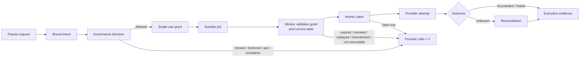
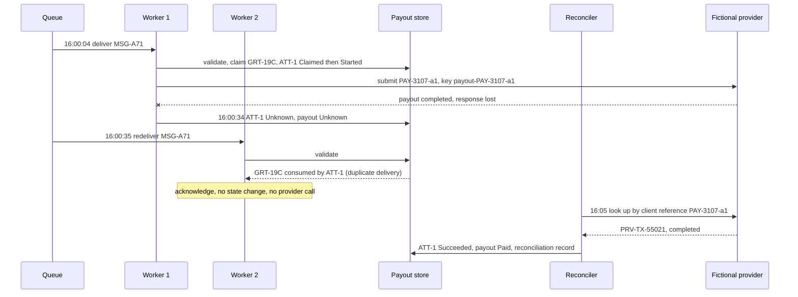

# Delayed Financial Payout and Ambiguous External Commit

**Learning objective:** Follow one delayed payout from an authenticated request through a bound intent, a governance decision, short-lived execution authority, durable job delivery, worker validation, an atomic claim, an external provider call, and reconciliation. Distinguish the historical decision, the execution authority, the claim, the provider attempt, the execution outcome, and the reconciliation evidence, so that an ambiguous provider timeout is resolved before anyone sends the payout again.

**Pattern classification:** General learning material

**Difficulty:** Advanced

**Prerequisites:** Recommended — [Capability-Scoped Background Operation](capability-scoped-background-operation.md), [Replay Protection and Bounded-Use Authority](../security/replay-protection-and-bounded-use.md), and [An Allowed Decision Does Not Mean the Operation Succeeded](../articles/2026/allowed-decision-does-not-mean-execution-succeeded.md). [Idempotency Does Not Prevent Authority Replay](../articles/2026/idempotency-does-not-prevent-authority-replay.md) and [How Short-Lived Execution Authority Differs from User Authorization](../articles/2026/short-lived-execution-authority-vs-user-authorization.md) support the identifier and authority sections.

**Estimated study time:** 45–60 minutes for the full case. The five-, ten-, and twenty-minute routes below cover the central distinctions first.

> **Scope.** This is architecture teaching material, not financial, banking, compliance, or payment-processing advice. The tenant, beneficiary, amounts, provider, and executor are fictional. The provider is a synthetic in-memory component. Nothing in this case connects to a bank, a payment provider, or any financial system, and it contains no credentials, account numbers, or provider-specific payment-flow details.

## Before You Begin

This case study uses one fictional operation:

```text
payout.submit
```

A finance clerk at a fictional tenant asks the platform to pay a supplier invoice. Policy allows the exact payout, but the platform does not call the payout provider inside the clerk's HTTP request. It releases payouts in a scheduled batch, so a background worker sends the payout hours later.

Keep these artifacts distinct throughout the study:

| Artifact | What it means | What it does not mean |
| --- | --- | --- |
| Payout request | What the clerk asked for, as an authenticated actor | That policy allows it |
| Bound payout intent | The exact payout: tenant, beneficiary, destination, amount, currency, purpose, payout-state version | That the payout is still executable later |
| Governance decision | What policy concluded about that exact intent, at that time | That money moved, or that a later worker may act indefinitely |
| Payout execution grant | Short-lived, single-use authority to submit this one payout | That a payout was sent, or that the queue message is trustworthy |
| Queue job | Transport that tells a worker there is work | Authority of any kind |
| Worker identity | Which service is presenting the grant | Permission to submit any payout |
| Claim | The atomic record that one worker, under one grant, owns one attempt | That the provider was called |
| Provider attempt | One request to the provider under one idempotency key | That the provider accepted or completed it |
| Execution outcome | What is known about the attempt: `Succeeded`, `Failed`, or `Unknown` | A change to the decision |
| Reconciliation evidence | What the provider's own records later established about an `Unknown` attempt | A new authorization |

The central distinctions are:

```text
Allowed decision
    ≠
Successful payout
```

```text
Idempotency
    ≠
Authority replay protection
```

```text
Ambiguous provider timeout after execution began
    → do not blindly re-execute
    → reconcile first
```

**Five-minute route:** read **At a Glance**, **The Scenario**, **Reconcile Before Any New Attempt**, and **The Simpler Alternative**.

**Ten-minute route:** add **Identifiers: One Per Question**, **Classify the Outcome by What the Provider Can Prove**, and the **Decision and Execution Matrix**.

**Twenty-minute route:** add **Atomically Claim the Grant and the Payout**, **Four Kinds of Retry**, **Idempotency Versus Authority Replay Protection**, and **What Makes a Payout Attempt Materially New**. The remaining sections cover authority issuance, worker validation, evidence, traces, tests, production adaptation, failure modes, tradeoffs, and review.

**About the code:** all C#, SQL, and pseudocode on this page is illustrative. Repositories, helpers, and some transitions are omitted, and none of it compiles as shown. The tests in **What the Tests Should Prove** describe the contract an implementation should meet; they are not a runnable companion.

## At a Glance

The lifecycle is:

```text
Authenticated payout request
    ↓
Bound payout intent
    ↓
Authoritative tenant / beneficiary / payout state
    ↓
Governance decision
    ↓
Allowed
    ↓
Short-lived payout execution grant
    ↓
Durable job delivery
    ↓
Worker authentication
    ↓
Grant + current-state validation
    ↓
Atomic claim / transition to Executing
    ↓
External payout attempt
    ↓
Observed success / deterministic failure / ambiguous timeout
    ↓
Execution evidence
    ↓
Reconciliation before any new attempt
```



The case preserves two invariants:

> **Every provider submission belongs to a durable attempt that was created by atomically consuming a matching grant, valid at claim time, and that the sending worker has confirmed as `Started` while it still owns the attempt.**

> **No new provider attempt starts while an earlier attempt for the same payout is `Unknown`. Reconciliation resolves it first.**

Neither invariant promises exactly-once payment. They promise something narrower and checkable: every blocked path makes zero provider calls, and every ambiguous path is resolved from evidence rather than by guessing.

---

## 1. The Scenario

**Tenant:** `T-0417`, payouts enabled, daily payout limit 50,000.00 EUR.

**Requester:** `clerk-22`, authenticated, member of the tenant's accounts-payable role, single-payout approval limit 10,000.00 EUR.

**Beneficiary:** `BEN-2208`, a supplier, verified, status `Active`. Its registered destination is `DST-77`, version 3. The platform stores the destination's provider-side token; no account number appears in the request, decision, grant, job, or evidence.

**Payout record before the request:**

```text
PayoutId:       PAY-3107
State:          Draft
Version:        6
```

**Request, at 09:58 UTC:**

```text
operation:      payout.submit
payout:         PAY-3107
beneficiary:    BEN-2208
destination:    DST-77
amount:         4,250.00
currency:       EUR
purpose:        supplier-invoice INV-9031
release:        16:00 UTC batch
```

The decision is `Allowed`. The platform issues grant `GRT-19C`, valid from 15:55 to 16:25 UTC, reserves 4,250.00 EUR against the tenant's daily limit, and moves the payout to `Approved`, version 7. At 16:00:04 a worker receives the job, validates the grant, claims it, and sends the payout to the fictional provider under client reference `PAY-3107-a1` and idempotency key `payout-PAY-3107-a1`. At 16:00:34 the call times out. The provider received the request and completed the payout, but the response never arrived.

The rest of the case explains why the platform does not send the payout again, and how it finds out that it already succeeded.

### Representative policy matrix

| Condition | Decision | Reason code |
| --- | --- | --- |
| Tenant payouts suspended | `Denied` | `tenant.payouts-suspended` |
| Beneficiary not verified or not active | `Denied` | `beneficiary.not-eligible` |
| Destination not registered to the beneficiary | `Denied` | `destination.not-registered` |
| Payout not in `Draft`, or version differs from the intent | `Denied` | `payout.not-submittable` |
| Paid plus reserved amounts plus this payout would exceed the daily tenant limit | `Denied` | `tenant.daily-limit` |
| Tenant, beneficiary, or payout record unavailable | `Deferred` | `context.unavailable` |
| Destination changed in the last 7 days | `AcknowledgmentRequired` | `destination.recently-changed` |
| Amount above the requester's approval limit | `EscalationRecommended` | `amount.above-requester-limit` |
| Otherwise | `Allowed` | `payout.allowed` |

The rules are illustrative. Real payout controls belong to the organization's finance, risk, and compliance owners, not to an architecture specimen.

---

## 2. Keep the Responsibilities Separate

| Concern | Owner in this case | Responsibility |
| --- | --- | --- |
| Architecture | Platform architecture | Where the decision, grant, queue, claim, provider call, and reconciliation boundaries sit; which records are authoritative |
| Implementation | Payments engineering | Intent binding, the side-effect-free policy, grant issuance, the worker's validation pipeline, the atomic claim, outcome classification, the reconciler |
| Operations | Payments operations | Batch schedules, queue health, the `Unknown` backlog, escalations that reconciliation cannot resolve |
| Security | Security engineering | Worker identity, custody of the provider credential, grant integrity, keeping account data out of messages and logs |
| Governance | Finance and risk policy owners | Payout policy, approval limits, acknowledgment and escalation rules, and when compensation is permitted |
| Execution | Payout executor | The only component that calls the provider, and only after a successful claim |

One service may implement several rows. What matters is that no row silently takes over another: the queue does not decide, the worker does not authorize, and the decision does not report what the provider did.

---

## 3. Identifiers: One Per Question

| Identifier | Example | Question it answers | Created by | Changes when |
| --- | --- | --- | --- | --- |
| `PayoutId` (the `OperationId`) | `PAY-3107` | Which logical payout is this, across every decision, attempt, and reconciliation? | Payout service, when the draft is created. Unique across every tenant that shares the platform's provider account | Never. A different payout is a different `PayoutId` |
| `CorrelationId` | `COR-8812` | Which end-to-end story does this record belong to? | API gateway, at the request | Never within the story. It groups; it does not authorize |
| `DecisionId` | `DEC-5530` | Which evaluation, under which facts and policy version, allowed this exact intent? | Policy evaluation | Every re-evaluation produces a new one |
| `GrantId` | `GRT-19C` | Which single-use authority is being presented, and has it been consumed? | Grant issuer, after `Allowed` | A new decision issues a new grant. A consumed grant is never reset |
| `JobId` / `MessageId` | `JOB-604` / `MSG-A71` | Which unit of queued work, and which delivery of it? | Outbox relay | A resubmission tool may create a new `MessageId`; that changes nothing about authority |
| `AttemptId` and attempt number | `ATT-1`, attempt 1 | Which claimed attempt, under which grant, produced which outcome? | The atomic claim creates the attempt. Its number is allocated atomically by the decision transaction and bound into the grant | Each claim creates one |
| Client reference | `PAY-3107-a1` | Which of *our* attempts does a provider record belong to? | Derived from `PayoutId` and attempt number, sent with the request | Per attempt, so a lookup can never confuse attempt 1 with attempt 2 |
| Provider idempotency key | `payout-PAY-3107-a1` | Has the provider already seen this exact request? | Derived deterministically from `PayoutId` and attempt number | Only for a materially new, newly authorized attempt |
| Provider reference | `PRV-TX-55021` | What does the provider call this payout? | The provider | Not ours to change |

In this specimen the idempotency key is derived from `PayoutId` and the authoritative attempt number, never from `CorrelationId`, `MessageId`, or `GrantId`. Each of those changes for reasons unrelated to whether the provider has already seen this request. Deterministic derivation is a design choice, not a universal rule: some providers recommend random keys, and every provider sets its own uniqueness scope, format, and retention. A production integration follows the provider's requirements. What must hold either way is that the key is fixed for the life of an attempt and recorded with it before the first send. [Idempotency Does Not Prevent Authority Replay](../articles/2026/idempotency-does-not-prevent-authority-replay.md#five-identifiers-five-questions) explains why one identifier doing several jobs is how a retry becomes a second payment.

---

## 4. Bind the Exact Payout Before Policy

The clerk's request names a payout. The platform does not evaluate the request body; it builds an intent from the authoritative payout record and the authenticated actor:

```csharp
public sealed record PayoutIntent(
    string PayoutId,
    string TenantId,
    string RequesterId,              // from authentication, not the body
    string BeneficiaryId,
    string DestinationId,
    int DestinationVersion,
    decimal Amount,
    string Currency,
    string Purpose,
    int PayoutVersion)                // the record version policy evaluates; not part of the fingerprint
{
    // Covers the material terms only: tenant, beneficiary, destination and its version,
    // amount, currency, and purpose. Excludes PayoutVersion, which changes when the
    // payout moves from Draft to Approved without changing what money moves where.
    public string TermsFingerprint => PayoutFingerprint.Compute(this);
}
```

If the request's beneficiary, destination, amount, or currency differs from the payout record, the request is rejected before policy runs. The client cannot propose one payout and have policy evaluate another.

Two different things are bound here, and they are kept apart:

- **The terms fingerprint** says *what* is being paid. It stays the same from request to claim unless the payout's terms change. It is computed over a canonical serialization: fixed field order, amounts as decimal strings at the currency's minor-unit scale, upper-case ISO currency codes, trimmed and normalized strings, and explicit markers for absent values. Two services that disagree about any of those produce different fingerprints for the same payout.
- **The record versions** say *which state* of the payout and destination a step relied on. The decision evaluated payout version 6. Approval moves it to version 7, and the grant expects version 7 at claim time. Any later edit, cancellation, or destination change moves a version and is detected without comparing every field by hand.

---

## 5. Authoritative Context and the Governance Decision

The policy rules are a pure function of the context. They perform no writes, calls, or notifications, and they do not read the clock or create identifiers; the observation time arrives in the context. The evaluator around them wraps the verdict in a decision record with its own `DecisionId` and evaluation time.

```csharp
public static class PayoutPolicy
{
    public const string Version = "payout-policy/2026.10";

    public static PayoutVerdict Evaluate(PayoutContext context)
    {
        if (context.Unavailable)
        {
            return Defer("context.unavailable");
        }

        PayoutIntent intent = context.Intent;

        if (context.Tenant.PayoutsSuspended)
        {
            return Deny("tenant.payouts-suspended");
        }

        if (context.Beneficiary is not { Verified: true, Status: BeneficiaryStatus.Active })
        {
            return Deny("beneficiary.not-eligible");
        }

        if (context.Destination.BeneficiaryId != intent.BeneficiaryId ||
            context.Destination.Version != intent.DestinationVersion)
        {
            return Deny("destination.not-registered");
        }

        if (context.Payout.State != PayoutState.Draft || context.Payout.Version != intent.PayoutVersion)
        {
            return Deny("payout.not-submittable");
        }

        // Reserved = amounts held by issued grants and active attempts not yet resolved.
        if (context.Tenant.PaidToday + context.Tenant.ReservedToday + intent.Amount > context.Tenant.DailyLimit)
        {
            return Deny("tenant.daily-limit");
        }

        if (context.ObservedAtUtc - context.Destination.ChangedAtUtc < TimeSpan.FromDays(7))
        {
            return RequireAcknowledgment("destination.recently-changed");
        }

        if (intent.Amount > context.Requester.ApprovalLimit)
        {
            return RecommendEscalation("amount.above-requester-limit");
        }

        return Allow("payout.allowed");
    }

    // Each helper returns a PayoutVerdict: the outcome, the reason code, and Version.
    // The evaluator adds DecisionId, evaluation time, the terms fingerprint,
    // the evaluated record versions, and the context observation times.
}
```

For `PAY-3107`, every check passes and the decision is `DEC-5530`, `Allowed`, reason `payout.allowed`, policy `payout-policy/2026.10`, terms fingerprint `fp-9b41`, evaluated payout version 6.

**One persistence sequence.** The decision is constructed first and then written in the **same local transaction** as everything an `Allowed` decision enables: the grant, the attempt-number allocation, the daily-limit reservation, the payout's move from `Draft` version 6 to `Approved` version 7, and the outbox row. The reservation is a conditional update on the tenant row that fails if paid plus reserved plus this amount would exceed the limit, so two payouts evaluated concurrently cannot both pass. A reservation belongs to the payout's release date in the tenant's settlement time zone, so a payout that completes after midnight, or is reconciled the next morning, still counts against the day it was released for. If the transaction does not commit, none of those records exists, and the clerk sees a failure to retry. A non-allowed decision is written alone, in its own transaction. Either way, no grant exists without a durable decision behind it.

Only `Allowed` continues. `Denied`, `Deferred`, `AcknowledgmentRequired`, and `EscalationRecommended` all stop here, with zero grants and zero provider calls. [Human Acknowledgment Workflow](human-acknowledgment-workflow.md) covers how an acknowledgment, once given, leads to a fresh decision rather than turning the pending one into `Allowed`.

---

## 6. Issue Short-Lived Payout Execution Authority

The decision is history. The worker that runs at 16:00 needs something narrower: authority to submit this one payout, once, in a short window.

```csharp
public sealed record PayoutGrant(
    string GrantId,
    string DecisionId,
    string PayoutId,
    string TenantId,
    string Operation,                 // "payout.submit"
    string Audience,                  // "payout-executor"
    string TermsFingerprint,
    int ExecutablePayoutVersion,      // 7: the Approved version the grant expects at claim time
    int AttemptNumber,                // 1: allocated in the decision transaction
    string PolicyVersion,
    DateTimeOffset NotBeforeUtc,
    DateTimeOffset ExpiresAtUtc,
    GrantState State);                // Issued, Consumed, Revoked, Expired
```

Every field comes from the decision and the intent, never from the request. The grant contains no provider credential, no destination token, and no user token. The clerk's session is not forwarded to the worker. [How Short-Lived Execution Authority Differs from User Authorization](../articles/2026/short-lived-execution-authority-vs-user-authorization.md#five-responsibilities-not-one-token) explains why.

The grant is stored by the issuer and looked up by `GrantId`. It is written in the decision transaction described above, so `GRT-19C` records `ExecutablePayoutVersion = 7` in the same commit that moves the payout to version 7.

The window, 15:55 to 16:25, covers the 16:00 batch and a short backlog. A payout that misses it does not run late on old authority; it waits for a fresh decision, and its daily-limit reservation is released when the grant expires.

**The grant's window governs admission, not every send.** The grant's window is checked when the worker claims it. Once the claim creates `ATT-1`, the attempt carries its own short send deadline, here five minutes after the claim. Every send for the attempt, including bounded resends and any recovery replay, happens before that deadline. After it, the attempt may only be reconciled. A consumed grant never admits a second attempt, whatever its window says.

**The provider enforces the deadline too.** A local deadline check cannot stop a worker that pauses after the check and sends later. So every request for the attempt carries the send deadline as an expiry, and the fictional provider documents that it rejects, with no effect, any request it receives after that expiry by its own clock, allowing a stated skew of 30 seconds. Once the deadline plus that skew has passed, no request for `ATT-1`, from a paused worker or a delayed network path, can still take effect. Reconciliation relies on that in **Reconcile Before Any New Attempt**. Where a real provider offers no request expiry and no durable cancellation, absence of a payout can never become final, and the payout stays `Unknown` until a person resolves it.

---

## 7. The Queue Message Is Transport

The decision record, grant, reservation, payout state change, and outbox row are written in one local transaction. A relay then publishes the job:

```json
{
  "messageId": "MSG-A71",
  "jobId": "JOB-604",
  "payoutId": "PAY-3107",
  "grantId": "GRT-19C",
  "correlationId": "COR-8812"
}
```

The message carries references, not facts. It does not carry the amount, destination, or beneficiary, because the worker must not trust them from the queue. If someone alters the message to point at a different payout, the grant lookup fails the binding check. If someone copies the message, the second copy meets a consumed grant.

The relay may publish the message more than once, the broker may deliver it more than once, and an operator's resubmission tool may republish it under a new `MessageId`. None of that changes what the worker is allowed to do. A new `MessageId` or `JobId` on its own is not evidence of misuse; it is what at-least-once delivery looks like.

> **A queue message tells a worker where to look. It never tells the worker what it may do.**

---

## 8. Worker Identity Is Presenter Identity

The worker authenticates to the platform with its own workload identity, `svc-payout-worker`. That identity answers *which service is presenting this grant*. It does not answer *may this payout be submitted*.

A worker that could submit any payout because of who it is would turn a stolen worker credential into a stolen treasury. Here, the worker can only present grants. The grant's audience is `payout-executor`, the component inside the worker host that holds the provider credential. A different service presenting `GRT-19C` is refused with `presenter.not-audience`.

The provider credential stays with the payout executor. It is acquired as late as possible, used only after a successful claim, and never written to messages, grants, or evidence.

---

## 9. The Worker Validation Pipeline

At 16:00:04 the worker receives `MSG-A71`. Before it may claim anything, it checks:

```csharp
public async Task<ValidationResult> ValidateAsync(PayoutJob job, WorkloadIdentity presenter, CancellationToken ct)
{
    DateTimeOffset now = clock.GetUtcNow();

    if (await grants.FindAsync(job.GrantId, ct) is not { } grant)                    return Refuse("grant.unknown");
    if (grant.PayoutId != job.PayoutId)                                               return Refuse("binding.mismatch");
    if (grant.Operation != "payout.submit" || !audiences.Accepts(grant.Audience, presenter))
                                                                                      return Refuse("presenter.not-audience");
    if (grant.State == GrantState.Revoked)                                            return Refuse("grant.revoked");
    if (grant.State == GrantState.Consumed)                                           return Refuse("grant.consumed");
    if (now < grant.NotBeforeUtc || now >= grant.ExpiresAtUtc)                        return Refuse("grant.expired");

    // Current state, not the state at decision time.
    PayoutContext current = await contexts.BuildCurrentAsync(grant.PayoutId, ct);

    // Checked before any field is read. Not a refusal of the grant: the job is
    // redelivered later and validated again while the grant is still in its window.
    if (current.Unavailable)                                                          return Postpone("context.unavailable");

    if (current.Payout.State != PayoutState.Approved ||
        current.Payout.Version != grant.ExecutablePayoutVersion)                      return Refuse("payout.not-executable");
    if (PayoutFingerprint.Compute(current.Intent) != grant.TermsFingerprint)         return Refuse("binding.mismatch");

    // Current policy: would this exact payout still be allowed now?
    // Same rules as Evaluate, except the payout is expected to be Approved, this payout's
    // own reservation is not counted twice, and requester facts (role, approval limit)
    // are the ones captured in the decision rather than re-read.
    PayoutVerdict recheck = PayoutPolicy.EvaluateForExecution(current);
    if (recheck.Outcome != PayoutOutcome.Allowed)                                    return Refuse("policy.no-longer-allows", recheck);

    // The versions this validation relied on. The claim transaction fences on them.
    return ValidationResult.Valid(grant, current.Versions);
}
```

Five points matter:

- **A consumed grant is refused, and then classified for evidence.** The provider is never called. If the grant's consuming attempt belongs to this same payout and binding, the delivery is recorded as a duplicate and acknowledged with no state change, whatever its `JobId` or `MessageId`. A consumed grant presented by a service outside its audience, or bound to a different payout, is already refused earlier and is the security signal worth alerting on.
- **Current state is rebuilt, not trusted from the decision.** Between 09:58 and 16:00 the payout might have been cancelled, the beneficiary suspended, or the destination changed. Each one changes a version or a state, and each one is refused.
- **Current policy is rechecked for these exact terms.** A rule that would now deny, such as a tenant suspended at 14:00, refuses the grant. A rule that would now require acknowledgment or escalation also refuses it, because the original decision no longer reflects current facts.
- **Requester facts are deliberately not rechecked.** The clerk acted at 09:58 and is not acting at 16:00, so the decision's record of their role and approval limit stands. A host that wants a later entitlement change to stop queued payouts either adds a requester entitlement version to the claim fence or revokes the clerk's outstanding grants when their entitlements change. Either is a valid choice; leaving it unstated is not.
- **Unavailable context postpones; it never allows.** The grant is not consumed, so a later delivery inside the window can still validate it. If the window closes first, the grant expires unused.

None of these refusals asks for new authority automatically. A refused grant stays refused, and the payout waits for a fresh decision.

Validation is a read, and reads go stale. The next section makes the claim fence on what validation read, so a change that lands between the two is caught. [Capability-Scoped Background Operation](capability-scoped-background-operation.md#17-freshness-model-rebuild-current-context-before-claim) discusses the freshness model and its availability cost in more depth.

---

## 10. Atomically Claim the Grant and the Payout

Validation is a read. Two workers can both pass it for the same grant, and the facts it read can change before either acts. The claim is the write that only one worker can win, and it re-asserts everything validation relied on:

```sql
-- SERIALIZABLE, or REPEATABLE READ plus shared locks on the context rows
-- (for example SELECT ... FOR SHARE), so a concurrent change to any fenced row
-- either commits first and fails a check below, or waits until this commits.
BEGIN TRANSACTION;

-- Context fence: every mutable input held in this store that the policy recheck
-- re-reads, at the version it read. Requester facts are captured at decision time
-- and deliberately not re-read; see the validation pipeline.
-- SettingsVersion changes with policy-relevant tenant settings, not with the
-- paid/reserved counters, so other payouts' reservations do not roll this claim back.
SELECT 1 FROM Tenants        WHERE TenantId      = @tenantId      AND SettingsVersion = @tenantSettingsVersion AND PayoutsSuspended = 0;
SELECT 1 FROM Beneficiaries  WHERE BeneficiaryId = @beneficiaryId AND Version = @beneficiaryVersion AND Status = 'Active';
SELECT 1 FROM Destinations   WHERE DestinationId = @destinationId AND Version = @destinationVersion;
SELECT 1 FROM PolicyReleases WHERE Operation = 'payout.submit' AND CurrentVersion = @policyVersion;
-- each must return exactly 1 row

UPDATE PayoutGrants
SET    State = 'Consumed', ConsumedAtUtc = @now, ConsumedBy = @workerId
WHERE  GrantId = @grantId AND State = 'Issued'
  AND  NotBeforeUtc <= @now AND ExpiresAtUtc > @now;   -- @now from the database clock
-- must affect exactly 1 row

UPDATE Payouts
SET    State = 'Executing', Version = Version + 1, ActiveAttemptId = @attemptId,
       LeaseEpoch = LeaseEpoch + 1, LeaseExpiresAtUtc = @leaseExpiry
WHERE  PayoutId = @payoutId AND State = 'Approved' AND Version = @executablePayoutVersion;
-- must affect exactly 1 row

INSERT INTO PayoutAttempts (AttemptId, PayoutId, GrantId, DecisionId, AttemptNumber,
                            ClientReference, IdempotencyKey, State, ClaimedAtUtc,
                            SendDeadlineUtc, LeaseEpoch)
VALUES (@attemptId, @payoutId, @grantId, @decisionId, @attemptNumber,
        'PAY-3107-a1', 'payout-PAY-3107-a1', 'Claimed', @now,
        @sendDeadline, @leaseEpoch);

COMMIT;  -- ROLLBACK if any check returned 0 rows or any update affected 0 rows
```

If any check fails, the whole transaction rolls back and the worker makes no provider call. The loser of a race sees `claim.lost`; on inspection, its delivery is a duplicate of work the winner owns. The daily limit needs no check here, because this payout's amount was already reserved when the grant was issued.

**What the fence guarantees, and where it stops.** The claim's commit is the point at which the platform decides. Every fenced fact was current at that instant. A beneficiary suspension or policy release that commits *after* the claim does not recall a payout already in `Executing`; stopping an in-flight payout is a separate operation. That boundary is deliberate and stated, not accidental.

The fence covers only facts held in the same store. If a fact comes from an external system, such as a sanctions list or a separate risk service, the claim cannot lock it. For those, state the permitted staleness instead, for example "observed no more than 60 seconds before the claim", record the observation time with the attempt, and accept that changes inside that window are outside the guarantee. Promising "current" for a fact the transaction cannot see would overstate the design.

**A lost commit acknowledgment is not a lost claim.** The connection can fail while `COMMIT` is in flight, so the worker sees an exception even though the claim committed. The rule is simple: if the worker cannot confirm that its claim committed, it does not send. It acknowledges nothing, lets the job be redelivered or swept, and recovery reads the durable state. If the grant shows `Consumed` by this worker's attempt, that attempt is still `Claimed`, which provably sent nothing, and the sweeper handles it as below. A confirmed `claim.lost` and an unknown claim outcome lead to the same action, which is not to send, but they are recorded differently. [Connection resiliency in EF Core](https://learn.microsoft.com/en-us/ef/core/miscellaneous/connection-resiliency#transaction-commit-failure-and-the-idempotency-issue) describes this commit-failure window.

**Leases reduce overlap; they do not prevent it.** The lease is longer than the provider call's timeout, so a slow but live worker is usually not swept while it waits. A worker paused by the scheduler or a long garbage collection can still outlive its lease. When a lease lapses, a recovery sweeper takes ownership by incrementing `LeaseEpoch`, and every later write from the original worker is conditional on the epoch it held. The epoch fences writes. It cannot fence a request the paused worker already sent, or one it sends after waking, because the provider never sees the epoch. [Idempotency Does Not Prevent Authority Replay](../articles/2026/idempotency-does-not-prevent-authority-replay.md#reconciliation-and-what-makes-an-attempt-new) and Martin Kleppmann's [How to do distributed locking](https://martin.kleppmann.com/2016/02/08/how-to-do-distributed-locking.html) explain both limits.

---

## 11. Classify the Outcome by What the Provider Can Prove

Before sending, the executor moves the attempt from `Claimed` to `Started` in a durable write. That ordering gives the platform one fact it would otherwise lack: an attempt still in `Claimed` never reached the provider. That fact holds only under four conditions, and each is part of the design:

- the executor sends only after the `Started` write is **confirmed** committed;
- the `Started` write is conditional on the attempt being `Claimed`, the lease epoch the worker holds, the lease not having expired, and the send deadline not having passed;
- a worker whose `Started` write fails, or whose outcome it cannot confirm, does not send;
- the sweeper fences the old worker by incrementing the epoch **before** it treats a `Claimed` attempt as `NotStarted`, so the old worker's `Started` write can no longer succeed.

These are local checks. They decide whether *this* worker may send, but a worker that pauses after passing them can still send later; only the provider-enforced expiry from **Issue Short-Lived Payout Execution Authority** bounds that.

An attempt found in `Started` is different. The worker may have sent, may be paused and about to send, or may never have sent. Local state cannot tell, so a `Started` attempt whose lease lapsed becomes `Unknown`, never `NotStarted`. Only reconciliation can later resolve it, and only after its request expiry has passed can that resolution be `NotApplied`.

```csharp
if (!await attempts.TryMarkStartedAsync(attempt.AttemptId, attempt.LeaseEpoch, ct))
{
    // Write refused, or its commit could not be confirmed: do not send.
    return AttemptResult.NotSent("start.unconfirmed");
}

ProviderResponse response;
try
{
    response = await provider.SubmitPayoutAsync(
        new ProviderPayoutRequest(
            ClientReference: attempt.ClientReference,          // PAY-3107-a1
            IdempotencyKey: attempt.IdempotencyKey,            // payout-PAY-3107-a1
            ExpiresAtUtc: attempt.SendDeadlineUtc,             // provider rejects it after this
            DestinationToken: current.Destination.ProviderToken,
            Amount: current.Intent.Amount,
            Currency: current.Intent.Currency),
        ct);
}
catch (Exception ex) when (ex is TimeoutException or HttpRequestException or TaskCanceledException)
{
    // The caller's token may already be cancelled. Record with a separate, bounded token;
    // if this write also fails, the lease lapses and the sweeper records Unknown.
    using CancellationTokenSource recordTimeout = new(TimeSpan.FromSeconds(10));
    return await attempts.RecordAsync(attempt, AttemptState.Unknown, "provider.no-response", recordTimeout.Token);
}

return await attempts.RecordAsync(attempt, OutcomeClassifier.Classify(response), ct);
```

The classifier uses the provider's documented semantics, not the HTTP status alone:

| Observation | Attempt state | Payout state | Why |
| --- | --- | --- | --- |
| The worker stopped before writing `Started`: credential unavailable, request invalid. The attempt is durably `Claimed` and the old owner is fenced | `NotStarted`, through the recovery transition | Back to `Approved`, with a new version, awaiting fresh authority | Under the conditions above, nothing was sent. The grant is consumed, so a new attempt needs a new grant |
| The `Started` write was refused, or its commit could not be confirmed | Not classified by the caller, which does not send | Unchanged until recovery reads durable state | An unconfirmed write may have committed. It proves only that this caller did not send |
| Recovery finds the attempt `Started` with its lease lapsed | `Unknown` | `Unknown` | Someone may have sent, or may still send before the expiry |
| Provider reports a rejection it documents as no-effect, for example `destination_closed` | `Failed` | `Failed` | The provider said the payout did not happen. Resending fails the same way |
| Provider reports a transient rejection it documents as no-effect, for example rate limiting | `Started`, with a recorded send failure | `Executing` | A bounded resend inside the same attempt, same key and parameters, is allowed before the attempt's send deadline |
| Provider accepted the request for asynchronous processing | `Started` | `Executing` | Accepted is not completed. Wait for a status check or notification |
| Provider reports completion | `Succeeded` | `Paid` | The provider's contract establishes the effect |
| Timeout, reset, crash after `Started`, or an error not documented as no-effect | `Unknown` | `Unknown` | The provider may have completed the payout. Nobody can yet say |

The daily-limit reservation follows the outcome: it becomes part of the paid total on `Succeeded`, is released on `NotStarted`, `Failed`, or `NotApplied`, and stays held while the attempt is `Claimed`, `Started`, or `Unknown`. Each release happens in the same transaction that records the attempt's resolution and clears the payout's active attempt, so a reservation can never be released while an attempt is still live.

`Failed` here means the provider affirmatively reported that the payout did not happen. A system that uses `Failed` more broadly must still represent "we do not know" separately. [An Allowed Decision Does Not Mean the Operation Succeeded](../articles/2026/allowed-decision-does-not-mean-execution-succeeded.md#illustrative-execution-states) explains these states, which are illustrative rather than a required enum.

**The decision does not change in any row.** When the provider rejects `PAY-3107` with `destination_closed`, `DEC-5530` remains `Allowed`. It was a correct answer to the facts available at 09:58. Rewriting it to `Denied` would erase why the platform acted and make the failure look like a policy refusal.

---

## 12. Execution Evidence Is Separate From the Decision

| Record | Written | Contents | Mutable? |
| --- | --- | --- | --- |
| Decision | 09:58, in the decision transaction | `DEC-5530`, outcome, reason, policy version, terms fingerprint, evaluated record versions, context observation times | Never |
| Grant | 09:58, with the decision | `GRT-19C`, bindings, window, state | State only: `Issued` → `Consumed`, `Revoked`, or `Expired` |
| Claim and attempt | 16:00:04, in the claim transaction | `ATT-1`, grant, decision, worker, idempotency key, lease epoch | State transitions only, each conditional on the lease epoch |
| Send started | 16:00:04, before the provider call | `ATT-1` → `Started`, time | Once |
| Provider observation | When a response, notification, or lookup arrives | Provider reference, provider status, provider reason code | Append-only |
| Reconciliation | When an `Unknown` attempt is resolved | Method, provider evidence, resulting state, who or what resolved it | Append-only |

Evidence records identifiers, amounts, currency, and provider reason codes. It does not record destination tokens, account details, provider credentials, or raw provider payloads. [Secure Logging Across Trust Boundaries](../security/secure-logging-across-trust-boundaries.md) covers keeping evidence useful without making it a store of sensitive data.

Two kinds of record appear in that table. **History** is append-only: the decision, every provider observation, every reconciliation, and an entry for every state transition. **Projections**, the grant and attempt rows, carry current state and change only through the conditional transitions shown in this case, each of which also appends to history. Auditors rely on history; workers act on projections.

Evidence also needs an owner and rules: how long each history record is kept, who may read it, and that nobody can edit or delete it within that period, including the services that wrote it. Those periods and access rules come from the organization's finance, audit, and legal owners. This case only requires that they exist and that they are enforced by the store rather than by convention.

---

## 13. Reconcile Before Any New Attempt

At 16:00:34 `ATT-1` is `Unknown`. The provider received the request and completed the payout as `PRV-TX-55021`, but the platform does not know that yet.



The reconciler does not hold a grant and does not need one, because it never submits a payout. It only asks the provider what happened to this exact attempt:

```text
for each attempt in Unknown, oldest first, at a controlled rate:
    query the provider with the strongest non-mutating lookup it supports for this attempt
    (here: client reference PAY-3107-a1)
        found → first verify provider account, tenant mapping, destination, amount, and currency
                match the attempt; on any mismatch, escalate
        found, completed          → Succeeded; record provider reference
        found, rejected           → Failed; record provider reason
        found, still processing   → leave Unknown; check again later
        not found                 → leave Unknown, unless BOTH:
                                    (1) the provider explicitly guarantees that a payout not visible
                                        after its stated processing window was never accepted, and
                                        that window has passed; and
                                    (2) the attempt's request expiry plus the provider's skew
                                        allowance has passed, so no paused worker or delayed request
                                        can still apply it
                                    then NotApplied
    cannot tell, or past the escalation deadline → escalate to payments operations; never resend
```

Four cautions shape that loop:

- **Look up the attempt, not the payout.** Once a payout has two attempts, the provider may hold a rejection for one and a completion for the other. A lookup by `PayoutId` alone could resolve attempt 2 with attempt 1's record. The client reference, provider reference, or idempotency key ties the provider's record to one attempt, and the amount, currency, destination, and account checks confirm it is the right one.
- **Use what the provider actually offers.** Lookup by client reference is convenient but not universal. Depending on the provider, the strongest non-mutating evidence may be a provider reference, a merchant reference, an idempotency-result query, a settlement record, or a verified asynchronous notification. The fictional provider here supports client-reference lookup; a real integration uses whatever its provider documents.
- **"Not found" stays `Unknown` by default.** A lookup can lag behind writes, and a request still in flight may not be visible. Even a decisive "never accepted" only describes the past: a worker paused after confirming `Started` could wake and send the original request after the lookup, and if attempt 2 had been authorized by then, both could pay. `NotApplied` therefore needs two facts: the provider's guarantee that nothing was accepted, and the provider-enforced expiry that stops anything for this attempt from being accepted later. A processing window alone is not enough. Without both, absence is not evidence, and a person decides.
- **A return is not a rejection.** A payout the provider completed and the beneficiary's bank later returned *was* submitted and *did* complete. The attempt is `Succeeded`, and the return is a separate, later lifecycle event recorded on the payout, with its own handling. Recording it as `Failed` would erase the fact that money moved.

Lookup-first is the conservative choice made in this case, not the only legitimate one. Some providers document that repeating the original request, with the original key and identical parameters, is safe after a network error and returns the original result while the key is retained. Where that contract exists, a same-key replay is a valid recovery action. It is not a read: if the original request never arrived, the replay *is* the payout. So it belongs to a recovery component with explicit permission to resend within the original attempt, before the attempt's send deadline, and never to the read-only reconciler. The provider's documentation says when a same-key repeat is safe; the platform's own policy says who may perform one and until when. In this case that window is the send deadline, which the provider also enforces, so a recovery replay cannot reopen an attempt that reconciliation is about to close. Its response resolves the attempt only if it actually establishes the outcome.

**Schedule and backlog.** The reconciler runs on a timer, here every minute, with each `Unknown` attempt checked on an increasing backoff, for example 1, 2, 5, and 15 minutes, at a rate the provider's limits allow. Each attempt also has an escalation deadline, here 60 minutes or the end of the provider's documented processing window, whichever is later. When the backlog grows faster than the reconciler drains it, the rate stays bounded and the oldest attempts are escalated first; the backlog is an operations signal, not a reason to start resending. These timings are illustrative parameters of the fictional provider integration, not recommended payment-processing defaults.

At 16:05 the reconciler finds `PRV-TX-55021` under `PAY-3107-a1`, completed, with the expected account, amount, currency, and destination. `ATT-1` becomes `Succeeded`, `PAY-3107` becomes `Paid`, and the redelivery at 16:00:35 is explained: it was a duplicate of work that had already succeeded. Nothing was sent twice.

If the provider's late response or notification reaches the platform first, it may resolve `ATT-1` through the same narrow evidence write, conditional on the attempt still being `Unknown`. It records what happened to a request already sent; it does not restore any worker's ownership.

---

## 14. Four Kinds of Retry

"Retry" names four different actions here, and a fifth action looks like one. Each has its own permission.

| Action | What repeats | Needs new authority? | Allowed while an attempt is `Unknown`? |
| --- | --- | --- | --- |
| Delivery retry | The broker redelivers, or an operator resubmits, the same job | No. The worker validates; a consumed grant makes it a duplicate | Yes. It makes no provider call |
| Execution retry | A resend inside the same claimed attempt, with the same key and parameters, after a documented no-effect rejection and before the send deadline | No. It is part of `ATT-1` | No. The attempt must not be `Unknown` |
| Reconciliation | A non-mutating provider lookup | No. It cannot move money | Yes. This is how `Unknown` is resolved |
| Recovery replay | The original request, same key and parameters, where the provider documents that a repeat is safe, before the attempt's send deadline | No new grant, but an explicit recovery permission held by a separate component. If the original never arrived, the replay *is* the payout | Yes, only under those conditions, and only for the original attempt |
| Authorization retry | A new decision and a new grant, for a materially new attempt | Yes. Fresh context, fresh decision, fresh grant | No. Reconciliation first |

The common bug is letting a generic resilience policy perform an execution retry after a timeout. A timeout is not a documented no-effect rejection. [Capability-Scoped Background Operation](capability-scoped-background-operation.md#27-operational-retry-versus-authorization-retry) separates operational and authorization retries in a longer worked case.

---

## 15. Idempotency Versus Authority Replay Protection

Both mechanisms protect `PAY-3107`. They answer different questions.

**Authority replay protection** answers: *has this grant already been used?* It keys on `GrantId`, lives in the platform's database, and is enforced by the atomic claim. It stops a copied message, a second worker, or a stolen grant from starting a second attempt. It does not know what the provider did.

**Provider idempotency** answers: *has the provider already seen this request?* It keys on `payout-PAY-3107-a1`, lives in the provider's system, and lasts as long as the provider's retention period says. It stops a resent request from paying twice. It does not know whether the authority behind the request was valid, and it does not cover a request sent under a different key.

Each one fails without the other:

- With only idempotency, a replayed grant presented after the provider's key retention expires can produce a second payout, and nothing in the platform notices the reused authority.
- With only replay protection, an execution retry after the timeout sends the same payout again, and the platform's single-use grant has nothing to say about it.

Even together they do not make the payout exactly once. No transaction spans the platform's database and the provider's ledger. The moment between "the provider completed the payout" and "the platform recorded it" always exists, and a lost response inside it produces `Unknown`. What this design can honestly claim is narrower: duplicate payouts are prevented within these stated boundaries, and every case outside them surfaces as `Unknown` and is reconciled before anything else is sent. [Replay Protection and Bounded-Use Authority](../security/replay-protection-and-bounded-use.md#replay-resistance-is-not-exactly-once-execution) describes the same limit for consumed authority.

---

## 16. What Makes a Payout Attempt Materially New

Suppose reconciliation had proven `NotApplied`: the provider explicitly guarantees that a payout not visible after its processing window was never accepted, the window has passed, the payout does not exist, and `ATT-1`'s request expiry has passed, so no late request for it can still be accepted. The invoice is still unpaid, and `PAY-3107` is back in `Approved` with no active attempt. Sending it again is a **materially new attempt**, not a retry of `ATT-1`. It needs:

- **A current decision.** A reauthorization request re-evaluates `PAY-3107` under current facts, producing `DEC-5544`. The policy's state precondition differs from a first submission: instead of `Draft`, it requires `Approved` with no active attempt and no attempt in `Started` or `Unknown`. The beneficiary may have been suspended, the tenant's daily limit may be used up, or the invoice may have been paid another way.
- **New authority.** `GRT-1A2`, bound to the new decision, the payout's new version, and attempt 2. `GRT-19C` stays consumed forever.
- **An attempt number allocated atomically.** The decision transaction increments the payout's attempt counter, so two concurrent reauthorizations cannot both obtain attempt 2.
- **A new attempt.** `ATT-2`, with client reference `PAY-3107-a2`, permitted only because `ATT-1` reached a terminal state.
- **A key chosen from the provider's documented semantics.** If the provider returns the saved result of the first request under a key, attempt 2 needs `payout-PAY-3107-a2`. The attempt number comes from the new decision, not from the worker.

An attempt is also materially new when the amount, currency, beneficiary, destination, or purpose would differ, when the earlier attempt `Failed` and someone wants to try again anyway, or when the grant behind it is consumed, expired, or revoked.

> **Never change the idempotency key to get past an outcome that has not been resolved.** A new key is justified only after reconciliation proves the earlier attempt had no effect and a new decision authorizes another one.

---

## 17. Compensation and Reversal Are Separate Operations

If `PAY-3107` was paid in error, perhaps because invoice `INV-9031` was a duplicate, the answer is not to edit the payout to `Cancelled` or to rewrite `DEC-5530`.

A reversal or recall is a separate consequential operation, for example `payout.recall`, with its own request, its own decision, its own authority, and its own attempts and outcomes. It may require different approvers, and the provider may not support it at all, or only within a window. A recall that fails or becomes `Unknown` is reconciled the same way.

The original payout's records stay as they are. The recall links to them. [An Allowed Decision Does Not Mean the Operation Succeeded](../articles/2026/allowed-decision-does-not-mean-execution-succeeded.md#compensation-is-another-operation) explains why compensation cannot always restore the original state.

---

## 18. Decision and Execution Matrix

| Scenario | Decision | Grant / validation | Claim | Provider calls | Attempt outcome | Payout state |
| --- | --- | --- | --- | ---: | --- | --- |
| Valid payout, provider completes | `Allowed` | valid | won | 1 | `Succeeded` | `Paid` |
| Tenant payouts suspended | `Denied` | none | — | 0 | none | `Draft` |
| Beneficiary not verified | `Denied` | none | — | 0 | none | `Draft` |
| Context unavailable | `Deferred` | none | — | 0 | none | `Draft` |
| Second payout would exceed the daily limit once the first one's reservation is counted | `Denied` (`tenant.daily-limit`) | none | — | 0 | none | `Draft` |
| Destination recently changed | `AcknowledgmentRequired` | none | — | 0 | none | `Draft` |
| Amount above requester's limit | `EscalationRecommended` | none | — | 0 | none | `Draft` |
| Job delivered after grant expiry | historical `Allowed` | refused `grant.expired` | — | 0 | none | `Approved`, awaiting fresh decision |
| Grant revoked by a finance hold | historical `Allowed` | refused `grant.revoked` | — | 0 | none | `Approved`, on hold |
| Consumed grant presented again under a new job or message ID | historical `Allowed` | refused `grant.consumed`, recorded as duplicate | — | 0 | none | unchanged |
| Context unavailable at the worker | historical `Allowed` | postponed `context.unavailable` | not attempted | 0 | none | `Approved`; revalidated on redelivery while the grant is valid |
| Message altered to point at another payout | historical `Allowed` | refused `binding.mismatch` | — | 0 | none | unchanged |
| Grant presented by a different service | historical `Allowed` | refused `presenter.not-audience` | — | 0 | none | unchanged |
| Payout cancelled after the decision | historical `Allowed` | refused `payout.not-executable` | — | 0 | none | `Cancelled` |
| Destination changed after the decision | historical `Allowed` | refused `payout.not-executable` | — | 0 | none | `Approved`, version changed |
| Tenant suspended after the decision | historical `Allowed` | refused `policy.no-longer-allows` | — | 0 | none | `Approved` |
| Beneficiary suspended between validation and claim | historical `Allowed` | valid when read | context fence fails, rolled back | 0 | none | `Approved` |
| Two workers race for one grant | `Allowed` | both valid | one wins, one `claim.lost` | 1 in total | winner's outcome | winner's outcome |
| Claim commits but its acknowledgment is lost | `Allowed` | valid | committed, unconfirmed; worker does not send | 0 | `Claimed`, then `NotStarted` after the sweeper fences | Back to `Approved`, awaiting fresh authority |
| Redelivery after the claim | `Allowed` | duplicate delivery | — | 0 additional | unchanged | unchanged |
| Provider credential unavailable before send | `Allowed` | valid | won | 0 | `NotStarted` | Back to `Approved`, awaiting fresh authority |
| Provider rejects: destination closed | `Allowed`, unchanged | valid | won | 1 | `Failed` | `Failed` |
| Provider rate-limits, documented no-effect | `Allowed` | valid | won | 1 per send, bounded | outcome of the final send | per that outcome |
| Provider times out after accepting | `Allowed` | valid | won | 1 | `Unknown` | `Unknown` |
| Reconciliation finds the payout completed | `Allowed` | — | — | 0 additional | `Succeeded` | `Paid` |
| Reconciliation finds a record whose amount or destination does not match the attempt | `Allowed` | — | — | 0 additional | `Unknown`, escalated | `Unknown` |
| Reconciliation proves not applied, under an explicit provider guarantee, after the attempt's request expiry | `Allowed` | — | — | 0 additional | `NotApplied` | `Approved`, awaiting fresh decision |
| Reconciliation cannot tell | `Allowed` | — | — | 0 additional | `Unknown`, escalated | `Unknown` |

The decision column never changes after it is written. Many rows have a historical `Allowed` decision and still make no provider call: a past decision is not current execution permission, and the claim succeeds only if the grant and the current execution conditions still hold.

---

## 19. Invariant Traces

### Trace A: Non-allowed decision

```text
DEC for PAY-3107: EscalationRecommended (amount.above-requester-limit)
grant issued:     no
job published:    no
provider calls:   0
```

The same trace holds for `Denied`, `Deferred`, and `AcknowledgmentRequired`.

### Trace B: Expired, revoked, replayed, or mismatched grant

```text
16:31:10  worker receives MSG-A71 after a broker outage
          GRT-19C ExpiresAtUtc 16:25:00
          validation: grant.expired
          claim:          not attempted
          provider calls: 0
          payout:         Approved, awaiting a fresh decision
```

A revoked grant, a consumed grant presented again, a message pointing at another payout, and a grant presented by another service follow the same shape with their own reason codes.

### Trace C: Payout no longer executable

```text
14:12     clerk-22 cancels PAY-3107; payout → Cancelled, version 8
16:00:04  worker validates GRT-19C (expects version 7)
          validation: payout.not-executable
          provider calls: 0
          DEC-5530 remains Allowed
```

### Trace D: Claim lost

```text
16:00:04.120  worker A validates GRT-19C: valid
16:00:04.125  worker B validates GRT-19C: valid
16:00:04.131  worker A claims: context fence 4/4, grant row 1, payout row 1 → commit, ATT-1
16:00:04.133  worker B claims: context fence 4/4, grant row 0 → rollback, claim.lost
              worker B provider calls: 0
              total provider calls:    1
```

The same shape holds when the context changed between validation and claim:

```text
16:00:04.120  worker A validates GRT-19C: valid (beneficiary version 4)
16:00:04.126  risk team suspends BEN-2208 → beneficiary version 5, commits
16:00:04.131  worker A claims: beneficiary fence 0 rows → rollback, claim.context-changed
              provider calls: 0
```

### Trace E: Deterministic provider rejection

```text
16:00:05  provider: rejected, code destination_closed (documented no-effect)
          ATT-1:    Failed
          PAY-3107: Failed
          DEC-5530: Allowed (unchanged)
          automatic resend: none
```

### Trace F: Ambiguous timeout

```text
16:00:04  ATT-1 Started, key payout-PAY-3107-a1
16:00:34  no response
          ATT-1:    Unknown
          PAY-3107: Unknown
          new attempt:     blocked
          new grant:       not requested
          provider calls:  1
```

### Trace G: Reconciliation confirms success

```text
16:05:00  reconciler looks up client reference PAY-3107-a1
          provider: PRV-TX-55021, completed
          account, amount, currency, destination: match ATT-1
          ATT-1:    Succeeded
          PAY-3107: Paid
          provider submit calls in total: 1
```

---

## 20. What the Tests Should Prove

The C# on this page is illustrative and is not a runnable companion. These tests are the contract an implementation, or a future executable sample, should prove. Each blocked path asserts the reason **and** that the synthetic provider was never called.

```csharp
[Theory]
[MemberData(nameof(BlockedBeforeProvider))]
public async Task Every_blocked_path_makes_zero_provider_calls(PayoutScenario scenario)
{
    PayoutHarness harness = PayoutHarness.For(scenario);

    PayoutRunResult result = await harness.RequestAndRunAsync();

    Assert.Equal(scenario.ExpectedReasonCode, result.StoppingReasonCode);
    Assert.Equal(0, harness.Provider.SubmitCalls);
}

[Fact]
public async Task Deterministic_rejection_leaves_the_decision_Allowed()
{
    PayoutHarness harness = PayoutHarness.For(PayoutScenario.Valid);
    harness.Provider.RejectNextWith("destination_closed");

    PayoutRunResult result = await harness.RequestAndRunAsync();

    Assert.Equal(PayoutOutcome.Allowed, harness.Decisions.Single().Outcome);
    Assert.Equal(AttemptState.Failed, result.Attempt!.State);
    Assert.Equal(1, harness.Provider.SubmitCalls);
}

[Fact]
public async Task Timeout_after_acceptance_is_Unknown_and_blocks_a_second_payout()
{
    PayoutHarness harness = PayoutHarness.For(PayoutScenario.Valid);
    harness.Provider.CompleteButLoseResponse();

    await harness.RequestAndRunAsync();
    await harness.RedeliverLastJobAsync();
    await harness.TryStartNewAttemptAsync();

    Assert.Equal(AttemptState.Unknown, harness.Attempts.Single().State);
    Assert.Equal(1, harness.Provider.SubmitCalls);
    Assert.Single(harness.Provider.CompletedPayouts);
}

[Fact]
public async Task Reconciliation_confirms_success_without_a_duplicate_payout()
{
    PayoutHarness harness = PayoutHarness.For(PayoutScenario.Valid);
    harness.Provider.CompleteButLoseResponse();
    await harness.RequestAndRunAsync();

    await harness.Reconciler.RunOnceAsync();

    Assert.Equal(AttemptState.Succeeded, harness.Attempts.Single().State);
    Assert.Equal(PayoutState.Paid, harness.Payouts.Get("PAY-3107").State);
    Assert.Equal(1, harness.Provider.SubmitCalls);
    Assert.Equal(1, harness.Provider.LookupCalls);
}
```

Additional tests should prove that:

- concurrent claims on one grant produce exactly one attempt and one provider call;
- a beneficiary, destination, tenant, or policy change committed between validation and claim rolls the claim back with zero provider calls;
- two payouts evaluated concurrently cannot together exceed the tenant's daily limit;
- a claim whose commit acknowledgment is lost produces no send, and recovery resolves the attempt from durable state;
- an attempt left in `Claimed` is classified `NotStarted` only after the sweeper fences the old worker, and one left in `Started` is classified `Unknown`;
- a worker whose `Started` write is refused or unconfirmed does not send;
- a generic resilience policy does not resend after a timeout, and no resend happens after the attempt's send deadline;
- a worker that lost its lease cannot write a state transition;
- with two attempts on one payout, reconciliation resolves each from its own provider record, and a record whose amount or destination does not match escalates;
- a provider return after completion is recorded as a separate event, not as a `Failed` attempt;
- reconciliation never records `NotApplied` before the attempt's request expiry plus skew, and a paused worker that sends after that expiry has its request rejected with no effect;
- a materially new attempt needs a new decision and grant, and is refused while an earlier attempt is `Started` or `Unknown`;
- the provider-outcome classifier maps each documented provider response, from a table of recorded test vectors, to the expected attempt state;
- no grant, message, or evidence record contains a destination token or provider credential.

[How to Test That a Denied Operation Never Executes](../articles/2026/test-denied-operation-never-executes.md) covers the zero-execution assertion in depth. [Idempotency Does Not Prevent Authority Replay](../articles/2026/idempotency-does-not-prevent-authority-replay.md#testing-both-directions) shows tests for both replay and ambiguous-retry directions.

---

## 21. Observability and Evidence

Evidence answers *what happened to this payout*. Observability answers *is the system healthy*. Both use the same identifiers.

Signals worth watching:

- **`Unknown` attempts by age.** The most important payout metric in this design. An attempt that stays `Unknown` past the provider's processing window needs a person.
- **Reconciliation outcomes.** How often `Unknown` resolves to `Succeeded`, `Failed`, `NotApplied`, or escalation. A rise in `Succeeded` after timeouts points at provider latency or a timeout set too short.
- **Validation refusals by reason code.** A spike in `grant.expired` points at queue backlog. A spike in `binding.mismatch` or `presenter.not-audience` is a security signal.
- **Claims lost, context-fence rollbacks, and duplicate deliveries.** Expected at a low rate; a high rate points at broker or worker misconfiguration, or at context that changes faster than the batch runs.
- **Unconfirmed commits and fenced `Claimed` attempts.** Each one is a payout that needs fresh authority, and a rising count points at database or network instability.
- **Grants issued but never consumed.** Payouts that missed their window and are waiting for a fresh decision.

Every log line carries `CorrelationId` and `PayoutId`, and where present `DecisionId`, `GrantId`, and `AttemptId`. A correlation identifier groups records. It is never used to authorize or deduplicate anything.

---

## 22. Production Adaptation

This specimen leaves the following to the host and its owners:

- **Grant representation.** A database row referenced by identifier is the simplest. A signed portable grant needs key custody and verification; [Capability-Scoped Background Operation](capability-scoped-background-operation.md#8-protect-portable-capability-integrity) covers that choice.
- **Freshness rule and consistency model.** Rechecking current policy and fencing context versions at claim time is conservative. A policy release between 09:58 and 16:00 can refuse many queued payouts. Choose and test that tradeoff explicitly, and for every fact the claim cannot fence, write down its permitted staleness.
- **Provider semantics.** Key format and retention, which responses are documented as no-effect, accepted, or completed, which non-mutating lookups exist, whether "not found" is ever decisive, whether requests can carry an expiry the provider enforces or be durably cancelled, how long processing can take, how returns are reported, and whether recall is supported all come from the provider's current documentation. Record them as an explicit, versioned classification table per provider, with recorded test vectors for each row, and revisit it when the provider changes its API.
- **Batch and cut-off rules.** Payment windows, value dates, and holidays belong to finance operations.
- **Multi-instance claim.** The claim works only if every worker and the sweeper use the same durable store and conditional writes.
- **Approval workflows.** Escalation and acknowledgment produce fresh decisions; they do not upgrade the original one.
- **Regulatory and audit requirements.** Retention, segregation of duties, and reporting obligations are outside this case.

If you want to compare this specimen with a working framework, [From Learning Samples to a Production Host](../getting-started/from-learning-samples-to-production-host.md) lists version-pinned implementation references for scoped authority and host-owned execution. Nothing in this case depends on them.

---

## 23. Common Failure Modes

### The decision is used as proof of payment

A dashboard shows "approved" payouts as paid. Approval is a decision; only the attempt outcome or reconciliation says what the provider did.

### A timeout is treated as a failure

The worker records `Failed` on timeout, and the next batch submits the payout again. A timeout is `Unknown` until reconciliation says otherwise.

### A new idempotency key is generated per send

The resend after a timeout uses a fresh key, so the provider treats it as a new payout. The key is fixed per attempt and recorded before the first send.

### Validation and claim read different worlds

The worker checks the beneficiary, then claims a few milliseconds later without rechecking. A suspension that lands in between is missed. The claim fences every fact validation relied on, or the design states the staleness it accepts.

### Reconciliation looks up the payout instead of the attempt

With two attempts on one payout, a lookup by `PayoutId` finds attempt 1's rejection and resolves attempt 2 with it. Lookups use an attempt-specific reference and check the amount, currency, destination, and account.

### A lost commit is treated as a lost claim, or as a won one

The claim's `COMMIT` times out. One worker assumes it lost and moves on, leaving a consumed grant nobody owns; another assumes it won and sends without a confirmed `Started`. Neither sends without confirmation, and recovery reads durable state.

### The queue message carries the payout details

The worker pays the amount and destination in the message. A modified or stale message moves money. The message carries references; the worker loads facts from authoritative records.

### The worker identity can submit any payout

A stolen worker credential can drain any tenant. The worker presents grants; it does not hold payout authority of its own.

### A consumed grant is reset after failure

To retry, someone sets `GRT-19C` back to `Issued`. A consumed grant is never reset. A new attempt needs a new decision and grant.

### The decision is rewritten after the provider rejects

`DEC-5530` becomes `Denied` after `destination_closed`. The decision was correct for its facts; the failure is execution evidence.

### Reconciliation resends instead of reading

The reconciler "fixes" `Unknown` by submitting again. Reconciliation only reads. A same-key replay is a separate recovery action, used only where the provider documents that a repeat is safe.

### Exactly-once is claimed

The design document promises each payout happens exactly once. It cannot. It prevents duplicates within stated boundaries and surfaces everything else as `Unknown`.

---

## 24. Tradeoffs

| Choice | Benefit | Cost |
| --- | --- | --- |
| Delayed execution with a grant | Batch release without forwarding user credentials | A grant store, expiry handling, and payouts that miss their window |
| Current-state and current-policy check at claim | Cancelled, changed, or newly disallowed payouts do not run | Policy changes can refuse queued payouts; the worker depends on context sources |
| Atomic claim in one local transaction | One attempt per grant, even under races | Grant, payout, and attempt state must share a store |
| Context versions fenced in the claim | Changes between validation and claim are caught | Serializable isolation or shared locks; more claim rollbacks when context changes often |
| Daily-limit reservation at grant issuance | Concurrent payouts cannot jointly exceed the limit | Reservations must be released on expiry, `NotStarted`, and `Failed`, and held while `Unknown` |
| Confirmed `Started` write before the send | A locally enforceable basis, under the stated conditions, for classifying fenced `Claimed` attempts as `NotStarted` | One more durable write per payout; an unconfirmed write costs the attempt |
| `Unknown` as a first-class state | No blind second payout | Payouts can sit unresolved; operations must own the backlog |
| Lookup-first reconciliation | Resolution without mutation | Depends on the provider offering a lookup and documenting its consistency |

---

## 25. The Simpler Alternative

Immediate payouts in the same trusted host may need far fewer components. If the payout is submitted **immediately, inside the authenticated request, by the same trusted host**, much of this architecture disappears:

```text
Authenticated request
    ↓
Ordinary authorization: role, tenant, approval limit
    ↓
Load and check the payout record
    ↓
Provider call with an idempotency key fixed for the attempt
    ↓
Synchronous result, recorded
```

There is no grant, no queue, no worker identity, and no claim on authority, because the actor's present authorization covers the call and nothing runs later. A conditional update from `Draft` to `Executing` still keeps two concurrent requests from sending the same payout.

What does **not** disappear is the provider boundary. A synchronous call can time out after the provider completed the payout, exactly as the worker's did. Even the simple design needs a stable `PayoutId`, a fixed idempotency key, an `Unknown` outcome, and a lookup before anyone presses "pay" again. Removing the queue removes the authority problem. It does not remove the ambiguous-commit problem.

### The Stopping Rule

Stop at the first design that meets these conditions: nothing executes a payout except under current authority for that exact payout; blocked paths make zero provider calls; the idempotency key is stable per attempt; an ambiguous outcome is recorded as `Unknown`; nothing is resent except a same-key recovery replay that the provider documents as safe and the platform explicitly permits within the attempt's window; and no new attempt starts until reconciliation has established that no earlier request had, or can still have, an effect.

If payouts run immediately in the requesting host, ordinary authorization plus idempotency and reconciliation meets that rule, and a delayed grant adds a store and a failure mode without adding safety. Add the grant, the claim, and the worker validation pipeline when execution genuinely happens later, in another process, under an identity that is not the requester's.

---

## 26. Review Checklist

**Decision**

1. Is the intent bound to the authoritative payout record, with a canonical terms fingerprint kept separate from the record versions?
2. Do `Denied`, `Deferred`, `AcknowledgmentRequired`, and `EscalationRecommended` all stop before any grant is issued?
3. Are the decision, grant, reservation, payout transition, and outbox row written in one commit, and is the decision never rewritten afterward?
4. Are concurrent payouts prevented from jointly exceeding shared limits?

**Authority and delivery**

5. Is the grant single-use, short-lived, bound to one payout, version, and attempt number, and free of credentials?
6. Does the grant's window govern admission only, with resends bounded by the attempt's own deadline?
7. Does the queue message carry only references?
8. Is the worker's identity a presenter identity rather than payout authority?

**Claim and execution**

9. Does the worker rebuild current state and recheck current policy, postponing rather than allowing when context is unavailable?
10. Does the claim fence every mutable fact the recheck re-reads, is the staleness of every unfenced fact stated, and is it explicit whether requester entitlements are rechecked?
11. Is the claim one atomic transition across grant, payout, and attempt, with zero provider calls on failure?
12. Does the worker refuse to send when its claim or `Started` write cannot be confirmed?
13. Are outcomes classified from an explicit per-provider table, with timeouts recorded as `Unknown` and returns kept separate from rejections?

**Reconciliation and retry**

14. Does a `Started` or `Unknown` attempt block every new attempt until reconciled?
15. Does reconciliation look up the exact attempt, verify the provider record's terms, and only read?
16. Is "not found" left `Unknown` unless the provider explicitly guarantees it is final **and** a provider-enforced request expiry, or durable cancellation, has closed off any late request?
17. Are delivery retry, execution retry, reconciliation, recovery replay, and authorization retry distinguished, each with its own permission?
18. Does a materially new attempt need a new decision, a new grant, and an atomically allocated attempt number?

**Proportionality**

19. Has the team checked whether immediate execution with ordinary authorization, idempotency, and reconciliation meets the stopping rule?

---

## 27. What This Case Intentionally Omits

- Any real bank, payment network, or payment provider, and any provider-specific API.
- Account numbers, routing details, credentials, or settlement mechanics.
- Fraud scoring, sanctions screening, and regulatory reporting.
- Multi-currency conversion, fees, and partial payouts.
- A universal execution-state enum. The states here are illustrative.
- A claim of exactly-once execution.

---

## Continue Deeper

- [Capability-Scoped Background Operation](capability-scoped-background-operation.md) develops the queue, worker, and capability boundaries this case composes, using a non-financial report scenario.
- [An Allowed Decision Does Not Mean the Operation Succeeded](../articles/2026/allowed-decision-does-not-mean-execution-succeeded.md) separates decision truth from execution truth and covers compensation.
- [Idempotency Does Not Prevent Authority Replay](../articles/2026/idempotency-does-not-prevent-authority-replay.md) follows one ambiguous timeout through leases, fencing, and reconciliation.
- [How Short-Lived Execution Authority Differs from User Authorization](../articles/2026/short-lived-execution-authority-vs-user-authorization.md) explains why the worker receives a grant rather than the clerk's credentials.
- [Replay Protection and Bounded-Use Authority](../security/replay-protection-and-bounded-use.md) covers atomic consumption and the consume-before-execute failure windows.
- [Scoped Capability and Host-Owned Execution](../tutorials/scoped-capability-and-host-owned-execution.md) introduces narrow authority validated at the execution boundary.
- [Should Authorization Fail Open, Fail Closed, or Defer?](../articles/2026/fail-open-fail-closed-or-defer.md) covers what happens when the decision itself cannot be made.

### Related Work

These external references address the boundaries this case depends on. Provider documentation describes one provider's contract at the time of writing; check your own provider's current documentation before relying on any of it.

- [RFC 9110, section 9.2.2](https://www.rfc-editor.org/rfc/rfc9110#section-9.2.2) defines idempotent methods and cautions against automatically retrying a non-idempotent request unless the client knows it is safe.
- Stripe's [idempotent requests](https://docs.stripe.com/api/idempotent_requests) and [low-level error handling](https://docs.stripe.com/error-low-level) documentation are one provider's statement of key retention, saved results, and when a same-key retry after a network error is safe.
- Adyen's [API idempotency](https://docs.adyen.com/development-resources/api-idempotency/) documentation describes missing responses after a timeout and combining idempotency with asynchronous notifications.
- The Azure Architecture Center's [Transactional Outbox pattern](https://learn.microsoft.com/en-us/azure/architecture/databases/guide/transactional-out-box-cosmos) and AWS Prescriptive Guidance's [transactional outbox pattern](https://docs.aws.amazon.com/prescriptive-guidance/latest/cloud-design-patterns/transactional-outbox.html) describe committing state and an outbox record together, and why consumers must still handle duplicates.
- [Connection resiliency in EF Core](https://learn.microsoft.com/en-us/ef/core/miscellaneous/connection-resiliency#transaction-commit-failure-and-the-idempotency-issue) describes a transaction that commits while the client sees a failure.
- Martin Kleppmann's [How to do distributed locking](https://martin.kleppmann.com/2016/02/08/how-to-do-distributed-locking.html) explains why a lease alone cannot stop a paused process from acting, and why fencing tokens must be checked by the resource itself.

The case should leave one rule visible:

> **An `Allowed` decision permits one payout attempt under current, single-use authority. It never proves the payout happened. When the provider's answer is lost, find out what happened before sending anything again.**
