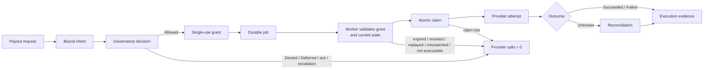

# Delayed Financial Payout and Ambiguous External Commit

**Learning objective:** Follow one delayed payout from an authenticated request through a bound intent, a governance decision, short-lived execution authority, durable job delivery, worker validation, an atomic claim, an external provider call, and reconciliation. Distinguish the historical decision, the execution authority, the claim, the provider attempt, the execution outcome, and the reconciliation evidence, so that an ambiguous provider timeout is resolved before anyone sends the payout again.

**Pattern classification:** General learning material

**Difficulty:** Advanced

**Prerequisites:** Recommended — [Capability-Scoped Background Operation](capability-scoped-background-operation.md), [Replay Protection and Bounded-Use Authority](../security/replay-protection-and-bounded-use.md), and [An Allowed Decision Does Not Mean the Operation Succeeded](../articles/2026/allowed-decision-does-not-mean-execution-succeeded.md). [Idempotency Does Not Prevent Authority Replay](../articles/2026/idempotency-does-not-prevent-authority-replay.md) and [How Short-Lived Execution Authority Differs from User Authorization](../articles/2026/short-lived-execution-authority-vs-user-authorization.md) support the identifier and authority sections.

**Estimated study time:** 45–60 minutes for the full case. The five-, ten-, and twenty-minute routes below cover the central distinctions first.

> **Scope.** This is architecture teaching material, not financial, banking, compliance, or payment-processing advice. The tenant, beneficiary, amounts, provider, and executor are fictional. The provider is a synthetic in-memory component. Nothing in this case connects to a bank, a payment provider, or any financial system, and it contains no credentials, account numbers, or provider-specific payment-flow details.

## Before You Begin

This case study uses one fictional operation:

```text
payout.submit
```

A finance clerk at a fictional tenant asks the platform to pay a supplier invoice. Policy allows the exact payout, but the platform does not call the payout provider inside the clerk's HTTP request. It releases payouts in a scheduled batch, so a background worker sends the payout hours later.

Keep these artifacts distinct throughout the study:

| Artifact | What it means | What it does not mean |
| --- | --- | --- |
| Payout request | What the clerk asked for, as an authenticated actor | That policy allows it |
| Bound payout intent | The exact payout: tenant, beneficiary, destination, amount, currency, purpose, payout-state version | That the payout is still executable later |
| Governance decision | What policy concluded about that exact intent, at that time | That money moved, or that a later worker may act indefinitely |
| Payout execution grant | Short-lived, single-use authority to submit this one payout | That a payout was sent, or that the queue message is trustworthy |
| Queue job | Transport that tells a worker there is work | Authority of any kind |
| Worker identity | Which service is presenting the grant | Permission to submit any payout |
| Claim | The atomic record that one worker, under one grant, owns one attempt | That the provider was called |
| Provider attempt | One request to the provider under one idempotency key | That the provider accepted or completed it |
| Execution outcome | What is known about the attempt: `Succeeded`, `Failed`, or `Unknown` | A change to the decision |
| Reconciliation evidence | What the provider's own records later established about an `Unknown` attempt | A new authorization |

The central distinctions are:

```text
Allowed decision
    ≠
Successful payout
```

```text
Idempotency
    ≠
Authority replay protection
```

```text
Ambiguous provider timeout after execution began
    → do not blindly re-execute
    → reconcile first
```

**Five-minute route:** read **At a Glance**, **The Scenario**, **Identifiers: One Per Question**, **Classify the Outcome by What the Provider Can Prove**, **Reconcile Before Any New Attempt**, the **Decision and Execution Matrix**, and **The Simpler Alternative**.

**Ten-minute route:** add **Atomically Claim the Grant and the Payout**, **Four Kinds of Retry**, and **Idempotency Versus Authority Replay Protection**. This route suits reviewers who already know scoped capabilities and want the side-effect boundary.

**Twenty-minute route:** add **Issue Short-Lived Payout Execution Authority**, **The Worker Validation Pipeline**, **What Makes a Payout Attempt Materially New**, the invariant traces, and **What the Tests Should Prove**. The remaining sections cover evidence, production adaptation, failure modes, tradeoffs, and review.

## At a Glance

The lifecycle is:

```text
Authenticated payout request
    ↓
Bound payout intent
    ↓
Authoritative tenant / beneficiary / payout state
    ↓
Governance decision
    ↓
Allowed
    ↓
Short-lived payout execution grant
    ↓
Durable job delivery
    ↓
Worker authentication
    ↓
Grant + current-state validation
    ↓
Atomic claim / transition to Executing
    ↓
External payout attempt
    ↓
Observed success / deterministic failure / ambiguous timeout
    ↓
Execution evidence
    ↓
Reconciliation before any new attempt
```



The case preserves two invariants:

> **No provider call happens without a current, unconsumed grant that matches the current payout record and is atomically claimed by the worker making the call.**

> **No new provider attempt starts while an earlier attempt for the same payout is `Unknown`. Reconciliation resolves it first.**

Neither invariant promises exactly-once payment. They promise something narrower and checkable: every blocked path makes zero provider calls, and every ambiguous path is resolved from evidence rather than by guessing.

---

## 1. The Scenario

**Tenant:** `T-0417`, payouts enabled, daily payout limit 50,000.00 EUR.

**Requester:** `clerk-22`, authenticated, member of the tenant's accounts-payable role, single-payout approval limit 10,000.00 EUR.

**Beneficiary:** `BEN-2208`, a supplier, verified, status `Active`. Its registered destination is `DST-77`, version 3. The platform stores the destination's provider-side token; no account number appears in the request, decision, grant, job, or evidence.

**Payout record before the request:**

```text
PayoutId:       PAY-3107
State:          Draft
Version:        6
```

**Request, at 09:58 UTC:**

```text
operation:      payout.submit
payout:         PAY-3107
beneficiary:    BEN-2208
destination:    DST-77
amount:         4,250.00
currency:       EUR
purpose:        supplier-invoice INV-9031
release:        16:00 UTC batch
```

The decision is `Allowed`. The platform issues grant `GRT-19C`, valid from 15:55 to 16:25 UTC, and moves the payout to `Approved`, version 7. At 16:00:04 a worker receives the job, validates the grant, claims it, and sends the payout to the fictional provider under idempotency key `payout-PAY-3107-a1`. At 16:00:34 the call times out. The provider received the request and completed the payout, but the response never arrived.

The rest of the case explains why the platform does not send the payout again, and how it finds out that it already succeeded.

### Representative policy matrix

| Condition | Decision | Reason code |
| --- | --- | --- |
| Tenant payouts suspended | `Denied` | `tenant.payouts-suspended` |
| Beneficiary not verified or not active | `Denied` | `beneficiary.not-eligible` |
| Destination not registered to the beneficiary | `Denied` | `destination.not-registered` |
| Payout not in `Draft`, or version differs from the intent | `Denied` | `payout.not-submittable` |
| Daily tenant limit would be exceeded | `Denied` | `tenant.daily-limit` |
| Tenant, beneficiary, or payout record unavailable | `Deferred` | `context.unavailable` |
| Destination changed in the last 7 days | `AcknowledgmentRequired` | `destination.recently-changed` |
| Amount above the requester's approval limit | `EscalationRecommended` | `amount.above-requester-limit` |
| Otherwise | `Allowed` | `payout.allowed` |

The rules are illustrative. Real payout controls belong to the organization's finance, risk, and compliance owners, not to an architecture specimen.

---

## 2. Keep the Responsibilities Separate

| Concern | Owner in this case | Responsibility |
| --- | --- | --- |
| Architecture | Platform architecture | Where the decision, grant, queue, claim, provider call, and reconciliation boundaries sit; which records are authoritative |
| Implementation | Payments engineering | Intent binding, the side-effect-free policy, grant issuance, the worker's validation pipeline, the atomic claim, outcome classification, the reconciler |
| Operations | Payments operations | Batch schedules, queue health, the `Unknown` backlog, escalations that reconciliation cannot resolve |
| Security | Security engineering | Worker identity, custody of the provider credential, grant integrity, keeping account data out of messages and logs |
| Governance | Finance and risk policy owners | Payout policy, approval limits, acknowledgment and escalation rules, and when compensation is permitted |
| Execution | Payout executor | The only component that calls the provider, and only after a successful claim |

One service may implement several rows. What matters is that no row silently takes over another: the queue does not decide, the worker does not authorize, and the decision does not report what the provider did.

---

## 3. Identifiers: One Per Question

| Identifier | Example | Question it answers | Created by | Changes when |
| --- | --- | --- | --- | --- |
| `PayoutId` (the `OperationId`) | `PAY-3107` | Which logical payout is this, across every decision, attempt, and reconciliation? | Payout service, when the draft is created | Never. A different payout is a different `PayoutId` |
| `CorrelationId` | `COR-8812` | Which end-to-end story does this record belong to? | API gateway, at the request | Never within the story. It groups; it does not authorize |
| `DecisionId` | `DEC-5530` | Which evaluation, under which facts and policy version, allowed this exact intent? | Policy evaluation | Every re-evaluation produces a new one |
| `GrantId` | `GRT-19C` | Which single-use authority is being presented, and has it been consumed? | Grant issuer, after `Allowed` | A new decision issues a new grant. A consumed grant is never reset |
| `JobId` / `MessageId` | `JOB-604` / `MSG-A71` | Which unit of queued work, and which delivery of it? | Outbox relay | A resubmission tool may create a new `MessageId`; that changes nothing about authority |
| `AttemptId` | `ATT-1` | Which claimed attempt, under which grant, produced which outcome? | The atomic claim | Each claim creates one |
| Provider idempotency key | `payout-PAY-3107-a1` | Has the provider already seen this exact request? | Derived deterministically from `PayoutId` and attempt number | Only for a materially new, newly authorized attempt |
| Provider reference | `PRV-TX-55021` | What does the provider call this payout? | The provider | Not ours to change |

The idempotency key is derived from `PayoutId` and the attempt number, never from `CorrelationId`, `MessageId`, or `GrantId`. Each of those changes for reasons unrelated to whether the provider has already seen this request. [Idempotency Does Not Prevent Authority Replay](../articles/2026/idempotency-does-not-prevent-authority-replay.md#five-identifiers-five-questions) explains why one identifier doing several jobs is how a retry becomes a second payment.

---

## 4. Bind the Exact Payout Before Policy

The clerk's request names a payout. The platform does not evaluate the request body; it builds an intent from the authoritative payout record and the authenticated actor:

```csharp
public sealed record PayoutIntent(
    string PayoutId,
    string TenantId,
    string RequesterId,              // from authentication, not the body
    string BeneficiaryId,
    string DestinationId,
    int DestinationVersion,
    decimal Amount,
    string Currency,
    string Purpose,
    int PayoutVersion)
{
    // Stable over every field that changes what money moves where.
    public string Fingerprint => PayoutFingerprint.Compute(this);
}
```

If the request's beneficiary, destination, amount, or currency differs from the payout record, the request is rejected before policy runs. The client cannot propose one payout and have policy evaluate another.

The `PayoutVersion` and `DestinationVersion` matter later. They let the worker detect that the payout or the destination changed after the decision, without comparing every field by hand.

---

## 5. Authoritative Context and the Governance Decision

The policy is a pure function. It performs no writes, calls, or notifications.

```csharp
public static class PayoutPolicy
{
    public const string Version = "payout-policy/2026.10";

    public static PayoutDecision Evaluate(PayoutContext context)
    {
        if (context.Unavailable)
        {
            return Defer("context.unavailable");
        }

        PayoutIntent intent = context.Intent;

        if (context.Tenant.PayoutsSuspended)
        {
            return Deny("tenant.payouts-suspended");
        }

        if (context.Beneficiary is not { Verified: true, Status: BeneficiaryStatus.Active })
        {
            return Deny("beneficiary.not-eligible");
        }

        if (context.Destination.BeneficiaryId != intent.BeneficiaryId ||
            context.Destination.Version != intent.DestinationVersion)
        {
            return Deny("destination.not-registered");
        }

        if (context.Payout.State != PayoutState.Draft || context.Payout.Version != intent.PayoutVersion)
        {
            return Deny("payout.not-submittable");
        }

        if (context.Tenant.PaidToday + intent.Amount > context.Tenant.DailyLimit)
        {
            return Deny("tenant.daily-limit");
        }

        if (context.ObservedAtUtc - context.Destination.ChangedAtUtc < TimeSpan.FromDays(7))
        {
            return RequireAcknowledgment("destination.recently-changed");
        }

        if (intent.Amount > context.Requester.ApprovalLimit)
        {
            return RecommendEscalation("amount.above-requester-limit");
        }

        return Allow("payout.allowed");
    }

    // Each helper builds a PayoutDecision with a new DecisionId, the outcome,
    // the reason code, Version, the intent fingerprint, and context observation times.
}
```

For `PAY-3107`, every check passes and the decision is `DEC-5530`, `Allowed`, reason `payout.allowed`, policy `payout-policy/2026.10`, intent fingerprint `fp-9b41`.

The decision is recorded durably before anything else happens. If that write fails, no grant is issued. Only `Allowed` continues. `Denied`, `Deferred`, `AcknowledgmentRequired`, and `EscalationRecommended` all stop here, with zero grants and zero provider calls. [Human Acknowledgment Workflow](human-acknowledgment-workflow.md) covers how an acknowledgment, once given, leads to a fresh decision rather than turning the pending one into `Allowed`.

---

## 6. Issue Short-Lived Payout Execution Authority

The decision is history. The worker that runs at 16:00 needs something narrower: authority to submit this one payout, once, in a short window.

```csharp
public sealed record PayoutGrant(
    string GrantId,
    string DecisionId,
    string PayoutId,
    string TenantId,
    string Operation,                 // "payout.submit"
    string Audience,                  // "payout-executor"
    string IntentFingerprint,
    int PayoutVersion,                // the version the grant expects at claim time
    string PolicyVersion,
    DateTimeOffset NotBeforeUtc,
    DateTimeOffset ExpiresAtUtc,
    GrantState State);                // Issued, Consumed, Revoked, Expired
```

Every field comes from the decision and the intent, never from the request. The grant contains no provider credential, no destination token, and no user token. The clerk's session is not forwarded to the worker. [How Short-Lived Execution Authority Differs from User Authorization](../articles/2026/short-lived-execution-authority-vs-user-authorization.md#five-responsibilities-not-one-token) explains why.

The grant is stored by the issuer and looked up by `GrantId`. In the same transaction, the payout moves from `Draft` version 6 to `Approved` version 7, and `GRT-19C` records `PayoutVersion = 7`.

The window, 15:55 to 16:25, covers the 16:00 batch and a short backlog. A payout that misses it does not run late on old authority; it waits for a fresh decision.

---

## 7. The Queue Message Is Transport

The decision record, grant, payout state change, and outbox row are written in one local transaction. A relay then publishes the job:

```json
{
  "messageId": "MSG-A71",
  "jobId": "JOB-604",
  "payoutId": "PAY-3107",
  "grantId": "GRT-19C",
  "correlationId": "COR-8812"
}
```

The message carries references, not facts. It does not carry the amount, destination, or beneficiary, because the worker must not trust them from the queue. If someone alters the message to point at a different payout, the grant lookup fails the binding check. If someone copies the message, the second copy meets a consumed grant.

The broker may deliver the message more than once, and an operator's resubmission tool may republish it under a new `MessageId`. Neither changes what the worker is allowed to do.

> **A queue message tells a worker where to look. It never tells the worker what it may do.**

---

## 8. Worker Identity Is Presenter Identity

The worker authenticates to the platform with its own workload identity, `svc-payout-worker`. That identity answers *which service is presenting this grant*. It does not answer *may this payout be submitted*.

A worker that could submit any payout because of who it is would turn a stolen worker credential into a stolen treasury. Here, the worker can only present grants. The grant's audience is `payout-executor`, the component inside the worker host that holds the provider credential. A different service presenting `GRT-19C` is refused with `presenter.not-audience`.

The provider credential stays with the payout executor. It is acquired as late as possible, used only after a successful claim, and never written to messages, grants, or evidence.

---

## 9. The Worker Validation Pipeline

At 16:00:04 the worker receives `MSG-A71`. Before it may claim anything, it checks:

```csharp
public async Task<ValidationResult> ValidateAsync(PayoutJob job, WorkloadIdentity presenter, CancellationToken ct)
{
    DateTimeOffset now = clock.GetUtcNow();

    if (await grants.FindAsync(job.GrantId, ct) is not { } grant)                    return Refuse("grant.unknown");
    if (grant.PayoutId != job.PayoutId)                                               return Refuse("binding.mismatch");
    if (grant.Operation != "payout.submit" || !audiences.Accepts(grant.Audience, presenter))
                                                                                      return Refuse("presenter.not-audience");
    if (grant.State == GrantState.Revoked)                                            return Refuse("grant.revoked");
    if (grant.State == GrantState.Consumed)                                           return await ClassifyConsumedAsync(grant, job, ct);
    if (now < grant.NotBeforeUtc || now >= grant.ExpiresAtUtc)                        return Refuse("grant.expired");

    // Current state, not the state at decision time.
    PayoutContext current = await contexts.BuildCurrentAsync(grant.PayoutId, ct);

    if (current.Payout.State != PayoutState.Approved ||
        current.Payout.Version != grant.PayoutVersion)                                return Refuse("payout.not-executable");
    if (PayoutFingerprint.Compute(current.Intent) != grant.IntentFingerprint)        return Refuse("binding.mismatch");

    // Current policy: would this exact payout still be allowed now?
    PayoutDecision recheck = PayoutPolicy.EvaluateForExecution(current);
    if (recheck.Outcome != PayoutOutcome.Allowed)                                    return Refuse("policy.no-longer-allows", recheck);

    return ValidationResult.Valid(grant, current);
}
```

Three points matter:

- **A consumed grant is not automatically a replay attack.** `ClassifyConsumedAsync` checks whether the payout already has an attempt claimed under this grant. If so, this delivery is a duplicate of work that is in progress or done, and is acknowledged with no state change. If not, the grant was consumed elsewhere, and the presentation is recorded as a replay. Either way, the provider is not called.
- **Current state is rebuilt, not trusted from the decision.** Between 09:58 and 16:00 the payout might have been cancelled, the beneficiary suspended, or the destination changed. Each one changes the payout's or destination's version or state, and each one is refused.
- **Current policy is rechecked for this exact intent.** `EvaluateForExecution` runs the same rules against current facts, except that it expects `Approved` rather than `Draft`. A rule that would now deny, such as a tenant suspended at 14:00, refuses the grant. A rule that would now require acknowledgment or escalation also refuses it, because the original decision no longer reflects current facts.

None of these refusals asks for new authority automatically. A refused grant stays refused, and the payout waits for a fresh request and decision. [Capability-Scoped Background Operation](capability-scoped-background-operation.md#17-freshness-model-rebuild-current-context-before-claim) discusses the freshness model and its availability cost in more depth.

---

## 10. Atomically Claim the Grant and the Payout

Validation is a read. Two workers can both pass it for the same grant. The claim is the write that only one of them can win:

```sql
BEGIN TRANSACTION;

UPDATE PayoutGrants
SET    State = 'Consumed', ConsumedAtUtc = @now, ConsumedBy = @workerId
WHERE  GrantId = @grantId AND State = 'Issued' AND ExpiresAtUtc > @now;
-- must affect exactly 1 row

UPDATE Payouts
SET    State = 'Executing', Version = Version + 1, ActiveAttemptId = @attemptId,
       LeaseEpoch = LeaseEpoch + 1, LeaseExpiresAtUtc = @leaseExpiry
WHERE  PayoutId = @payoutId AND State = 'Approved' AND Version = @expectedVersion;
-- must affect exactly 1 row

INSERT INTO PayoutAttempts (AttemptId, PayoutId, GrantId, DecisionId, AttemptNumber,
                            IdempotencyKey, State, ClaimedAtUtc, LeaseEpoch)
VALUES (@attemptId, @payoutId, @grantId, @decisionId, 1,
        'payout-PAY-3107-a1', 'Claimed', @now, @leaseEpoch);

COMMIT;  -- or ROLLBACK if either update affected 0 rows
```

If either update affects zero rows, the whole transaction rolls back and the worker makes no provider call. The loser of a race sees `claim.lost` and, on inspection, a duplicate delivery of work that the other worker owns.

The grant, the payout state, and the attempt record live in one database, so one local transaction covers them. That is the only boundary where atomicity is available. The provider is outside it.

The lease is longer than the provider call's timeout, so a slow but live worker is not swept while it waits. If the lease lapses, a recovery sweeper takes ownership by incrementing `LeaseEpoch`, and every later write from the original worker is conditional on the epoch it held. [Idempotency Does Not Prevent Authority Replay](../articles/2026/idempotency-does-not-prevent-authority-replay.md#reconciliation-and-what-makes-an-attempt-new) explains why a lease must fence writes, and why it cannot fence a request already on the network.

---

## 11. Classify the Outcome by What the Provider Can Prove

Before sending, the executor moves the attempt from `Claimed` to `Started` in a durable write. That ordering gives the platform one fact it would otherwise lack: an attempt still in `Claimed` provably never reached the provider.

```csharp
if (!await attempts.TryMarkStartedAsync(attempt.AttemptId, attempt.LeaseEpoch, ct))
{
    return AttemptResult.NotStarted("lease.lost");
}

ProviderResponse response;
try
{
    response = await provider.SubmitPayoutAsync(
        new ProviderPayoutRequest(
            ClientReference: attempt.PayoutId,
            IdempotencyKey: attempt.IdempotencyKey,
            DestinationToken: current.Destination.ProviderToken,
            Amount: current.Intent.Amount,
            Currency: current.Intent.Currency),
        ct);
}
catch (Exception ex) when (ex is TimeoutException or HttpRequestException or TaskCanceledException)
{
    return await attempts.RecordAsync(attempt, AttemptState.Unknown, "provider.no-response", ct);
}

return await attempts.RecordAsync(attempt, OutcomeClassifier.Classify(response), ct);
```

The classifier uses the provider's documented semantics, not the HTTP status alone:

| Observation | Attempt state | Payout state | Why |
| --- | --- | --- | --- |
| Failure before `Started` was written: credential unavailable, request invalid, lease lost | `NotStarted` | `Approved`, awaiting fresh authority | Affirmative evidence nothing was sent. The grant is consumed, so a new attempt needs a new grant |
| Provider reports a rejection it documents as no-effect, for example `destination_closed` | `Failed` | `Failed` | The provider said the payout did not happen. Resending fails the same way |
| Provider reports a transient rejection it documents as no-effect, for example rate limiting | `Started`, with a recorded send failure | `Executing` | A bounded resend inside the same attempt, same key and parameters, is allowed |
| Provider accepted the request for asynchronous processing | `Started` | `Executing` | Accepted is not completed. Wait for a status check or notification |
| Provider reports completion | `Succeeded` | `Paid` | The provider's contract establishes the effect |
| Timeout, reset, crash after `Started`, or an error not documented as no-effect | `Unknown` | `Unknown` | The provider may have completed the payout. Nobody can yet say |

`Failed` here means the provider affirmatively reported that the payout did not happen. A system that uses `Failed` more broadly must still represent "we do not know" separately. [An Allowed Decision Does Not Mean the Operation Succeeded](../articles/2026/allowed-decision-does-not-mean-execution-succeeded.md#illustrative-execution-states) explains these states, which are illustrative rather than a required enum.

**The decision does not change in any row.** When the provider rejects `PAY-3107` with `destination_closed`, `DEC-5530` remains `Allowed`. It was a correct answer to the facts available at 09:58. Rewriting it to `Denied` would erase why the platform acted and make the failure look like a policy refusal.

---

## 12. Execution Evidence Is Separate From the Decision

| Record | Written | Contents | Mutable? |
| --- | --- | --- | --- |
| Decision | 09:58, before the grant | `DEC-5530`, outcome, reason, policy version, intent fingerprint, context observation times | Never |
| Grant | 09:58, with the decision | `GRT-19C`, bindings, window, state | State only: `Issued` → `Consumed`, `Revoked`, or `Expired` |
| Claim and attempt | 16:00:04, in the claim transaction | `ATT-1`, grant, decision, worker, idempotency key, lease epoch | State transitions only, each conditional on the lease epoch |
| Send started | 16:00:04, before the provider call | `ATT-1` → `Started`, time | Once |
| Provider observation | When a response, notification, or lookup arrives | Provider reference, provider status, provider reason code | Append-only |
| Reconciliation | When an `Unknown` attempt is resolved | Method, provider evidence, resulting state, who or what resolved it | Append-only |

Evidence records identifiers, amounts, currency, and provider reason codes. It does not record destination tokens, account details, provider credentials, or raw provider payloads. [Secure Logging Across Trust Boundaries](../security/secure-logging-across-trust-boundaries.md) covers keeping evidence useful without making it a store of sensitive data.

---

## 13. Reconcile Before Any New Attempt

At 16:00:34 `ATT-1` is `Unknown`. The provider received the request and completed the payout as `PRV-TX-55021`, but the platform does not know that yet.


The reconciler does not hold a grant and does not need one, because it never submits a payout. It only asks the provider what happened:

```text
for each attempt in Unknown, oldest first, at a controlled rate:
    look up the provider by client reference (PayoutId)
        found, completed          → Succeeded; record provider reference
        found, rejected/returned  → Failed; record provider reason
        found, still processing   → leave Unknown; check again later
        not found                 → NotApplied only if the provider documents that a payout
                                    not visible after its stated processing window was never
                                    accepted, and that window has passed; otherwise leave Unknown
    cannot tell, or too old       → escalate to payments operations; never resend
```

Two cautions shape that loop:

- **Prefer a non-mutating lookup.** Replaying the original request with the original key can be safe where the provider documents that a repeat cannot pay twice, and only while the key is within the provider's retention period. Even then it is a recovery action, not a read, and its response may not establish the outcome. The fictional provider in this case offers lookup by client reference, so the reconciler reads.
- **"Not found" is decisive only when the provider says so.** A lookup can lag behind writes, and a request still in flight may not be visible. Without documented processing rules, "not found" stays `Unknown` and a person decides.

At 16:05 the reconciler finds `PRV-TX-55021`, completed. `ATT-1` becomes `Succeeded`, `PAY-3107` becomes `Paid`, and the redelivery at 16:00:35 is explained: it was a duplicate of work that had already succeeded. Nothing was sent twice.

If the provider's late response or notification reaches the platform first, it may resolve `ATT-1` through the same narrow evidence write, conditional on the attempt still being `Unknown`. It records what happened to a request already sent; it does not restore any worker's ownership.

---

## 14. Four Kinds of Retry

"Retry" names four different actions here. Each has its own permission.

| Retry | What repeats | Needs new authority? | Allowed while an attempt is `Unknown`? |
| --- | --- | --- | --- |
| Delivery retry | The broker redelivers, or an operator resubmits, the same job | No. The worker validates; a consumed grant makes it a duplicate | Yes. It makes no provider call |
| Execution retry | A resend inside the same claimed attempt, with the same key and parameters, after a documented no-effect rejection | No. It is part of `ATT-1` | No. The attempt must not be `Unknown` |
| Reconciliation | A provider lookup, or a documented-safe replay of the original request | No. It does not submit a new payout | Yes. This is how `Unknown` is resolved |
| Authorization retry | A new decision and a new grant, for a materially new attempt | Yes. Fresh context, fresh decision, fresh grant | No. Reconciliation first |

The common bug is letting a generic resilience policy perform an execution retry after a timeout. A timeout is not a documented no-effect rejection. [Capability-Scoped Background Operation](capability-scoped-background-operation.md#27-operational-retry-versus-authorization-retry) separates operational and authorization retries in a longer worked case.

---

## 15. Idempotency Versus Authority Replay Protection

Both mechanisms protect `PAY-3107`. They answer different questions.

**Authority replay protection** answers: *has this grant already been used?* It keys on `GrantId`, lives in the platform's database, and is enforced by the atomic claim. It stops a copied message, a second worker, or a stolen grant from starting a second attempt. It does not know what the provider did.

**Provider idempotency** answers: *has the provider already seen this request?* It keys on `payout-PAY-3107-a1`, lives in the provider's system, and lasts as long as the provider's retention period says. It stops a resent request from paying twice. It does not know whether the authority behind the request was valid, and it does not cover a request sent under a different key.

Each one fails without the other:

- With only idempotency, a replayed grant presented after the provider's key retention expires produces a second payout, and nothing in the platform notices the reused authority.
- With only replay protection, an execution retry after the timeout sends the same payout again, and the platform's single-use grant has nothing to say about it.

Even together they do not make the payout exactly once. No transaction spans the platform's database and the provider's ledger. The moment between "the provider completed the payout" and "the platform recorded it" always exists, and a lost response inside it produces `Unknown`. What this design can honestly claim is narrower: duplicate payouts are prevented within these stated boundaries, and every case outside them surfaces as `Unknown` and is reconciled before anything else is sent. [Replay Protection and Bounded-Use Authority](../security/replay-protection-and-bounded-use.md#replay-resistance-is-not-exactly-once-execution) describes the same limit for consumed authority.

---

## 16. What Makes a Payout Attempt Materially New

Suppose reconciliation had proven `NotApplied`: the provider's processing window passed and the payout does not exist. The invoice is still unpaid. Sending it again is a **materially new attempt**, not a retry of `ATT-1`. It needs:

- **A current decision.** `PAY-3107` is re-evaluated under current facts, producing `DEC-5544`. The beneficiary may have been suspended, the tenant's daily limit may be used up, or the invoice may have been paid another way.
- **New authority.** `GRT-1A2`, bound to the new decision and attempt 2. `GRT-19C` stays consumed forever.
- **A new attempt.** `ATT-2`, permitted only because `ATT-1` reached a terminal state.
- **A key chosen from the provider's documented semantics.** If the provider returns the saved result of the first request under a key, attempt 2 needs `payout-PAY-3107-a2`. The attempt number comes from the new decision, not from the worker.

An attempt is also materially new when the amount, currency, beneficiary, destination, or purpose would differ, when the earlier attempt `Failed` and someone wants to try again anyway, or when the grant behind it is consumed, expired, or revoked.

> **Never change the idempotency key to get past an outcome that has not been resolved.** A new key is justified only after reconciliation proves the earlier attempt had no effect and a new decision authorizes another one.

---

## 17. Compensation and Reversal Are Separate Operations

If `PAY-3107` was paid in error, perhaps because invoice `INV-9031` was a duplicate, the answer is not to edit the payout to `Cancelled` or to rewrite `DEC-5530`.

A reversal or recall is a separate consequential operation, for example `payout.recall`, with its own request, its own decision, its own authority, and its own attempts and outcomes. It may require different approvers, and the provider may not support it at all, or only within a window. A recall that fails or becomes `Unknown` is reconciled the same way.

The original payout's records stay as they are. The recall links to them. [An Allowed Decision Does Not Mean the Operation Succeeded](../articles/2026/allowed-decision-does-not-mean-execution-succeeded.md#compensation-is-another-operation) explains why compensation cannot always restore the original state.

---

## 18. Decision and Execution Matrix

| Scenario | Decision | Grant / validation | Claim | Provider calls | Attempt outcome | Payout state |
| --- | --- | --- | --- | ---: | --- | --- |
| Valid payout, provider completes | `Allowed` | valid | won | 1 | `Succeeded` | `Paid` |
| Tenant payouts suspended | `Denied` | none | — | 0 | none | `Draft` |
| Beneficiary not verified | `Denied` | none | — | 0 | none | `Draft` |
| Context unavailable | `Deferred` | none | — | 0 | none | `Draft` |
| Destination recently changed | `AcknowledgmentRequired` | none | — | 0 | none | `Draft` |
| Amount above requester's limit | `EscalationRecommended` | none | — | 0 | none | `Draft` |
| Job delivered after grant expiry | historical `Allowed` | refused `grant.expired` | — | 0 | none | `Approved`, awaiting fresh decision |
| Grant revoked by a finance hold | historical `Allowed` | refused `grant.revoked` | — | 0 | none | `Approved`, on hold |
| Consumed grant presented by a different job | historical `Allowed` | refused, recorded as replay | — | 0 | none | unchanged |
| Message altered to point at another payout | historical `Allowed` | refused `binding.mismatch` | — | 0 | none | unchanged |
| Grant presented by a different service | historical `Allowed` | refused `presenter.not-audience` | — | 0 | none | unchanged |
| Payout cancelled after the decision | historical `Allowed` | refused `payout.not-executable` | — | 0 | none | `Cancelled` |
| Destination changed after the decision | historical `Allowed` | refused `payout.not-executable` | — | 0 | none | `Approved`, version changed |
| Tenant suspended after the decision | historical `Allowed` | refused `policy.no-longer-allows` | — | 0 | none | `Approved` |
| Two workers race for one grant | `Allowed` | both valid | one wins, one `claim.lost` | 1 in total | winner's outcome | winner's outcome |
| Redelivery after the claim | `Allowed` | duplicate delivery | — | 0 additional | unchanged | unchanged |
| Provider credential unavailable before send | `Allowed` | valid | won | 0 | `NotStarted` | `Approved`, awaiting fresh authority |
| Provider rejects: destination closed | `Allowed`, unchanged | valid | won | 1 | `Failed` | `Failed` |
| Provider rate-limits, documented no-effect | `Allowed` | valid | won | 1 per send, bounded | outcome of the final send | per that outcome |
| Provider times out after accepting | `Allowed` | valid | won | 1 | `Unknown` | `Unknown` |
| Reconciliation finds the payout completed | `Allowed` | — | — | 0 additional | `Succeeded` | `Paid` |
| Reconciliation proves not applied | `Allowed` | — | — | 0 additional | `NotApplied` | `Approved`, awaiting fresh decision |
| Reconciliation cannot tell | `Allowed` | — | — | 0 additional | `Unknown`, escalated | `Unknown` |

The decision column never changes after it is written. Many rows have a historical `Allowed` decision and still make no provider call: a past decision is not current permission, and the worker decides at the moment of claim.

---

## 19. Invariant Traces

### Trace A: Non-allowed decision

```text
DEC for PAY-3107: EscalationRecommended (amount.above-requester-limit)
grant issued:     no
job published:    no
provider calls:   0
```

The same trace holds for `Denied`, `Deferred`, and `AcknowledgmentRequired`.

### Trace B: Expired, revoked, replayed, or mismatched grant

```text
16:31:10  worker receives MSG-A71 after a broker outage
          GRT-19C ExpiresAtUtc 16:25:00
          validation: grant.expired
          claim:          not attempted
          provider calls: 0
          payout:         Approved, awaiting a fresh decision
```

A revoked grant, a consumed grant presented by another job, a message pointing at another payout, and a grant presented by another service follow the same shape with their own reason codes.

### Trace C: Payout no longer executable

```text
14:12     clerk-22 cancels PAY-3107; payout → Cancelled, version 8
16:00:04  worker validates GRT-19C (expects version 7)
          validation: payout.not-executable
          provider calls: 0
          DEC-5530 remains Allowed
```

### Trace D: Claim lost

```text
16:00:04.120  worker A validates GRT-19C: valid
16:00:04.125  worker B validates GRT-19C: valid
16:00:04.131  worker A claims: grant row 1, payout row 1 → commit, ATT-1
16:00:04.133  worker B claims: grant row 0 → rollback, claim.lost
              worker B provider calls: 0
              total provider calls:    1
```

### Trace E: Deterministic provider rejection

```text
16:00:05  provider: rejected, code destination_closed (documented no-effect)
          ATT-1:    Failed
          PAY-3107: Failed
          DEC-5530: Allowed (unchanged)
          automatic resend: none
```

### Trace F: Ambiguous timeout

```text
16:00:04  ATT-1 Started, key payout-PAY-3107-a1
16:00:34  no response
          ATT-1:    Unknown
          PAY-3107: Unknown
          new attempt:     blocked
          new grant:       not requested
          provider calls:  1
```

### Trace G: Reconciliation confirms success

```text
16:05:00  reconciler looks up client reference PAY-3107
          provider: PRV-TX-55021, completed
          ATT-1:    Succeeded
          PAY-3107: Paid
          provider submit calls in total: 1
```

---

## 20. What the Tests Should Prove

The C# on this page is illustrative and is not a runnable companion. These tests are the contract an implementation, or a future executable sample, should prove. Each blocked path asserts the reason **and** that the synthetic provider was never called.

```csharp
[Theory]
[MemberData(nameof(BlockedBeforeProvider))]
public async Task Every_blocked_path_makes_zero_provider_calls(PayoutScenario scenario)
{
    PayoutHarness harness = PayoutHarness.For(scenario);

    PayoutRunResult result = await harness.RequestAndRunAsync();

    Assert.Equal(scenario.ExpectedReasonCode, result.StoppingReasonCode);
    Assert.Equal(0, harness.Provider.SubmitCalls);
}

[Fact]
public async Task Deterministic_rejection_leaves_the_decision_Allowed()
{
    PayoutHarness harness = PayoutHarness.For(PayoutScenario.Valid);
    harness.Provider.RejectNextWith("destination_closed");

    PayoutRunResult result = await harness.RequestAndRunAsync();

    Assert.Equal(PayoutOutcome.Allowed, harness.Decisions.Single().Outcome);
    Assert.Equal(AttemptState.Failed, result.Attempt!.State);
    Assert.Equal(1, harness.Provider.SubmitCalls);
}

[Fact]
public async Task Timeout_after_acceptance_is_Unknown_and_blocks_a_second_payout()
{
    PayoutHarness harness = PayoutHarness.For(PayoutScenario.Valid);
    harness.Provider.CompleteButLoseResponse();

    await harness.RequestAndRunAsync();
    await harness.RedeliverLastJobAsync();
    await harness.TryStartNewAttemptAsync();

    Assert.Equal(AttemptState.Unknown, harness.Attempts.Single().State);
    Assert.Equal(1, harness.Provider.SubmitCalls);
    Assert.Single(harness.Provider.CompletedPayouts);
}

[Fact]
public async Task Reconciliation_confirms_success_without_a_duplicate_payout()
{
    PayoutHarness harness = PayoutHarness.For(PayoutScenario.Valid);
    harness.Provider.CompleteButLoseResponse();
    await harness.RequestAndRunAsync();

    await harness.Reconciler.RunOnceAsync();

    Assert.Equal(AttemptState.Succeeded, harness.Attempts.Single().State);
    Assert.Equal(PayoutState.Paid, harness.Payouts.Get("PAY-3107").State);
    Assert.Equal(1, harness.Provider.SubmitCalls);
    Assert.Equal(1, harness.Provider.LookupCalls);
}
```

Additional tests should prove that:

- concurrent claims on one grant produce exactly one attempt and one provider call;
- an attempt left in `Claimed` is classified `NotStarted`, and one left in `Started` is classified `Unknown`;
- a generic resilience policy does not resend after a timeout;
- a worker that lost its lease cannot write a state transition;
- a materially new attempt needs a new decision and grant, and is refused while an earlier attempt is `Unknown`;
- no grant, message, or evidence record contains a destination token or provider credential.

[How to Test That a Denied Operation Never Executes](../articles/2026/test-denied-operation-never-executes.md) covers the zero-execution assertion in depth. [Idempotency Does Not Prevent Authority Replay](../articles/2026/idempotency-does-not-prevent-authority-replay.md#testing-both-directions) shows tests for both replay and ambiguous-retry directions.

---

## 21. Observability and Evidence

Evidence answers *what happened to this payout*. Observability answers *is the system healthy*. Both use the same identifiers.

Signals worth watching:

- **`Unknown` attempts by age.** The most important payout metric in this design. An attempt that stays `Unknown` past the provider's processing window needs a person.
- **Reconciliation outcomes.** How often `Unknown` resolves to `Succeeded`, `Failed`, `NotApplied`, or escalation. A rise in `Succeeded` after timeouts points at provider latency or a timeout set too short.
- **Validation refusals by reason code.** A spike in `grant.expired` points at queue backlog. A spike in `binding.mismatch` or recorded replays is a security signal.
- **Claims lost and duplicate deliveries.** Expected at a low rate; a high rate points at broker or worker misconfiguration.
- **Grants issued but never consumed.** Payouts that missed their window and are waiting for a fresh decision.

Every log line carries `CorrelationId` and `PayoutId`, and where present `DecisionId`, `GrantId`, and `AttemptId`. A correlation identifier groups records. It is never used to authorize or deduplicate anything.

---

## 22. Production Adaptation

This specimen leaves the following to the host and its owners:

- **Grant representation.** A database row referenced by identifier is the simplest. A signed portable grant needs key custody and verification; [Capability-Scoped Background Operation](capability-scoped-background-operation.md#8-protect-portable-capability-integrity) covers that choice.
- **Freshness rule.** Rechecking current policy at claim time is conservative. A policy deployment between 09:58 and 16:00 can refuse many queued payouts. Choose and test that tradeoff explicitly.
- **Provider semantics.** Retention of idempotency keys, which errors are documented as no-effect, whether lookup by client reference exists, how long processing can take, and whether recall is supported all come from the provider's current documentation. Each row of the outcome table depends on them.
- **Batch and cut-off rules.** Payment windows, value dates, and holidays belong to finance operations.
- **Multi-instance claim.** The claim works only if every worker and the sweeper use the same durable store and conditional writes.
- **Approval workflows.** Escalation and acknowledgment produce fresh decisions; they do not upgrade the original one.
- **Regulatory and audit requirements.** Retention, segregation of duties, and reporting obligations are outside this case.

If you want to compare this specimen with a working framework, [From Learning Samples to a Production Host](../getting-started/from-learning-samples-to-production-host.md) lists version-pinned implementation references for scoped authority and host-owned execution. Nothing in this case depends on them.

---

## 23. Common Failure Modes

### The decision is used as proof of payment

A dashboard shows "approved" payouts as paid. Approval is a decision; only the attempt outcome or reconciliation says what the provider did.

### A timeout is treated as a failure

The worker records `Failed` on timeout, and the next batch submits the payout again. A timeout is `Unknown` until reconciliation says otherwise.

### A new idempotency key is generated per send

The resend after a timeout uses a fresh key, so the provider treats it as a new payout. The key is fixed per attempt and derived from `PayoutId` and attempt number.

### The queue message carries the payout details

The worker pays the amount and destination in the message. A modified or stale message moves money. The message carries references; the worker loads facts from authoritative records.

### The worker identity can submit any payout

A stolen worker credential can drain any tenant. The worker presents grants; it does not hold payout authority of its own.

### A consumed grant is reset after failure

To retry, someone sets `GRT-19C` back to `Issued`. A consumed grant is never reset. A new attempt needs a new decision and grant.

### The decision is rewritten after the provider rejects

`DEC-5530` becomes `Denied` after `destination_closed`. The decision was correct for its facts; the failure is execution evidence.

### Reconciliation resends instead of reading

The reconciler "fixes" `Unknown` by submitting again. Reconciliation reads first, and resends only where the provider documents that a repeat is safe.

### Exactly-once is claimed

The design document promises each payout happens exactly once. It cannot. It prevents duplicates within stated boundaries and surfaces everything else as `Unknown`.

---

## 24. Tradeoffs

| Choice | Benefit | Cost |
| --- | --- | --- |
| Delayed execution with a grant | Batch release without forwarding user credentials | A grant store, expiry handling, and payouts that miss their window |
| Current-state and current-policy check at claim | Cancelled, changed, or newly disallowed payouts do not run | Policy changes can refuse queued payouts; the worker depends on context sources |
| Atomic claim in one local transaction | One attempt per grant, even under races | Grant, payout, and attempt state must share a store |
| `Started` written before the send | Proof that `Claimed` attempts sent nothing | One more durable write per payout |
| `Unknown` as a first-class state | No blind second payout | Payouts can sit unresolved; operations must own the backlog |
| Lookup-first reconciliation | Resolution without mutation | Depends on the provider offering a lookup and documenting its consistency |

---

## 25. The Simpler Alternative

Most payouts do not need this architecture. If the payout is submitted **immediately, inside the authenticated request, by the same trusted host**, much of it disappears:

```text
Authenticated request
    ↓
Ordinary authorization: role, tenant, approval limit
    ↓
Load and check the payout record
    ↓
Provider call with a stable idempotency key derived from PayoutId
    ↓
Synchronous result, recorded
```

There is no grant, no queue, no worker identity, and no claim on authority, because the actor's present authorization covers the call and nothing runs later. A conditional update from `Draft` to `Executing` still keeps two concurrent requests from sending the same payout.

What does **not** disappear is the provider boundary. A synchronous call can time out after the provider completed the payout, exactly as the worker's did. Even the simple design needs a stable `PayoutId`, a fixed idempotency key, an `Unknown` outcome, and a lookup before anyone presses "pay" again. Removing the queue removes the authority problem. It does not remove the ambiguous-commit problem.

### The Stopping Rule

Stop at the first design that meets these conditions: nothing executes a payout except under current authority for that exact payout; blocked paths make zero provider calls; the idempotency key is stable per attempt; an ambiguous outcome is recorded as `Unknown`; and nothing is sent again until reconciliation resolves it.

If payouts run immediately in the requesting host, ordinary authorization plus idempotency and reconciliation meets that rule, and a delayed grant adds a store and a failure mode without adding safety. Add the grant, the claim, and the worker validation pipeline when execution genuinely happens later, in another process, under an identity that is not the requester's.

---

## 26. Review Checklist

**Decision**

1. Is the intent bound to the authoritative payout record, including amount, currency, beneficiary, destination, purpose, and version?
2. Do `Denied`, `Deferred`, `AcknowledgmentRequired`, and `EscalationRecommended` all stop before any grant is issued?
3. Is the decision recorded before the grant, and never rewritten afterward?

**Authority and delivery**

4. Is the grant single-use, short-lived, bound to one payout and version, and free of credentials?
5. Does the queue message carry only references?
6. Is the worker's identity a presenter identity rather than payout authority?

**Claim and execution**

7. Does the worker rebuild current payout state and recheck current policy before claiming?
8. Is the claim one atomic transition across grant, payout, and attempt, with zero provider calls on failure?
9. Is `Started` written before the provider call?
10. Are outcomes classified by the provider's documented semantics, with timeouts recorded as `Unknown`?

**Reconciliation and retry**

11. Does an `Unknown` attempt block every new attempt until reconciled?
12. Does reconciliation read before it resends?
13. Are delivery, execution, reconciliation, and authorization retries distinguished, each with its own permission?
14. Does a materially new attempt need a new decision and grant?

**Proportionality**

15. Has the team checked whether immediate execution with ordinary authorization, idempotency, and reconciliation meets the stopping rule?

---

## 27. What This Case Intentionally Omits

- Any real bank, payment network, or payment provider, and any provider-specific API.
- Account numbers, routing details, credentials, or settlement mechanics.
- Fraud scoring, sanctions screening, and regulatory reporting.
- Multi-currency conversion, fees, and partial payouts.
- A universal execution-state enum. The states here are illustrative.
- A claim of exactly-once execution.

---

## Continue Deeper

- [Capability-Scoped Background Operation](capability-scoped-background-operation.md) develops the queue, worker, and capability boundaries this case composes, using a non-financial report scenario.
- [An Allowed Decision Does Not Mean the Operation Succeeded](../articles/2026/allowed-decision-does-not-mean-execution-succeeded.md) separates decision truth from execution truth and covers compensation.
- [Idempotency Does Not Prevent Authority Replay](../articles/2026/idempotency-does-not-prevent-authority-replay.md) follows one ambiguous timeout through leases, fencing, and reconciliation.
- [How Short-Lived Execution Authority Differs from User Authorization](../articles/2026/short-lived-execution-authority-vs-user-authorization.md) explains why the worker receives a grant rather than the clerk's credentials.
- [Replay Protection and Bounded-Use Authority](../security/replay-protection-and-bounded-use.md) covers atomic consumption and the consume-before-execute failure windows.
- [Scoped Capability and Host-Owned Execution](../tutorials/scoped-capability-and-host-owned-execution.md) introduces narrow authority validated at the execution boundary.
- [Should Authorization Fail Open, Fail Closed, or Defer?](../articles/2026/fail-open-fail-closed-or-defer.md) covers what happens when the decision itself cannot be made.

The case should leave one rule visible:

> **An `Allowed` decision permits one payout attempt under current, single-use authority. It never proves the payout happened. When the provider's answer is lost, find out what happened before sending anything again.**
