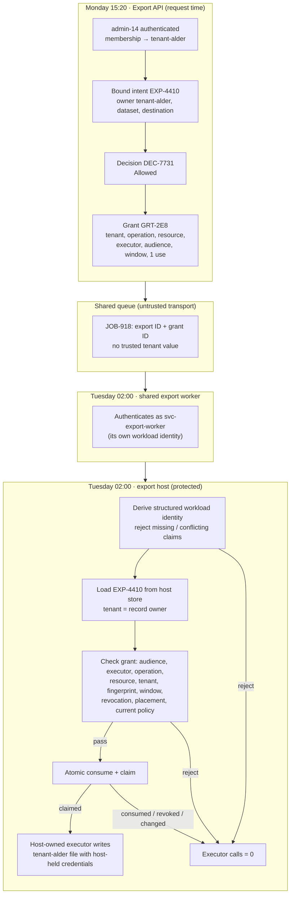
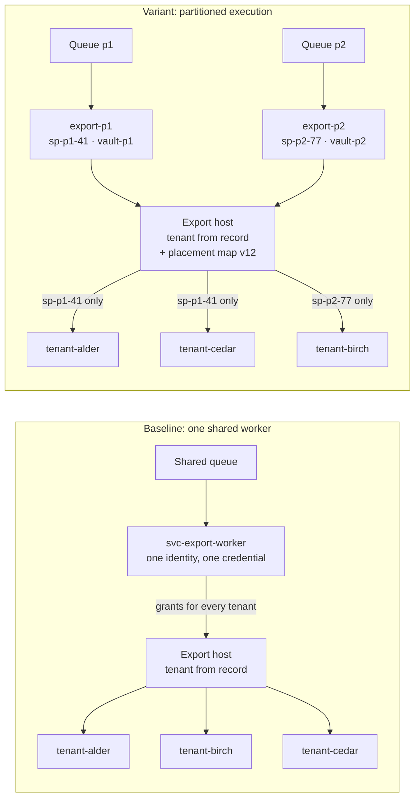

# Shared Multi-Tenant Worker and Delayed Execution Isolation

**Learning objective:** Follow one delayed `records.export` operation from a tenant-scoped request through authoritative tenant context, a bound export intent, a governance decision, a tenant-bound execution grant, durable job delivery, a shared worker that authenticates as itself, and a protected host that resolves the tenant from its own records before a host-owned executor runs. Distinguish what stops one tenant's grant from being used against another tenant's data from what would contain a compromised worker that legitimately serves every tenant, and decide when one shared worker with ordinary tenant checks is the proportionate design.

**Pattern classification:** General learning material

**Difficulty:** Advanced

**Prerequisites:** Recommended — [Can One Worker Safely Execute Delayed Operations for Many Tenants?](../articles/2026/multi-tenant-worker-execution-authority.md), [Capability-Scoped Background Operation](capability-scoped-background-operation.md), and [Trust Boundaries and Least Privilege](../security/trust-boundaries-and-least-privilege.md). [How Short-Lived Execution Authority Differs from User Authorization](../articles/2026/short-lived-execution-authority-vs-user-authorization.md) and [Replay Protection and Bounded-Use Authority](../security/replay-protection-and-bounded-use.md) support the grant and replay sections.

**Estimated study time:** 50–70 minutes for the full case. The five-, ten-, and twenty-minute routes below cover the central distinctions first.

> **Scope.** This is architecture teaching material. The tenants, users, exports, identity provider, worker, host, and executor are fictional, and the protected side effect is a synthetic, local write to an in-memory export store. Token claims are shaped like Microsoft Entra ID access tokens only because Entra's identifiers are well documented and often confused; nothing here depends on Entra or on any other identity product. Regional partition names in this case are deployment labels. They are not evidence of data residency, data sovereignty, or compliance with any legal obligation.

## Before You Begin

This case study uses one fictional operation:

```text
records.export
```

A fictional software-as-a-service platform stores customer records for a few hundred business tenants. A tenant administrator asks for an encrypted export of their tenant's customer records. Exports are heavy, so the platform does not run them inside the request. It schedules them overnight, and **one shared export worker** processes due exports for every tenant.

Keep these artifacts distinct throughout the study:

| Artifact | What it means | What it does not mean |
| --- | --- | --- |
| Export request | What an authenticated administrator asked for | That policy allows it, or which tenant it belongs to |
| Authoritative tenant context | The application tenant the platform resolved from its own membership records | A tenant value the client, the queue, or the worker supplied |
| Bound export intent | The exact export: owning tenant, dataset, field set, format, destination and its version | That the export is still executable at 02:00 |
| Governance decision | What policy concluded about that exact intent, at request time | Authority for a later process to act indefinitely |
| Execution grant | Short-lived, single-use authority to run this one export, at one host, presented by one workload | A credential for tenant data, or permission to export anything else |
| Queue job | Transport that tells the worker there is work | Authority, or a trustworthy tenant value |
| Worker identity | Which workload is presenting the grant, as a structured, validated identity | Permission to act for any tenant |
| Placement assignment | Which workload identity the host accepts for which tenant | Isolation, unless the identities behind it are genuinely separate |
| Protected host check | The host's own resolution of tenant and resource state, compared with the grant | A trust of anything the worker asserts |
| Export execution | The host-owned executor writing one tenant's file to that tenant's store | Proof that every earlier step was correct |

The central distinctions are:

```text
Grant tenant == resource tenant
    → blocks cross-tenant substitution
```

```text
Grant tenant == resource tenant
    ≠
Containment of a compromised shared worker that legitimately reaches every tenant
```

```text
Worker identity
    ≠
Tenant-bound operation authority
```

```text
Separate worker names
    + shared credentials / permissions
    ≠
Real compromise isolation
```

**Five-minute route:** read **At a Glance**, **The Scenario**, **What Tenant Equality Protects and What It Does Not**, and **The Simpler Architecture**.

**Ten-minute route:** add **Three Identities and Two Meanings of Tenant**, **The Protected Host Resolves the Tenant**, and the **Decision and Execution Matrix**.

**Twenty-minute route:** add **The Shared Worker Authenticates as Itself**, **The Higher-Isolation Variant: Partitioned Execution**, **Separate Names Are Not Separate Boundaries**, and **Shared Versus Partitioned Execution**. The remaining sections cover the decision, grant, queue, freshness, token exchange, traces, tests, operations, failure modes, tradeoffs, and review.

**About the code:** all C# and pseudocode on this page is illustrative. Repositories, helpers, and some transitions are omitted, and none of it compiles as shown. The tests in **What the Tests Should Prove** describe the contract an implementation should meet; they are not a runnable companion.

## At a Glance

The lifecycle is:

```text
Tenant-scoped request
    ↓
Authenticated actor + authoritative tenant context
    ↓
Bound export intent
    ↓
Current resource / destination / policy evaluation
    ↓
Allowed
    ↓
Tenant-bound short-lived execution grant
    ↓
Durable job delivery
    ↓
Shared worker authenticates as itself
    ↓
Protected host resolves current tenant/resource state
    ↓
Validate worker identity + grant + tenant + audience + scope + freshness + replay
    ↓
Host-owned export executor
```

The same path, drawn across its trust boundaries:



The case preserves two invariants and states one limit:

> **The export executor runs only for a tenant the host resolved from its own records, under an unconsumed grant whose tenant, operation, resource, audience, executor, and window all match, presented by a workload identity derived without ambiguity from a validated token.**

> **No tenant value supplied by the client, the queue, or the worker selects which tenant's data is read or where it is written.**

> **Neither invariant contains a compromise of the shared worker. A worker that is the legitimate executor for every tenant can misuse every grant that flows through it. Containing that requires separately enforced identities, credentials, permissions, or partitions, and the case shows when that is worth its cost.**

---

## 1. The Scenario

**Platform:** a fictional records platform with an Export API, a shared queue, one shared export worker deployment, and an export host in the data tier. The export host is the only component that can read a tenant's records in bulk and write an export file.

**Tenants:** `tenant-alder`, `tenant-birch`, and `tenant-cedar`, among a few hundred others. All three have exports enabled. Each has its own export store and its own registered destinations.

**Requester:** `admin-14`, authenticated by the Export API, member of `tenant-alder` with the `export-admin` role.

**Worker:** `svc-export-worker`, one deployment with one workload identity, serving every tenant.

**Request, Monday 15:20 UTC:**

```text
operation:      records.export
export:         EXP-4410
dataset:        customers
fields:         contact (name, email, phone); notes excluded
format:         encrypted CSV
destination:    DST-A3 (tenant-alder export store)
schedule:       Tuesday 02:00 UTC
```

The decision is `DEC-7731`, `Allowed`. The Export API records `EXP-4410` as `Scheduled`, version 1, owned by `tenant-alder`, and issues grant `GRT-2E8`, valid from 01:55 to 06:00 UTC on Tuesday, for one use. The relay publishes job `JOB-918` as message `MSG-C04` with correlation `COR-5520`.

At 02:00:07 the worker receives `MSG-C04`, authenticates to the export host as itself, and presents `GRT-2E8` for `EXP-4410`. The export host loads `EXP-4410` from its own store, resolves its owner as `tenant-alder`, checks every binding, consumes the grant, and the host-owned executor writes the encrypted file into `tenant-alder`'s export store with credentials the worker never sees.

The same night the worker also processes `EXP-5120` for `tenant-birch` under grant `GRT-3A1`. Every trace in this case uses those two exports.

### Representative policy matrix

| Condition | Decision | Reason code |
| --- | --- | --- |
| Actor not a member of the tenant, or lacks `export-admin` | `Denied` | `actor.not-entitled` |
| Tenant exports disabled or tenant suspended | `Denied` | `tenant.exports-disabled` |
| Destination not registered to the owning tenant | `Denied` | `destination.not-registered` |
| Dataset classification above the tenant's export ceiling | `Denied` | `dataset.above-ceiling` |
| Tenant membership or export record unavailable | `Deferred` | `context.unavailable` |
| Field set includes notes or other free text | `AcknowledgmentRequired` | `fields.free-text` |
| Full-dataset export above 1,000,000 rows | `EscalationRecommended` | `volume.above-threshold` |
| Otherwise | `Allowed` | `export.allowed` |

The rules are illustrative. Real export policy, classification ceilings, and thresholds belong to the platform's data-protection and product owners. [Sensitive-Data Access Decision](sensitive-data-access-decision.md) develops classification, acknowledgment, and data-safe evidence for a single-tenant `records.export`; this case reuses the operation name and concentrates on what changes when one worker serves many tenants.

---

## 2. Keep the Responsibilities Separate

| Concern | Owner in this case | Responsibility |
| --- | --- | --- |
| Architecture | Platform architecture | Where the request-time decision, the grant store, the queue, the worker, and the export host sit; which records are authoritative for tenant, resource, destination, and placement |
| Implementation | Export engineering | Intent binding, the side-effect-free policy, grant issuance, the host's validation pipeline, the atomic claim, the executor |
| Operations | Platform operations | Worker deployments, queue health, credential rotation, placement-map changes, failover, the backlog of refused and expired exports |
| Security | Security engineering | Workload identity issuance and claim mapping, custody of tenant data credentials, the threat model that decides how much compromise isolation is required |
| Governance | Data-protection and product policy owners | Export policy, classification ceilings, acknowledgment and escalation rules, which tenants or tiers have contractual isolation commitments |
| Execution | Export host and its executor | The only components that resolve the tenant, open tenant data, and write the export |

One service may implement several rows. What matters is that no row silently takes over another: the queue does not carry authority, the worker does not choose the tenant, and the decision does not open tenant data.

---

## 3. Three Identities and Two Meanings of Tenant

A multi-tenant delayed export involves more identifiers than a single-tenant one, and several of them look interchangeable.

| Identifier | Example | Question it answers | Source of truth | Must never be used as |
| --- | --- | --- | --- | --- |
| Actor identity | `admin-14` | Who asked, at request time? | The Export API's authentication | Execution authority at 02:00 |
| Application tenant | `tenant-alder` | Which customer owns the export and its data? | The platform's membership and export records | A value read from a token's directory claim |
| Directory tenant | `dir-platform` (the token's `tid`) | Which identity directory issued the worker's token? | The validated token | An application tenant, unless the design deliberately maps one to the other |
| Workload identity | issuer `https://idp.example.test/dir-platform/v2.0`, directory `dir-platform`, principal `sp-7f2c` | Which workload principal is presenting the grant? | Transport authentication of the worker's token | Permission to act for a tenant |
| Application (client) ID | `app-export-worker` (the token's `azp`) | Which application registration requested the token? | The validated token | The executor binding; every deployment and every directory's service principal of one registration shares it |
| Placement partition | `shared` in the baseline; `export-p1` / `export-p2` in the partitioned variant | Which workload identity may act for which tenant? | A placement map owned by the control plane and trusted by the host | A value from the worker's configuration or the message |
| `ExportId` | `EXP-4410` | Which logical export is this? | Export API, at request time | A tenant selector |
| `DecisionId` / `GrantId` | `DEC-7731` / `GRT-2E8` | Which evaluation allowed it, and which single-use authority is being presented? | Policy evaluation / grant issuer | Proof that the export ran |
| `CorrelationId` | `COR-5520` | Which end-to-end story does this record belong to? | API gateway | Authorization or deduplication |

Two meanings of *tenant* now coexist. The **application tenant** is the platform's customer. The **directory tenant** is the identity directory that issued a token. The worker's token carries `tid = dir-platform` for every export, whichever customer owns it. That value says nothing about whether the worker may act for `tenant-alder`, and the host never compares it with an application tenant. [The multi-tenant worker article](../articles/2026/multi-tenant-worker-execution-authority.md#two-meanings-of-tenant) explains the case where a design deliberately maps one to the other.

The **client ID** is not the principal. One multi-tenant application registration has the same client ID in every directory and a separate service principal, with separately granted permissions, in each. Two deployments of the same registration also share it. The executor binding in this case is the structured workload identity, never the client ID or a display name.

---

## 4. Bind the Export Intent From Authoritative State

The administrator's request names an export. It does not get to name the tenant. The Export API builds the intent from the authenticated actor and its own records:

```csharp
public sealed record ExportIntent(
    string ExportId,
    string TenantId,              // from the platform's membership records, not the request
    string ActorId,               // from authentication, not the body
    string Dataset,
    string FieldSet,
    string Format,
    string DestinationId,         // resolved from the tenant's own registered destinations
    int DestinationVersion,
    int ExportVersion)
{
    // Canonical, versioned hash over tenant, dataset, field set, format, destination and
    // destination version. The owning tenant is inside the fingerprint, so a record that
    // moves between tenants after authorization no longer matches.
    public string Fingerprint => ExportFingerprint.Compute(this);
}
```

Three rules apply before policy runs:

- **The tenant comes from membership, not from the request.** If the request carries a tenant header or body field, it is at most a value to compare with the resolved membership. A conflict rejects the request with `actor.tenant-conflict`; it never switches tenants.
- **The destination is resolved inside the owning tenant.** `DST-A3` is looked up among `tenant-alder`'s registered destinations. A destination identifier that exists only in `tenant-birch` is `destination.not-registered`, even if the identifier is well formed.
- **The fingerprint covers the owning tenant.** Including the tenant inside the fingerprint, and not only in a separate field, means any later disagreement between the grant and the record is detected twice and reported once with a specific reason.

[Trust Boundaries and Least Privilege](../security/trust-boundaries-and-least-privilege.md#resource-ownership-must-be-resolved-not-declared) covers why resource ownership must be resolved rather than declared.

---

## 5. The Request-Time Decision

The policy is a pure function of the resolved context. It performs no writes, calls, or notifications and does not read the clock.

```csharp
public static class RecordsExportPolicy
{
    public const string Version = "records-export-policy/2026.10";

    public static ExportVerdict Evaluate(ExportContext context)
    {
        if (context.Unavailable)                                             return Defer("context.unavailable");
        if (!context.Actor.IsMemberOf(context.Intent.TenantId, "export-admin")) return Deny("actor.not-entitled");
        if (!context.Tenant.ExportsEnabled || context.Tenant.Suspended)      return Deny("tenant.exports-disabled");
        if (context.Destination.TenantId != context.Intent.TenantId)         return Deny("destination.not-registered");
        if (context.Dataset.Classification > context.Tenant.ExportCeiling)   return Deny("dataset.above-ceiling");
        if (context.Intent.FieldSet.IncludesFreeText)                        return RequireAcknowledgment("fields.free-text");
        if (context.Dataset.RowCount > 1_000_000)                            return RecommendEscalation("volume.above-threshold");
        return Allow("export.allowed");
    }
}
```

For `EXP-4410`, every check passes. The decision is `DEC-7731`, `Allowed`, reason `export.allowed`, policy `records-export-policy/2026.10`, fingerprint `fp-3c90`, evaluated export version 1.

The decision, the export record, the grant, and the outbox row are written in one local transaction. If it does not commit, none of them exists. A non-allowed decision is written alone, with zero grants and zero executor calls. [Human Acknowledgment Workflow](human-acknowledgment-workflow.md) covers how an acknowledgment leads to a fresh decision rather than upgrading the pending one.

---

## 6. Issue the Tenant-Bound Execution Grant

The decision is history. The worker that runs at 02:00 needs something narrower:

```csharp
public sealed record WorkloadIdentity(string Issuer, string DirectoryTenantId, string PrincipalId);

public sealed record ExportGrant(
    string GrantId,               // "GRT-2E8"
    string DecisionId,            // "DEC-7731"
    string Operation,             // "records.export"
    string ExportId,              // "EXP-4410"
    string ExportFingerprint,     // "fp-3c90", includes the owning tenant
    int ExecutableExportVersion,  // 1
    string TenantId,              // "tenant-alder": the application tenant that owns the export
    WorkloadIdentity Executor,    // the placement-assigned identity for tenant-alder
    string Audience,              // "export-host"
    string PlacementVersion,      // "placement/12": the map the issuer consulted
    DateTimeOffset NotBeforeUtc,  // Tuesday 01:55
    DateTimeOffset ExpiresAtUtc,  // Tuesday 06:00
    GrantState State);            // Issued, Consumed, Revoked, Expired
```

Every field comes from the decision, the intent, and the placement map, never from the request. The grant contains no tenant data credential, no destination secret, and no user token. `admin-14`'s session is not forwarded to the worker; [How Short-Lived Execution Authority Differs from User Authorization](../articles/2026/short-lived-execution-authority-vs-user-authorization.md#five-responsibilities-not-one-token) explains why.

The grant binds five things that a shared worker makes easy to merge:

| Binding | Value | What it stops |
| --- | --- | --- |
| Tenant | `tenant-alder` | Using this grant for another tenant's export |
| Operation and resource | `records.export`, `EXP-4410`, `fp-3c90` | Using it for a different export, even in the same tenant, or for a different operation |
| Audience | `export-host` | Presenting it to a different host that would accept it |
| Executor | `svc-export-worker`'s structured identity | Presenting it from another workload that copied it |
| Window and use | 01:55–06:00, one use | Running late on stale authority, or running twice |

The grant is stored by the issuer and looked up by `GrantId`. A signed portable representation is possible; [Capability-Scoped Background Operation](capability-scoped-background-operation.md#8-protect-portable-capability-integrity) covers that choice. Either way, the export host treats the grant as evidence to compare with its own records, not as the source of the tenant it opens.

---

## 7. The Queue Message Carries References Only

```json
{
  "messageId": "MSG-C04",
  "jobId": "JOB-918",
  "exportId": "EXP-4410",
  "grantId": "GRT-2E8",
  "correlationId": "COR-5520"
}
```

The message carries no tenant, no dataset, no destination, and no credential. A tenant field would be tempting for routing and logging, and harmless if nothing downstream trusted it, but a field that is present is a field someone eventually trusts. If the platform needs tenant-aware routing, for example to send work to a partition's queue, the router reads the tenant from the export record, not from the message.

If someone alters the message to point at `EXP-5120`, the host's resource binding fails. If someone copies it, the second presentation meets a consumed grant. If the broker delivers it twice, that is at-least-once delivery, not an attack, and the second delivery is refused without consequence. [Capability-Scoped Background Operation](capability-scoped-background-operation.md#21-queue-redelivery-is-not-automatically-a-replay-attack) separates the two.

> **A queue message tells the worker where to look. It never tells the host which tenant's data to open.**

---

## 8. The Shared Worker Authenticates as Itself

The worker presents a token issued to its own workload identity. That identity answers *which workload is presenting this grant*. It does not answer *may this export run*, and it does not answer *for which tenant*.

The host derives a structured identity once, at the point where the token has just been validated and before any application claims transformation runs:

```csharp
// Called from JwtBearerEvents.OnTokenValidated, with JwtBearerOptions.MapInboundClaims = false,
// so claim names are the issuer's own and IClaimsTransformation has not yet run.
public static WorkloadIdentityResult Read(ClaimsIdentity validated, ITrustedWorkloadIssuers trusted)
{
    // Each trusted issuer has one explicit mapping. This one is Entra-shaped: iss + tid + oid.
    // An issuer that identifies workloads by iss + sub gets its own mapping; fields are never mixed.
    IssuerMapping mapping = trusted.MappingFor(validated);
    if (mapping is null)                                              return Rejected("identity.untrusted-issuer");

    if (!TryGetSingle(validated, mapping.IssuerClaim,    out string? issuer,    out string? error) ||
        !TryGetSingle(validated, mapping.DirectoryClaim, out string? directory, out error) ||
        !TryGetSingle(validated, mapping.PrincipalClaim, out string? principal, out error) ||
        !TryGetSingle(validated, mapping.TokenTypeClaim, out string? tokenType, out error))
    {
        return Rejected(error);                                       // missing, repeated, or empty: reject
    }

    if (tokenType != "app")                                           return Rejected("identity.not-app-only");
    if (!trusted.IssuerMatchesDirectory(issuer, directory))           return Rejected("identity.issuer-directory-conflict");

    return Accepted(new WorkloadIdentity(issuer, directory, principal));
}
```

The rules that matter more than the exact code:

- **Missing, repeated, empty, or conflicting required claims reject the call.** No fallback from `oid` to `sub`, no "first value wins", no default directory.
- **Issuer + subject + directory semantics are per issuer.** A workload is identified by its validated issuer plus the identifier that issuer guarantees to be unique within its scope: issuer, directory, and object ID for an Entra-shaped issuer; issuer and subject for a Kubernetes service-account issuer; trust domain and path for a SPIFFE ID. The host compares the whole structure, not one string.
- **A user token is not a workload token.** The token-type check, or a separate transport such as mutual TLS for workloads, keeps an administrator's token from reaching the workload endpoint.
- **The identity is derived before transformations.** A claims transformation that adds a `tid` for convenience can create exactly the duplicate value the reader is trying to detect.

[Can One Worker Safely Execute Delayed Operations for Many Tenants?](../articles/2026/multi-tenant-worker-execution-authority.md#claim-mapping-in-aspnet-core) explains ASP.NET Core's default inbound claim mapping, why `FindFirst` hides conflicts, and why `idtyp` must be configured explicitly before a reader can require it.

---

## 9. The Protected Host Resolves the Tenant

At 02:00:07 the worker calls the export host with an export ID and a grant ID. The caller's identity comes from transport authentication. Everything else the host acts on comes from its own stores.

```csharp
public sealed class ExportExecutionHost(
    IGrantStore grants,
    IExportStore exports,
    ITenantPlacement placement,
    ICurrentExportPolicy policy,
    IExportExecutor executor,
    TimeProvider clock)
{
    private const string Audience = "export-host";

    public async Task<ExecutionResult> ExecuteAsync(
        WorkloadIdentity caller,          // derived in OnTokenValidated; never from the message
        string grantId,
        string exportId,
        string? callerTenantHint,         // optional label from the worker; compared, never used
        CancellationToken ct)
    {
        if (await grants.FindAsync(grantId, ct) is not { } grant)            return Reject("grant.unknown");

        // Is this grant meant for this host, this caller, this operation, and this export?
        if (grant.Audience != Audience)                                       return Reject("grant.wrong-audience");
        if (grant.Executor != caller)                                         return Reject("grant.wrong-executor");
        if (grant.Operation != "records.export")                              return Reject("grant.wrong-operation");
        if (grant.ExportId != exportId)                                       return Reject("grant.wrong-resource");

        // Early rejections; the atomic consume below enforces state and window again.
        DateTimeOffset now = clock.GetUtcNow();
        if (grant.State == GrantState.Revoked)                                return Reject("grant.revoked");
        if (grant.State == GrantState.Consumed)                               return Reject("grant.consumed");
        if (now < grant.NotBeforeUtc || now >= grant.ExpiresAtUtc)            return Reject("grant.outside-window");

        // Authoritative tenant: the owner recorded on the export the host itself stores.
        if (await exports.FindAsync(exportId, ct) is not { } export)          return Reject("export.unknown");
        if (export.Status != ExportStatus.Scheduled)                          return Reject("export.not-executable");

        // A worker-supplied label never selects a tenant. A conflicting one is a security signal.
        if (callerTenantHint is not null && callerTenantHint != export.TenantId)
                                                                              return Reject("caller.tenant-conflict");

        // Substitution prevention: the grant was issued for this tenant's export, unchanged.
        if (grant.TenantId != export.TenantId)                                return Reject("grant.tenant-mismatch");
        if (ExportFingerprint.Compute(export) != grant.ExportFingerprint ||
            export.Version != grant.ExecutableExportVersion)                  return Reject("export.changed-since-authorization");

        // Placement: may this workload act for this tenant at all? Trivially true in the
        // shared baseline; a real boundary only when partition identities are genuinely separate.
        if (!await placement.IsAssignedAsync(caller, export.TenantId, ct))    return Reject("executor.not-assigned-to-tenant");

        // Current tenant policy at execution time: tenant active, exports enabled,
        // destination still registered to this tenant, classification still within the ceiling.
        PolicyResult current = await policy.EvaluateAsync(export, grant, now, ct);
        if (!current.Allowed)                                                 return Reject(current.Reason);

        // Consume the grant and claim the export in one transaction, fenced on the
        // export version and the placement version the checks above relied on.
        ClaimResult claim = await grants.TryConsumeAndClaimAsync(
            grant.GrantId, export.Id, export.Version, placement.Version, now, ct);
        if (claim is not ClaimResult.Claimed)                                 return Reject($"claim.{claim}");

        // Host-owned execution. The executor receives the authoritative export record;
        // it opens tenant data with credentials selected by export.TenantId.
        return await executor.ExecuteAsync(export, claim.AttemptId, ct);
    }
}
```

The points that carry most of the weight:

**Every tenant value the host acts on comes from the host's own record.** `export.TenantId` decides which tenant's data is opened and which store is written. The grant's tenant is compared with it, never substituted for it. The caller's hint is compared with it, never substituted for it.

**Tenant equality is necessary and not sufficient.** `GRT-3A1` for `tenant-birch`'s `EXP-5120` presented with `EXP-4410` fails the resource binding before tenant equality is ever consulted. A grant for a different `tenant-alder` export fails the same way, even though its tenant matches. Tenant equality is one binding among five.

**A valid, tenant-bound grant does not replace host enforcement.** However narrowly the issuer bound the grant, the host still loads the export, resolves its owner, and opens only that tenant's data. A grant that is correct about the tenant is evidence. The host's own resolution is enforcement.

**The checks run before any tenant data is read.** Every rejection above happens before the executor is called and before any tenant data session is opened.

---

## 10. Atomic Consume and Claim

The consume-and-claim step is the same as in a single-tenant design, with one addition: it fences the placement version too.

```text
BEGIN
  UPDATE grants
     SET state = 'Consumed', consumed_at = @now, consumed_by = @caller
   WHERE grant_id = @grant AND state = 'Issued'
     AND @now >= not_before AND @now < expires_at;
  -- 0 rows → ROLLBACK, claim.not-claimable

  UPDATE exports
     SET status = 'Executing', version = version + 1
   WHERE export_id = @export AND status = 'Scheduled' AND version = @expected_version;
  -- 0 rows → ROLLBACK, claim.export-changed

  SELECT 1 FROM placement_meta WHERE version = @expected_placement_version;
  -- 0 rows → ROLLBACK, claim.placement-changed

  INSERT INTO export_attempts (attempt_id, export_id, grant_id, tenant_id, executor, started_at)
  VALUES (@attempt, @export, @grant, @tenant_from_export_record, @caller, @now);
COMMIT
```

Two concurrent presentations of `GRT-2E8` produce one attempt. A cancellation of `EXP-4410` or a placement change committed between validation and claim rolls the claim back with zero executor calls. The tenant written to the attempt is the export record's, not the grant's.

[Replay Protection and Bounded-Use Authority](../security/replay-protection-and-bounded-use.md#atomic-consume-semantics) covers consumption semantics and the consume-before-execute failure windows. [Delayed Financial Payout and Ambiguous External Commit](delayed-financial-payout-and-ambiguous-external-commit.md) covers what happens when the side effect after the claim is external and its outcome can become ambiguous. The export here is a local, synthetic write, so a crash after the claim leaves an attempt that recovery can resolve by inspecting the export store directly.

---

## 11. Host-Owned Execution With Tenant-Selected Credentials

The executor is the only component that opens tenant data:

```csharp
public sealed class SyntheticExportExecutor(ITenantDataAccess tenantData, IExportStoreWriter stores)
    : IExportExecutor
{
    public async Task<ExecutionResult> ExecuteAsync(ExportRecord export, string attemptId, CancellationToken ct)
    {
        // Credentials are selected by the authoritative tenant and held by the host.
        await using ITenantDataSession data = await tenantData.OpenAsync(export.TenantId, ct);
        IReadOnlyList<SyntheticRow> rows = await data.ReadAsync(export.Dataset, export.FieldSet, ct);

        // The destination is resolved inside the same tenant; a cross-tenant destination cannot be named.
        return await stores.WriteEncryptedAsync(export.TenantId, export.DestinationId, attemptId, rows, ct);
    }
}
```

The worker never holds a connection string to the shared record store, a key for any tenant's export store, or a token that opens tenant data. That single property does more for cross-tenant safety than any later isolation step: a compromised worker that holds no data credentials can reach tenant data only through the host, and the host enforces every binding on every call.

[Trust Boundaries and Least Privilege](../security/trust-boundaries-and-least-privilege.md#broad-credentials-create-authority-tunnels) explains why a worker holding a credential that works for every tenant creates an authority tunnel around every check described here.

---

## 12. Freshness: Expiry, Revocation, Stale Resource State, and Policy Drift

Ten and a half hours pass between the decision and the execution. The host rechecks every fact that may have changed:

| Change between 15:20 and 02:00 | Where it is caught | Reason code |
| --- | --- | --- |
| The grant's window has closed | Window check and conditional consume | `grant.outside-window` |
| `admin-14` cancelled the export; the grant was revoked | Grant state, then export status | `grant.revoked` |
| The grant was already consumed by an earlier presentation | Grant state and conditional consume | `grant.consumed` |
| The export's field set was widened to include notes | Fingerprint and version | `export.changed-since-authorization` |
| The export record was reassigned to another tenant | Tenant equality, and the fingerprint | `grant.tenant-mismatch` |
| `DST-A3` was deregistered from `tenant-alder` | Current execution policy | `destination.not-registered` |
| `tenant-alder` disabled exports at 23:00 | Current execution policy | `tenant.exports-disabled` |
| The dataset's classification was raised above the tenant's ceiling | Current execution policy | `dataset.above-ceiling` |
| `tenant-alder` moved to another partition (partitioned variant) | Placement check and placement-version fence | `executor.not-assigned-to-tenant` / `claim.placement-changed` |
| Tenant membership or policy store unavailable | Current execution policy | `context.unavailable`: postpone, never allow |

Two questions stay separate. **Was the export allowed when it was requested?** `DEC-7731` answers that, and it stays `Allowed` forever. **Is it still allowed now?** The execution-time policy check answers that. A refusal at 02:00 is execution evidence; it does not rewrite the decision.

Whether `admin-14`'s own entitlement is rechecked at 02:00 is a design choice to make explicitly. This case rechecks tenant and destination state but not the actor's role, on the grounds that the export was the tenant's request. A design that must stop exports when the requester leaves the tenant adds that recheck and accepts more refused exports. [Capability-Scoped Background Operation](capability-scoped-background-operation.md#17-freshness-model-rebuild-current-context-before-claim) works through the same choice for a report.

---

## 13. What Tenant Equality Protects and What It Does Not

Suppose an attacker gains code execution inside the shared export worker, through a vulnerable dependency, a leaked deployment credential, or a crafted file in a worker that also parses tenant uploads.

**What still holds.** The attacker cannot take `GRT-2E8` and point it at `tenant-birch`'s `EXP-5120`; the resource binding and tenant equality reject it. The attacker cannot name a destination outside the export's own tenant; the destination is resolved from the record. The attacker cannot invent a new export; there is no grant for it. The attacker cannot open tenant data directly; the worker holds no data credentials.

**What does not hold.** The compromised worker is the legitimate executor for every tenant. It already receives `GRT-3A1` for `EXP-5120`, and grants for `tenant-cedar`'s exports, because processing them is its job. When it presents `GRT-3A1` for `EXP-5120`, every check passes: right audience, right executor, right operation, right resource, right tenant, inside the window. Substitution prevention was never designed to stop that.

What the attacker can reach depends on the design around the worker, not on the tenant check:

| Design | A compromised shared worker can reach |
| --- | --- |
| Worker holds standing data credentials for every tenant | Every tenant's data directly; the host is never consulted |
| Host-owned execution, but the host accepts any request from the worker's identity | Any export for any tenant, chosen by the attacker |
| **This case's baseline:** host-owned execution, one shared identity, tenant-bound grants enforced at the host | The legitimate grants that flow through it while it is compromised, for every tenant, within each grant's bindings. It may delay, drop, or trigger them, and may observe any results that pass through it; it cannot retarget them |
| Partitioned variant: separately enforced partition identities, credentials, and placement | Only the tenants placed on the compromised partition |
| Dedicated per-tenant execution | One tenant |

The threat-analysis conclusion:

```text
Shared worker compromised
    → tenant-bound grants still block substitution, retargeting, and invented operations
    → ordinary tenant-binding alone does NOT claim blast-radius containment:
      every tenant whose grants flow through the worker is in scope
```

This is not an executable test. It is the honest boundary of the baseline design, and it belongs in the threat model so nobody later reads the tenant check as more than it is. Whether the residual exposure is acceptable is a threat-model and contractual question, answered in **The Simpler Architecture**.

In this case the export file is written by the host into the tenant's own store, and the worker receives only a completion status. That design choice narrows what a compromised worker can observe. A design where the worker receives or forwards the export content widens the residual exposure in the third row to the content of every export it handles.

---

## 14. The Higher-Isolation Variant: Partitioned Execution

When the threat model needs a smaller blast radius, the same code runs as several deployments, each serving a defined set of tenants:

```text
Partition  Tenants                       Workload identity (issuer / directory / principal)           Credential
export-p1  tenant-alder, tenant-cedar    https://idp.example.test/dir-platform/v2.0 / dir-platform / sp-p1-41   cert in vault-p1
export-p2  tenant-birch                  https://idp.example.test/dir-platform/v2.0 / dir-platform / sp-p2-77   cert in vault-p2
```

Four things change, and all four are enforced outside the worker:

1. **Each partition has its own identity, issued separately.** `sp-p1-41` and `sp-p2-77` are distinct principals with distinct object IDs, not one principal with two labels.
2. **Each partition has its own credential, stored where other partitions cannot read it.** `vault-p1` is readable only by `export-p1`'s runtime, and the reverse.
3. **The placement map is owned by the control plane and trusted by the host.** Version `placement/12` says `tenant-alder → sp-p1-41`. The worker cannot read its own tenants from configuration and assert them.
4. **The issuer binds each grant to the placement-assigned identity, and the host enforces placement on every call.** `GRT-2E8` names `sp-p1-41` as executor. If `export-p2` presents it, `grant.wrong-executor` rejects it; if `export-p2` presents a grant naming itself for a `tenant-alder` export, which an issuer defect might mint, `executor.not-assigned-to-tenant` rejects it.



In the baseline, a compromise of `svc-export-worker` puts all three tenants in scope. In the variant, a compromise of `export-p1` puts `tenant-alder` and `tenant-cedar` in scope and leaves `tenant-birch` out, because `sp-p2-77`'s credential is not available to it and the host will not accept `sp-p1-41` for `tenant-birch`.

Per-tenant execution is the limiting case: one partition per tenant. It is usually justified only for tenants with contractual isolation commitments, dedicated infrastructure, or sensitivity sharply different from everyone else's, and is often offered as a separate tier.

---

## 15. Separate Names Are Not Separate Boundaries

Partitioning is often done on paper. `export-p1` and `export-p2` look partitioned. They are **not** isolated from each other if any of these is true:

| Looks separate | Actually shared | Result |
| --- | --- | --- |
| Two deployment names | One client secret or certificate, under two configuration labels | Whoever holds it can be either partition |
| Two identities | One managed identity or service account attached to both deployments | One principal; the placement check cannot tell them apart |
| Two principals | The host grants both principals permission for every tenant | The placement check is trivially true, as in the baseline |
| Placement per partition | The tenant-to-partition list comes from the worker's own configuration or the message | The compromised worker asserts whatever tenants it likes |
| One service principal per customer directory | The workers use credentials registered on the multi-tenant application itself | Those credentials can potentially request tokens in every directory where the application has a service principal, subject to each directory's consent and policies |
| Two regional queues | One broker credential that can read and write both | A compromised partition can read or inject the other's work |

They are isolated only when each partition's identity is issued separately, each partition's credential is distinct and stored where other partitions cannot read it, and the host or resource grants each identity permission only for its own tenants, according to a placement map the worker cannot change.

A useful review exercise: for each partition, list the credentials its runtime can read and the tenants each credential can reach at the host. If any credential reaches a tenant placed elsewhere, the partitions are labels, not boundaries.

---

## 16. Optional Tenant-Scoped Token Exchange

Token exchange can be added to either design. Instead of the host accepting the worker's own identity directly, the worker presents its identity and the grant reference to a token service, which loads `EXP-4410` and `GRT-2E8` from authoritative state, derives the tenant from the export record, and issues a short-lived token with audience `export-host`, tenant `tenant-alder`, operation `records.export`, and resource `EXP-4410`.

Three rules keep it from becoming a new cross-tenant path:

- **The token service chooses the tenant from the accepted operation.** A worker that asks for `tenant-birch` is, at most, offering a value to compare. A token service that issues whatever tenant is requested is a cross-tenant authority service.
- **The host still enforces the tenant.** It validates the exchanged token and still loads `EXP-4410`, still requires owner `tenant-alder`, and still opens only `tenant-alder`'s data.
- **It is an additional control, not a universal requirement.** It removes standing worker authority between operations and suits resources that accept only identity-provider tokens. It adds a highly trusted service, a dependency to fail closed on, and a call per operation. For a shared worker, it does not isolate tenants: the compromised worker can still exchange every grant it receives. Combined with partitioning, it narrows each partition's authority further.

[OAuth 2.0 Token Exchange (RFC 8693)](https://www.rfc-editor.org/rfc/rfc8693.html) defines the exchange; it does not define tenants. Binding a token to a tenant is the token service's policy. [The multi-tenant worker article](../articles/2026/multi-tenant-worker-execution-authority.md#tenant-bound-token-exchange-who-chooses-the-tenant) walks through the exchange sequence.

---

## 17. Regional Partitions Are Not Sovereignty Evidence

Platforms often partition by region: `export-eu-1`, `export-us-1`. That can be a useful operational boundary and one input to a data-protection assessment. It does not establish, by itself, where a tenant's data is stored, processed, replicated, cached, logged, backed up, or accessible to operators, or that any data-residency or data-sovereignty obligation is met. Those depend on actual data flows, storage locations, sub-processors, support access, and the legal requirements involved, and they need their own assessment by the people accountable for them.

In this case, partition names deliberately avoid regions. If a real design partitions by region, its evidence should record the partition as a deployment fact, not as a compliance conclusion. [Multi-Tenant and Regional Policy Overlay](multi-tenant-and-regional-policy-overlay.md) covers how regional *policy* composes with tenant policy, which is a different question from where the worker runs.

---

## 18. Shared Versus Partitioned Execution

| Dimension | Shared worker, host-side tenant checks | Partitioned identities and credentials | Per-tenant execution | Adding tenant-scoped token exchange |
| --- | --- | --- | --- | --- |
| Cross-tenant substitution | Prevented at the host | Prevented at the host | Prevented at the host | Unchanged; still enforced at the host |
| Worker-compromise reach | Every tenant whose grants flow through it | One partition's tenants | One tenant | Unchanged for a shared worker; narrower standing authority |
| Deployments | One | One per partition | One per tenant | Adds a token service |
| Credentials to issue, store, rotate, revoke | One | One per partition, in separate custody | One per tenant | Short-lived, per operation; the token service's own keys |
| Queue topology | One queue | A queue, or a strictly partitioned subscription, per partition, with separate broker credentials | Per tenant | Unchanged |
| Throughput and capacity | Pooled; one tenant's spike uses spare capacity | Fragmented; each partition needs headroom | Highly fragmented | One extra call per operation |
| Failure recovery | One deployment to restore; an outage affects every tenant | An outage affects one partition; failover to another partition is an explicit, recorded, time-limited placement change, never an automatic retry under another identity | Per tenant | The token service becomes a dependency to fail closed on |
| Tenant moves | No change | Coordinated: placement change, drain or re-grant in-flight work | Provision and decommission | Unchanged |
| Observability | One set of signals | Per-partition signals; drift between partitions' code and configuration must be watched | Per tenant | Exchange success, refusal, and latency |
| Operational cost | Lowest | Moderate | Highest | Moderate |

---

## 19. Decision and Execution Matrix

Every row below makes **zero executor calls** except the two marked otherwise. "Grant" refers to `GRT-2E8` for `tenant-alder`'s `EXP-4410` unless stated.

| # | Situation | Stops at | Reason code | Grant consumed | Executor calls |
| --- | --- | --- | --- | --- | --- |
| 1 | Valid grant, shared worker, all checks pass | Executor | `export.completed` | Yes | **1** |
| 2 | Actor not entitled | Request-time decision | `actor.not-entitled` | No grant | 0 |
| 3 | Request carries a tenant that conflicts with membership | Intent binding | `actor.tenant-conflict` | No grant | 0 |
| 4 | Destination registered to another tenant | Request-time decision | `destination.not-registered` | No grant | 0 |
| 5 | Decision `Deferred`, `AcknowledgmentRequired`, or `EscalationRecommended` | Request-time decision | per policy | No grant | 0 |
| 6 | Token missing `oid` | Identity derivation | `identity.missing-claim:oid` | No | 0 |
| 7 | Token carries two `tid` values | Identity derivation | `identity.ambiguous-claim:tid` | No | 0 |
| 8 | Token issuer and directory disagree | Identity derivation | `identity.issuer-directory-conflict` | No | 0 |
| 9 | Administrator's user token presented to the workload endpoint | Identity derivation | `identity.not-app-only` | No | 0 |
| 10 | Grant issued with `tenant-birch` for `EXP-4410` | Tenant equality | `grant.tenant-mismatch` | No | 0 |
| 11 | Worker supplies tenant label `tenant-birch` for `EXP-4410` | Caller-label comparison | `caller.tenant-conflict` | No | 0 |
| 12 | Valid tenant-bound grant presented to `report-host` | Audience | `grant.wrong-audience` | No | 0 |
| 13 | Valid tenant-bound grant presented with `EXP-4411`, same tenant | Resource binding | `grant.wrong-resource` | No | 0 |
| 14 | `tenant-alder` grant for `records.purge` presented to the export operation | Operation binding | `grant.wrong-operation` | No | 0 |
| 15 | `GRT-3A1` (`tenant-birch`) presented with `EXP-4410` | Resource binding | `grant.wrong-resource` | No | 0 |
| 16 | Grant copied and presented by another workload | Executor binding | `grant.wrong-executor` | No | 0 |
| 17 | Presented at 06:03 | Window | `grant.outside-window` | No | 0 |
| 18 | Export cancelled; grant revoked at 01:40 | Grant state | `grant.revoked` | No | 0 |
| 19 | Second presentation after row 1 | Grant state | `grant.consumed` | Already | 0 |
| 20 | Two concurrent presentations | Atomic claim | one `Claimed`, one `claim.not-claimable` | Once | **1** in total |
| 21 | Field set widened after authorization | Fingerprint / version | `export.changed-since-authorization` | No | 0 |
| 22 | Tenant disabled exports at 23:00 | Current execution policy | `tenant.exports-disabled` | No | 0 |
| 23 | `DST-A3` deregistered | Current execution policy | `destination.not-registered` | No | 0 |
| 24 | Policy or membership store unavailable | Current execution policy | `context.unavailable` (postpone) | No | 0 |
| 25 | Partitioned: `export-p2` presents a grant naming itself for a `tenant-alder` export | Placement | `executor.not-assigned-to-tenant` | No | 0 |
| 26 | Partitioned: placement changes between validation and claim | Claim fence | `claim.placement-changed` | No (rolled back) | 0 |
| 27 | Shared worker compromised, presents legitimate `GRT-3A1` for `EXP-5120` | Nowhere: every check passes | `export.completed` | Yes | 1 — the documented limit of the baseline, not a defect in the checks |

Row 27 is the one to read twice. It is why the matrix alone does not answer the isolation question.

---

## 20. Invariant Traces

### Trace A: Grant tenant differs from the authoritative resource tenant

```text
Setup:     A defective support tool minted GRT-91 for EXP-4410, taking the tenant
           from its own session header: tenant-birch.
Request:   svc-export-worker presents GRT-91 for EXP-4410.
Host:      audience, executor, operation, resource, window   → pass
           load EXP-4410                                      → owner tenant-alder
           grant.TenantId (tenant-birch) != tenant-alder      → reject grant.tenant-mismatch
Result:    grant not consumed; tenant data sessions opened = 0; executor calls = 0
Evidence:  rejection with GrantId, ExportId, both tenant values, CorrelationId; security alert
```

### Trace B: Worker supplies a tenant label that conflicts with authoritative state

```text
Setup:     A worker bug copies the previous job's tenant into the call: tenantHint = tenant-birch.
Request:   svc-export-worker presents GRT-2E8 for EXP-4410 with tenantHint tenant-birch.
Host:      bindings and window → pass; load EXP-4410 → owner tenant-alder
           hint present and != tenant-alder               → reject caller.tenant-conflict
Result:    executor calls = 0; the hint never selected a tenant
Note:      without the hint the same call would succeed. The hint is compared, never used.
```

### Trace C: Required workload identity claims missing or conflicting

```text
Case C1:   token has no oid                      → identity.missing-claim:oid
Case C2:   token has tid twice (a transformation added one) → identity.ambiguous-claim:tid
Case C3:   iss names dir-other, tid says dir-platform      → identity.issuer-directory-conflict
Case C4:   admin-14's user token (idtyp = user)            → identity.not-app-only
Host:      rejected during identity derivation, before any grant lookup
Result:    grant not loaded or consumed; executor calls = 0
```

### Trace D: Valid tenant-bound grant, wrong audience, resource, or operation

```text
Case D1:   GRT-2E8 presented to report-host               → grant.wrong-audience
Case D2:   GRT-2E8 presented for EXP-4411 (also tenant-alder) → grant.wrong-resource
Case D3:   a tenant-alder grant for records.purge presented to the export operation
                                                          → grant.wrong-operation
Result:    executor calls = 0 in every case
Lesson:    every grant here has the right tenant. Tenant equality alone would have passed all three.
```

### Trace E: Expired, revoked, or replayed grant

```text
Case E1:   presented at 06:03, window closed at 06:00     → grant.outside-window
Case E2:   admin-14 cancelled at 01:40; grant revoked, export Cancelled → grant.revoked
Case E3:   presented again after a successful run         → grant.consumed
Case E4:   broker redelivers MSG-C04 after a successful run → grant.consumed,
           recorded as duplicate delivery, not as an attack
Result:    executor calls = 0; no grant is ever reset to Issued
```

### Trace F: Stale resource state and policy drift

```text
Case F1:   field set widened to include notes at 21:10    → export.changed-since-authorization
Case F2:   tenant-alder disabled exports at 23:00         → tenant.exports-disabled
Case F3:   policy store unreachable at 02:00              → context.unavailable, postponed
Result:    executor calls = 0; DEC-7731 remains Allowed as history
```

### Trace G: Partitioned variant rejects the wrong partition

```text
Setup:     placement/12: tenant-alder → sp-p1-41; tenant-birch → sp-p2-77
Case G1:   export-p2 (sp-p2-77) presents GRT-2E8, which names sp-p1-41 → grant.wrong-executor
Case G2:   an issuer defect minted a grant naming sp-p2-77 for EXP-4410
           export-p2 presents it                          → executor.not-assigned-to-tenant
Result:    executor calls = 0; tenant-alder data unreachable from export-p2's credential
```

### Trace H: Shared worker compromised (threat analysis, not a test)

```text
Setup:     attacker has code execution in svc-export-worker (baseline design)
Attempt:   retarget GRT-2E8 to EXP-5120                   → rejected (Trace D, Trace A)
Attempt:   name a destination in another tenant           → impossible; destination resolved from record
Attempt:   open tenant data directly                      → no credential in the worker
Attempt:   present legitimate GRT-3A1 for EXP-5120        → accepted; every binding is correct
Conclusion: tenant binding prevents substitution. It does not contain this compromise.
            Every tenant whose grants reach this worker is in scope until the compromise ends.
            Containment needs the partitioned variant or stronger.
```

---

## 21. What the Tests Should Prove

The tests drive the host with a counting fake executor and in-memory stores:

```csharp
public sealed class CountingExportExecutor : IExportExecutor
{
    public int Calls { get; private set; }
    public List<string> TenantsOpened { get; } = [];

    public Task<ExecutionResult> ExecuteAsync(ExportRecord export, string attemptId, CancellationToken ct)
    {
        Calls++;
        TenantsOpened.Add(export.TenantId);
        return Task.FromResult(ExecutionResult.Completed(attemptId));
    }
}

public sealed class SharedWorkerIsolationTests
{
    [Fact]
    public async Task Valid_grant_executes_once_for_the_record_owner()
    {
        var (host, executor) = Fixture.Baseline();

        var result = await host.ExecuteAsync(Fixture.SharedWorker, "GRT-2E8", "EXP-4410", null, default);

        Assert.True(result.Completed);
        Assert.Equal(1, executor.Calls);
        Assert.Equal(["tenant-alder"], executor.TenantsOpened);
    }

    [Fact]
    public async Task Grant_tenant_differing_from_record_tenant_never_executes()
    {
        var (host, executor) = Fixture.Baseline(grant: Fixture.Grant("GRT-91", "EXP-4410", tenant: "tenant-birch"));

        var result = await host.ExecuteAsync(Fixture.SharedWorker, "GRT-91", "EXP-4410", null, default);

        Assert.Equal("grant.tenant-mismatch", result.Reason);
        Assert.Equal(0, executor.Calls);
        Assert.Equal(GrantState.Issued, Fixture.GrantState("GRT-91"));
    }

    [Theory]
    [InlineData("tenant-birch")]
    [InlineData("TENANT-ALDER")]       // no case-folding: a near match is a conflict, not a match
    public async Task Conflicting_worker_tenant_label_never_executes(string hint)
    {
        var (host, executor) = Fixture.Baseline();

        var result = await host.ExecuteAsync(Fixture.SharedWorker, "GRT-2E8", "EXP-4410", hint, default);

        Assert.Equal("caller.tenant-conflict", result.Reason);
        Assert.Equal(0, executor.Calls);
    }

    [Theory]
    [MemberData(nameof(Fixture.MalformedWorkloadTokens), MemberType = typeof(Fixture))]
    public void Missing_or_conflicting_identity_claims_are_rejected(ClaimsIdentity token, string expected)
    {
        var result = WorkloadIdentityReader.Read(token, Fixture.TrustedIssuers);

        Assert.False(result.Accepted);
        Assert.Equal(expected, result.Reason);   // and the host is never called, so executor calls = 0
    }

    [Theory]
    [InlineData("report-host", "records.export", "EXP-4410", "grant.wrong-audience")]
    [InlineData("export-host", "records.purge",  "EXP-4410", "grant.wrong-operation")]
    [InlineData("export-host", "records.export", "EXP-4411", "grant.wrong-resource")]
    public async Task Same_tenant_grant_with_wrong_audience_operation_or_resource_never_executes(
        string audience, string operation, string presentedExport, string expected)
    {
        var (host, executor) = Fixture.Baseline(
            grant: Fixture.Grant("GRT-2E8", "EXP-4410", tenant: "tenant-alder", audience: audience, operation: operation));

        var result = await host.ExecuteAsync(Fixture.SharedWorker, "GRT-2E8", presentedExport, null, default);

        Assert.Equal(expected, result.Reason);
        Assert.Equal(0, executor.Calls);
    }

    [Fact]
    public async Task Expired_revoked_and_replayed_grants_never_execute()
    {
        var (host, executor) = Fixture.Baseline();

        await host.ExecuteAsync(Fixture.SharedWorker, "GRT-2E8", "EXP-4410", null, default);   // consumes
        var replay = await host.ExecuteAsync(Fixture.SharedWorker, "GRT-2E8", "EXP-4410", null, default);
        Assert.Equal("grant.consumed", replay.Reason);

        Fixture.Clock.SetUtc("Tuesday 06:03");
        var expired = await host.ExecuteAsync(Fixture.SharedWorker, "GRT-2E9", "EXP-4412", null, default);
        Assert.Equal("grant.outside-window", expired.Reason);

        Fixture.Revoke("GRT-2EA");
        var revoked = await host.ExecuteAsync(Fixture.SharedWorker, "GRT-2EA", "EXP-4413", null, default);
        Assert.Equal("grant.revoked", revoked.Reason);

        Assert.Equal(1, executor.Calls);   // only the first, valid presentation
    }
}
```

Beyond those, a complete suite should show that:

- two concurrent presentations of one grant produce exactly one executor call;
- a cancellation, field-set change, or placement change committed between validation and claim rolls the claim back with zero executor calls;
- tenant disablement, destination deregistration, or a raised classification after the decision refuses execution while the decision stays `Allowed`;
- an unavailable policy or membership store postpones rather than allows;
- the executor opens only the tenant recorded on the export, and writes only to a destination registered to that tenant;
- in the partitioned variant, a partition identity is rejected for every tenant placed elsewhere, and a credential from one partition's vault cannot authenticate as another partition;
- no queue message, grant, log line, or evidence record contains a tenant data credential or export content.

[How to Test That a Denied Operation Never Executes](../articles/2026/test-denied-operation-never-executes.md) covers the zero-execution assertion in depth.

---

## 22. Observability and Evidence

Evidence answers *what happened to this export*. Observability answers *is the boundary holding*. Both use the same identifiers, and every record carries the **authoritative** tenant from the export record, not a tenant from the message or the token.

Signals worth watching:

- **`grant.tenant-mismatch` and `caller.tenant-conflict`.** Near zero in a healthy system. Any occurrence is a defect in an issuer or a worker, or an attack, and pages security.
- **Identity rejections by reason.** A rise in `identity.ambiguous-claim` usually means a claims transformation or an identity-provider change. A rise in `identity.not-app-only` means user tokens are reaching the workload endpoint.
- **`grant.wrong-executor` and `executor.not-assigned-to-tenant`.** In the partitioned variant, a partition presenting another partition's work is a placement-map, routing, or credential-custody problem.
- **Refusals by freshness reason.** `grant.outside-window` points at queue backlog; `tenant.exports-disabled` and `destination.not-registered` at expected policy drift.
- **Executions per workload identity per tenant.** In the partitioned variant, this should match the placement map exactly. In the baseline, a sudden rise in one worker's executions across many tenants is worth a look.

Evidence for each execution links `CorrelationId`, `ExportId`, `DecisionId`, `GrantId`, attempt, the authoritative tenant, the caller's structured workload identity, and the placement version. It contains no tenant data and no credential.

---

## 23. Production Adaptation

This specimen leaves the following to the host and its owners:

- **Identity provider and claim mapping.** Which issuers are trusted, the uniqueness guarantee each one provides, the explicit claim mapping for each, and how workload tokens are distinguished from user tokens.
- **Grant representation.** A stored row referenced by identifier is simplest. A signed portable grant needs key custody and verification.
- **Placement ownership.** Who changes the placement map, how changes are reviewed and recorded, and how in-flight work is drained or re-granted when a tenant moves.
- **Credential custody per partition.** Platform-managed identities or federated workload credentials remove stored secrets, but each identity still needs its own permissions configured and reviewed at the host.
- **Freshness rule.** Which facts are rechecked at execution, which are fenced in the claim, and the permitted staleness of every fact that is not.
- **Required isolation.** Whether the threat model and contracts require none beyond the shared worker, isolation per partition, or per tenant, written down and owned.
- **Data protection and residency.** Assessed separately, from actual data flows, by the people accountable for those obligations.

If you want to compare this specimen with a working framework, [From Learning Samples to a Production Host](../getting-started/from-learning-samples-to-production-host.md) lists version-pinned implementation references for scoped authority and host-owned execution. Nothing in this case depends on them.

---

## 24. Common Failure Modes

### The message's tenant opens the data

The worker reads `tenantId` from the job and the host opens that tenant. Whoever can write the queue chooses the tenant. The host resolves the tenant from its own export record.

### Both sides of the tenant comparison came from the worker

The host checks `message.TenantId == grantClaims.TenantId`, where the worker supplied both. The comparison proves nothing. One side must be the host's authoritative record.

### Tenant equality is read as compromise containment

A design review concludes that tenant-bound grants isolate tenants from a compromised worker. They prevent substitution. A worker that legitimately serves every tenant passes the check for every tenant.

### The worker holds a key to every tenant's data

The worker reads tenant data directly with a shared connection string, so no host check is ever consulted. Moving data access behind the host is usually the largest single improvement available, and it needs no partitioning.

### The client ID is the executor binding

Grants name `app-export-worker`. Every deployment of the registration, and every directory's service principal for it, shares that value. Bind the structured workload identity instead.

### The directory tenant is compared with the application tenant

The host checks `token.tid == export.TenantId`. The worker's `tid` is the platform's directory for every export. The two meanings of tenant are kept apart unless a design deliberately maps them.

### Missing claims fall back silently

The reader uses `sub` when `oid` is absent, or the first of two `tid` values. An unexpected token becomes a different identity. Missing, repeated, empty, or conflicting required claims reject the call.

### Partitions share a credential

`export-p1` and `export-p2` authenticate with one certificate under two labels. Whoever holds it is both. Separate identities, separate credentials, separate custody, and host-side permissions limited to each partition's tenants.

### The worker declares its own tenants

Each partition reads its tenant list from its own configuration and the host accepts it. A compromised partition declares every tenant. Placement is owned by the control plane and trusted by the host.

### Failover silently crosses partitions

When `export-p2` is down, its work retries automatically under `export-p1`. That is the boundary partitioning exists to keep. Failover is an explicit, recorded, time-limited placement change.

### The token service issues the tenant the worker asks for

The exchange accepts `resource=…/tenants/tenant-birch` from the worker. It has become a cross-tenant authority service. The token service derives the tenant from the accepted operation.

### A regional worker name is cited as residency evidence

`export-eu-1` appears in a compliance document as proof of data location. It is a deployment label. Data location and legal obligations need their own assessment.

### Per-tenant workers by default

Every tenant gets a deployment, credential, and queue because isolation sounded safer. The platform pays for fragmentation, rotation, and coordinated moves without reducing a risk its threat model requires reducing.

---

## 25. Tradeoffs

| Choice | Benefit | Cost |
| --- | --- | --- |
| Tenant resolved at the host from its own record | No message, token, or worker value selects a tenant | The host needs the export store and a lookup per call |
| Tenant inside the fingerprint and as an explicit binding | Reassignment and substitution caught, with a specific reason | Canonical serialization must be versioned and shared |
| Structured workload identity with explicit per-issuer mapping | No confusion between client ID, object ID, and directory | Each trusted issuer needs its own reviewed mapping |
| Rejecting missing or conflicting claims | Unexpected tokens fail closed | Identity-provider changes can cause outages until mappings are updated |
| Data credentials held only by the host | A compromised worker cannot bypass host checks | The host is a high-value component and a throughput bottleneck |
| Current policy recheck at execution | Disabled tenants and deregistered destinations do not export | More refused exports after policy changes |
| Partitioned identities and credentials | Compromise reach limited to one partition | Deployments, credentials, queues, capacity headroom, and placement changes multiply |
| Tenant-scoped token exchange | No standing worker authority between operations | A highly trusted service, an extra dependency, and per-operation latency |

---

## 26. The Simpler Architecture

For many products, one shared worker with ordinary tenant checks is not a compromise. It is the proportionate design:

```text
Tenant-scoped request, tenant from membership
    ↓
Decision + tenant-bound grant
    ↓
Shared queue (references only)
    ↓
One shared worker, one structured workload identity, no data credentials
    ↓
Host resolves tenant from its record; checks audience, executor, operation,
resource, tenant, window, revocation, replay, and current policy
    ↓
Host-owned executor opens only the resolved tenant
```

It is usually enough when:

- the worker holds no standing tenant data credentials, and the host resolves the tenant and opens only that tenant's data;
- the host enforces every binding on every call;
- tenants share a similar trust tier and sensitivity, and none has a contractual or regulatory commitment to execution isolation;
- the worker orchestrates work rather than parsing complex, tenant-supplied content, so it is not an easy path for one tenant to attack another;
- the worst-case misuse of the grants flowing through the worker, across all tenants, is a risk the threat model accepts, or the operations are reversible, rate-limited, or produce results the worker never sees.

If exports ran **immediately, inside the administrator's request, in the same trusted host**, even the grant and the queue disappear. Ordinary authorization with the tenant resolved from membership, and the data opened for that tenant only, would meet the same invariants. The delayed-authority machinery exists because a different process acts later under an identity that is not the requester's.

### When Stronger Isolation Is Justified

Partitioning, per-tenant execution, or token exchange becomes worth its cost when one of these holds:

- tenants differ sharply in sensitivity, or a tenant or tier has a contractual commitment to execution isolation;
- the worker processes untrusted tenant input, making it a plausible route from one tenant to another;
- the cross-tenant blast radius of a worker compromise is unacceptable for the operations involved;
- the protected resource can only accept short-lived, tenant-scoped identity-provider tokens.

Even then, order matters. Removing data credentials from the worker and enforcing the tenant at the host usually reduces cross-tenant exposure more than any amount of partitioning a worker that still holds a key to every tenant.

### The Stopping Rule

Stop at the first design that meets these conditions: no tenant value supplied by a client, a queue, a token's directory claim, or a worker selects tenant data; the host resolves the tenant from its own records and enforces tenant, operation, resource, audience, executor, window, revocation, and replay on every call; the worker holds no standing tenant data credentials; required identity claims are mapped explicitly and fail closed; and the compromise reach of the worker is written down and accepted by the people who own the threat model.

If that reach is accepted, one shared worker is the answer. If it is not, add the smallest partitioning that makes it acceptable, and make sure the partitions have genuinely separate identities, credentials, and permissions rather than separate names.

---

## 27. Review Checklist

**Tenant and resource**

1. Does the request-time intent take its tenant from membership, rejecting a conflicting caller-supplied tenant?
2. Is the destination resolved among the owning tenant's own registrations?
3. Is the owning tenant both a grant binding and part of the export fingerprint?
4. Does the host resolve the tenant from its own export record, never from the message, the token, or the worker?
5. Is any caller-supplied tenant label compared and never used, with a conflict rejected?

**Grant**

6. Is the grant bound to tenant, operation, resource and fingerprint, audience, executor, window, and one use, and free of credentials?
7. Does a valid tenant-bound grant still pass through every host check?
8. Are expiry, revocation, consumption, and duplicate delivery handled distinctly, with no grant ever reset?

**Workload identity**

9. Is the executor bound to a structured identity with the issuer's own uniqueness semantics, compared field by field?
10. Are client IDs, directory-local object IDs, and display names used only for what they identify?
11. Is the directory tenant kept distinct from the application tenant?
12. Is claim mapping explicit, derived before claims transformation, and are missing, repeated, empty, or conflicting claims rejected?

**Execution and freshness**

13. Does the worker hold no tenant data credentials?
14. Are current tenant state, destination, and policy rechecked at execution, postponing when context is unavailable?
15. Does the atomic claim fence the export version and, where partitions exist, the placement version?

**Isolation**

16. Is the worker's compromise reach written down and owned?
17. If partitions exist, does each have a separately issued identity, a distinct credential in separate custody, and host-side permissions limited to its tenants?
18. Is placement owned by the control plane, trusted by the host, and unchangeable by the worker?
19. Are failover and tenant moves explicit placement changes?
20. If token exchange is used, does the token service derive the tenant from the accepted operation, and does the host still enforce it?
21. Is any regional partition described as a deployment fact, not as residency or sovereignty evidence?

**Proportionality**

22. Has the team checked whether one shared worker with host-side tenant checks and no worker-held data credentials meets the stopping rule?

---

## 28. What This Case Intentionally Omits

- Any real identity provider, cloud platform, broker, or storage service.
- Real tenant data, real credentials, and real export formats.
- Data-classification design, which [Sensitive-Data Access Decision](sensitive-data-access-decision.md) covers.
- Regional policy composition, which [Multi-Tenant and Regional Policy Overlay](multi-tenant-and-regional-policy-overlay.md) covers.
- Ambiguous external commits and reconciliation, which [Delayed Financial Payout and Ambiguous External Commit](delayed-financial-payout-and-ambiguous-external-commit.md) covers.
- Any legal, data-residency, or data-sovereignty conclusion.
- A recommendation of how many partitions any product needs.

---

## Continue Deeper

- [Can One Worker Safely Execute Delayed Operations for Many Tenants?](../articles/2026/multi-tenant-worker-execution-authority.md) explains the distinctions this case composes, including identity claims and ASP.NET Core claim mapping, in article form.
- [Capability-Scoped Background Operation](capability-scoped-background-operation.md) develops the queue, worker, capability, freshness, and replay boundaries for a single-tenant report.
- [Multi-Tenant and Regional Policy Overlay](multi-tenant-and-regional-policy-overlay.md) covers how tenant and regional policies compose at request time.
- [How Short-Lived Execution Authority Differs from User Authorization](../articles/2026/short-lived-execution-authority-vs-user-authorization.md) explains why the worker receives a grant rather than the administrator's credentials.
- [Trust Boundaries and Least Privilege](../security/trust-boundaries-and-least-privilege.md) covers caller-supplied versus authoritative context and credential ownership.
- [Replay Protection and Bounded-Use Authority](../security/replay-protection-and-bounded-use.md) covers atomic consumption and the difference between replay and duplicate delivery.
- [Scoped Capability and Host-Owned Execution](../tutorials/scoped-capability-and-host-owned-execution.md) introduces narrow authority validated at the execution boundary.

### Related Work

These external references address the identity and exchange boundaries this case depends on. Identity-provider documentation describes one provider's contract at the time of writing; check your own provider's current documentation before relying on it.

- Microsoft's [access token claims reference](https://learn.microsoft.com/entra/identity-platform/access-token-claims-reference) and [application and service principal objects](https://learn.microsoft.com/entra/identity-platform/app-objects-and-service-principals) describe the issuer, directory, object, client, and subject identifiers used as an illustration here.
- Microsoft's guide to [mapping, customizing, and transforming claims in ASP.NET Core](https://learn.microsoft.com/aspnet/core/security/authentication/claims) describes default inbound claim mapping.
- [SPIFFE concepts](https://spiffe.io/docs/latest/spiffe-about/spiffe-concepts/) define a vendor-neutral workload identity within a trust domain.
- [OAuth 2.0 Token Exchange (RFC 8693)](https://www.rfc-editor.org/rfc/rfc8693.html) standardizes exchanging one token for another targeted at an audience, resource, or scope, leaving the issuance decision to the token service.

The case should leave one rule visible:

> **A tenant-bound grant, checked at a host that resolves the tenant itself, stops one tenant's work from becoming another's. It does not stop a compromised worker that is trusted by every tenant. Decide which of those your threat model needs, and build only that.**
